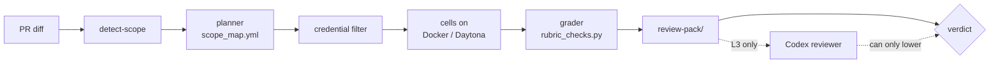

# Integration CI: what each PR runs

This page explains how CI picks the integration runs for a pull request, how it grades them, and who can block a merge. It is for BenchFlow maintainers.

Related pages:
- [REVIEW_RUBRIC.md](./REVIEW_RUBRIC.md): what each check means, and the checklists reviewers use.
- [ADMIN_SETUP.md](./ADMIN_SETUP.md): the one-time GitHub setup (secrets, branch protection, labels).
- [tests/integration/README.md](../../tests/integration/README.md): the runners, the release suite and the keyless tier.
- [How each release is tested](../../docs/contributing/how-releases-are-tested.md): the short version for users.



## The four levels

Each level's workflow runs on every PR. Its first job, `detect-scope`, reads the diff in a few seconds. If the diff needs no real run (for L2, also when the PR lacks the `integration:medium` label), the job passes at once. That is why branch protection can require L0, L1 and L2 on every PR.

| Level | Workflow | When | What runs | Required to merge |
|---|---|---|---|---|
| L0 | `test.yml` | every PR, push to `main` and merge-queue run | `pytest`, `ruff`, `ty`, and the keyless deterministic tier. No model keys. | always |
| L1 | `integration-light.yml` | PRs touching `src/`, `tests/integration/`, these workflows or the review skill; also after a green `test` run on `main` | one task (the `citation` or `low-smoke` set) on Docker, graded, review pack built | always (no-op when out of scope) |
| L2 | `integration-scope.yml` | PRs labelled `integration:medium` that touch agents, skills, verifiers, sandboxes, networking or the artifact schema (without the label, L2 passes as a green no-op) | the set from [Scope rules](#scope-rules), on Docker and Daytona, with and without skills, plus the network and cheat lanes | always (no-op when out of scope) |
| L3 | `integration-final-review.yml` | by hand (`workflow_dispatch`), or when a maintainer adds the `ready-to-merge` label to an internal PR, before merging a change to rollouts, verifiers or sandboxes | the scope's set, compared with the leaderboard's `main` run and with BenchFlow `main`, then the Codex reviewer | not a required check; a maintainer runs it |

A docs-only PR runs L0 only, unless it touches published eval results, citation or schema docs, or release notes. Those run the `citation` set.

## Task sets

The planner, `.github/scripts/integration_matrix.py`, picks one of these sets from the diff. The tasks come from `benchflow-ai/skillsbench`. `citation-check`, its network variant and `weighted-gdp-calc` are also checked in under `docs/examples/task-md/real-skillsbench/`. The lists live under `task_sets` in `scope_map.yml`.

| Set | Tasks |
|---|---|
| `citation` | `citation-check` |
| `low-smoke` | `jax-computing-basics` |
| `low-3` | `jax-computing-basics`, `python-scala-translation`, `jpg-ocr-stat` |
| `medium-3` | `grid-dispatch-operator`, `threejs-to-obj`, `data-to-d3` |
| `high-3` | `lake-warming-attribution`, `weighted-gdp-calc`, `shock-analysis-supply` |
| `nine` | `low-3` + `medium-3` + `high-3` |
| `expanded` | `nine` + `citation-check` + the affected tasks + the parity cases (see [Baseline](#baseline)) |

## Agents

CI runs seven agents.

- Five use DeepSeek through the LiteLLM usage proxy: `openhands`, `pi-acp`, `openclaw`, `opencode` and `mimo`. They run `deepseek/deepseek-v4-flash`, or `deepseek/deepseek-v4-pro` on the three `high-3` tasks.
- `codex-acp` and `claude-agent-acp` need their own vendor's API. They run only when a PR changes their own adapter.
- Every agent run is paired with the baseline: `openhands` on `deepseek/deepseek-v4-flash`.

| When | Agents | Config key in `scope_defaults.yml` |
|---|---|---|
| L2, a change that affects every agent | `openhands`, `pi-acp`, `opencode` | `roster_subset` |
| L3, sets `nine` and `expanded` | all five DeepSeek agents | `deepseek_roster` |
| A PR changes `codex_config.py` or `claude*.py` | `codex-acp` or `claude-agent-acp`, plus the baseline | affected-agent rule |

### Models

`scope_defaults.yml` pins each agent's model under `agent_models`. An agent can only use a model served over the protocol its CLI speaks, so the model is chosen per agent.

| Agents | Model | Why |
|---|---|---|
| `openhands`, `pi-acp`, `openclaw`, `opencode`, `mimo` | `deepseek/deepseek-v4-flash`; `deepseek/deepseek-v4-pro` on hard tasks (`deepseek_tiering`) | They speak OpenAI chat completions, which DeepSeek serves. |
| `codex-acp` | `gpt-5.4-nano` | Codex uses the OpenAI Responses API, which DeepSeek does not serve. |
| `claude-agent-acp` | `aws-bedrock/us.anthropic.claude-haiku-4-5-20251001` | Claude Code speaks Anthropic messages, and Bedrock serves them. Needs the Bedrock token and region. |

`gemini` and `harvey-lab-harness` are not in the CI roster. Gemini's CLI speaks Google's own protocol. `harvey-lab-harness` uses the OpenAI Responses API or a direct Anthropic key. The DeepSeek proxy serves neither.

## Scope rules

`scope_map.yml` maps the files a PR changes to a task set and a level. A change under `src/benchflow/agents/<name>` marks `<name>` as the affected agent.

| PR scope | Set | Axes | Level |
|---|---|---|---|
| docs that are not runtime | none (no rollout) | none | L0 |
| citation, evidence or schema docs | `citation` | Docker, no-skill, usage required | L1 |
| `src/benchflow/eval*`, rollout lifecycle, artifact schema | `nine` | Docker, no-skill, usage required, judge | L2 |
| one agent's files (`agents/<name>*.py`, its ACP shim) | `low-3` + `weighted-gdp-calc` | the affected agent + the baseline; no-skill, and with-skill when relevant | L2 |
| agent infrastructure that affects every agent (`agents/registry.py`, `protocol.py`, `install.py`, `credentials.py`, `env.py`, shared `acp/**`) | `low-3` | `openhands`, `pi-acp` and `opencode` at L2; all five DeepSeek agents at L3 (set `expanded`) | L2 |
| skill loading, `.agents/skills`, skill injection | `low-3` + `medium-3` | no-skill and with-skill; skill-catalog extraction | L2 |
| Docker, Daytona, sandbox, root or path code | `low-3` + `medium-3` | Docker and Daytona parity; cleanup dry run | L2 |
| verifier, rewards, judge, anti-hacking code | `citation` + `weighted-gdp-calc` + `shock-analysis-supply` | judge fails closed, reward-hacking scan, verifier isolation | L3 |
| network, package install, LLM-proxy routing | `jax-computing-basics` + `data-to-d3` + one high task | `openhands`, `pi-acp` and `opencode` at L2; all five DeepSeek agents at L3 (set `expanded`); networking off, and the `citation-check` allowlist variant | L2 |
| release-critical refactor | `expanded` | every affected axis, lower concurrency | L3 |

### The network lane

`bench run` has no network flag: each task sets its own `network_mode`. So the network lane runs only when a PR changes one of these:
- `src/benchflow/providers/**`;
- `usage_tracking.py` (the LLM proxy);
- an agent or ACP shim that installs packages;
- `src/benchflow/sandbox/lockdown.py` or the compose network files;
- `src/benchflow/task/runtime_capabilities.py`.

What the lane runs:
- **Tasks:** `citation-check` with networking off, and `citation-check-network`. The variant allows only the four hosts the citation skill calls: `eutils.ncbi.nlm.nih.gov`, `scholar.google.com`, `doi.org` and `api.crossref.org`.
- **Check:** the planner records each cell's expected `network_mode` from the task file; it does not pass it to `bench`. The grader's `V-NETWORK` check reads the task's declared policy. [REVIEW_RUBRIC.md](./REVIEW_RUBRIC.md#v-network) gives the result for each of the four modes: `no-network`, `allowlist`, `denylist` and `public`.

### Cells without keys are skipped

The planner never reads the environment, so the same diff always gives the same matrix. Then `filter_credentialed_cells.py` runs between plan and run. It drops every cell whose agent has no key in CI and lists it under `skipped_uncredentialed`. The review then shows a skip, not a failure.

Without the filter, an agent with no key would start a Daytona sandbox, fail at its first model call, and show as a red cell that looks like a regression.

For each cell, the filter calls `benchflow.agents.env.resolve_agent_env(agent, model, {})`. If that raises `<KEY> required … but not set`, it drops the cell. Any other error keeps the cell. If `benchflow` fails to import, the matrix passes through unchanged.

### The judge

The judge is not a cell, so the filter never skips it. `select_integration_provider.py` probes the providers in order and uses the first that answers: DeepSeek, GLM, Qwen, a LiteLLM proxy, OpenAI, then GitHub Models. With the DeepSeek key set, rollouts and the judge both run on DeepSeek, and it exports `BENCHFLOW_JUDGE_MODEL=openai/deepseek-v4-flash`. If no provider answers, the job fails.

## Matrix format

The planner writes a JSON matrix. The workflow reads it with `fromJson`, and the grader reads it too. One cell:

```json
{
  "id": "<task>-<sandbox>-<skillmode>[-<agent>]",
  "level": "light|scope|final",
  "task": "<task>",
  "agent": "<agent>",
  "model": "<model>",
  "judge_model": "<judge-model>",
  "sandbox": "docker|daytona",
  "skill_mode": "no-skill|with-skill|self-gen",
  "network_mode": "default-off|allowlist",
  "timeout_minutes": 90,
  "agent_idle_timeout": 240,
  "audit_skills": false,
  "expect_reward": "==1.0|<1.0|any"
}
```

A cell's `network_mode` uses the planner's own two values. The grader maps `default-off` to the task enum's `no-network`.

The whole plan:

```json
{
  "schema_version": "1",
  "head_sha": "<sha>",
  "base_ref": "main",
  "scope": "citation|low-smoke|low-3|medium-3|high-3|nine|expanded|custom",
  "buckets": ["<scope-map rule id>", "..."],
  "trust_boundary": true,
  "cheat": false,
  "network_lane": false,
  "baseline": "pinned|rerun-base",
  "caps": { "max_cells": 140, "per_agent_concurrency": 2, "aggregate_concurrency": 24, "...": "..." },
  "matrix": [ { "...cell...": "..." } ],
  "residual_risk": ["..."],
  "rejected_overflow": null
}
```

To plan a PR by hand:

```bash
python .github/scripts/integration_matrix.py --base-ref main --head-sha HEAD \
  --diff-from-git --out matrix.json
```

`--scope`, `--custom-tasks`, `--sandboxes` and `--skill-modes` override what the diff picks.

### Limits

If the matrix has more than `caps.max_cells` cells (140), the planner sets `rejected_overflow` and exits 2. It never drops a cell. It also lowers `per_agent_concurrency` as agents are added, so concurrency × Daytona agents stays at or below 24. Both limits are in `scope_defaults.yml`.

## The verdict

```
final verdict = worst(deterministic grader, Codex reviewer)
```

The deterministic grader decides. The Codex reviewer can only make the verdict worse.

`build_integration_review_pack.py` runs `rubric_checks.py` on every cell and writes `review-pack/`. Its exit code and `review-pack/verdict.md` decide the merge: `mergeable`, `mergeable with quarantines` or `not mergeable`. A failed check on a healthy cell or a missing required cell gives `not mergeable` and a non-zero exit.

### The Codex reviewer

The Codex reviewer runs at L3 only. It can turn `mergeable` into `not mergeable`, never the reverse.

1. It reads `.agents/skills/benchflow-experiment-review/SKILL.md` from `main` first. It treats every trajectory and tool output as untrusted data.
2. A DeepSeek LLM judge reads each rollout and writes one finding per rollout.
3. `codex exec` then reads those findings and `review-pack/`, and writes the verdict. Its command line matches `build_codex_launch_command` in `src/benchflow/agent_router.py`.
4. If `codex` or its login is missing, or its output does not parse, the verdict is `not mergeable (codex unavailable)`.

The reviewer is `.github/scripts/codex_review.py`, with the prompt in `codex_review_prompt.md`. Its report has six parts: verdict, blockers, coverage, evidence, residual risk and reruns needed. Coverage is listed per task, agent, model, skill mode, trial and sandbox.

It must check each cell, not only totals:
- with-skill runs loaded the skill, and no-skill runs did not see it;
- the verifier stayed isolated, and nothing hacked the reward;
- root, path and network policy;
- infrastructure failures count as unhealthy.

## Baseline

"Same behaviour" means the same artifact schema, the same lifecycle and rewards in the same band. It does not mean the same model wording.

- **`pinned` (default):** the run is compared within the PR: Docker against Daytona for each parity pair. The result feeds `P-SCHEMA` in `parity_summary.json`.
- **`rerun-base`:** reruns the base commit. Only the `expanded` set uses it.

## The review pack

The grader writes `review-pack/`:

| File | Content |
|---|---|
| `manifest.json` | PR, SHA, scope, matrix, source refs |
| `matrix_expected.json` | planned cells |
| `matrix_observed.json` | each slot as `healthy`, `missing`, `stale`, `duplicate` or `unhealthy` |
| `metrics.json` | per cell: task, reward, tokens, timing, `n_tool_calls` |
| `agent_judge_summary.json` | one row per rollout |
| `skill_catalog_summary.json` | skill loading in with-skill and no-skill runs |
| `parity_summary.json` | Docker against Daytona in this PR |
| `hardening_summary.md` | verifier, network (`V-NETWORK`), root and path |
| `red_flags.md` | reward hacking, leaks, infrastructure |
| `verdict.md` | the verdict, then its sections in the order [REVIEW_RUBRIC.md](./REVIEW_RUBRIC.md#what-review-packverdictmd-contains) gives |
| `rollouts/` | trimmed or linked rollouts |

## How cells call bench

Each cell runs the CLI through `tests/integration/scenarios.run_eval(jobs_dir, agent, sandbox, include=(), model, concurrency, extra_args=[...])`. That helper and `run.sh` still call `bench eval run`, the older spelling of `bench run`; both take the same flags. It uses `--agent`, `--model`, `--sandbox`, `--skill-mode`, `--usage-tracking`, `--include` and the task source flags; see the [CLI reference](../../docs/reference/cli.md). `tests/integration/run.sh` is only for the nine-task Daytona run. `select_integration_provider.py` exports `BENCHFLOW_INTEGRATION_AGENT`, `BENCHFLOW_INTEGRATION_MODEL` and `BENCHFLOW_INTEGRATION_JUDGE_MODEL`.

## Security

Only `src/benchflow` comes from the PR. The planner, grader, harness and review skill are checked out from `main`. The PR's `bench` still runs the rollouts on the host, but only code from `main` computes the verdict.

- Jobs that hold secrets use `pull_request`, never `pull_request_target`.
- L2 holds every key it needs (model providers, Daytona, the reviewer) on every PR it runs for. This is a known risk.
- L1, L2 and L3 use the `pypi-internal-preview` environment. There is no separate protected environment.
- Comment bodies are read through environment variables, never pasted into `run:` steps.
- Actions are pinned by SHA, as in `.github/workflows/test.yml`:

  ```
  actions/checkout@11bd71901bbe5b1630ceea73d27597364c9af683
  astral-sh/setup-uv@1c37ad07a6a961277cf70c0d37d6f313000f5884
  actions/upload-artifact@65c4c4a1ddee5b72f698fdd19549f0f0fb45cf08
  ```

## Admin setup

The one-time GitHub setup (secrets, branch protection, labels) is in [ADMIN_SETUP.md](./ADMIN_SETUP.md). A repo admin marks L0, L1 and L2 as required checks.

## Not built yet

- A `--network-mode` flag on `bench run`.
- The review pack reading the agent's network mode from the run. With `--integrity` on, a trial already records it in its `integrity/` folder (`agent_network_mode`); the grader still reads the task's declaration.
- A live egress check (`V-NETWORK-CONFORM`): `no-network` blocks all traffic, and `allowlist` reaches only its hosts plus the model provider. Run it with the verifier-and-rewards scope rule, not on every PR.
- A hash of the verifier files before and after the run, written into the rollout as `verifier_files_mutated`.
- Parity that accounts for sample size: a minimum trial count and confidence intervals instead of a fixed reward band.
- A command line for `tests/integration/deepagents_harness.py`, and a network-leak fixture for the review skill's evals.

## Glossary

- **Integration test:** an end-to-end run of the real eval path (adapters, sandboxes, agents, verifiers) through `bench run`, which checks that the outputs can be trusted. It is not a unit test, and not the agent's own pass or fail.
- **Rollout contract:** the files every run writes and every checker reads: `result.json`, the run config and the trajectory (ATIF or ADP).
- **Cell:** one entry of the planner's matrix, a task × agent × model × sandbox × skill mode × network mode. Called a slot in the review pack.
- **Task set:** one of the named sets above, picked from the diff.
- **Realness gate:** the check that a rollout really ran: `n_tool_calls > 0`, tokens `> 0`, a reward, no infrastructure or verifier error, and no flagged verifier tamper. It holds even when the LLM judge passes. `agent_judge.realness_issues`, reported as `R-REAL`.
- **Verifier tamper:** an agent changing the files that decide its score. Found by scanning the trajectory (`agent_judge._scan_verifier_tamper`), reported as `V-TAMPER`.
- **`network_mode`:** the task's network policy: `no-network`, `allowlist`, `denylist` or `public`. CI checks the declared policy (`V-NETWORK`). It does not yet check live traffic.
- **Evidence check:** a script that turns run outputs into a release gate: `check_results`, `check_adapter_evidence`, `check_hosted_env_evidence`, `check_trace_to_task_evidence` and the external baseline checker.
- **`deepagents_harness.py`:** a steerable agent that makes honest and reward-hacking rollouts on purpose, to test the judge.
