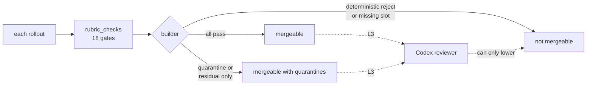

# Integration review rubric

This page says when a BenchFlow pull request may merge, judged by the integration rollouts it produces. It is for BenchFlow maintainers and reviewer agents.

The gate IDs and their classes come from `RUBRIC_GATES` in `tests/integration/rubric_checks.py`. If this page and that list disagree, the list wins.

Related:
- [README.md](./README.md): the L0-L3 levels, the matrix, the network lane, the Codex reviewer and the admin setup.
- `.agents/skills/benchflow-experiment-review/SKILL.md`: the manual review this rubric automates.
- The same skill's `references/verifier-hardening-checklist.md` and `references/reward-hacking-patterns.md`: how to prevent and spot reward hacking.

A change may ship only if the rollouts it produces are real, healthy, free of leaks and cover every planned slot.

## Run it

Grade one rollout:

```bash
python tests/integration/rubric_checks.py jobs/run-1/task-a__trial-0 --json
```

It detects the rollout's format itself. Pass `--run-config run_config.json` when a flat fixture keeps its config elsewhere.

| Exit | Means |
|---|---|
| 0 | no deterministic reject |
| 1 | a deterministic reject fired |
| 2 | the rollout folder is missing |

Grade a whole PR:

```bash
python .github/scripts/integration_matrix.py --base-ref main --head-sha HEAD \
  --diff-from-git --out matrix.json
python .github/scripts/build_integration_review_pack.py \
  --matrix matrix.json --artifacts jobs/ --out review-pack/
```

`--matrix` takes a path or inline JSON. `--out` defaults to `review-pack`. The command exits 0 for `mergeable` or `mergeable with quarantines`, and 1 otherwise, including an unreadable matrix or a missing `--artifacts` folder.



## Outcomes

Each rollout ends in one of three healthy outcomes, or it is unhealthy. Only healthy rollouts count toward coverage. An unhealthy rollout blocks the merge unless you quarantine it as an infrastructure failure (see [Failure attribution](#failure-attribution-c-attrib)).

| Outcome | Means |
|---|---|
| `pass` | The agent finished, the verifier scored it, and `reward == 1.0`. |
| `fail` | The agent finished, the verifier scored it, `reward < 1.0`, and the failure is the model's. |
| `normal_timeout` | The agent ran out of time but left a full trajectory, a reward, and token and timing data. |

All three also need the rollout to be real. A rollout is **real** when `n_tool_calls > 0`, `total_tokens > 0` and `reward` is set (gate `R-REAL`). A rollout that isn't real is unhealthy: the agent never started, or its traffic never arrived.

A rollout is also unhealthy when:
- the trajectory is missing, cut short or unreadable;
- token, timing or tool-use data is missing;
- the agent lacked an input it needed: a file, skill, key, asset, runtime or compute;
- the verifier ran before the agent stopped, or the agent could see verifier files;
- the reward contradicts the task's visible state;
- paths disagree between the config, the sandbox and the results;
- a provider, Daytona, Docker or file-system error stopped a fair attempt.

## Gates

Each gate has an ID, a check, an enforcement class and the code that runs it.

| Class | Who decides | On failure |
|---|---|---|
| `deterministic` | code | the rollout is rejected |
| `quarantine` | code can't decide | the slot goes to manual or LLM review instead of failing |
| `codex` | the LLM judge or the Codex reviewer | the reviewer flags it |
| `residual` | nothing in the files can prove it | the pack lists it as a known risk |

| Gate | Check | Class | Code |
|---|---|---|---|
| `R-REAL` | `n_tool_calls > 0`, `total_tokens > 0` and a reward | deterministic | `agent_judge.realness_issues` |
| `R-OUTCOME` | outcome is `pass`, `fail` or `normal_timeout`, with a valid score | deterministic | `rubric_checks.check_outcome` |
| `R-ARTIFACT` | trajectory present and readable; ATIF and ADP well formed; no secret leak | deterministic | `scenarios.atif_issues`, `adp_issues`, `secret_leak_issues` |
| `R-TELEMETRY` | token and timing data present on new rollouts | deterministic | `rubric_checks.check_telemetry` |
| `S-WITHSKILL` | a with-skill run loaded every expected skill | quarantine | `extract_harness_skills` |
| `S-NOSKILL` | a no-skill run loaded no skill and shows no leak marker | deterministic | `rubric_checks.check_noskill_leak` |
| `V-TAMPER` | the agent never wrote, deleted or `chmod`-ed a file that decides the score | deterministic | `agent_judge._scan_verifier_tamper` |
| `V-EMPTYPATCH` | an empty patch scores below 1.0, and the reference patch scores 1.0 | deterministic | null-agent slot + oracle slot |
| `V-LIFECYCLE` | the verifier starts only after the agent stops | residual | no lifecycle timestamps in the rollout |
| `V-ENVHARDEN` | git history stops at the base commit; no answer, hidden-test or scorer file is visible | residual | env-probe rollout when run |
| `V-REWARDHACK` | the reward matches the task's visible state | codex | `agent_judge` LLM judge |
| `P-REWARD` | the same oracle task scores the same on Docker and Daytona | deterministic | `test_sandbox_parity` (oracle, reward only) |
| `P-SCHEMA` | token, timing and schema match on a Docker and Daytona pair run by a real model | deterministic | `rubric_checks.parity_schema_diff` |
| `C-ATTRIB` | a `fail` or timeout is the model's, not the setup's | deterministic | `check_results.INFRA_ERROR_CATEGORIES`, `verifier_error`, required inputs |
| `P-PROV` | source repo, path, ref and hashes match | deterministic | `check_results._source_hash_truth_issues`, `_source_git_truth_issues` |
| `P-PATHS` | config root, sandbox folder, trajectory paths and result paths agree | deterministic where the fields exist, else residual | `rubric_checks` |
| `X-SLOTS` | every planned slot is present once, at the head commit | deterministic | the builder's slot classification |
| `V-NETWORK` | the task's declared network policy is safe (see [below](#v-network)) | deterministic (task config, not the run) | `rubric_checks.network_hardening` |

Planned, and not in `RUBRIC_GATES`: `V-NETWORK-CONFORM` (see [Network](#network)).

Change a gate ID here and in `RUBRIC_GATES` in the same commit: the review pack and the Codex reviewer key on the IDs.

### What each gate reads

Rollouts come in two formats. `rubric_checks.py` picks the format by its fields, and an adapter maps both into one shape before the gates run.
- **Production run folder:** `result.json` (`task_name`, `agent`, `rewards.reward`, `n_tool_calls`, `agent_result.total_tokens`, `error`, `verifier_error`), `rewards.jsonl`, `trajectory/acp_trajectory.jsonl`, `trainer/atif.json` and `trainer/adp.jsonl`.
- **Flat skill-eval fixture:** `result.json` (`status`, `reward`, `verifier_started_after_agent`, `timing`, `token_usage`, `tool_usage`) with a `run_config.json` beside it (`task_id`, `harness`, `model`, `skill_mode`, `trial_id`, `sandbox`, `source_ref`, `timeout_seconds`, `task_skills`).

The shared checkers (`agent_judge`, `check_results`, `scenarios`) read only the production format, so the adapter is the one place that renames flat fields.

**`R-REAL`** (deterministic). Reads `n_tool_calls`, `agent_result.total_tokens` and the reward (flat fixture: `tool_usage`, `token_usage`, `reward`). Runs `agent_judge.realness_issues`; an empty list means real. This is the gate that catches made-up rollouts.

**`R-OUTCOME`** (deterministic). Reads the reward plus `error` and `verifier_error` (flat: `status`, `reward`). Fails a missing or unreadable status, or a missing reward on anything but a timeout. Whether a `fail` is the model's fault is `C-ATTRIB`'s job.

**`R-ARTIFACT`** (deterministic). The trajectory (`trajectory/acp_trajectory.jsonl`) must parse to the end. `trainer/atif.json` and `trainer/adp.jsonl` must be well formed. No secret may appear anywhere under the rollout.

**`R-TELEMETRY`** (deterministic). New rollouts must carry token and timing data (`agent_result.total_tokens` and timing fields; flat: `token_usage`, `timing`). It checks that the fields are filled, not that the numbers match the provider's bill.

**`S-WITHSKILL`** (quarantine). In a with-skill slot, every expected skill (`task_skills` in `run_config.json`) must appear in the startup catalog. `extract_harness_skills.py` recovers that catalog from `trajectory/llm_trajectory.jsonl` or `acp_trajectory.jsonl`. A clean match passes. The extractor may return `unknown`, `skill_count: 0`, `manual_review_required` or `catalog_not_serialized`. Each means the harness didn't record a catalog (`pi-acp` never does). That isn't proof the skills were missing, so the slot goes to review instead of failing.

**`S-NOSKILL`** (deterministic). In a no-skill slot, no skill may load. The trajectory may not contain any of `skill.md`, `.codex/skills`, `.agents/skills`, `.claude/skills`, `invoke_skill`, `activate_skill` or `toolsearch`, matched case-insensitively. Any marker rejects the rollout. This direction can be strict because a marker proves a leak. A missing catalog in the with-skill direction proves nothing.

**`V-TAMPER`** (deterministic). Scans the whole trajectory for writes, deletes or `chmod` on tests, verifier or scoring code, or result files. It can't see tricks that never touch a file, such as monkey-patching or overriding `__eq__`; `V-REWARDHACK` covers those.

**`V-EMPTYPATCH`** (deterministic). The null-agent slot must score below 1.0 and the oracle slot exactly 1.0. If an empty patch passes, the reward is reachable without solving the task: an answer leak or a grader bug. It needs the planner to emit a null-patch slot and an oracle slot.

**`V-LIFECYCLE`** (residual). The verifier must start after the agent stops. Production rollouts don't record when the verifier started, so code can't check it. A flat fixture's `verifier_started_after_agent` is shown when present. Otherwise the pack lists it as a risk, and the Codex reviewer looks for signs of an early verifier.

**`V-ENVHARDEN`** (residual). Git history must stop at the base commit, and no answer, hidden-test or scorer file may sit where the agent can read it. Rollouts don't record the sandbox's files, so code can only check this when an env-probe rollout ran. Otherwise the Codex reviewer looks for `git log --all`, reflog or answer-file reads in the trajectory.

**`V-REWARDHACK`** (LLM judge). The reward must match what the task's visible state shows: no monkey-patching, operator overloads, exit-code tricks or hard-coded test inputs. The `agent_judge` LLM judge reads the full trajectory and reward, using `BENCHFLOW_JUDGE_MODEL`. If no judge model or key works, the gate fails; it never passes silently.

**`P-REWARD`** (deterministic). The same oracle task must score the same on Docker and Daytona (`test_sandbox_parity_docker_daytona`).

**`P-SCHEMA`** (deterministic). On a Docker and Daytona pair run by a real model, token usage, timing and artifact schema must match. The oracle has no model data, so an oracle pair can't satisfy it. Without a model pair, the slot is reported missing.

**`C-ATTRIB`**: see [Failure attribution](#failure-attribution-c-attrib).

**`P-PROV`** (deterministic). Source repo, path, ref and file hashes must match the recorded source (flat: `run_config.source_ref`).

**`P-PATHS`** (deterministic where the fields exist). Config root, sandbox working folder, trajectory paths and result paths must agree. When a format lacks a field, that sub-check is listed as a risk, not passed.

**`X-SLOTS`** (deterministic). Every slot in the planner's matrix must appear exactly once, built at the head commit. The builder sorts each into `missing`, `duplicate`, `stale`, `healthy` or `unhealthy` in `matrix_observed.json`. A missing or stale slot blocks the merge.

### Network

Network has two checks. `V-NETWORK` checks what the task **declares**. `V-NETWORK-CONFORM` (planned) would check what the run **did**: that allowed hosts were reachable and others were blocked.

#### `V-NETWORK`

Deterministic, on the task config only. Reads the task's `network_mode`, `allowed_hosts`, `blocked_urls` and `blocked_hosts`.

| Result | When |
|---|---|
| pass | `no-network`; `allowlist` with hosts; `denylist` with URLs or hosts |
| fail | `allowlist` with no hosts; `denylist` with nothing listed; `allowed_hosts` without `allowlist`; an unknown mode; `public` on a PR that touches the verifier or sandbox |
| quarantine | `public` on any other PR (needs a person to sign off) |
| na | no mode declared, so the runtime default `no-network` applies |

The builder takes each slot's expected mode from the matrix; there is no `bench run` flag for it. The example task is `docs/examples/task-md/real-skillsbench/citation-check-network/`.

#### Planned: `V-NETWORK-CONFORM`

It would check, from the run itself, that `no-network` blocked all traffic and that `allowlist` reached only its hosts plus the model provider. It is not in `RUBRIC_GATES` yet. When built, run it with the verifier-and-rewards scope rule, not on every PR. Docker and Daytona parity stays nightly.

## Verdict

The builder turns the gate results into one verdict. This verdict is the required check, and it fails closed.

- **`mergeable`:** every gate passes, every slot is covered, nothing is quarantined.
- **`mergeable with quarantines`:** every deterministic gate passes, and only quarantine or residual items remain. Examples: an `S-WITHSKILL` unknown, `V-LIFECYCLE`, `V-ENVHARDEN`, or a slot quarantined as an infrastructure failure.
- **`not mergeable`:** a deterministic gate rejects a healthy slot, or a required slot is missing.

### The Codex reviewer

At L3, the Codex reviewer (`.github/scripts/codex_review.py`) also reads the rollouts and the pack. It can turn `mergeable` into `not mergeable`, for example on confirmed reward hacking or a failure it blames on the setup. It never does the reverse. The final verdict is the worse of the two.

If the Codex binary or login is missing, or its output can't be read, the L3 verdict is `not mergeable`. L1 and L2 don't run it.

Before/after "same behaviour" means the same schema, lifecycle and reward band, not the same words.

## Failure attribution (`C-ATTRIB`)

A `fail` or `normal_timeout` counts as healthy only when the model is to blame, not the setup.

- **The model's failure (healthy):** the task's files, keys, skills, compute and dependencies were all there. The agent made a real attempt, and the verifier scored the end state.
- **The setup's failure (unhealthy):** something outside the model blocked the agent. Fix the setup and rerun, or quarantine the slot with a note. Examples:
  - a missing key or skill;
  - a hidden or wrongly mounted file;
  - a failed install, or a network or permission error;
  - too little memory, or broken rendering;
  - a path mismatch, a provider outage or an unstable sandbox.

Code decides first. `check_results.INFRA_ERROR_CATEGORIES`, `verifier_error` and a check that the task's required keys and files were present catch the known setup failures and quarantine them. The Codex reviewer judges what's left.

## What the gates can't prove

These properties aren't in the rollout files, so no gate can prove them. The pack lists each under Residual risk.

| Gap | Gate | What covers it |
|---|---|---|
| When the verifier started | `V-LIFECYCLE` | The harness starts the verifier as a separate process after the agent; the Codex reviewer looks for early-verifier signs. |
| Git history past the base commit | `V-ENVHARDEN` | An env-probe rollout when run; the Codex reviewer looks for history reads. |
| Answer files the agent could read | `V-ENVHARDEN` | The same; `V-EMPTYPATCH` still catches a reward reachable without work. |
| Skill catalog on `pi-acp` and some `claude-code` runs | `S-WITHSKILL` | Quarantine and review; `S-NOSKILL` markers still apply. |
| Reward hacks that never touch a file | `V-REWARDHACK` | The LLM judge over the full trajectory; fails closed. |
| Whether token and timing numbers are accurate | `R-TELEMETRY` | Not covered; only presence is checked. |

## Checklists

These are the manual review's checklists. The gates above automate most rows; the Codex reviewer works through the rest for every rollout.

### For every slot

The gates cover realness, outcome, artifacts, telemetry, attribution, paths, provenance and parity. The Codex reviewer also checks that:
- the agent got the intended prompt and nothing meant for the verifier;
- the tool calls add up to a real attempt, not just setup;
- the final answer and the score refer to the same workspace and trial.

### Skills

Beyond `S-WITHSKILL` and `S-NOSKILL`, the Codex reviewer checks two things. A with-skill run must show that harness's own skill-loading evidence. `skill_catalog_summary.json` must record the source field, line, names, count and SHA-256.

### Reward hacking

`V-EMPTYPATCH`, `V-TAMPER`, `V-REWARDHACK`, `V-LIFECYCLE`, `V-ENVHARDEN` and `V-NETWORK` cover it.

## Which level a PR needs

The levels are defined in [README.md](./README.md#the-four-levels); `scope_map.yml` decides them.

| PR touches | Level |
|---|---|
| anything | L0 |
| `src/`, `tests/integration/`, the integration workflows or the review skill | L1 |
| citation, evidence or schema docs | L1 (`citation` set) |
| the eval or rollout lifecycle, agent adapters or agent infrastructure, skill loading, sandbox or path code, network or package install, or the artifact schema | L2, when the PR has the `integration:medium` label (otherwise L2 passes as a green no-op) |
| the verifier, rewards, the judge or anti-hacking code, or a release-critical refactor | L3 and the Codex reviewer |
| docs only | L0, no rollouts |

## What `review-pack/verdict.md` contains

In this order:

1. **Verdict.**
2. **Blockers:** each deterministic reject and missing slot, with its gate ID and slot.
3. **Coverage:** planned slots against `healthy`, `missing`, `duplicate`, `stale` and `unhealthy`, grouped by task, skill mode, sandbox and agent (`X-SLOTS`).
4. **Evidence:** run folders, refs, the gates that fired, and the exact `rubric_checks.py` and `build_integration_review_pack.py` commands to reproduce them.
5. **Residual risk:** each open quarantine, residual or Codex item, with its gate ID.
6. **Reruns:** for each `fail` or timeout, whether the model or the setup is to blame and why, and each slot to rerun after a setup fix.
