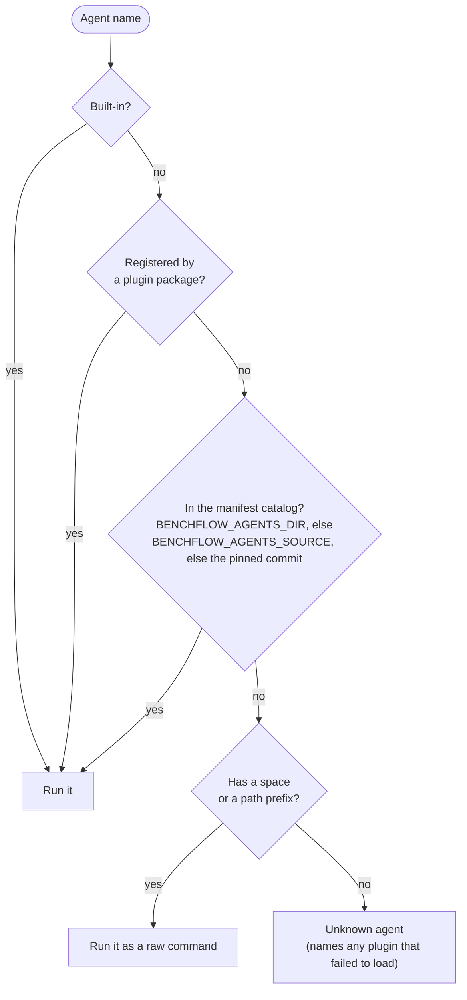

# External agents

Run agents that live in the [benchflow-ai/agents](https://github.com/benchflow-ai/agents) repo or in a pip package.

```bash
pip install 'benchflow[sandbox-daytona]'
export DEEPSEEK_API_KEY=sk-...      # key for your --model provider
export DAYTONA_API_KEY=dtn_...      # or use --sandbox docker

git clone --depth 1 --filter=blob:none --sparse https://github.com/benchflow-ai/skillsbench
cd skillsbench && git sparse-checkout set tasks/edit-pdf

bench run tasks/edit-pdf -a prime-agent -m deepseek/deepseek-v4-flash --sandbox daytona
```

The run ends with a `✓ Score` line. The first run installs the agent in the sandbox, which can take a few minutes. Outputs land in the jobs folder, as for built-in agents.

`bench agents` lists the agents built into BenchFlow. Other agents, such as goose, qwen-code and prime-agent, load in one of these ways:

| Way | What you do | When |
|---|---|---|
| [Autoload](#autoload) (default) | nothing: use the agent's name | most users |
| [`BENCHFLOW_AGENTS_SOURCE`](#choose-the-source) | point at another ref, repo or folder, or `off` | try an agent from a branch or a PR |
| [`BENCHFLOW_AGENTS_DIR`](#local-checkout) | point at a local checkout | developing the agents repo |
| [Plugin package](#plugin-packages) | `pip install` it | agents that need Python on the host |

## Autoload

Name an agent BenchFlow doesn't know, and it fetches the agent manifests from the `benchflow-ai/agents` commit this release pins (`DEFAULT_AGENTS_SOURCE`). So a release always loads the manifests it was tested with. OpenClaw loads this way too.

- BenchFlow fetches at most once per process, and only for a name it doesn't know.
- A fetched agent never replaces a built-in or an already registered agent.
- An agent added to the agents repo after the pinned commit needs `BENCHFLOW_AGENTS_SOURCE=benchflow-ai/agents@main`.
- The repo's `acp/` folder lists what exists. Its `acp-registry/AGENTS.md` lists the agents from the ACP registry.
- `DEEPSEEK_BASE_URL` is optional. `deepseek/*` models default to `https://api.deepseek.com/v1`.

## Choose the source

```bash
export BENCHFLOW_AGENTS_SOURCE="benchflow-ai/agents@main"        # follow main, unpinned
export BENCHFLOW_AGENTS_SOURCE="benchflow-ai/agents@my-branch"   # owner/repo[@ref]
export BENCHFLOW_AGENTS_SOURCE="benchflow-ai/agents@0123456789abcdef0123456789abcdef01234567"  # reproducible
export BENCHFLOW_AGENTS_SOURCE="/path/to/agents-checkout"        # local folder
export BENCHFLOW_AGENTS_SOURCE="off"                             # no autoload
```

`off`, `0`, `none`, `disabled` and `false` all turn autoload off.

To try an agent from an open PR, point at its branch: `BENCHFLOW_AGENTS_SOURCE="benchflow-ai/agents@<pr-branch>"`.

A remote source needs the network. There is no offline copy.

## Local checkout

```bash
export BENCHFLOW_AGENTS_DIR=/path/to/agents-checkout
```

A non-empty `BENCHFLOW_AGENTS_DIR` wins over `BENCHFLOW_AGENTS_SOURCE`. It may update a built-in agent's manifest fields, but it never replaces an agent that a plugin installed. `bench agents` can preview this catalog before a run loads it.

## Plugin packages

Agents that need Python on the host ship as pip packages. Installing the package is all it takes:

```bash
pip install "mini-swe-acp @ git+https://github.com/benchflow-ai/agents#subdirectory=acp/mini-swe-acp"
bench run ./tasks -a mini-swe -m openai/gpt-4o-mini
```

This installs from the agents repo's `main`; add `@<commit>` after the repository URL to match the pinned catalog.

The package name, its entry-point name and the agent name may all differ. For example, the package `mimo-acp` registers the agent `mimo`. `bench agents` shows the names a plugin added.

Plugins load when `benchflow` is imported. A plugin that fails to import does not stop the run. Its error appears in the "Unknown agent" message if you later ask for that agent.

## mini-swe with an OpenAI-compatible endpoint

This runs the mini-swe agent with Xiaomi's MiMo model. It uses the `mini-swe` plugin, not the separate `mimo` agent. Install the plugin into the same environment as BenchFlow; for a uv tool installation:

```bash
uv tool install --python 3.12 --upgrade benchflow \
  --with 'mini-swe-acp @ git+https://github.com/benchflow-ai/agents@9aaec336b68426058db1bd83fd2c463be2935ce7#subdirectory=acp/mini-swe-acp'
export XIAOMI_API_KEY='<your MiMo key>'
export XIAOMI_BASE_URL='https://token-plan-sgp.xiaomimimo.com/v1'
export MSWEA_COST_TRACKING=ignore_errors
bench run --source-repo benchflow-ai/skillsbench --source-path tasks/citation-check \
  --agent mini-swe --model xiaomi/mimo-v2.6-flash --sandbox docker
```

The model prefix `xiaomi/` selects `XIAOMI_API_KEY` and the OpenAI-compatible `XIAOMI_BASE_URL`. Use the endpoint your MiMo account supplies if it differs. `MSWEA_COST_TRACKING=ignore_errors` lets mini-swe continue when its price table does not know this model; reported cost can be unknown. BenchFlow routes the key to the model connection; do not pass it as a task environment variable. Other compatible providers need their own model prefix, base URL and key mapping; see [Auth](./auth.md).

## Names and raw commands

| You pass | BenchFlow |
|---|---|
| a known name, such as `claude-agent-acp` or `prime-agent` | runs that agent |
| an unknown bare name | stops with "Unknown agent", listing what it knows |
| a command with a space, such as `"my-agent --acp"` | runs the command as given in the sandbox |
| a path, such as `./my-agent` or `/opt/bin/agent` | runs the command as given in the sandbox |

`bench agents NAME` shows how a name resolves.

## Which agent wins



1. Built-in agents.
2. Plugin packages. A plugin may replace a built-in.
3. One manifest catalog. A remote catalog only fills gaps; it never replaces an agent that is already registered.

## What a manifest can do

A `manifest.toml` holds data only: install and launch commands, environment mapping and model hints. The [agents-repo contract](https://github.com/benchflow-ai/agents/tree/main/contract) defines it.

An agent that needs host-side code, such as credential files, session factories or native MCP config, must be a plugin package or a built-in agent. [Write your own agent](./custom-agent.md) shows both.

## Next steps

- [Write your own agent](./custom-agent.md): a manifest, a plugin, or a raw command.
- [Agents](./index.md): the built-in agents and their options.
- [Auth](./auth.md): API keys for your model provider.
