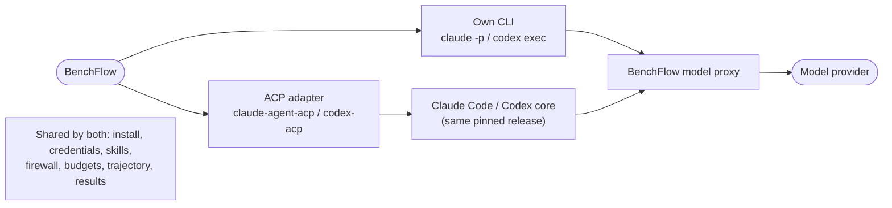

# Native harness

Run Claude Code and Codex through their own CLIs instead of their ACP adapters.

```sh
bench run ./tasks -a claude-agent-acp -m claude-haiku-4-5-20251001 --harness native
bench run ./tasks -a codex-acp -m gpt-5.4 --harness native
```

BenchFlow can run Claude Code and Codex two ways. Pick one with `--harness`:

| `--harness` | What runs |
|---|---|
| `acp` (default) | the agent's ACP adapter: `claude-agent-acp` or `codex-acp` |
| `native` | the agent's own CLI in headless JSON mode: `claude -p --output-format stream-json` or `codex exec --json` |

Everything else stays the same: the agent name, install, credentials, skills, model proxy, network policy, sandbox user, timeouts, budgets and outputs. Only the program between BenchFlow and the model changes.



## Python and YAML

| Where | Setting |
|---|---|
| `EvaluationConfig` | `harness="native"` |
| `RolloutConfig` | `harness="native"` |
| `bf.branch(...)` | `harness="native"` |
| run config YAML | `harness: native` |

An agent with no native harness is refused before any sandbox starts. The error names the agents that have one. Today these are `claude-agent-acp` and `codex-acp`.

## When to use which

Use ACP, the default, unless you need one of these:

- the agent exactly as its vendor runs it in scripts and CI;
- a check that an adapter release did not change the agent's behaviour;
- a CLI release that no adapter supports yet (see [Pins](../contributing/native-harness-internals.md#pins)).

## What each harness supports

| | ACP | Native |
|---|---|---|
| Several prompts per trial (`--prompt` repeated) | yes | yes: each turn resumes the CLI session (`claude -p --resume`, `codex exec resume`) |
| Simulated users (`--loop-strategy`, a task.md user, [scripted users](../tasks/scripted-users.md)) | yes: a fresh ACP session per round | yes: a fresh CLI session per round |
| Branching and checkpoints | yes | yes, including `--resume-session`: each child resumes the parent's CLI session |
| Agent asks the user (`on_ask_user`, `confirmation_policy: human`) | yes | no. The CLIs run with approvals off, so a run that registers an ask-user handler is refused. |
| Token ids and logprobs | from BenchFlow's gateway (`BENCHFLOW_CAPTURE_TOKEN_LOGPROBS=1` on a `vllm/` or `sglang/` route) | the same |
| Task MCP servers | yes | yes: `--mcp-config` (Claude Code), `-c mcp_servers.*` (Codex) |
| Skills | yes | yes, same skill paths |
| Subscription login | Claude Code and Codex (ChatGPT) | Claude Code only. Native Codex needs an API key. |
| No-web, denylist and allowlist network modes | yes | yes |
| Idle watchdog | a beat per streamed token, and per running-tool heartbeat | Claude Code: the same. Codex: a beat per item, not per token, so one model call longer than `--idle-timeout` (600 s by default) is cut. Raise it for long reasoning. |
| Usage and cost | from the proxy (API key), or the adapter's report (subscription, no price) | from the proxy (API key), or the CLI's `result` usage (Claude Code subscription, no price) |
| Parity | | same trajectory, rewards and error categories as ACP on the deterministic tests ([Parity](../contributing/native-harness-internals.md#parity)) |

A branch on the native harness:

```sh
bench branch --tasks-dir ./tasks --agent claude-agent-acp --harness native \
  --prompt "Write a draft first." --prompt @instruction --checkpoint-after-prompt 1 \
  --child "label=a,prompt=Finish the draft." --child "label=b,prompt=Start over." --resume-session
```

## Compare the two harnesses

`config.json` records `harness_mode` (`acp` or `native`). For native runs it also records `native_harness`: the CLI and its pinned package.

```sh
bench eval compare jobs/acp-run jobs/native-run --vary harness_mode
```

In Python: `bf.compare(..., vary=("harness_mode",))`. The field is not called `harness`, because published metadata already uses that name for the agent.

## Files per trial

| File | Holds |
|---|---|
| `agent/<cli>.jsonl` | every JSON event the CLI printed, credentials redacted |
| `agent/native-turns.json` | one entry per turn: arguments (MCP settings left out), session id, exit code, stop reason, usage, the CLI's own cost estimate |
| `agent/claude_agent_acp.txt`, `agent/codex_acp.txt` | the CLI's stderr, in the same log the ACP harness writes |

A rollout that connects more than once, such as user rounds or scenes, adds to the same files and keeps numbering turns.

## When the CLI fails

A CLI that exits before it finishes its turn is an agent error:

```text
Native harness error (claude-code): the CLI exited (exit code 137) ...
```

It is classified `acp_error`, like an adapter failure. A sandbox or transport that went away is reported as that failure instead. See [When a run fails](../jobs/when-a-run-fails.md).

## Model routing

A native CLI reaches a model only through BenchFlow. Anything else is refused before the CLI starts.

| Login | Route |
|---|---|
| API key | The CLI gets the model proxy's address and a per-run key, never your provider key. `ANTHROPIC_API_KEY` in its environment is refused. |
| Claude Code subscription | The CLI uses its own login (`CLAUDE_CODE_OAUTH_TOKEN` or `claude login` files), as over ACP. On no-web tasks it goes through the [model-only proxy](./no-web-subscription.md). |
| Codex | An API key through the proxy only. `CODEX_ACCESS_TOKEN`, `CODEX_AUTH_JSON` and `CODEX_API_KEY` are removed from its environment. |

[Auth](./auth.md) covers which credential each agent uses.

## A login with no usage left

When a Claude Code subscription runs out mid-run, the turn raises `bf.UsageLimitError`, as on ACP.

- The trial is filed as `usage_limit`: unscored and never retried.
- The job starts no new trials.
- The error carries the limit window and reset time. They come from the CLI's `rate_limit_event` record, or from its message when there is no record.

See [Usage limits](../jobs/when-a-run-fails.md#usage-limits).

Any other failed turn raises `NativeHarnessError`:

| Attribute | Holds |
|---|---|
| `.agent_text` | the CLI's own words |
| `.message` | `Native harness error (<cli>): ` and the CLI's message, with any provider failure the proxy saw appended |
| `.rate_limit` | any rejected `rate_limit_event` record |

Native Codex runs only on an API key, so it has no subscription to run out of. A 429 there is an ordinary rate limit.

With an API key, Claude Code also treats a 429 as an ordinary rate limit. It retries for about three minutes, then reports `API Error: Request rejected (429)` with no window or reset.

## Codex Apps

Scored runs turn off Codex Apps on both harnesses. See [Codex Apps](./codex-apps.md).

## Limits

- Daytona uses the same transport (a PTY), but only Docker has run the native harness so far.
- There is no native harness yet for Gemini CLI or OpenCode. [Adding a CLI](../contributing/native-harness-internals.md#adding-a-cli) says what one needs.

## Next steps

- [Agents](./index.md): every built-in agent and its options.
- [Auth](./auth.md): logins and API keys.
- [Native harness internals](../contributing/native-harness-internals.md): how a turn runs, pins and parity tests.
