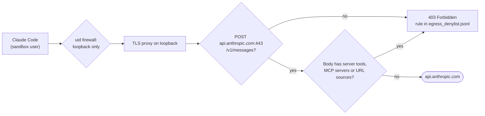

# Subscription logins on no-web tasks

A Claude Code subscription login (`CLAUDE_CODE_OAUTH_TOKEN` or `claude login`) works on tasks with no web access.

```sh
export CLAUDE_CODE_OAUTH_TOKEN='<token>'
bench run tasks/my-no-web-task -a claude-agent-acp
```

BenchFlow runs a small proxy that lets the agent reach only Anthropic's model endpoint. Everything else stays blocked. Automatic [rubric reviewers](../judging/rubric-review.md) with no open network use the same path.



## Which client works

Only BenchFlow's pinned client works:

| Part | Pin |
|---|---|
| `claude-agent-acp` | 0.81.2 (`_CLAUDE_AGENT_ACP_PACKAGE`) |
| `@anthropic-ai/claude-agent-sdk` | 0.3.280, the version that adapter release depends on |
| `@anthropic-ai/claude-code` | 2.1.280 (`_CLAUDE_CODE_PACKAGE`) |

BenchFlow installs them itself, on Linux. Any other client, or custom model routing, is refused before the agent starts. It never falls back to open network or an API key.

## What the proxy allows

| Allowed | Refused |
|---|---|
| HTTPS `api.anthropic.com:443`, method `POST`, path `/v1/messages`, no query or exactly `?beta=true` | every other host, port, method and path, including the client's optional settings requests |
| client-executed custom tools | server tools: `web_search_*`, `web_fetch_*`, `code_execution_*`, `advisor_*`, `mcp_toolset` |
| `base64`, `text`, `content` and `file` image or document sources | URL sources, and `mcp_servers` (MCP connector servers) |

The proxy reads each request before any byte goes upstream. Server tools are refused because Anthropic runs them itself, which would give the sandbox web access through the model endpoint. Model responses still stream.

**Leave `advisorModel` out of no-web runs.** Its requests carry an `advisor_*` server tool, so the proxy answers them with `403 Forbidden`. The refusal is logged as rule `native-model-body-server-tool` in `trajectory/egress_denylist.jsonl`.

## Task image requirements

The proxy and firewall run inside the task's `main` container. A no-web subscription run needs:

| Needs | Without it |
|---|---|
| `python3` on `PATH` (the proxy is a Python script) | setup stops before the agent starts: `... needs python3 in the task image` |
| `openssl` on `PATH` (the proxy signs its certificates with it) | setup stops: `... needs openssl in the task image` |
| a system CA bundle, such as `ca-certificates` | setup succeeds, but every model request fails certificate checks. This is not checked at setup. |
| a non-root `sandbox_user` with a nonzero UID | not supported |
| `iptables`, and `ip6tables` when the kernel has IPv6 | setup installs `iptables` with apt, dnf or apk |
| the `NET_ADMIN` capability on `main` | Docker and Daytona-with-compose add it automatically. Daytona direct sandboxes don't need it. You don't need `cap_add`. |

None of these falls back to open network or an API key when it is missing.

Stock `ubuntu:24.04` has none of the first three. Add them with:

```dockerfile
RUN apt-get update && apt-get install -y --no-install-recommends python3 openssl ca-certificates && rm -rf /var/lib/apt/lists/*
```

A no-web run with an API key does not use this proxy, so it needs no `python3`.

## What the trial records

`native-oauth-network.json` in the trial folder records that the proxy started, the client versions and the sandbox UID. It proves setup, not that a model call succeeded.

## Next steps

- [Auth](./auth.md): create a subscription token.
- [No-web proxy reference](../reference/no-web-subscription-proxy.md): every check the proxy makes.
- [Native harness](./harness.md): run Claude Code through `claude -p`, also on no-web tasks.
