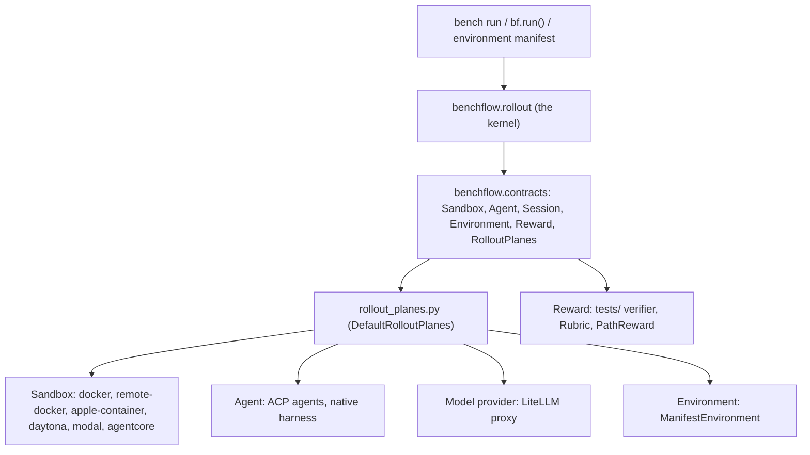
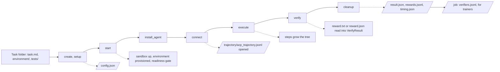
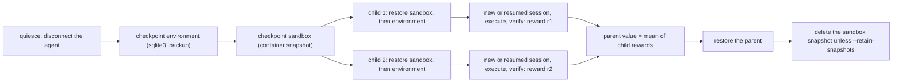

# Architecture

This page shows how BenchFlow is built: the four planes, the contracts between them, and what happens during a rollout. For the reasoning behind the design, see [Design rationale](./contributing/design-rationale.md).

```bash
bench run tests/examples/hello-world-task --agent claude-agent-acp --model claude-sonnet-5
```

That one command walks through every part of this page. It creates a sandbox, starts the agent, records each step, scores the result and writes the trajectory.

## What BenchFlow is

BenchFlow runs agents on tasks inside sandboxes, scores the result, and saves the trajectory. The same scored rollout serves evaluation and RL training data. BenchFlow stops where the gradient starts: it does not hold weights or run optimizers.

One scored rollout serves each mode:

| Mode | What happens to the scored rollout |
|---|---|
| Eval | BenchFlow scores it and reports the score. |
| Train | BenchFlow scores it and hands the trajectory to a trainer. |
| Monitor | Planned, not built. `benchflow.Monitor` raises `MonitorNotImplementedError`. |

BenchFlow splits an RL environment into five parts: Tasks, Harness, Verifier, State and Config. The split follows Han Lee's *RL Environments for LLM Agents*. The table under [Planes](#planes) shows where each part lives.

## Design principles

1. **The rollout kernel reaches planes through contracts.** `benchflow.rollout` never imports the concrete sandbox, ACP, provider or environment modules. `benchflow/rollout_planes.py` binds them, and `tests/test_rollout_architecture.py` enforces it.
2. **Four swappable planes:** Sandbox, Agent, Environment and Reward. Each has built-in providers and accepts your own.
3. **A rollout is a tree.** A plain run is a tree with one child per node. Branching forks a node into several children.
4. **Benchmarks don't change BenchFlow.** A benchmark ships a task package and, for a stateful world, an environment manifest.
5. **BenchFlow owns readiness and teardown.** The agent never starts before the environment reports healthy.

## Planes



The kernel is the `benchflow.rollout` package. It runs the rollout lifecycle and records the trajectory and reward.

The kernel reaches the planes through `benchflow.contracts`. That package holds the `Sandbox`, `Agent`, `Session`, `Environment` and `Reward` protocols. It also holds `RolloutPlanes`, the protocol for the concrete operations the kernel needs.

`benchflow/rollout_planes.py` implements `RolloutPlanes` with the concrete ACP, provider, sandbox and manifest code. A test checks that the kernel imports none of eight concrete modules, such as `benchflow.acp.runtime` and `benchflow.sandbox.lockdown`.

| Part | In BenchFlow | Plane |
|---|---|---|
| T, Tasks | a task folder (`task.md`, or legacy `task.toml` + `instruction.md`) | input |
| H, Harness | the agent, run over ACP or its native CLI (`--harness acp` or `native`) | Agent |
| V, Verifier | the task's `tests/`, a `Reward`, a `RewardFunc`, a `Rubric` | Reward |
| S, State | the environment manifest and the services it starts | Environment |
| C, Config | `RolloutConfig` (one rollout), `EvaluationConfig` (a job) | input |

Tasks and Config are inputs. The Agent, Reward and Environment planes do the work, and all three run on the Sandbox plane.

**Sandbox: where the rollout runs.** Choose it with `--sandbox`: `docker` (the default), `remote-docker` or `apple-container`. With an extra installed, you can also use `daytona`, `modal` or `agentcore`, for example `pip install 'benchflow[sandbox-daytona]'`. To plug in your own, implement the `Sandbox` protocol. See [Sandbox capabilities](#sandbox-capabilities), [Sandbox hardening](./sandboxes/security.md) and [Remote Docker](./sandboxes/remote-docker.md).

**Agent: who acts.** This is the agent under test, or the policy being trained. BenchFlow drives it over ACP by default, or through its own CLI with `--harness native`. Built-in agents live in `benchflow/agents/registry.py`. Others load from `manifest.toml` files, or from a directory set in `BENCHFLOW_AGENTS_DIR`. From Python, call `benchflow.register_agent()`. `bench agents` lists them all. See [External agents](./agents/external-agents.md).

**Environment: the world the agent changes.** These are the databases and services the agent reads and writes. BenchFlow starts them, waits for readiness, snapshots and restores them, and stops them. Declare one with an [environment manifest](#environment-manifest). See [Environment plane](./environment-plane.md).

**Reward: how the rollout is scored.** The task's verifier writes `/logs/verifier/reward.txt` or `reward.json`. BenchFlow turns it into a `VerifyResult`. In Python, a `Reward` scores any tree node, so it can grade the final state or the path to it. See [Evaluation spaces](#evaluation-spaces).

### Skill loading

```bash
bench run path/to/task --agent claude-agent-acp --task-skills
```

Skills are mounted where the agent looks for them natively. BenchFlow never pastes skill bodies into the prompt.

| Mode | How to choose it | What the agent sees |
|---|---|---|
| no skill | the default | nothing: the task's `environment/skills` is hidden |
| with skill | `--task-skills` | the task's `environment/skills`, or your own folder with `--skills-dir` |
| self-generated | `--skill-mode self-gen` | a creator scene writes skills; the solver sees only those |

`--skills-dir` needs task skills on. Claude Code reads each skill's name and description from its frontmatter. It opens the full `SKILL.md` only when it uses the skill. See [Skill evals](./judging/skill-evals.md).

### Sandbox capabilities

| Provider | Compose services | `no-network` | Denylist | Allowlist | Live ACP process | Container snapshot | Install extra |
|---|---|---|---|---|---|---|---|
| `docker` | yes | yes | yes | yes | yes | yes | none |
| `remote-docker` | yes | yes | yes | yes | yes | yes | none |
| `daytona` | yes | yes | yes | yes | yes | direct strategy only | `sandbox-daytona` |
| `modal` | no | yes | no | no | no | no | `sandbox-modal` |
| `apple-container` | no | no | no | no | yes | no | none |
| `agentcore` | no | no | no | no | yes | no | `sandbox-agentcore` |

The first five columns come from `benchflow/_utils/sandbox_providers.py`. The snapshot column comes from each sandbox's `supports_snapshot` property.

<a id="the-four-contracts"></a>

## Contracts

Each plane is a Python protocol. Import them with `from benchflow.contracts import Sandbox, Agent, Session, Environment, Reward`. Implement one to bring your own sandbox, agent, environment or scorer.

```python
class Sandbox(Protocol):            # where it runs
    async def exec(cmd, *, user="root", timeout_sec=30) -> ExecResult: ...
    async def upload_file(src, dst, *, mode=None) -> None: ...
    async def upload_dir(src, dst, service="main") -> None: ...
    async def download_file(src, dst) -> None: ...
    async def download_dir(src, dst, service="main") -> None: ...
    async def start() -> None: ...
    async def stop(*, delete=True) -> None: ...
    async def snapshot(name=None) -> SandboxImage: ...
    async def restore(image: SandboxImage) -> None: ...
    @property
    def supports_snapshot() -> bool: ...
    @property
    def host() -> str: ...
    @property
    def expose_ports() -> list[int]: ...

class Agent(Protocol):              # who acts
    async def connect(sandbox, role) -> Session: ...
    def capabilities() -> AgentCapabilities: ...

class Session(Protocol):            # one live agent session
    async def prompt(text: str) -> StopReason: ...
    async def cancel() -> None: ...
    def on_ask_user(handler: AskUserHandler) -> None: ...
    @property
    def steps(self) -> list[Any]: ...

class Environment(Protocol):        # the world
    async def provision(ctx) -> EnvHandle: ...
    async def readiness() -> ReadinessProbe: ...
    async def query() -> EnvState: ...
    async def teardown() -> None: ...
    async def snapshot() -> StateSnapshot: ...
    async def restore(snap: StateSnapshot) -> None: ...
    async def reset() -> None: ...

class Reward(Protocol):             # how it's scored
    async def score(node: RolloutNode) -> VerifyResult: ...
```

`Agent.connect()` returns a `Session`. The session carries the whole ACP exchange: the prompt, follow-up nudges, and the `ask_user` callback.

`Reward.score(node)` gets a `RolloutNode` with `id`, `parent`, `children`, `step_in` and `state`. Read the leaf for an outcome reward. Call `trajectory(node)` from `benchflow.trajectories.tree` to get the steps from the root to the node, and score the process.

`score` returns `VerifyResult(reward, items, events, space, granularity)`. An older `RewardFunc` scores a rollout folder and returns a float. It still works: wrap it in `PathReward`.

## Rollouts are trees

A rollout is one episode. Each state is a node and each agent turn is an edge, so a plain run is a chain. A branch adds more children to a node, which turns the chain into a tree. The data model is in `benchflow/trajectories/tree.py`.

| Term | What it is | Code |
|---|---|---|
| Job | Many rollouts run together: an eval sweep, a GRPO group, a continual-learning sequence | `benchflow.Evaluation` |
| Rollout | One episode on one task; owns a tree of states | `benchflow.rollout.Rollout`, `RolloutTree` |
| Step | One edge: the agent reasons, acts, and gets the tool result | `trajectories.tree.Step` |
| Branch | Snapshot a node and run N children from it | `Rollout.branch()`, `bench branch` |
| Trajectory | One root-to-leaf path, computed from the tree | `trajectories.tree.trajectory(leaf)` |
| Scene | A declared phase (roles, prompts, skills) that compiles to steps | `benchflow.scenes.compile_scenes_to_steps` |

A rollout is what some other harnesses call a trial.

A branch scores one state across N continuations. Each child's reward is stored on the child node, and their mean is stored as the parent's value, `parent.state["value"]`. You create branches yourself, with `bench branch` or `Rollout.branch()`. An `ask_user` question does not fork the rollout.

A trajectory is computed from the tree, never stored on it. At the end of a job, BenchFlow writes each rollout's path to `<job>/verifiers.jsonl`. Each line is a Verifiers-style record: `prompt`, `completion`, `reward`, `metrics` and `info`.

A scene declares a multi-phase or multi-agent rollout (`RolloutConfig.scenes`). `compile_scenes_to_steps` turns scenes into per-step prompts and roles before the run. Scenes have no lifecycle of their own. See [Concepts: Scenes, roles and turns](./core-concepts.md#scenes-roles-and-turns).

## Lifecycles

The diagram shows one rollout from task to trajectory, with the `Rollout` method for each phase and the files it writes.



**Rollout** (`benchflow.rollout.Rollout`). `Rollout.run()` runs every phase in order:

| Phase | What it does |
|---|---|
| `create`, `setup` | resolve the config, stage the task, write `config.json` |
| `start` | bring the sandbox up; the environment provisions its services; BenchFlow waits for readiness |
| `install_agent` | install the agent in the sandbox |
| `connect` | open the ACP or native session and the trajectory file |
| `execute` | run the prompts; each step grows the tree |
| `verify` | run the verifier; the Reward plane scores |
| `cleanup` | stop the sandbox; `run()` (or `finalize()`) then writes `result.json`, `rewards.jsonl` and `timing.json` |

<a id="the-eight-capabilities--how-each-fits"></a>

**Job** (`benchflow.Evaluation`). A job plans tasks × agents × repeats, runs the rollouts, aggregates and writes results. Rollouts run in parallel by default (`job_mode: parallel-independent`).

For continual learning, set `job_mode: sequential-shared` in a `--config` file. Rollouts then run in order over one learner store of memory and skills. The store never rolls back with a branch. See [Design rationale: capabilities](./contributing/design-rationale.md#capabilities).

**Branch** (`Rollout.branch()`, `bench branch`). The diagram shows one fork with two children.



A branch checkpoints only the layers you ask for. The default differs by entry point:

| Entry point | Default `snapshot_layers` | Choose with |
|---|---|---|
| `bench branch` | `sandbox` | `--snapshot-layers` |
| `bf.branch()` | `sandbox` | `snapshot_layers=` |
| `Rollout.branch()` | `environment` (needs a manifest) | `snapshot_layers=` |

```bash
bench branch --tasks-dir tests/examples/hello-world-task \
  --agent claude-agent-acp --model claude-sonnet-5 --sandbox docker \
  --prompt "Create draft.txt containing: Hello world" --prompt @instruction \
  --checkpoint-after-prompt 1 \
  --child label=baseline \
  --child "label=hint,prompt=Rename draft.txt to hello.txt, then stop." \
  --snapshot-layers sandbox
```

Each child normally starts a new agent session. With `--resume-session` (`resume_session=True`), the child resumes the parent's conversation through ACP `session/load`. That needs an agent that advertises `loadSession` and keeps its session on disk, as Claude Code does. See [Branching](./jobs/branching.md) and [Composed checkpoints](./jobs/branching-reference.md).

**Environment** (`Environment` protocol). `provision` → `readiness` → `query` → `snapshot` / `restore` / `reset` → `teardown`. `snapshot` and `restore` work only when the manifest declares `[environment.state]`.

**Sandbox** (`Sandbox` protocol). Configure `expose_ports` → `start` → `exec` / `upload_file` / `upload_dir` / `download_file` / `download_dir` → optional `snapshot` / `restore` → `stop`.

<a id="the-environment-plane--the-manifest"></a>

## Environment manifest

```bash
bench run path/to/tasks --agent claude-agent-acp \
  --environment-manifest path/to/environment.toml
```

A stateful benchmark adds one file, `environment.toml`, next to its tasks. `ManifestEnvironment` reads it. Pass a path, or a registry name such as `--environment-manifest env0@prod`.

```toml
[environment]
name           = "chi-bench"
image          = "chi-bench:latest"   # or base_image + [[environment.services]]
owns_lifecycle = true                 # the image's entrypoint starts the services
isolation      = "per_task"           # or "persistent" (state kept across episodes)

[environment.task_selection]
mechanism   = "env_var"               # or "image" (one image per task)
key         = "CHI_BENCH_TASK_ID"
inject_into = "entrypoint"            # reaches PID 1, not only exec()

[environment.readiness]               # BenchFlow waits on these before the agent runs
http        = ["http://localhost:8023/health"]
timeout_sec = 120

[environment.state]                   # what snapshot/restore copy; omit it for a stateless world
kind  = "sqlite"
paths = ["/data/*.db"]
```

Every table rejects unknown keys, so a typo fails at load time. A working example ships with BenchFlow: `benchflow/environment/_registry/env0@prod.toml`.

Verifier isolation is set in the task, not the manifest. See [Separate verifier](./tasks/separate-verifier.md).

Keep the world's state in a database the tools read and write. That lets BenchFlow snapshot, diff and restore it. Today it copies SQLite files with `sqlite3 .backup`. The environment runs inside the rollout's own sandbox.

<a id="evaluation--the-five-spaces"></a>

## Evaluation spaces

Every reward record says which part of the agent's behaviour it judges, its *space*. It also says whether it covers the whole run or one step, its *granularity*.

| Space | What it checks |
|---|---|
| `output` | Did the agent finish the job? This is the verifier's reward. |
| `action` | Were the actions right, with no reward hacking? Did the agent ask when it should have? |
| `reasoning` | Is the reasoning sound and connected to the actions and answer? |
| `memory` | Did the agent update its memory or skills correctly? |
| `latent` | Reserved for model internals. Nothing scores it yet. |

Granularity is `terminal` (the whole run) or `step` (one edge). Process rewards walk the path to a node instead of scoring each step alone.

## User interaction

BenchFlow is the ACP client, and a user model plays the human. Two channels carry the exchange:

- `session/prompt` (BenchFlow → agent): the task, then any follow-up nudges.
- `request_permission` / `ask_user` (agent → BenchFlow): a question with options, handled by `Session.on_ask_user`.

The handler returns one answer, and BenchFlow does not fork on the options. To try several answers, branch explicitly. The agent decides when to ask, and an action-space scorer can grade whether it asked.

User models live in `benchflow.contracts`: `PassthroughUser`, `FunctionUser` (your callback), `DocumentNudgeUser` and `ModelDocumentNudgeUser` (an LLM plays the user). See [Simulated user](./tasks/scenes.md#simulated-user).

## Adapters and trainers

BenchFlow's native task format is `task.md`. Adapters translate other formats in and out.

| Direction | What | How |
|---|---|---|
| In | task folders in the task.toml format (`task.toml`), such as Terminal-Bench | `bench run` reads them as they are; `bench import` converts them to `task.md` |
| In | PrimeIntellect Verifiers environments | `--source-env`, on their own runtime |
| Out | Inspect AI | `InspectAdapter` |
| Out | OpenReward (ORS) | `ORSAdapter` |
| Out | RL trainers | `<job>/verifiers.jsonl`, one record per rollout |

Other trajectory exports (ATIF, ADP, TRL SFT, Prime SFT) live in `benchflow/trajectories/`. Trainers such as Tinker, verl and NeMo-RL stay outside BenchFlow.

## How a task flows through the planes

A task is one `task.md` (or legacy `task.toml` + `instruction.md`) with its `environment/` and `tests/` folders. It feeds every plane:

| The task carries | Which goes to |
|---|---|
| the environment package and manifest | the Environment plane, which provisions the state |
| the instruction | the Agent plane |
| the verifier and its hidden fixtures | the Reward plane |
| turn limits and budgets | `RolloutConfig` |

One task gives one rollout tree, and one trajectory per leaf. A job runs many tasks, or one task many times.

<a id="the-hard-part--honest-risk"></a>

## Limits

- Sandbox snapshots work on `docker`, `remote-docker` and Daytona's direct strategy. Other providers raise `SandboxSnapshotNotSupported`; check `sandbox.supports_snapshot` first.
- Environment snapshots copy SQLite files only (`kind = "sqlite"`).
- BenchFlow does not snapshot a live agent process. A child either starts fresh or resumes the conversation with `--resume-session`.
- Mounted volumes and external services are not captured by any snapshot layer.
- Monitor mode is not built.

The reasons behind these limits are in [Design rationale: the hard part](./contributing/design-rationale.md#the-hard-part).

## Next steps

- [Concepts](./core-concepts.md): the terms on this page, with examples.
- [Branching](./jobs/branching.md): fork a run and compare children.
- [Environment plane](./environment-plane.md): write and register a manifest.
- [External agents](./agents/external-agents.md): bring your own agent.
- [Design rationale](./contributing/design-rationale.md): why BenchFlow is built this way.
