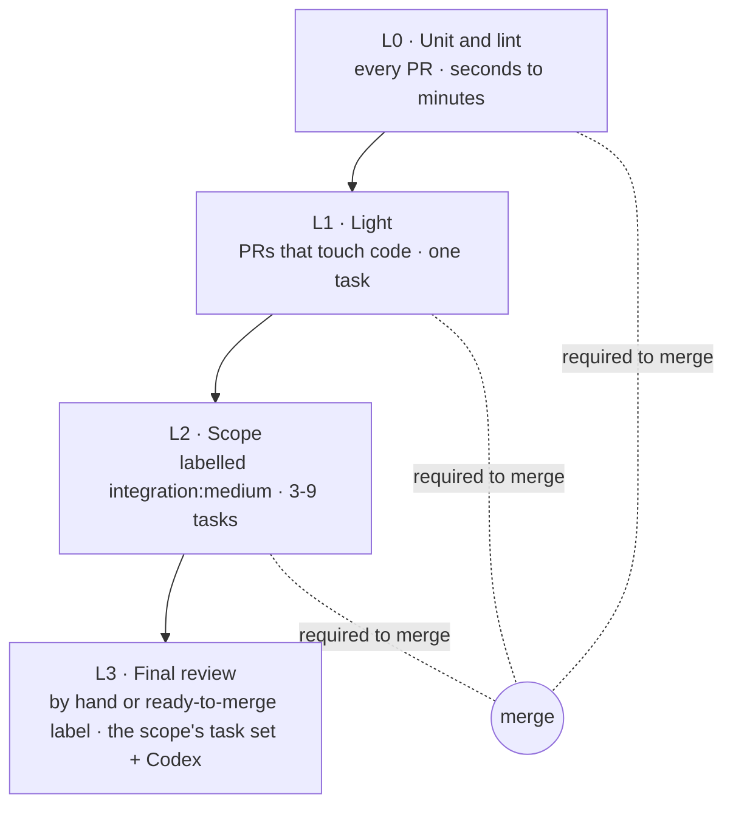

# How each release is tested

Every code change runs a real agent on a real task before it merges (L1); docs-only changes run L0 only, and the wider L2 set needs the `integration:medium` label.

| Level | When | What runs | Blocks a merge |
|---|---|---|---|
| L0: unit and lint | every PR | `pytest`, `ruff`, `ty`, and a keyless end-to-end run with a scripted fake model. No model keys. | yes |
| L1: light | every PR that touches code | one SkillsBench task with one agent on Docker, checked by an LLM judge | yes |
| L2: scope | PRs labelled `integration:medium` that touch agents, skills, sandboxes, verifiers or networking (without the label, a green no-op) | 3-9 SkillsBench tasks, the changed agent plus a baseline, on Docker and Daytona | yes |
| L3: final review | by hand (`workflow_dispatch`), or when a maintainer adds the `ready-to-merge` label to an internal PR | the scope's task set, compared with the published leaderboard run and with BenchFlow `main`, then a Codex review | a maintainer runs it |

L1 and L2 pass at once when a PR doesn't touch what they test.

A run counts only if the agent made tool calls, used tokens and got a reward. 18 checks then grade each run. They reject a run whose agent touched the grader or could see the answers. They also reject a no-skill run that loaded a skill, and a task that opens the network without a host list. An LLM judge reads each trajectory for reward hacking that never touches a file. The Codex review can only make a verdict stricter.

Before a release, 9 agents run 9 SkillsBench tasks on Daytona. Every benchmark adapter in the release runs at least one task, and Docker and Daytona run the same task.

## Next steps

- [Integration CI](https://github.com/benchflow-ai/benchflow/blob/main/.github/integration/README.md): how CI picks the runs for each PR.
- [Review rubric](https://github.com/benchflow-ai/benchflow/blob/main/.github/integration/REVIEW_RUBRIC.md): every check and what it can't prove.
- [Integration tests](https://github.com/benchflow-ai/benchflow/blob/main/tests/integration/README.md): run the release suite yourself.
