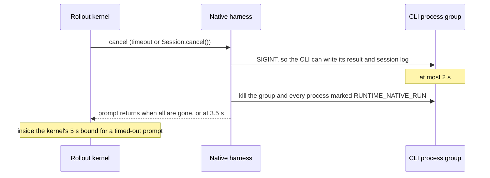

# Native harness internals

How the [native harness](../evaluate/agents.md#run-claude-code-or-codex-through-their-own-cli) runs a turn, how its CLI pins move, and how its parity with the ACP harness is tested. This page is for maintainers.

## How a native turn runs

Each prompt runs the CLI once, as the sandbox user. It uses the same live-process transport as the ACP path: Docker `exec`, the Daytona PTY, or Modal's `Sandbox.exec` streams.

- The prompt goes to the CLI's stdin as one base64 line. It never goes on the command line or in an environment variable, so its size is not limited.
- The CLI runs as a job in its own process group.
- Its JSON lines are parsed as they arrive into the same ACP session updates an adapter sends.
- BenchFlow's ACP session records them. So the prompt loop, the idle watchdog, the wall-clock budget and the bounded cancel are the ACP path's own code.

### Claude Code

```sh
claude -p --output-format stream-json --verbose --include-partial-messages \
  --forward-subagent-text --thinking-display summarized \
  --permission-mode bypassPermissions \
  --session-id <uuid>        # first turn; later turns use --resume <uuid>
```

`--model` and `--effort` are added when the run sets them. With BenchFlow's proxy the model rides `ANTHROPIC_MODEL`, as over ACP.

`--thinking-display summarized` asks for the thinking the ACP session asks for (it passes the same setting to the adapter's SDK). Print mode's own default is `updates`, which sends the model a different request and returns different thinking.

The parser is a port of `claude-agent-acp` 0.81.2's own mapping: tool titles and kinds, tool results, and the Edit and Write diffs. So both harnesses record the same trajectory.

### Codex

```sh
codex exec --json --ignore-user-config --skip-git-repo-check \
  --dangerously-bypass-approvals-and-sandbox -c ... -
# later turns: codex exec resume <thread> ...
```

- Every setting comes from the run's `CODEX_CONFIG` as `-c` overrides: model provider, model, effort, web search. No `config.toml` in the sandbox takes part.
- BenchFlow also sets `features.plugins=false`, `analytics.enabled=false`, `feedback.enabled=false` and `check_for_update_on_startup=false`. Without them, Codex 0.156.1 contacted github.com, api.github.com, chatgpt.com and ab.chatgpt.com at startup (measured through a logging proxy).
- It sets `model_reasoning_summary="auto"`, which `codex-acp` sets on every turn.
- Codex's approvals and its own sandbox are off, as `codex-acp` runs them (`INITIAL_AGENT_MODE=agent-full-access`). BenchFlow's non-root sandbox user and uid firewall are the isolation.

### Cancel



- Every process of the turn inherits the marker `RUNTIME_NATIVE_RUN`, so tool processes that left the group are found too.
- If the prompt returns at 3.5 s, the kill goes on. The disconnect and the next turn wait for it.
- The trajectory stops at the cancel. A tool call that was running stays pending, as over ACP.

### Log names

Absolute raw agent spellings write stderr to `agent/-raw-abs-<sha256>.txt`. Other spellings keep the usual log path, including across reconnects. ACP and native launches use the same mapping. The leading hyphen cannot occur in the older log names, which replace every hyphen with an underscore.

## Model routing checks

`connect_native` refuses any route but BenchFlow's before a process starts. On a no-web task, the model-only TLS proxy admits a Claude Code subscription run only after it checks the CLI package, its `--version`, and that the executable resolves into the pinned package.

The deterministic tier checks two things:

- every model call a native CLI makes reaches the proxy: the model responses in the CLI's own stream equal the calls the proxy captured;
- native Codex on a task whose agent network is an allowlist (`example.com` only) passes, and the egress proxy records no attempt to reach api.openai.com, chatgpt.com or any other host.

## Pins

| CLI | Pin | Constant in `agents/registry.py` |
|---|---|---|
| Claude Code | `@anthropic-ai/claude-code@2.1.280` | `_CLAUDE_CODE_PACKAGE`. It is the same binary `claude-agent-acp` runs (`CLAUDE_CODE_EXECUTABLE`), so the two harnesses cannot drift apart on the CLI. |
| Codex | `@openai/codex@0.159.3` | `_CODEX_CLI_PACKAGE`. It is the release `codex-acp` 2.0.1 resolves its `^0.159.1` dependency to, so both harnesses run one Codex core. It is installed next to `codex-acp` for native runs only; `codex-acp` still runs its own nested copy. |

Each native connect checks the CLI's `--version` against the pin and refuses another build. The [Codex Apps](../evaluate/agents.md#codex-apps) policy checks and probes the native CLI when the harness is native.

### When a pin moves

1. Change `_CLAUDE_CODE_PACKAGE` or `_CODEX_CLI_PACKAGE` in `src/benchflow/agents/registry.py`.
2. Re-record the samples on a machine with the pinned CLIs:
   ```sh
   npm install -g --prefix DIR <pins>
   python tests/fixtures/native_harness/record_samples.py --npm-prefix DIR
   ```
   The samples are each CLI's output for a turn, a resumed turn, a failing tool call and a cancelled turn, against the deterministic fake model. `tests/test_native_harness_parsers.py` replays them. A pin without samples fails that test.
3. Run the deterministic tier on both harnesses. When the adapter pin moves, also re-check the Claude Code parser port against the adapter's `tools.js` and `acp-agent.js`.

## Parity

`tests/test_deterministic_integration.py` runs the deterministic tier on both harnesses with the scripted fake model, so parity costs no model calls. The scenarios are a passing task, a wrong answer, a timeout during a tool call, a CLI crash, a broken verifier and an in-place branch. A native branch whose children resume the parent's session (`--resume-session`) runs too.

### Outcome and trajectory parity

Claude Code native must reproduce the ACP runs' golden files field for field: outcome labels, rewards, counts, error categories, usage and cost, provider calls, the ACP trajectory and the ATIF export. The one allowed difference is the ATIF agent name: the CLI instead of the adapter.

Codex runs four scenarios on both harnesses: pass, wrong answer, a Codex CLI crash, and a model call slower than the agent timeout. The two must agree on everything but tool call ids. `codex-acp` exposes the model's call id; `codex exec` only its own item id.

One written exception: when the Codex process dies mid-turn, `codex-acp` (1.13.1 and 2.0.1) does not report it. The prompt runs to the agent timeout, and then the verifier scores the workspace. The native harness reports the crash at once as an agent error, as both harnesses do for Claude Code. Up to the crash the two runs match: the model call, its usage and the trajectory.

### Wire parity

With `BENCHFLOW_LITELLM_WIRE_LOG_DIR` set, the proxy writes every request as the agent sent it. It keeps the body without the proxy's own keys and identifying headers only, never credentials. The tier compares the two harnesses' requests for the same task. It normalizes ids, removes the written differences below with one exact rewrite each, and requires the rest to be identical.

Expected request differences (`WIRE_EXPECTED_DIFFERENCES` in the tier):

| CLI | Where | Why |
|---|---|---|
| Claude Code | `User-Agent`, and the billing line that opens the system prompt (`cc_entrypoint`) | Claude Code names its entrypoint: `sdk-ts` and the Agent SDK version inside the adapter, or `sdk-cli` in print mode. |
| Claude Code | `tools` | The ACP session starts in the default permission mode and offers `EnterPlanMode` and `ExitPlanMode`, which bypassPermissions does not. The other 24 tool definitions are identical and in the same order. |
| Claude Code | the first tool result | The adapter hands the SDK the session directory as an extra working directory. That adds a system reminder: "Environment update: Additional working directories added: /app". On `claude-opus-5-5` it is a system message of its own after that tool result. |
| Claude Code | the environment message and the `Bash` tool, on `claude-opus-5-5` | Each permission mode adds its own guidance. Print mode's bypassPermissions adds "While bypass permissions mode is active: You can do much of your work through the Bash tool …". The ACP session's default mode keeps "IMPORTANT: Avoid using this tool to run `cat`, `head`, `tail`, `sed`, `awk`, or `echo` …" in `Bash`. The `claude-haiku-4-5` prompt has neither. |
| Codex | `originator`, `User-Agent` | `codex-acp` names the ACP client (`benchflow` and its version); `codex exec` names itself (`codex_exec`). |

Everything else is identical. For Claude Code that includes the system prompt, the messages, the model, thinking and limits. For Codex it includes the instructions, tools, input items, reasoning settings and `store`. Session, thread, turn and installation ids, and Claude Code's `metadata.user_id`, are normalized away.

### Model, effort and the sub-agent tool

Each pair also runs one passing task at a model and effort set with `--model` and `--reasoning-effort`, on both harnesses: Claude Code on `claude-opus-5-5` at `max`, Codex on `gpt-5.5` at `max`. The tier checks four things:

- Every request names the run's model; for Claude Code that is the proxy's alias for it. The one other model a request may name is the one `codex-acp` hard-wires for its session title (`gpt-5.6-luna`, a turn without tools).
- Every agent-loop request carries the effort. Claude Code 2.1.316 sends `output_config.effort` with adaptive thinking; Codex 0.159.3 sends `reasoning.effort` and names the effort in its turn metadata. The fake provider receives the same effort after the proxy, and the trial's `model-calls.jsonl` records it.
- The sub-agent tool is offered. For Claude Code that is `Agent`. For Codex 0.159.3 on `gpt-5.5` it is the multi-agent tools, which it defers behind `tool_search`, and `apply_patch` is there too. The Claude Code task hands its file to a general-purpose sub-agent, whose own requests name the same model and effort.
- The two harnesses' requests match, bar the written differences above.

Claude Code applies an effort only to a model it knows takes one. `claude-haiku-4-5` takes none. The CLI ignores `--effort`, so a native run goes on with no effort on the wire. Over ACP the adapter offers no effort option, so BenchFlow refuses the run.

### The harness contract

On every native trial, the tier checks three things:

- the pinned CLI ran with its headless flags;
- its JSON events are kinds that the pin's recorded samples contain;
- the proxy captured as many model calls as the CLI made.

## Adding a CLI

A native harness is two functions and one entry (`benchflow/native_harness/spec.py`):

| Part | In | Out |
|---|---|---|
| command builder | a `NativeTurn` (resume id, model, effort, MCP servers) and the launch environment | the CLI's arguments |
| parser | the CLI's JSON events | ACP `session/update` payloads, and at the end a `NativeTurnOutcome` (stop reason, usage, error, session id) |
| `NativeHarness` entry in `native_harness/harnesses.py` | agent entry, executable, npm pin, `--version` output, extra install command, the two functions | |

Gemini CLI (`gemini -p --output-format stream-json`, in 0.62.0) and OpenCode (`opencode run --format json`, raw JSON events, in 1.18.33) fit this shape. Each also needs recorded samples, a route through the proxy, and a place in the parity suite.

## Not covered yet

- `claude-agent-acp` 0.82 and later changed the tool-call contract (AIR). BenchFlow stays on the 0.81 line, so neither harness is tested against it. The native harness itself does not depend on the adapters' contract.
- Native harnesses for Gemini CLI and OpenCode.
- A bot that proposes pin bumps with re-recorded samples and a parity run.
- Daytona: the native harness uses the same live-process transport there (a PTY), but only Docker has run it so far.
- Modal: the same holds for its `Sandbox.exec` transport; only the ACP harness has run there.

## Next steps

- [Native harness](../evaluate/agents.md#run-claude-code-or-codex-through-their-own-cli): the user guide.
- [Codex Apps](../evaluate/agents.md#codex-apps): the Codex Apps policy and its checks.
