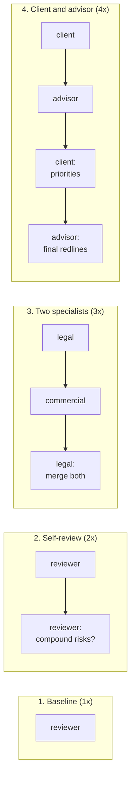

# Multi-role scenes: four patterns

A task can run several turns, and several agents, in one sandbox. This page shows four ways to arrange them on one example, a contract review, and when each is worth its cost.

Roles go under `agents.roles` in a task's `task.md` front matter, and turns go under `scenes:`. See [Scenes and simulated users](../tasks/scenes.md) for the full format.

| Term | Meaning |
|---|---|
| **Role** | A named agent and model, for example `legal` |
| **Turn** | One prompt to one role |
| **Scene** | A list of turns, each taken by a role |
| **Rollout** | All of a task's scenes, run in one sandbox |



Each box is one turn. The cost grows with the number of turns.

## The example

A startup is reviewing a vendor's SaaS contract. Three risks are buried in it: auto-renewal with uncapped price rises, an SLA with no credits, and only 30 days to export data after termination.

## Pattern 1: Baseline

One agent reviews the contract in one pass.

```yaml
agents:
  roles:
    reviewer: {agent: gemini, model: gemini-3.1-flash-lite-preview}
scenes:
  - name: review
    turns: [{role: reviewer}]
```

**Typical miss:** one pass tends to flag single clauses, such as the liability cap or the SLA. It misses risks that appear only in combination: uncapped renewal pricing + auto-renewal + a 90-day notice window = lock-in.

**Use when** the task is simple and its success criteria are clear.

## Pattern 2: One agent, two turns (self-review)

The same role gets a second turn that asks for compound risks.

```yaml
agents:
  roles:
    reviewer: {agent: gemini, model: gemini-3.1-flash-lite-preview}
scenes:
  - name: self-review
    turns:
      - {role: reviewer}
      - {role: reviewer, prompt: "Re-examine for compound risks: combinations of clauses that together are worse than any one clause."}
```

**What it adds:** the second turn often catches the lock-in combination.

**Use when** a second look is likely to help; about twice the cost. **Skip when** the model's blind spot is systematic: the same model rarely catches what it missed.

## Pattern 3: Two specialists

Two roles split the review: `legal` looks at liability, `commercial` at cost. Then `legal` merges both.

```yaml
agents:
  roles:
    legal: {agent: gemini, model: gemini-3.1-flash-lite-preview}
    commercial: {agent: gemini, model: gemini-3.1-flash-lite-preview}
scenes:
  - name: specialist-review
    turns:
      - {role: legal}
      - {role: commercial}
      - {role: legal, prompt: "Merge the commercial review with your legal findings."}
```

**What it adds:** each specialist covers what the other skips, and the last turn turns both into redlines.

**Use when** the task needs more than one kind of expertise; about 3x the cost. **Skip when** a second opinion adds cost but no insight.

## Pattern 4: Client and advisor

One role plays the client and states its priorities; the other advises.

```yaml
agents:
  roles:
    client: {agent: gemini, model: gemini-3.1-flash-lite-preview}
    advisor: {agent: gemini, model: gemini-3.1-flash-lite-preview}
scenes:
  - name: consultation
    turns:
      - {role: client}
      - {role: advisor}
      - {role: client, prompt: "Clarify your top priorities and acceptable compromises."}
      - {role: advisor, prompt: "Give final redline recommendations with fallback positions."}
```

**What it adds:** the advice fits the client's real priority (cash flow, lock-in or data portability) instead of generic boilerplate.

**Use when** the right answer depends on the user; about 4x the cost. **Skip when** the task is fully specified.

For a scripted user with private facts, see the [simulated-user example](https://github.com/benchflow-ai/benchflow/blob/main/docs/examples/task-md/user-runtime/private-facts-nudges/task.md).

## Summary

| Pattern | Adds | Cost | Use for |
|---|---|---|---|
| 1. Baseline | — | 1x | simple tasks |
| 2. Self-review | compound risks | 2x | tasks a second look can fix |
| 3. Two specialists | a second kind of expertise | 3x | tasks that need several perspectives |
| 4. Client and advisor | advice fitted to the user | 4x | user-specific decisions |

In BenchFlow each pattern is only a change to `agents.roles` and `scenes:`. The task, its verifier and the trajectory format stay the same.

## Try it

For a quick preview without a sandbox, [`scene-patterns.py`](../examples/scene-patterns.py) sends each pattern's prompts straight to Gemini and prints the replies. It does not run BenchFlow, a verifier or a sandbox. A notebook version is [`scene-patterns.ipynb`](../examples/scene-patterns.ipynb).

```bash
export GEMINI_API_KEY=...
uv run --with google-generativeai python docs/examples/scene-patterns.py
```

To check a three-scene task file (plan, implement, review):

```bash
bench check docs/examples/task-md/multi-scene --level schema
```

That example holds only `task.md`, so it does not run. To run a task with scenes, a simulated user and a verifier, use the simulated-user example. With no `--agent`, `bench run` runs the task's oracle:

```bash
bench run docs/examples/task-md/user-runtime/private-facts-nudges
```

## Next steps

- [Scenes and simulated users](../tasks/scenes.md): the full scene format.
- [Cookbook](./index.md): other recipes.
