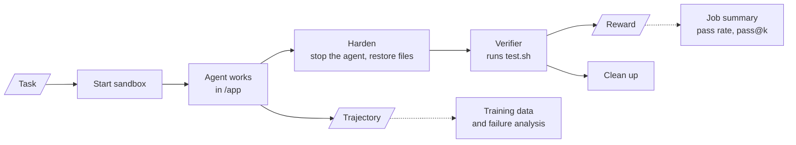
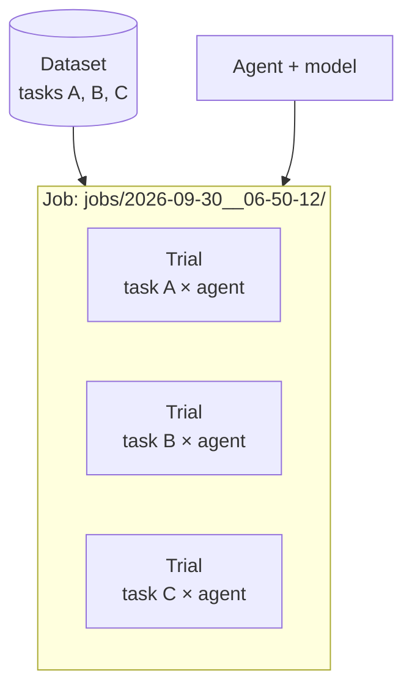
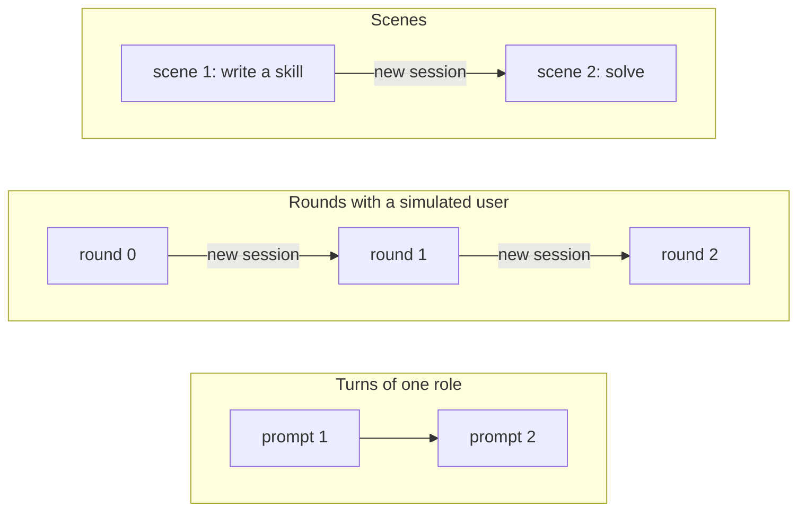

# Core concepts

The words the rest of the docs use.

## Task

A task is a folder with an instruction, a sandbox environment and a verifier. Its `task.md` holds YAML settings on top and the instruction below. `environment/Dockerfile` defines the sandbox, `verifier/test.sh` scores the result, and the optional `oracle/solve.sh` is the reference solution.

BenchFlow also runs older split tasks (`task.toml`, `instruction.md`, `tests/`, `solution/`) and any [task format](./tasks/task-formats.md) a benchmark registers. See [Task authoring](./tasks/overview.md).

## Dataset

A dataset is a set of tasks, usually one benchmark. It can be a local folder of tasks, a folder in a Git repository (`org/repo/path`), or a registry dataset (`bench run --dataset terminal-bench@2.0`).

## Agent

An agent is a program that does tasks: Claude Code, Codex, Gemini CLI, OpenHands and more. BenchFlow talks to most of them over [ACP](https://agentclientprotocol.com). `bench agents` lists them.

Two agents are built in and need no model. `oracle` runs the task's reference solution, and `nop` does nothing. A sound task scores 1 with the oracle and 0 with `nop`.

## Sandbox

A sandbox is the isolated machine where the agent works and the verifier scores. BenchFlow runs sandboxes on Docker (local or `remote-docker`), Daytona, Modal, AgentCore or Apple Container (on supported Apple Silicon Macs). Pick one with `--sandbox`; the default is `docker`.

## Verifier

The verifier scores the agent's work and writes the reward, from 0.0 to 1.0. Its entry point is the task's `verifier/test.sh`, run as a script. Most `test.sh` scripts call pytest. A task can use an [LLM judge](./judging/llm-judge.md) instead.

A task passes only at reward 1.0. `Score: 3/5` counts passed tasks; `reward` is the raw value.

## Trial

A trial is one agent's attempt at one task. The Python API calls it a rollout (`bf.Rollout`, `RolloutResult`), and its folder holds `result.json`, the trajectory and the verifier output.



Between the agent and the verifier, BenchFlow hardens the sandbox so the agent can't game its score. It stops the agent's processes and restores build files to their state before the agent ran. It removes `conftest.py`, `sitecustomize.py` and `.pth` files the agent added, and runs pytest with only the plugins the task declares. [Sandbox hardening](./sandboxes/security.md) has the full list.

## Job

A job is one `bench run`: its trials, run in parallel, and their summary. Each job is a folder under `--jobs-dir`, named by its start time. Running the same command again resumes the job.



## Trajectory

A trajectory is everything the agent did in a trial: its messages, thoughts and tool calls. It is in the trial's `trajectory/acp_trajectory.jsonl`, and as an ATIF record in `trainer/atif.json`. Use it for debugging, replay and training data.

## Scenes, roles and turns

A scene runs several agents, or one agent several times, in the same sandbox. A scene has roles and turns:

- a **role** is a named agent with its model, such as `coder` or `reviewer`;
- a **turn** is one prompt to one role.

```python
from benchflow import Role, Scene, Turn

Scene(
    name="review-loop",
    roles=[
        Role(name="coder",    agent="opencode", model="anthropic/claude-sonnet-5"),
        Role(name="reviewer", agent="gemini",   model="gemini-3.1-pro-preview"),
    ],
    turns=[
        Turn(role="coder"),
        Turn(role="reviewer", prompt="Review the current workspace."),
        Turn(role="coder",    prompt="Read the reviewer's feedback and revise."),
    ],
)
```

The roles share the sandbox's files, not a conversation. When the turn passes to another role, BenchFlow stops the current agent and starts the next one in a new session. Back-to-back turns of the same role keep one session.

A trial can have several scenes in a row, for example one that writes a skill and one that uses it. [Scenes and simulated users](./tasks/scenes.md) has worked examples.

## Turns, rounds and scenes

Three ways to give an agent more than one prompt. They differ in what carries over.

| | What repeats | The agent's memory | The sandbox's files |
|---|---|---|---|
| **Turns** of one role | prompts in one session | kept | kept |
| **Rounds** with a simulated user | sessions, each prompt chosen by your Python code | new each round | kept |
| **Scenes** | whole scenes, one after another | new each scene | kept |



In all three, the files in the sandbox carry over. Only turns of one role keep the agent's memory.

A **simulated user** picks each round's prompt. It is a `BaseUser` subclass, or a `FunctionUser` around a function, with two methods:

- `setup(instruction, solution)` runs once, before round 0;
- `run(round, instruction, round_result)` returns the next prompt, or `None` to stop.

Between rounds, BenchFlow runs `soft_verify()`, the verifier without the destructive hardening steps. The user then gets the round's result: trajectory, rewards, verifier output and tool count. See [Progressive disclosure](./tasks/scripted-users.md).

## Rollout lifecycle

In Python, `bf.run(config)` runs a whole trial. A `Rollout` also exposes each phase, for custom flows:

| Phase | Does |
|---|---|
| `setup()` | resolves the config and creates the sandbox handle |
| `start()` | starts the sandbox and uploads the task files |
| `install_agent()` | installs the agent, writes its credentials, sets up the sandbox user |
| `connect()` / `connect_as(role)` | starts an agent session, for one role |
| `execute(prompts)` | sends prompts to the agent |
| `disconnect()` | ends the session |
| `verify()` | hardens the sandbox, runs `test.sh` and scores |
| `cleanup()` | stops the agent's processes and the sandbox |

A scene repeats `connect_as`, `execute` and `disconnect` for each change of role.

```python
import asyncio
from pathlib import Path

import benchflow as bf
from benchflow import RolloutConfig, Scene

config = RolloutConfig(
    task_path=Path("tasks/edit-pdf"),
    scenes=[Scene.single(agent="gemini", model="gemini-3.1-pro-preview")],
    environment="daytona",
)
result = asyncio.run(bf.run(config))   # the whole lifecycle
print(result.rewards)                  # {'reward': 1.0}
```

## Verifier files

Native `task.md` tasks and older split tasks name their verifier files differently. BenchFlow looks for the native name first, so a task has one of each row, not both:

| What it is | Native (`task.md`) task | Split task | In the sandbox |
|---|---|---|---|
| Verifier folder | `verifier/` | `tests/` | `/verifier` (native), `/tests` (split) |
| Entry point | `verifier/test.sh` | `tests/test.sh` | run as a script in the verifier folder |
| How it is scored | `verifier/verifier.md` | `[verifier]` in `task.toml` | not uploaded; picks the strategy |
| LLM-judge rubric | `verifier/rubrics/verifier.md` and `verifier.toml` | `tests/rubric.toml` (or `rubric.json`) | sent to the judge |

A plain `test.sh` is a complete verifier. `verifier/verifier.md` picks another strategy: `script`, `llm-judge`, `criteria-runner`, `agent-judge` or `ors-episode`. See [task.md authoring](./tasks/overview.md).

A task that needs its own `conftest.py` turns that cleanup off in its `task.md` settings:

```yaml
verifier:
  hardening:
    cleanup_conftests: false
```

## Next steps

- Run a task: [Quick start](./getting-started/quick-start.md).
- Write a task: [Task authoring](./tasks/overview.md).
- Run several agents in one task: [Scenes and simulated users](./tasks/scenes.md).
- Read results in Python: [Analysing runs](./results/analysing-runs.md).
