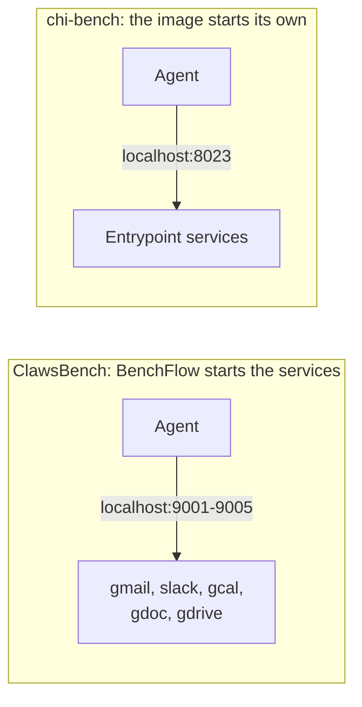

# Environment manifests

An environment manifest (`environment.toml`) describes the services a benchmark's agent works with, such as mock email or a hospital simulator. BenchFlow starts them, waits until they are healthy, and stops them after the trial.

```bash
bench run benchmarks/clawsbench/tasks \
  --environment-manifest benchmarks/clawsbench/environment.toml \
  --agent claude-agent-acp --model claude-haiku-4-5
```

You write one file; BenchFlow's default adapter, `ManifestEnvironment`, runs it on any sandbox. The manifest is the whole integration. In the architecture, this is the Environment plane; see [Architecture](./architecture.md).

`--environment-manifest` is not `--sandbox`: the sandbox is *where* the trial runs, the manifest is *the world* the agent acts in.

## The manifest schema

The manifest's keys live under an `[environment]` table.

### `[environment]`

| Field | Type | Default | Meaning |
|---|---|---|---|
| `name` | str | required | The environment or benchmark name |
| `image` | str | none | A ready-to-run image. Set this **or** `base_image` |
| `base_image` | str | none | The image per-task images build `FROM` |
| `ports` | list[int] | `[]` | Ports the environment exposes, besides the service ports |
| `owns_lifecycle` | bool | `true` | `true`: the image's entrypoint starts the services. `false`: BenchFlow starts the `[[environment.services]]` |
| `keep_alive` | bool | `true` | Keep the environment up for the whole trial |
| `isolation` | `"per_task"` \| `"persistent"` | `"per_task"` | `per_task`: a fresh environment per episode. `persistent`: state carries across episodes |

Set exactly one of `image` and `base_image`. With `owns_lifecycle = false` the manifest must declare `[[environment.services]]`; with `true` it must not.

### `[environment.task_selection]`

| Field | Type | Default | Meaning |
|---|---|---|---|
| `mechanism` | `"image"` \| `"env_var"` | `"env_var"` | `image`: each task's seed data is baked into its own image. `env_var`: one image, with the task id passed at runtime |
| `key` | str | `"BENCHFLOW_TASK_ID"` | The variable name, for `mechanism = "env_var"` |
| `inject_into` | `"entrypoint"` \| `"exec"` | `"entrypoint"` | `entrypoint` reaches PID 1; `exec` does not |

### `[[environment.services]]`

One table per service BenchFlow starts, only when `owns_lifecycle = false`.

| Field | Type | Default | Meaning |
|---|---|---|---|
| `name` | str | required | The service name |
| `command` | str | required | The full start command |
| `port` | int | required | The port the service listens on |
| `health_path` | str | `"/health"` | The HTTP path probed for readiness |

### `[environment.readiness]`

| Field | Type | Default | Meaning |
|---|---|---|---|
| `http` | list[str] | `[]` | HTTP probes. When empty, they come from the services |
| `tcp` | list[int] | `[]` | TCP-connect probes |
| `timeout_sec` | int | `120` | How long to wait before the trial fails |

### `[environment.forward_env]`

| Field | Type | Default | Meaning |
|---|---|---|---|
| `keys` | list[str] | `[]` | Your variables forwarded into the environment container |

A manifest a `task.md` names forwards only the keys you allow with `--allow-task-env`; the task is refused otherwise. See [Environment variables](./jobs/environment-variables.md#letting-a-task-read-your-variables).

### `[environment.state]`

Only for an environment that supports roll-back. Without this table, the environment is stateless, and `snapshot` and `restore` raise `RuntimeError`.

| Field | Type | Default | Meaning |
|---|---|---|---|
| `kind` | `"sqlite"` | `"sqlite"` | The state backend. Only SQLite is supported |
| `paths` | list[str] | `[]` | The database files to capture and restore, all in one snapshot |

## Two topologies



### ClawsBench

`benchmarks/clawsbench/environment.toml`: mock Gmail, Slack, Calendar, Docs and Drive, started by BenchFlow.

```toml
[environment]
name           = "clawsbench"
base_image     = "kywch/smolclaws-base:latest"
owns_lifecycle = false
isolation      = "per_task"

[environment.task_selection]
mechanism = "image"

[environment.readiness]
timeout_sec = 60

[environment.forward_env]
keys = ["ANTHROPIC_API_KEY"]

[[environment.services]]
name    = "gmail"
command = "claw-gmail --db /data/gmail.db serve --host 0.0.0.0 --port 9001 --no-mcp"
port    = 9001

# ... slack (9002), gcal (9003), gdoc (9004), gdrive (9005)
```

One manifest serves the whole benchmark, though each task's image carries only some of the services. `ManifestEnvironment` probes each service's command with `--help` and starts only those installed in that image.

### chi-bench

`benchmarks/chi-bench/environment.toml`: a hospital simulator in one image whose entrypoint starts its own services, so the manifest declares none.

```toml
[environment]
name           = "chi-bench"
image          = "chi-bench:latest"
owns_lifecycle = true
isolation      = "per_task"
ports          = [8020, 8023, 8100, 8200]

[environment.task_selection]
mechanism   = "env_var"
key         = "CHI_BENCH_TASK_ID"
inject_into = "entrypoint"

[environment.readiness]
http        = ["http://localhost:8023/health"]
timeout_sec = 120

[environment.forward_env]
keys = ["ANTHROPIC_API_KEY"]
```

The image, its Dockerfile and its entrypoint are unchanged. See [`benchmarks/chi-bench/README.md`](https://github.com/benchflow-ai/benchflow/blob/main/benchmarks/chi-bench/README.md) for the field mapping.

## How it runs

The services run inside the trial's own sandbox, so the agent reaches them on `localhost`. During a trial:

1. `Rollout.start()` starts the declared services inside the sandbox.
2. It waits for `readiness()`. The agent never starts before the environment is healthy.
3. `Rollout.cleanup()` stops the environment.

```bash
# one task
bench run benchmarks/clawsbench/tasks/<task> \
  --environment-manifest benchmarks/clawsbench/environment.toml \
  --agent claude-agent-acp --model claude-haiku-4-5

# chi-bench
bench run benchmarks/chi-bench/tasks/<task> \
  --environment-manifest benchmarks/chi-bench/environment.toml \
  --agent claude-agent-acp --model claude-haiku-4-5
```

A [run config](./jobs/configs.md) takes the same setting as `environment_manifest: <path>`, so the run can be repeated from disk.

## Which manifest a run uses

| Source | Wins over |
|---|---|
| `--state` | Everything below. It takes inline JSON with an optional tool subset (`{"name": "env0", "tools": ["gmail", "gcal"]}`), a `name@version`, or a manifest path |
| `--environment-manifest` (or `environment_manifest:` in a config) | The task's own pin |
| The task's pin, `benchflow.environment.manifest: <path>` in `task.md` frontmatter, relative to the task folder | Nothing; it applies only when no flag is given |

## Registry (`name@version`)

`--environment-manifest` and `--state` also take a registry name instead of a path: `name@version`, or a bare `name`. The registry is a folder of manifest files:

```
<registry>/<name>@<version>.toml   # a pinned environment version
<registry>/<name>.toml             # optional default for a bare <name>
```

`.yaml` and `.yml` work too. A bare `name` resolves to `<name>.toml` when it exists, else to the highest-sorting pinned version.

Every resolution is content-addressed (`env_hash = sha256(manifest bytes)`), so a run records exactly which environment it used.

| Registry | When |
|---|---|
| `$BENCHFLOW_ENV_REGISTRY` | When set. It wins entirely: names it does not hold do not fall back to the built-in one |
| The built-in registry, inside the `benchflow` wheel ([`src/benchflow/environment/_registry/`](https://github.com/benchflow-ai/benchflow/blob/main/src/benchflow/environment/_registry)) | Otherwise. It ships [`env0@prod`](https://github.com/benchflow-ai/benchflow/blob/main/src/benchflow/environment/_registry/env0@prod.toml) and [`env0@outage`](https://github.com/benchflow-ai/benchflow/blob/main/src/benchflow/environment/_registry/env0@outage.toml), which work on a plain `pip install benchflow` |

```bash
# works on a plain pip install
bench run <tasks> --environment-manifest env0@prod ...

# your own registry folder
export BENCHFLOW_ENV_REGISTRY=$PWD/env-registry
bench run <tasks> --environment-manifest myenv@v1 ...
```

## Roll-back: snapshot and restore

For a manifest with an `[environment.state]` table, `snapshot()` copies each declared SQLite file with `sqlite3 .backup` (a consistent online backup) into a folder inside the sandbox. `restore(snap)` copies them back over the live files.

[Branching](./jobs/branching.md) uses this: `--snapshot-layers environment` quiesces the agent and services, restores a snapshot, and runs another child from it.

## Reset

`reset` returns the environment to its per-task baseline, so it can be reused for a fresh episode without a new sandbox. (`restore` instead rolls back to any snapshot.)

| Manifest | What `reset` does |
|---|---|
| With `[environment.state]` | At start, BenchFlow captures a baseline. `reset` stops the services it started, restores the baseline and starts them again |
| `owns_lifecycle = true` | Nothing: BenchFlow cannot restart services the entrypoint owns. Recycle the container for a hard reset |

## Exporting for training

A scored trajectory exports to the Verifiers dataset format that prime-rl reads:

```python
from benchflow.trajectories.export import (
    trajectory_to_verifiers_record,
    export_trajectories_to_jsonl,
)

record = trajectory_to_verifiers_record(
    task_id="clawsbench/archive-alice",
    messages=trajectory_messages,
    verify_result=verify_result,
    model="claude-haiku-4-5",
    environment="clawsbench",
)
export_trajectories_to_jsonl([record], "dataset.jsonl")
```

Each line is one record: `prompt`, `completion`, `reward`, `metrics`, `is_completed`, `is_truncated`, `example_id`, `info`. The shape follows Verifiers' `RolloutOutput` type.

## Not supported yet

Services shared across sandboxes, with host-exposed ports, are not supported. Every trial runs its own services in its own sandbox.

## Next steps

- Run a manifest benchmark: [Benchmarks](./datasets/benchmarks.md).
- Let the manifest forward your keys: [Environment variables](./jobs/environment-variables.md).
- Branch from saved database state: [Branching](./jobs/branching.md).
