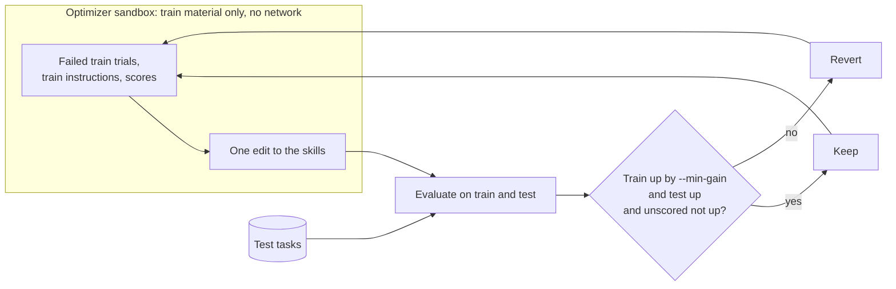

# Hill-climb a skill against a held-out test split

```bash
cd docs/examples/hillclimb
export CLAUDE_CODE_OAUTH_TOKEN=...   # from `claude setup-token`; or set ANTHROPIC_API_KEY
export DAYTONA_API_KEY=...           # or: export SANDBOX=docker
./run.sh smoke                       # 4 tasks; caps: $10, 20 rollouts, 6 sandbox-hours
```

An optimizer agent edits a skills folder, one change per round, to raise an agent's score on a set of tasks. A change is kept only if the score rises on the train tasks by at least `--min-gain`. It must also rise on held-out test tasks that the optimizer never sees.

The method follows Lance Martin's post [Automating eval design and hillclimbing with Claude](https://claude.dev/blog/automating-eval-design-and-hillclimbing/) (2026-09-28). The post trusts the optimizer to stay away from the test tasks. Here it can't reach them: it runs in a sandbox that holds only train material, with no network. Each run records every file it was given.

A full climb (`./run.sh climb`) costs about $40 to $200 and takes 2 to 4 hours. See [Run it](#run-it).

## Run it

The recipe climbs a small skill, [`office-skills/office-files`](https://github.com/benchflow-ai/benchflow/blob/main/docs/examples/hillclimb/office-skills/office-files/SKILL.md), on 20 SkillsBench tasks ([`tasks.txt`](./tasks.txt)). They are Word, Excel, PowerPoint and PDF tasks from the `office-white-collar` and `finance-economics` categories. For the run, this skill replaces each task's own skills. All 20 tasks have an oracle, and none uses an LLM judge.

```bash
cd docs/examples/hillclimb
export CLAUDE_CODE_OAUTH_TOKEN=...  # from `claude setup-token`; or set ANTHROPIC_API_KEY
export DAYTONA_API_KEY=...          # or: export SANDBOX=docker
export BENCHFLOW_DAYTONA_OWNER=hillclimb-demo   # labels the sandboxes, for `bench sandbox list` and `cleanup`
./run.sh smoke    # 4 tasks, 2 trials, one forced round; caps: $10, 20 model rollouts, 6 sandbox-hours
./run.sh climb    # 20 tasks (12 train, 8 test), 5 trials, --min-gain 0.15, 5 rounds; caps: $250, 610 rollouts, 150 sandbox-hours
```

`run.sh` downloads SkillsBench to `$WORK/skillsbench` (default `~/hillclimb-demo`). It writes each run to `$WORK/runs/<stage>-<timestamp>/`.

Set these environment variables to change it:

| Variable | Default |
|---|---|
| `TRIALS` | 5 |
| `MIN_GAIN` | 0.15 |
| `TEST_FRAC` | 0.4 |
| `SEED` | 7 |
| `ROUNDS` | 5 |
| `MAX_COST_USD` | 250 |
| `MAX_ROLLOUTS` | 610 |
| `MAX_SANDBOX_HOURS` | 150 |
| `CONCURRENCY` | 40 |
| `SANDBOX` | `daytona` |
| `AGENT_MODEL` | `claude-haiku-4-5-20251001` |
| `PROPOSER_MODEL` | `claude-opus-5-5` |
| `OAUTH_POOL` | unset; see [A pool of subscriptions](#a-pool-of-subscriptions) |
| `WORK` | `~/hillclimb-demo` |
| `SKILLSBENCH_SHA` | `9a1f4dd5f7659f75707435da3ce854b6e48321d1` |

For every flag of the underlying script, run `uv run python docs/examples/hillclimb/hillclimb.py --help` from a BenchFlow checkout.

<details><summary>The default split (SEED=7, TEST_FRAC=0.4)</summary>

- train (12): `citation-check`, `court-form-filling`, `econ-detrending-correlation`, `exceltable-in-ppt`, `financial-modeling-qa`, `organize-messy-files`, `paper-anonymizer`, `pdf-excel-diff`, `pptx-reference-formatting`, `reserves-at-risk-calc`, `sales-pivot-analysis`, `shock-analysis-demand`;
- test (8): `edit-pdf`, `invoice-fraud-detection`, `offer-letter-generator`, `powerlifting-coef-calc`, `sec-financial-report`, `shock-analysis-supply`, `weighted-gdp-calc`, `xlsx-recover-data`;
- smoke: train `court-form-filling`, `reserves-at-risk-calc`; test `offer-letter-generator`, `weighted-gdp-calc`.

</details>

### What it needs

- **Claude credentials** for both agents: a subscription token from `claude setup-token` (`CLAUDE_CODE_OAUTH_TOKEN`) or `ANTHROPIC_API_KEY`. If both are set, the API key wins.
- **Sandboxes:** Daytona with `CONCURRENCY` 40 or more, or a large Docker host.
- **SkillsBench at commit `9a1f4dd5`** (run.sh's default). Tag `v1.1` uses the old `environment:` key and does not load.
- **Models:** `claude-haiku-4-5-20251001` for the agent under test and `claude-opus-5-5` for the optimizer. After the smoke run, open `hillclimb.json` and check two things:
  - `cost.source` is not `unknown`;
  - `cost.context_1m` is `false`. If it is `true`, the account put Opus on its 1M-context model. Rerun with `--proposer-model-env`, which sets the model through `ANTHROPIC_MODEL`.

### Cost and time

These are estimates, not measured on these tasks:

| Run | Rollouts | USD | Wall time | Sandbox-hours | Caps |
|---|---|---|---|---|---|
| `smoke` | ≤ 20 | a few dollars | — | ≤ 6 | $10, 20 rollouts, 6 h |
| `climb` | ≤ 600, plus up to 6 optimizer runs | $40–200 | 2–4 h at 40 sandboxes | 50–120 | $250, 610 rollouts, 150 h |

Under a subscription the USD figures are list-price equivalents. The caps stop the climb before a round it can't afford.

It stops early when something is wrong:

| Exit | Message | Cause |
|---|---|---|
| 2 | "Refusing to climb" | The noise is above `--min-gain`. Only the baseline was spent, and the message says what to raise. |
| 1 | | Too many trials had no score, or the next step would pass a cap. |

## How it works



The test tasks never enter the optimizer's sandbox. Only aggregate test scores reach it.

The whole loop is `climb()` in [`hillclimb.py`](./hillclimb.py). `one_round()` runs one round, and `decide()` holds the keep-or-revert rule.

1. **Split** the tasks into train and test at random (`--test-frac`, `--seed`), or read the split from `--split-file`.
2. **Check the graders.** Each task runs once with its reference solution (`oracle`) and once with an agent that does nothing (`nop`). The demo drops any task whose oracle fails or whose `nop` run passes: its grader is broken.
3. **Measure the baseline and the noise.** The starting skills run `--trials` times per task on both splits. If `--min-gain` is within the noise, the climb stops. It says which `--trials`, task count or `--min-gain` would fix it. `--force` climbs anyway and marks the run ungated.
4. **Propose.** The optimizer (Claude Code by default) reads the failed train trials, the train instructions, the scores and its earlier proposals. It makes one edit, aimed at one root cause.
5. **Keep or revert.** The edited skills run on both splits. The edit is kept only if train rises by at least `--min-gain` and test rises too. It is reverted if test is flat or lower (train up with test flat means overfitting). It is also reverted if anything regresses, or if the trials without a score rise by more than 2 or 10% of those attempted, whichever is larger.
6. **Stall.** After `--stall-rounds` rounds (default 3) with nothing kept, the optimizer sorts each remaining train failure into `ambiguous_task`, `grader_bug`, `infrastructure` or `capability_gap`.
7. **Report.** The best version is compared with the baseline on the test split, with a 95% interval. The verdict calls the gain real only when the whole interval is above zero. Otherwise it recommends keeping the original skills.

### The BenchFlow APIs it uses

| API | For |
|---|---|
| `bf.Evaluation` with `bf.EvaluationConfig(skills_dir=..., skill_mode="with-skill", include_tasks=..., config_override=..., agent_env=...)` | Each split's evaluation, one job per trial, with the skills deployed. `agent="oracle"` and `agent="nop"` run the grader checks. `config_override` adds the setup that keeps Claude Code's session log ([Cost under a subscription](#cost-under-a-subscription)). `agent_env` passes a pool account's token ([pool](#a-pool-of-subscriptions)). |
| `bf.Budget(max_cost_usd=..., max_sandbox_seconds=...)`, `bf.RetryConfig` | Every job's share of the caps; retries of infrastructure errors |
| `bf.load_job`, `Job.agents()`, `Job.solve_rates()`, `Trial.assessment`, `Trial.cost_usd`, `Trial.timing` | Reading trials back; pass@1; leaving unscored trials out; cost and sandbox time |
| `bf.run(bf.RolloutConfig(uploads=..., pre_agent_hooks=...))` | The optimizer, as a rollout of a task folder the demo writes (its `artifacts:` keep Claude Code's session log) |
| `bf.Task` | Task instructions, for the optimizer (train only) and for the leak check (test) |

[`tests/test_hillclimb_example.py`](https://github.com/benchflow-ai/benchflow/blob/main/tests/test_hillclimb_example.py) fails if the demo uses any other BenchFlow name.

### Safeguards

| Safeguard from the post | How the demo enforces it |
|---|---|
| The optimizer never sees the test set | Its sandbox gets two folders, both built from train records only: `/hillclimb` (read-only) and `/app/surface`. Test results appear only as aggregate scores. The sandbox has no network (`allow_internet: false`). Before each run, every uploaded file is searched for each test task's name and instruction text. The result and a sha256 manifest go into the report under "What the optimizer saw". |
| Never paste failures into the prompt | The brief forbids it. The demo rejects, unevaluated, any patch that copies 12 or more words in a row from a train instruction or grader output. |
| Validate graders before trusting them | The oracle and do-nothing checks run first (step 2). |
| Check the plumbing | Trials without a reward are left out of every score and counted by cause: agent, provider, verifier or sandbox failure, or never ran. The climb stops if more than `--max-infra-error-rate` (default 0.25) of an evaluation's trials have no score. A patch that raises the unscored count is reverted, so it can't win by crashing hard tasks. |
| Watch variance | Every task runs `--trials` times, and every score and delta has a bootstrap interval. The noise gate refuses a `--min-gain` that noise alone could produce. |

### Statistics

[`hillclimb_stats.py`](./hillclimb_stats.py) computes everything below.

- **Score:** pass@1, the mean over tasks of each task's solve rate over its scored trials (`Job.solve_rates(ks=[1]).get_scored_only(1)`).
- **Interval:** a two-stage bootstrap. It draws tasks, then each drawn task's trials.
- **Delta between versions:** a paired bootstrap. It draws tasks once for both sides, so differences between tasks cancel.
- **Noise gate:** `--min-gain` must be at least 1.96 x the standard error of the rerun noise on both splits. A patch with no effect then clears it on train by chance less than 2.5% of the time.
- **Lowering the noise:** noise falls with the square root of trials x tasks. To halve it, run 4x the trials or 4x the tasks. The gate needs `--trials 2` or more.

## Cost under a subscription

With a subscription, Claude Code calls Anthropic itself. BenchFlow sees the tokens but not the dollars, so a `bf.Budget`'s `max_cost_usd` can't count them. The demo prices each trial from Claude Code's own session log instead ([`hillclimb_cost.py`](./hillclimb_cost.py)). It copies the log into every trial folder at `artifacts/claude-sessions/`.

- **Credentials** in the collected logs are replaced before they are written.
- **Pricing:** in order of preference:
  1. Claude Code's own `totalCostUSD`, when it covers the whole log (`claude-code-cost-state`).
  2. The log's token usage at list price (`claude-code-usage-at-list-price`). For `claude-opus-5-5` this is within 0.3% of Claude Code's own figure.
  3. BenchFlow's own `cost_usd` (`benchflow`, API key only).
  4. Otherwise `unknown`.
- **Where it shows:** `hillclimb.json` has `cost.source` and `cost.sources` (rollouts per source) for the run. Every split of every evaluation has `cost_source` and `cost_sources`, and every optimizer run has `cost_source`. The report shows them under the tiles.

Three caps stop the climb before a step it can't afford. Every job gets its share of the first two as a `bf.Budget`.

| Cap | Counts | Works under a subscription? |
|---|---|---|
| `--max-cost-usd` | USD from the sources above; a job's `bf.Budget` counts only BenchFlow's own USD | between steps only |
| `--max-sandbox-seconds` | sandbox wall-clock of every trial and optimizer run, grader checks included | yes, inside every job too |
| `--max-rollouts` | rollouts that call a model: evaluation trials and optimizer runs | yes, between steps (`bf.Budget` has no rollout count) |

## A pool of subscriptions

`OAUTH_POOL=<file>` (`--oauth-pool`) spreads a climb over several Claude subscriptions. The file holds `CC_OAUTH_<NAME>=<token>` lines. Tokens never appear on a command line or in any record.

- **Leasing:** before each job, [`hillclimb_pool.py`](./hillclimb_pool.py) checks each account's 5-hour and 7-day usage. It leases the free account with the most 5-hour headroom.
- **Skipped accounts:** an account is skipped if its probe is refused, or if less than 15% of its 7-day window is left. It is also skipped if more than 70% of its 5-hour window is used, or if the job would push it past 80%. A job waits for a free account, up to 45 minutes for a reset.
- **Usage limits:** a trial that hits a usage limit marks its account spent until the reset. It reruns on another account, up to twice (`trial-NN/retry-N/`).
- **Records:** `hillclimb.json` names the account of every job and has per-account usage, which the report shows.

## Outputs

```
<out>/
  hillclimb.json      the record; hillclimb.schema.json in this folder is its schema
  report.html         the static report (no network requests)
  surfaces/vNNN/      every skills version, kept or not
  controls/oracle|nop/job/                 the grader checks, as BenchFlow jobs
  evals/<id>/<split>/trial-NN/job/         every evaluation (id: baseline, r01, r02, ...)
  proposer/<id>/      each optimizer run: workspace/ (exactly what was uploaded),
                      mounted.json (every uploaded file, sha256), task/, job/ (the rollout)
```

Open any job folder with `bench view <folder>`. `bench eval metrics evals/<id>/test` pools a split's trials, pass@k included.

`hillclimb.json` and `report.html` are rewritten after every phase, so you can watch a running climb. The report shows:

- the verdict;
- train and test scores by round, with 95% bands (filled candidates were kept, hollow ones reverted);
- each decision and its delta;
- what the optimizer saw;
- the stall analysis and every diff.

## Files

| File | What |
|---|---|
| `hillclimb.py` | The loop (`climb`, `decide`), the evaluations, the optimizer's rounds, `hillclimb.json`, the command line |
| `hillclimb_proposer.py` | The optimizer's sandbox: the train-only workspace, the mount check and manifest, the task it runs |
| `hillclimb_stats.py` | Bootstrap intervals, paired deltas, rerun noise, the noise gate |
| `hillclimb_cost.py` | What each rollout cost, from Claude Code's session log |
| `hillclimb_pool.py` | A pool of Claude subscriptions: which account runs each job |
| `hillclimb_report.py` | The HTML report |
| `hillclimb.schema.json` | The schema of `hillclimb.json` |
| `run.sh`, `tasks.txt`, `office-skills/` | The SkillsBench recipe |

## Limits

- The no-network optimizer has reached the model on Daytona but has not yet finished a real proposal. The Docker test runs it with the network open.
- No resume: each `--out` is a new run.
- Caps are checked before each step. As with `bench run --max-cost-usd`, USD counts trials as they finish. A round can overshoot the USD cap by what its running trials spend.
- LLM-judged graders are not checked for consistency.
- The optimizer sees train grader output, so a train task's expected values can leak into a patch. The pasted-text check catches long copies; the test split catches what does not transfer.
- Test scores pick which patches are kept, so after many rounds the best test score is slightly optimistic. Check the final version on a fresh held-out set.
- A trial whose agent crashed keeps no session log, so its cost is `unknown`.

## Next steps

- [Cookbook](../../tasks/multi-turn.md): other recipes, including [GRPO training](../../train/environment.md).
- [Skill evals](../../evaluate/skills.md): measure a skill once, without climbing.
