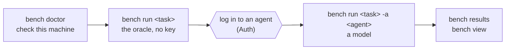

# Quick start

Run your first task with no model and no key, then run a model on it, then read the results. Allow several minutes for the first run: one cold-cache check took 6 minutes 12 seconds, including image building and package downloads in the verifier.



## Install BenchFlow

```bash
uv tool install --python 3.12 benchflow
bench --version
```

You need [uv](https://docs.astral.sh/uv/getting-started/installation/) and [Docker](https://docs.docker.com/get-started/get-docker/) running. [Install](./install.md) covers pinned versions, cloud sandbox extras, upgrades and Intel Macs.

On Linux, also install Docker's buildx plugin (`docker-buildx-plugin`). Without it, Compose falls back to the legacy builder, which can't build Dockerfiles that use BuildKit features.

## Check this machine

```bash
bench doctor
```

`bench doctor` prints one PASS, WARN or FAIL line per check, each with a fix. It checks Python and uv, Docker, agent credentials and network access. Credentials are shown by name and expiry, never by value. It exits 1 if a required check fails.

Before you log in, the `agent credentials` check is a WARN that no model agent can run; doctor still exits 0. That is expected. Doctor then ends with `Next:` and the oracle run below: the oracle and nop controls run without a login.

| Flag | Does |
|---|---|
| `--sandbox daytona` | checks the Daytona path too |
| `--json` | prints JSON, for scripts |
| `--offline` | skips the network probes |

Before each job, `bench run` repeats the Docker check (or, for Daytona, the `DAYTONA_API_KEY` check) and stops with the same fix. `BENCHFLOW_SKIP_PREFLIGHT=1` skips it.

## Run a task with the oracle

```bash
bench run --source-repo benchflow-ai/skillsbench --source-path tasks/citation-check \
  --agent oracle --sandbox docker --jobs-dir jobs/oracle
```

The oracle runs the task's own reference solution (`oracle/solve.sh`) instead of a model. It tests the sandbox, the task and its verifier with no key.

BenchFlow downloads only that task from SkillsBench, builds its image, runs the solution and the verifier, and prints the score. A cold-cache first run took 6 minutes 12 seconds, including image building and the verifier's package downloads; allow longer on a slow connection. During the build, a terminal shows it as `building image…`, and a log as `Building the task image …` lines with the time so far. Later runs reuse the cached layers.

```text
✓ Score: 1/1 (100.0%), mean reward 1.00, errors=0
Artifacts: jobs/oracle/2026-09-30__06-50-12
Summary:   jobs/oracle/2026-09-30__06-50-12/summary.json
View:      bench view jobs/oracle/2026-09-30__06-50-12
```

`bench run benchflow-ai/skillsbench/tasks/citation-check` is the same run, shorter. Without `--agent`, `bench run` runs the oracle; the sandbox defaults to `docker` and the jobs folder to `jobs/`.

The task is cached in `.cache/datasets-v2/<org>/<repo>/` (0.7 used `.cache/datasets/`), at the root of the enclosing Git repository or in the current folder outside one, and reused on later runs.

## Run a model

Log in to an agent first. With a Claude subscription, `claude setup-token` prints a token that lasts a year:

```bash
claude setup-token
export CLAUDE_CODE_OAUTH_TOKEN='<token>'
bench run --source-repo benchflow-ai/skillsbench --source-path tasks/citation-check \
  --agent claude --model claude-haiku-4-5-20251001 --sandbox docker --jobs-dir jobs/claude
```

The agent may pass or fail. Either way, the run worked.

> **Billing:** an exported `ANTHROPIC_API_KEY` or `ANTHROPIC_AUTH_TOKEN` wins over the token and is billed. Unset both to use your subscription.

When the agent calls Anthropic's or OpenAI's API directly with `ANTHROPIC_API_KEY` or `OPENAI_API_KEY` (no base URL of your own), `bench run` lists that provider's models with the key once before it creates a job. A key the provider rejects (HTTP 401) stops the run there, naming the variable; a 401 that names missing scopes or permissions does not. A model missing from the list gets a note with the closest name. Any other answer (a 403, a 429, a server error, no network) checks nothing and says nothing. Listing models costs no tokens, and the quota is not checked. `BENCHFLOW_KEY_CHECK=0` skips this request.

`--agent claude` is short for `claude-agent-acp`, Claude Code over ACP. `bench agents` lists every agent. [Auth](../agents/auth.md) covers ChatGPT logins, API keys and the other agents.

To check every login at once, run `bench eval smoke`. It runs a bundled hello-world task once per logged-in agent and prints each agent's reward and time.

## Read the results

```bash
bench results jobs/              # one row per jobs folder, with its score
bench eval metrics jobs/claude   # passed, failed, errored, solve rate, pass@k, tool calls, time
bench view jobs/claude           # every run in jobs/claude, in your browser
```

If you skipped the model run, substitute `jobs/oracle` for `jobs/claude`. These are jobs directories. The timestamped `Artifacts:` path printed by `bench run` names one exact job; pass it to `bench results <job>` for its trials or `bench eval resume <job>` to finish it. Passing the parent directory to `bench eval resume` is refused and tells you to list its jobs first.

`bench view` serves a local page at the printed `http://localhost:8888` URL. It shows the trajectory, the verifier output and the score. `--port` picks another port. On a remote machine, forward the port first, for example `ssh -N -L 8888:localhost:8888 <host>`, then open the URL on your own machine; the viewer prints this recipe when it runs over ssh. The local port may differ (`ssh -N -L 9000:localhost:8888 <host>`, then `http://localhost:9000/`, if Jupyter has 8888). Open it as `localhost`: other host names, `127.0.0.1` included, are refused. [Analysing runs](../results/analysing-runs.md#where-results-land) shows where each file lands and what the exit codes mean.

## Run again, or start over

Run the same command again to resume its job: finished tasks are kept, not rerun, unless the task's files changed since its trial ran. A rerun that changes what a trial measures, such as another model or timeout, starts a new job and says which setting changed. So does a rerun that selects other tasks (`-i`): a run scores only the tasks it selected.

Add `--fresh` to start a new job, or use another `--jobs-dir`. [Resume a job](../jobs/resume.md) has the details.

## Run a whole benchmark

Name the folder of tasks. Pick tasks with `-i` (`--include`), or leave it out to run them all:

```bash
bench run benchflow-ai/skillsbench/tasks -i citation-check -i 3d-scan-calc -j 2 --jobs-dir jobs/two-tasks
```

`-j` (`--concurrency`) sets how many trials run at a time. Add `-a` and `-m` to run a model instead of the oracle.

| Target | Runs |
|---|---|
| `tasks/my-task` | one local task |
| `tasks/` | every task in a local folder |
| `org/repo/path` | a folder in a GitHub repository; add `@<ref>` for a branch, tag or commit |
| `--config run.yaml` | a run config |

For a task's own skills, add `--task-skills`. Git 2.26 or newer downloads only the folder you name; older Git downloads the whole repository.

## Write your own task

```bash
bench new my-task                  # writes tasks/my-task/ with [REPLACE: ...] placeholders
bench check tasks/my-task          # lists every placeholder left to fill
bench run tasks/my-task            # the oracle: should score 1
bench run tasks/my-task -a nop     # an agent that does nothing: should score 0
```

The nop run ends with `nop control: 0/1, as expected: doing nothing passes none of the tasks`. If it passes a task instead, it says so in yellow: that task can be passed without solving it, so check its verifier.

A task is a folder: `task.md` (the instruction, with YAML settings on top), `environment/Dockerfile`, `verifier/test.sh` and `oracle/solve.sh`. [Task authoring](../tasks/overview.md) walks through each file.

## Run from Python

Add `benchflow` to your program's environment (`uv add benchflow`), then:

```python
import benchflow as bf

task = bf.resolve_source("benchflow-ai/skillsbench", path="tasks/citation-check")
result = bf.run_sync(bf.RolloutConfig(task_path=task, agent="oracle", environment="docker"))
print(result.reward, result.passed)   # 1.0 True
print(result.rollout_dir)             # result.json, trajectory/, verifier/
```

`bf.run_sync` blocks until the trial ends, even inside Jupyter's event loop. In async code, use `await bf.arun(config)`. For a model, set `agent="claude-agent-acp", model="claude-haiku-4-5-20251001"`.

[`docs/examples/python-sdk/`](../examples/python-sdk/) has runnable scripts for single runs and batches.

## Next steps

- Learn the words: [Core concepts](../core-concepts.md).
- Write a task: [Task authoring](../tasks/overview.md).
- Run several agents in one task: [Scenes and simulated users](../tasks/scenes.md).
- When a run fails: [When a run fails](../jobs/when-a-run-fails.md).
- Every flag: [CLI reference](../reference/cli.md).
