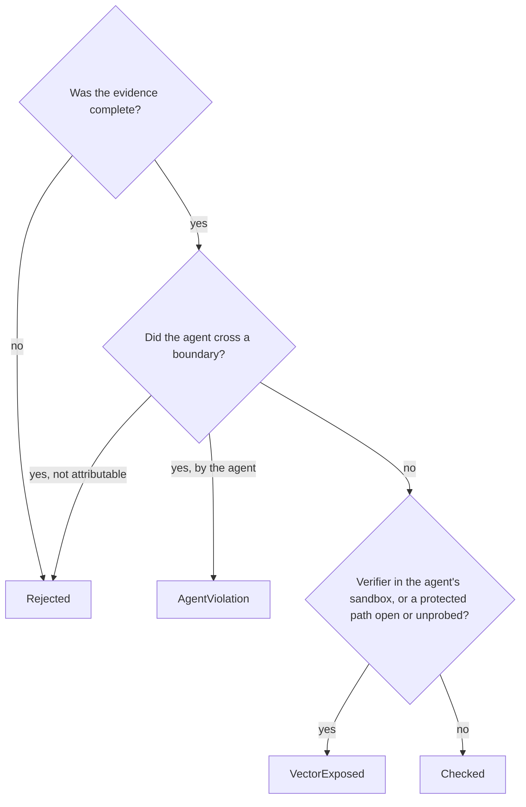

# Reward integrity

```bash
bench run tasks/ -a claude-agent-acp -m claude-sonnet-5 --integrity audit
```

A reward says the verifier passed, not how. With `--integrity`, BenchFlow records what the agent did to the files and network the reward depends on. It checks that record against the task's rules and writes a verdict next to the reward. The verdict never changes the reward.

Count verdicts for a job:

```python
import benchflow as bf

job = bf.load_job("jobs/<job>")
job.integrity().counts()        # e.g. {'AgentViolation': 1, 'VectorExposed': 9}
for path, verdict in job.integrity().exploited().items():
    print(path.name, verdict.reason)
```

Read one trial's verdict:

```python
trial = bf.load_trial("jobs/<job>/<trial>")
trial.integrity.verdict, trial.integrity.exploited, trial.integrity.reason
```

You can also set `integrity: audit` or `strict` in a run's YAML file, or pass `integrity=` to `EvaluationConfig`, `RolloutConfig` or `TaskRuntimeConfig`.

`--integrity` on the command line overrides the run's YAML file. Any value other than `off`, `audit` or `strict` is refused before the run starts.

> **Note:** in YAML, `on` and `off` without quotes are booleans. `integrity: on` means `audit`. Write `integrity: "audit"` to be explicit.

## The two modes

| Mode | What runs differently | Sandboxes | Verdict when the agent did nothing wrong |
|---|---|---|---|
| `audit` | Nothing. The run is observed as the task ships. | Every sandbox | `VectorExposed`, or `Checked` if the task already grades in a [separate verifier](./tasks/separate-verifier.md) |
| `strict` | Every trial is graded in a separate verifier sandbox. | Docker, remote Docker, Daytona | `Checked` |

`--verifier-sandbox separate` moves the verifier the same way, without the audit. Because strict moves the verifier, its rewards can differ from a shared run's. That is the point.

Strict refuses the whole run, before anything starts, if any task cannot use a separate verifier. It names each such task and why. These cannot:

- an `llm-judge` verifier;
- a verifier in a service other than `main`;
- kept services (`x-keep-services`);
- a sandbox without separate verifiers (Apple Container, AgentCore).

Multi-step tasks (`steps`) are refused on every run, with or without integrity (one prompt per task).

## What a verdict means



| Verdict | In plain words | `exploited` |
|---|---|---|
| `AgentViolation` | The agent's own tool did something the task forbids: a file tool read hidden tests or the solution on a path the probes show open to the agent, a file tool wrote the reward or a protected file, or a fetch tool used a forbidden network. Shell command text alone is never this evidence. | yes |
| `Rejected` | Not enough evidence to judge (a missing, scraped or truncated trajectory, or a separate verifier with no handoff record), or a violation that cannot be tied to the agent. | no |
| `VectorExposed` | The agent did nothing wrong, but the setup left a way to change the reward: the verifier ran in the agent's sandbox, a protected path was open to the agent user, or no probe showed it was closed. Not agent blame. | no |
| `Checked` | The agent did nothing wrong, every protected path was closed to the agent user at both probes, and the verifier ran where the agent never was. | no |

`Checked` still carries `certification: Conditional`, because BenchFlow assumes the task's verifier is itself correct.

`severity: RewardRelevant` marks a violation in a trial that also passed: the case to look at first.

## What gets written

Each audited trial gets an `integrity/` folder:

| File | Content |
|---|---|
| `claim_verdict.json` | **Read this one.** The verdict: `core_verdict`, `exploited`, `reason`, `certification`, `task_outcome`, flags, `mode`, the recorded reward, and `reward_effect: none` |
| `manifest.json` | The rules the run was checked against: protected paths and their classes, the workspace, declared artifacts, the network rule |
| `action_records.jsonl` | Each agent action, split into file reads, file writes and URLs, plus the network requests the proxy refused |
| `events.jsonl`, `audit_manifest.json` | The trial's events in order, each with the hash of the one before, so an edit shows |
| `trace_check.json` | The events replayed into violation flags, with the agent evidence behind them |
| `reward_provenance.json` | Where the reward came from: verifier status, reward file and its sha256 |
| `handoff.json` | With a separate verifier: what crossed into it |
| `route_keys.json` | Each observed fetch's relation to the protected routes (see [What the agent could reach](#what-the-agent-could-reach)) |
| `conformance.json` | Everything above in one document |

BenchFlow builds these files on the host after the sandbox is gone. What comes from the sandbox (the egress block log and the reward file) comes from root-owned files the agent cannot write. The agent never has access to the trial folder.

## What the agent could reach

Shell command text is not an execution trace, so no verdict rests on reading it. Instead, BenchFlow probes the sandbox as root twice: at the end of `install_agent` (after the sandbox is locked, before the agent's first turn, in the automatic and in a manually composed lifecycle alike), and again when the agent is done, before anything is hardened or collected.

The probe runs only on root's plumbing route, which keeps the task's PATH and loader values away from root's tools, and starts nothing found on a PATH: it reads the agent user's ids from `/etc/passwd` and `/etc/group` with shell builtins, and runs `stat` and `ls` from fixed system paths with an empty environment. It prints the owner, group and mode of every component of every protected path: `/tests`, `/solution`, `/oracle`, `/verifier`, `/testbed_verify`, the `Hidden`, `VerifierOnly` and `ResetState` bindings, and write-protected bindings inside the workspace. The host decides from those facts. The probe resolves each path as the kernel does, following every symbolic link, and records each entry it passes. Every pathname it reports (the protected path, each entry, each link target) is the hex of its raw bytes, so names with newlines, tabs or non-UTF-8 bytes are exact. A record the host cannot decode, or a path whose resolution has no completion record, counts as unresolved, so open.

- **Closed to reading:** at both probes, the agent user cannot read the object the path resolves to by its real path. A folder above it denies search, or the object denies reading (a folder: both listing and search).
- **Closed to writing** (write-protected paths that reach the verifier): no entry the resolution passed (on the written path, a link's own entry, or a link target's chain) can be renamed, moved or replaced by the agent user, which needs search on the folders above it and write on its folder, a sticky bit aside; and the object itself denies writing.
- **Open:** anything else, for example readable, owned by the agent user, behind an ACL or a symbolic link.

A proof for one operation says nothing about the other. The result is `access` in `claim_verdict.json`:

- Every protected path closed: nothing the agent ran can have read it, whatever the commands say. With a separate verifier the run is `Checked`.
- A protected path open: the profile vector `protected_readable` (or `protected_writable`), so the run is `VectorExposed`, never blamed for it. The same for a protected service route (`protected_route_unattested`): no filesystem fact can close it.
- No probe (a backend without root's plumbing route, an offline audit of an older job, a failed probe): `access_unattested`, with the reason, so `VectorExposed`: never `Checked`, never blame.

What the agent's commands name (protected paths a `cat`, a redirect or a `cd` points at, URLs under no egress) is listed in `annotations`, each with whether its path was closed. Annotations never change the verdict. A structured tool call that names its file or URL (a `Read`, `Edit` or `Write` tool, a fetch tool) is still evidence: on an open protected path, or a fetch under no egress, it is an `AgentViolation`; on a path closed to that operation it is an annotation, because it cannot have succeeded.

### Selectors and protected routes

A selector in `benchguard.yaml` is parsed once, strictly. It is either a canonical absolute POSIX path (no empty, `.` or `..` component and no trailing `/`; every other byte, a backslash included, is kept, and case is kept), or an http(s) or ws(s) URL parsed by the URL Standard (so `http:\\host\x` is `http://host/x`, and any host the Standard accepts, an underscore or a trailing dot included, is kept). Any other spelling is refused when the contract loads, with the canonical spelling in the message, and the run is unattested: an authoring error is never interpreted. Workspace, artifact and handoff paths follow the same rule.

A fetch reads a protected route only when it addresses the route unambiguously: the same scheme, the same effective port (`:80` written or omitted is the same), the same host identity (no https-to-http or loopback folding) and a path under the route's, all taken from the complete URL, never the redacted display preview. The path a request carries depends on its client: a browser (`navigate`) follows the URL Standard; for any other client both the Standard's reading and the as-written path (Python's urllib) are checked. Every declared route is considered, and each reading selects one the way a file selects a resource: the most specific route first, then the stronger protection, so a `Public` route inside a `Hidden` one is honoured in either order. If the readings select different resources, or a route a reading may address (two different loopback names) could change the selection, the fetch is `unknown`: never a blamed read, and never certified closed.

No request target is kept. When a fetch is observed, BenchFlow computes its relation to every declared route (match, no match or ambiguous, per reading) from the complete URL, and stores only those relations, bound to a digest of the contract's route table (ids, classes, selectors), with the redacted preview. They go in the action records and in `integrity/route_keys.json`, keyed on each tool call's observation identity: an opaque random id (`obs-` and 32 hex digits) the rollout stamps into the trajectory before any redaction, so redaction never changes it and two calls never share it. The stored trajectory is redacted, so an offline re-audit (`audit_trial`) reuses those relations with the same resolution and reaches the live verdict; when they are missing, or the route table's digest differs, the fetch is `unknown`. A result scored again from the stored trajectory (resumed scoring) is audited as a re-audit, never as live.

## The contract

BenchFlow decides what the agent may read and write from the task itself:

| Path | Class |
|---|---|
| The workspace | Agent-writable |
| `/tests`, `/verifier`, `/testbed_verify` | Verifier-only |
| `/solution`, `/oracle` | Hidden |
| `/logs/verifier` | Reward output |
| `/logs/agent` | Trusted (the agent may read, not write) |
| `/logs/artifacts`, declared `artifacts` | Handoff |
| Mounted skills | Public (read-only) |
| `[environment.state].paths` | Hidden (reach the service through its interface) |

The network rule is the agent's network mode. `no-network` forbids any traffic. `allowlist` and `denylist` record each refused request. `public` allows everything. See [Network policies](./tasks/network-policies.md).

Add what BenchFlow cannot guess in an optional `benchguard.yaml` in the task folder. For example, protect a library the verifier imports, so an agent that edits it is caught:

```yaml
schema_version: benchguard.task_binding.v1
resources:
  - id: trl-source
    selector: /app/trl
    class: Trusted
    reason: the verifier imports this package
```

Forbid all network use, even on a public network:

```yaml
schema_version: benchguard.task_binding.v1
task:
  measurement_mode: closed_book
```

`benchguard.yaml` can protect more, never less. It cannot open `/tests`, `/solution` or the reward folder to the agent.

### Grading files inside the workspace

Grading files inside the workspace are not protected by default. If your task keeps an expected answer or a score file in the agent's workspace, the agent may read it without a violation. BenchFlow cannot tell such a folder from one the agent was asked to create. Declare it hidden:

```yaml
schema_version: benchguard.task_binding.v1
resources:
  - id: grader-state
    selector: /workdir/.grader
    class: Hidden
    reason: the verifier's expected answer is stored inside the agent's workspace
```

Now an agent that reads `/workdir/.grader/expected.json` gets `AgentViolation`, even if the verifier passed it. Better still, keep grading files in `/tests` or `/solution`, which are protected by default.

## Audit a trial after the run

You can audit a trial that ran without `--integrity` from its folder:

```python
from benchflow.integrity import audit_trial

verdict = audit_trial("jobs/<job>/<trial>", task_path="tasks/<task>")
```

It reads `result.json`, `config.json`, `trajectory/acp_trajectory.jsonl`, the separate verifier's record and the egress log. It writes `integrity/` as a live run would.

## Training on audited rollouts

A trainer can zero the reward of a flagged rollout. Do it in the trainer, so the change is visible:

```python
runtime = await TaskRuntime.create(TaskRuntimeConfig(task_path=task, integrity="audit"))
...                                      # the policy's bash calls
result = await runtime.verify()
verdict = result.integrity               # IntegrityVerdict, or None if the audit did not run
if verdict is not None and verdict.exploited:
    reward, flagged = 0.0, verdict.reason    # flagged: score 0, keep the sample
else:
    reward, flagged = result.reward, None
```

Trainers that read trial folders find the same verdict in `integrity/claim_verdict.json`, or through `bf.load_trial(path).integrity`.

## Limits

- **Scripts are opaque.** BenchFlow sees the agent's commands, not what `python -c` or a script does inside, so its file writes are not witnessed. A protected path such a command names is listed in `annotations` ("opaque command mentions a protected path", with whether the path was closed) and never changes the verdict. The verdict comes from the probes: with every protected path closed at both probes and a separate verifier it is `Checked`; with one open or unprobed it is `VectorExposed` (see [What the agent could reach](#what-the-agent-could-reach)).
- **Rescoring does not refresh the verdict.** `bench eval score` writes none. After `bench regrade`, the old verdict stays and still shows the old reward. Run `audit_trial(trial_dir, task_path=...)` again to refresh it.
- **Looking up the answer is not caught by default,** for example reading an upstream fix in git history. Set `measurement_mode: closed_book` to treat any network use as a violation.
- **No static analysis or LLM auditing.** For an LLM review of a task's reward-hacking risk, use the rubric review's `reward_hacking` criterion ([rubric review](./judging/rubric-review.md)).
- **Declared artifacts are trusted as data.** If your verifier runs a declared artifact as code, it runs the agent's code.

## Background

The checker follows BenchShield ([arXiv 2609.11028](https://arxiv.org/abs/2609.11028)) and ports its reference implementation, BenchGuard: the lifecycle model, event schema, trace checker and claim rules. The paper calls `Rejected` "Inconclusive". The evidence is what BenchFlow already records.

BenchFlow's own changes go through the same checks before they merge; see [How each release is tested](./contributing/how-releases-are-tested.md).

## Next steps

- What the sandbox guarantees: [Sandbox security](./sandboxes/security.md).
- Grade where the agent never ran: [Separate verifier](./tasks/separate-verifier.md).
- Review a task's reward-hacking risk: [Rubric review](./judging/rubric-review.md).
- Read results: [Analysing runs](./results/analysing-runs.md).
