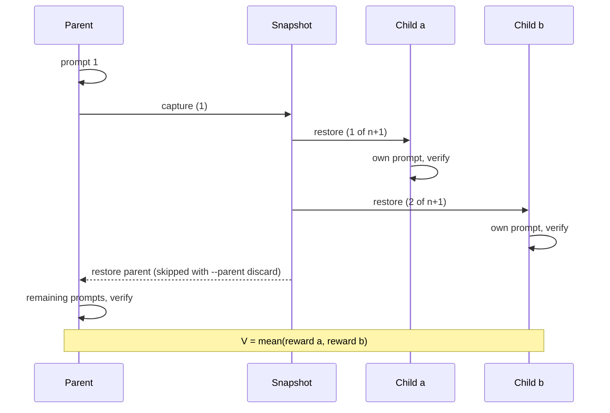

# Branching reference

This page lists every branching option and what it records. For which option to use when, start with [Branching](./branching.md).

```bash
bench branch --tasks-dir tests/examples/hello-world-task \
  --agent claude-agent-acp --model claude-sonnet-5 --sandbox daytona \
  --prompt "Create draft.txt containing exactly one line: Hello world. Do not create hello.txt." \
  --prompt @instruction --checkpoint-after-prompt 1 \
  --child "label=baseline" \
  --child "label=hint-reuse-draft,prompt=Rename draft.txt to hello.txt without changing it, then stop."
```

`bench branch` runs each task up to a checkpoint, forks it into labelled children, and scores each child with the task's verifier. It prints a `Branches: <job folder>` table with one row per child: task, child, the node it forked from, status, reward and reward source. Then it prints a cost table and one line per task:

```
hello-world-task: V = 0.5, fork completed, parent restored, parent reward 1
Next: bench view jobs/branch-20261019-101500
```

V is the mean of the children's rewards.

| Exit code | Meaning |
|---|---|
| 0 | every fork completed |
| 1 | a fork did not complete, or a task errored |
| 2 | the request is invalid (the message says why) |

Open the result with `bench view <job folder>`. The **Lineage** tab lists each fork and opens each child's trajectory. `bench eval branches <job folder> [--json]` prints every fork and child as a table, or as JSON.

## Three ways to branch

| Entry point | Use it to | Default layers |
|---|---|---|
| `bench branch` | branch one or more tasks from the command line | `sandbox` |
| `bf.branch(...)`, `await bf.abranch(...)` | do the same from Python; returns a `BranchResult` | `sandbox` |
| `Rollout.branch(n, run_child, ...)` | fork a rollout you drive yourself, with your own child runner | `environment` |

`bf.branch` takes the CLI's options as keywords. It returns V, each child's reward and source, and the parent's `RolloutResult`; see [Python API: Branching](../reference/python-api.md#branching).

## Options

### What the parent runs

| Option | Default | Meaning |
|---|---|---|
| `--prompt TEXT` | the task's prompts | a parent prompt; repeat it to send several in order. `@instruction` is the task's instruction. |
| `--checkpoint-after-prompt N` | 1; 0 for the oracle and with `--from-checkpoint` | branch after the first N prompts. `0` branches before the first prompt. |
| `--parent continue\|discard` | `continue`; `discard` with `--from-checkpoint` | `continue` restores the parent after the children, sends its remaining prompts and verifies it. `discard` skips that restore and leaves the parent unverified. |
| `--agent`, `--model`, `--sandbox` | `claude-agent-acp`, docker; the checkpoint's with `--from-checkpoint` | the agent and sandbox. With `--agent oracle`, every child runs the task's `solve.sh`. |

### The children

| Option | Default | Meaning |
|---|---|---|
| `--child label=NAME[,parent=LABEL][,prompt=TEXT\|,prompt-file=PATH]` | | adds a child; give at least two |
| `--concurrency K` | 1 | run up to K children at once, each in its own sandbox |
| `--isolate-children` | off | give each child its own sandbox, one at a time |
| `--resume-session` | off | children continue the parent's conversation instead of starting fresh |
| `--child-retries N` | 1 | retry a child that failed before its agent did anything, such as on a connect timeout |
| `--stop-on-child-failure` | off | stop a fork at the first child that fails for good. By default the other children still run and the fork is partial. |

`prompt=` takes the rest of the option, so the text may contain commas. A child without a prompt runs the parent's remaining prompts. If the checkpoint is after the last prompt, it runs the task's prompts instead.

Each child starts a fresh agent session, so its prompt must make sense on its own. `--resume-session` changes that ([Resume the parent's conversation](#resume-the-parents-conversation)).

### Snapshots

| Option | Default | Meaning |
|---|---|---|
| `--snapshot-layers` | `sandbox` | what the checkpoint captures: `sandbox`, `environment`, or `sandbox,environment` ([Layers](#layers)) |
| `--retain-snapshots` | off | keep the fork's snapshot after the run |
| `--checkpoints every-prompt\|prompt:N[,M]` | off | also keep snapshots of the parent after those prompts ([Automatic checkpoints](#automatic-checkpoints)) |
| `--checkpoint-keep K` | 3 | keep at most K automatic checkpoints per trial |
| `--from-checkpoint <trial folder>` | | branch again from a kept snapshot ([Branch again](#branch-again-from-a-kept-checkpoint)) |
| `--checkpoint ID\|prompt:N` (same as `--fork`) | the last kept fork, else the last kept checkpoint | which kept snapshot to use with `--from-checkpoint` |

`--tasks-dir`, `--include`, `--agent-env`, `--jobs-dir`, `--job-name`, `--reasoning-effort` and `--harness` work as on `bench run`. The [CLI reference](../reference/cli.md#bench-branch) lists them.

## The job folder

```
jobs/<job>/
  results.jsonl, summary.json      # total, passed and score count children
  <task>__<id>/
    result.json, results.jsonl     # the parent, plus a branches block
    tree.json                      # every fork, child and outcome
    checkpoints.json               # automatic checkpoints, with --checkpoints
    branches/<fork>/children/<node>/
      observation.json, mounted/, verifier/
```

## Parallel children

`--concurrency K` (Python: `branch(isolate_children=True, concurrency=K)`) gives each child its own sandbox, made from the snapshot. Without it, children run one at a time in the parent's sandbox, restored between them.

On Daytona the sandbox is created straight from the snapshot. On Docker the task sandbox starts and the snapshot is restored into it. Each child installs the agent again, because credential files are never in a snapshot. At most K children run at once, and one failing child does not stop the others.

Each child is a full trial folder at `branches/<fork>/children/<node>`. `bench eval metrics` and other result readers do not count it as an extra trial.

Only the sandbox layer can be isolated, because declared environment state lives inside the parent's sandbox. `tree.json` records `children_mode` and `timing_sec.children`.

## Nested forks

```bash
--child label=a --child label=b \
--child "label=a1,parent=a,prompt=Try again with tests first." \
--child "label=a2,parent=a,prompt=Try again without tests."
```

`parent=a` forks again from child `a`, after `a` runs its prompts and before it is verified. Give at least two children per parent. Nested children without a prompt run the task's prompts.

Nesting turns on isolated children. Each nested fork can run K children of its own, so sandbox counts multiply. In Python, call `child.rollout.branch(...)` from the runner of an isolated child. `tree.json` records the nested fork with its `parent_node`, and saves its children under the root trial's `branches/`.

## Resume the parent's conversation

`--resume-session` (Python: `branch(resume_session=True)`) makes each child continue the parent's conversation, so a child prompt can just say "continue".

It needs an agent that can reload a saved session from disk (ACP `session/load`). Claude Code keeps sessions under `~/.claude/projects`, which the snapshot captures. BenchFlow refuses other agents rather than quietly giving them a fresh session. The replayed history is not part of the child's trajectory. `tree.json` records `snapshot.agent_session: "resumed"` (`"fresh"` otherwise).

It needs a conversation before the fork, so it does not work with the oracle or `--checkpoint-after-prompt 0`. It is also refused with `--from-checkpoint`, which does not know the source session's id.

## Automatic checkpoints

```bash
bench run tasks/my-task --agent claude-agent-acp --checkpoints every-prompt
bench branch --tasks-dir tasks/my-task --from-checkpoint jobs/<job>/<trial> --checkpoint prompt:2 \
  --child label=a --child "label=b,prompt=..."
```

`--checkpoints every-prompt` or `prompt:N,M`, on `bench run` or `bench branch`, snapshots the sandbox after those prompts and keeps the snapshot. Any run can then be branched later. In Python, pass `RolloutConfig(checkpoints=parse_checkpoint_policy(...))`.

`--checkpoint-keep K` (default 3, or a run config's `checkpoint_keep`) keeps at most K per trial and deletes the oldest. On a `--config` run, each checkpoint flag given wins over the file and each one left out keeps the file's value. The trial's `checkpoints.json` lists each one:

| Field | Meaning |
|---|---|
| `id` | `prompt:N` |
| node id, provider, ref | where the snapshot is |
| seconds | how long the snapshot took |
| status | `kept`, `deleted`, `failed` or `unsupported` |

A checkpoint never fails the run: a sandbox that cannot snapshot is recorded and the run goes on. Snapshots are taken while the agent is idle between prompts, with credential files removed.

## Branch again from a kept checkpoint

A trial run with `--retain-snapshots` keeps its fork snapshot (`snapshot.retention: kept` in `tree.json`). A run with `--checkpoints` keeps its automatic checkpoints.

`--from-checkpoint <trial folder>` starts a new trial of the same task from that snapshot; `--tasks-dir` must contain the task. BenchFlow installs the agent again and branches there. You can then compare new children with old ones without rerunning the parent. The new trial writes `checkpoint_source.json` (source trial, fork id, provider, snapshot ref). It uses the source trial's agent and model unless you pass others.

Limits:

- Only sandbox snapshots can be reused, on the provider that made them: a Docker image on the same host, or a Daytona snapshot in the same account. A fork that also captured the environment layer is refused, because declared database state cannot be exported.
- Children start fresh sessions: `--resume-session` is refused.
- A deleted checkpoint is refused.
- The parent defaults to `--parent discard`, because there is no parent conversation to continue. `--parent continue` sends the task's prompts from the checkpoint.
- The new trial does not delete the kept snapshot.

## Cost

| What | Count |
|---|---|
| In-place children (default) | 1 capture, n + 1 restores (each child, then the parent); n with `--parent discard` |
| `--concurrency K` on Daytona | one more sandbox and agent install per child; n + 1 sandboxes at once when K ≥ n |
| `--checkpoints every-prompt` | one snapshot's time and storage per prompt |

The first restore after a capture is usually the slowest, because the new snapshot is still becoming available. Snapshot and restore times grow with the sandbox's filesystem size: seconds for a small sandbox, minutes for one holding several GB. Each fork records `timing_sec` in `tree.json`: `checkpoint`, one `child_restore` per child and `parent_restore` (null when skipped).

Kept Daytona snapshots count toward your account's snapshot storage. `bench sandbox cleanup` deletes this owner's Daytona branch snapshots and unused Docker `bf-snap-*` images older than `--max-age` minutes (default 1440). A Daytona run also reaps this owner's abandoned sandboxes (stopped by Daytona, run lease lapsed) when it starts (`BENCHFLOW_DAYTONA_AUTO_REAP=0` turns it off); branch snapshots carry no lease, so only `bench sandbox cleanup` removes them. Daytona snapshots are selected only when `BENCHFLOW_DAYTONA_OWNER` is set. Docker snapshots are never cleaned automatically.

## Fork timeline



The first child is restored from the snapshot too, although the live sandbox was just captured. Processes started before the checkpoint, such as a server the agent left running, keep running in the live sandbox but not in a restored one. Skipping that restore would let the first child see a different world from the others.

## Branch a real agent run from Python

Drive the rollout yourself, in this order:

`setup` → `start` → `install_agent` → `connect` → `execute` (first prompt) → `branch` → `connect` → `execute` → `verify` → `finalize`

`branch()` disconnects the agent before the checkpoint and leaves it disconnected, so the parent calls `connect()` again afterwards. `finalize()` cleans up and writes `result.json`; `cleanup()` alone writes no result.

```python
from benchflow.rollout import BranchChild, Rollout, RolloutConfig

task = "tests/examples/hello-world-task"
instruction = open(f"{task}/instruction.md").read()

rollout = Rollout(RolloutConfig(task_path=task, agent="claude-agent-acp",
                                model="claude-sonnet-5", environment="docker"))
prompts = {"baseline": instruction, "hint": "Rename draft.txt to hello.txt."}

async def run_child(node, *, child: BranchChild) -> float | None:
    rewards = None
    try:
        await rollout.connect()                      # a fresh agent session
        await rollout.execute([prompts[child.label]], node=node)
        rewards = await rollout.verify()             # the task's own verifier
    finally:
        await rollout.disconnect()
    return (rewards or {}).get("reward")             # None marks it unscored

try:
    await rollout.setup()
    await rollout.start()
    await rollout.install_agent()
    await rollout.connect()
    await rollout.execute(["Write draft.txt containing: Hello world"])
    value = await rollout.branch(2, run_child, snapshot_layers={"sandbox"},
                                 child_labels=list(prompts))
    await rollout.connect()                          # branch() left it disconnected
    await rollout.execute([instruction])
    await rollout.verify()
    result = await rollout.finalize()                # result.json and tree.json
except BaseException:
    await rollout.cleanup()
    raise
```

Each child starts a fresh session, so every child prompt above stands alone. From a clone of the repo, the complete script is [`examples/branch-agent-run.py`](../examples/branch-agent-run.py):

```bash
uv run python docs/examples/branch-agent-run.py --sandbox docker
```

`Rollout.branch()` has its own defaults: `snapshot_layers={"environment"}`, no child retries, and it stops at the first failed child. Pass `snapshot_layers={"sandbox"}` for a task without an environment manifest, as above.

### The child runner

- `run_child(node)` receives the child's pending tree node. Declare a keyword-only `child` parameter (or `**kwargs`) to also receive a `BranchChild` with `index`, `label` (from `child_labels`), `node` and `fork_id`.
- Pass `node=node` to `execute()`. Inside a child, `execute()` without `node` fills the pending child node the same way.
- Return the child's reward. If the runner called `verify()` and returns the same number, the child's `reward_source` is `verifier`; any other number is `runner_return`. Missing or invalid verifier reward files give score 0 with a warning. A runner that returns `None` without a verifier score leaves its child unscored; the runner is controller code.
- Omit `run_child` to use the default runner: a fresh session, the task's own prompts, and the verifier.

`child_requests=[...]` records, per child, what your runner does differently (at most 200 characters each). It lands in `tree.json` as `intervention.requested`, with `execution: "runner"`.

### Skip the parent restore

`branch(..., restore_parent=False)` (the CLI's `--parent discard`) is for callers that stop after the fork. BenchFlow skips the parent restore after the last child, so it restores n times instead of n + 1.

The sandbox then holds the last child's state, so the rollout is closed for further work. `tree.json` records `parent_restore: "skipped"`, and any later `setup`, `connect`, `execute`, `verify` or `branch` raises. `finalize()` and `cleanup()` still work. The parent's `result.json` covers the parent up to the fork, and has no reward unless it was verified before branching.

## Layers

| Layer | Captures | Needs |
|---|---|---|
| `sandbox` (CLI and `bf.branch` default) | the container filesystem | Docker, or Daytona in direct mode (Docker-in-Docker cannot snapshot) |
| `environment` (`Rollout.branch` default) | declared environment state, such as task databases | an [environment manifest](../environment-plane.md#roll-back-snapshot-and-restore) |

A task without a manifest must use `sandbox`; the error says so. Unknown layers fail before the agent disconnects. The older `require_sandbox_snapshot=True` only checks support and captures nothing; use `snapshot_layers`.

If a restore fails, the sandbox may be partly restored. BenchFlow reports the error and does not treat it as a rollback.

### What a checkpoint does not capture

Agent memory, mounted folders, sibling services, running processes, simulator state and real-robot state. Processes started before the checkpoint do not run in a restored child. Services that BenchFlow started restart after a restore, and must pass their readiness check again. Embodied tasks refuse to branch; see [Embodied tasks](../tasks/embodied.md#what-embodied-tasks-cannot-do).

BenchFlow deletes the fork's snapshot when the fork ends, unless you pass `--retain-snapshots`. `tree.json` records the result as `snapshot.retention`:

| `snapshot.retention` | Meaning |
|---|---|
| `deleted` | deleted when the fork ended |
| `deferred` | still in use by the restored parent; deleted when the sandbox stops. Always the case on Docker. |
| `delete_failed` | the delete failed |
| `kept` | kept by `--retain-snapshots` |

### Credentials are never in a snapshot

Before each snapshot, BenchFlow takes the agent's credential files out of the sandbox, captures, then puts them back. They go back into the live sandbox and into every sandbox restored from the snapshot. Examples are `~/.codex/auth.json` and `~/.claude/.credentials.json`, under `/root` and each `/home/<user>`; the full list is `CREDENTIAL_EVIDENCE_PATHS` in `benchflow/agents/credentials.py`.

The file contents never appear on a command line. A credential path that is a symlink is refused. A kept snapshot restored by another process has no credentials, so install the agent again there. Credential files that a task puts elsewhere are not covered.

### Failures BenchFlow cannot undo

If a child or a restore fails in a way BenchFlow cannot undo, the rollout refuses further work, and `tree.json` records `parent_restore: "deferred"` or `"failed"`. Dispose of the rollout and create a new one.

Branching also refuses a rollout that already runs a shared provider runtime, such as the LLM proxy, and nested forks of a shared instance.

## What `tree.json` records

One record per branch call: the fork id, snapshot layers, children, outcomes and how the parent was restored. V is the mean over that call's children only. Failed, cancelled and unscored children have `reward: null`.

| Field | Meaning |
|---|---|
| `intervention.requested` | what the child ran: `parent's remaining prompts (k)`, `the task's prompts (k)`, `oracle solve.sh`, or `own prompt (n characters, sha256:…)`. The prompt text is in the child's trajectory. |
| `intervention.execution` | `runner` for `child_requests`, `unspecified` for `child_labels` |
| `usage`, `timing_sec` | the child's tokens and phase seconds |
| `snapshot.agent_session` | `fresh` or `resumed` |
| `snapshot.retention` | `deleted`, `deferred`, `delete_failed` or `kept` |
| `children_mode` | whether children were isolated, and the concurrency |
| `parent_node` | the node the fork started from |
| `parent_restore` | `restored`, `skipped`, `deferred` or `failed` |

The trial's `result.json` adds a `branches` block. It holds each fork's status, V, child counts and nodes, plus `child_usage` and `child_timing_sec` for cost dashboards. The rollout's `results.jsonl` row has the same block as `info.branches`. Each child's `observation.json` has a `lineage` block: parent rollout, fork id, parent node, index and label.

`tree.json` holds ids and fork metadata, not step payloads, configs or error messages. It is a record, not a checkpoint: you cannot import or replay from it. A last record still marked `running` is incomplete.

## Next steps

- [Branching](./branching.md): which option to use when, retries from a checkpoint, and training on branch runs.
- [Branch view](../reference/branch-view.md): the `bench eval branches --json` document.
- [Python API: Branching](../reference/python-api.md#branching): `bf.branch` and `BranchResult`.
- [CLI reference: bench branch](../reference/cli.md#bench-branch): every flag.
