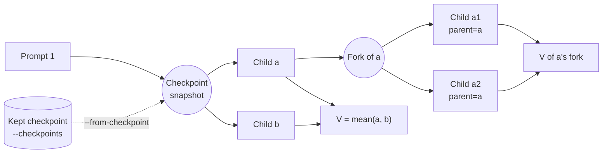

# Branching

Run an agent up to a checkpoint, snapshot the sandbox there, and run several children from that snapshot, each with its own prompt.

```bash
bench branch --tasks-dir tests/examples/hello-world-task \
  --agent claude-agent-acp --model claude-sonnet-5 --sandbox daytona \
  --prompt "Create draft.txt containing: Hello world" --prompt @instruction \
  --checkpoint-after-prompt 1 --concurrency 2 \
  --child label=baseline \
  --child "label=hint,prompt=Rename draft.txt to hello.txt, then stop."
```

The task's verifier scores each child. The mean of the children's rewards is the checkpoint's value, V.

Use branching to:

- compare hints or prompts from the same mid-run state;
- judge how good a partial trajectory is;
- retry a failed trial from where it went wrong;
- make sibling groups for training.



Details and edge cases are in [Composed checkpoints](./branching-reference.md). Every flag is in the [CLI reference](../reference/cli.md#bench-branch).

## Which tool for which job

| You want to… | Use | Notes |
|---|---|---|
| Compare a few prompts or hints from the same mid-run state | `bench branch --checkpoint-after-prompt N --child label=a --child "label=b,prompt=…"`, or `bf.branch(...)` | Children run one after another in the parent's sandbox, restored between them: the fewest sandboxes at once. On Daytona each restore makes a new sandbox, so n children make n + 1 |
| Run many children faster | Add `--concurrency K` (`concurrency=K`) | Each child gets its own sandbox from the snapshot, K at a time. More sandboxes; see [Cost](#cost) |
| Branch again from one child's result | `--child "label=a1,parent=a,prompt=…"`, at least two per parent | A nested fork in the same `tree.json`. It gives every child its own sandbox |
| Let children continue the parent's conversation ("now fix it") | `--resume-session` (`resume_session=True`) | Needs an agent that supports ACP `session/load` and keeps the session on disk (Claude Code). Otherwise each child prompt must stand alone |
| Branch a normal run later | `bench run --checkpoints every-prompt\|prompt:N [--checkpoint-keep K]`, then `bench branch --from-checkpoint <trial> --checkpoint prompt:N` | Keeps sandbox snapshots after the chosen prompts (`checkpoints.json`). Each costs a snapshot's time and storage |
| Retry a failed trial from where it was | `bench run --checkpoints … --retry-from-checkpoint on-failure,on-timeout` | See [Retry from a checkpoint](#retry-from-a-checkpoint) |
| Survive a provider hiccup in one child | On by default (`--child-retries 1`) | A child that failed before its agent did anything is retried once. Siblings still run. `--stop-on-child-failure` stops at the first failure |
| Read a branched run from code or a viewer | `bench eval branches <job> [--json]`, `bf.load_job(...).branch_views()` | One `benchflow.branch-view/1` document per trial. See [Branch view](../reference/branch-view.md) |
| Keep a fork's checkpoint for later | `--retain-snapshots`, then `--from-checkpoint <trial>` | Sandbox layer only, on the same provider and account |
| Throw the parent away after the fork | `--parent discard` (`restore_parent=False`) | Skips one restore. The parent is left unverified and refuses further use |
| Checkpoint declared database state | `--snapshot-layers environment` or `sandbox,environment` | For an [environment manifest](../environment-plane.md#roll-back-snapshot-and-restore). In-place children only |
| Turn branch runs into training data | `bench train convert <jobs> --format branch-tree [--pairs pairs.jsonl]` | See [Training on branch runs](#training-on-branch-runs) |
| Inspect a run | `bench view <job>` | The Lineage tab opens every child, nested ones included |

## The three entry points

**CLI.** `bench branch` runs one or more tasks, one after another. It writes the usual job folder plus `tree.json`, and prints a table per child and per fork. It exits 0 when every fork completed.

**Python, one call.** `bf.branch(...)`, or `await bf.abranch(...)`, takes the same options and returns a `BranchResult`: the value, each child's reward, the parent's result, `cost` and `forks`. See `docs/examples/python-sdk/run-branch.py`.

**Python, full control.** Drive a `Rollout` yourself and call `rollout.branch(n, run_child, snapshot_layers={"sandbox"}, ...)` with your own child runner, for example to act between prompts. See [Composed checkpoints](./branching-reference.md#branch-a-real-agent-run-from-python) and `docs/examples/branch-agent-run.py`.

## Retry from a checkpoint

```bash
bench run tasks/ -a claude-agent-acp --checkpoints every-prompt \
  --retry-from-checkpoint on-failure,on-timeout --retry-prompt "@instruction @verifier_feedback"
```

When a trial fails or times out, BenchFlow forks one retry child from its last kept checkpoint, and the verifier scores it the same way.

| Flag | Meaning |
|---|---|
| `--retry-from-checkpoint` | `on-failure`, `on-timeout`, or both |
| `--retry-prompt` | Replaces the prompts after the checkpoint. `@instruction` is the task's instruction; `@verifier_feedback` is the failed trial's reward and verifier output |
| `--retry-resume-session` | The retry continues the failed conversation instead of a fresh session |

The trial keeps its own reward. The retry's reward is reported next to it, in `result.json`'s `retry` block and `summary.json`'s `checkpoint_retries`. A retry that made no tool calls is flagged `no_work`.

## What gets recorded

- `tree.json` in the trial folder: every node and fork, with each child's label, prompt, status, reward and cost, and each fork's value and timing. Retries have `kind: retry`. The fields are in [Branch view](../reference/branch-view.md).
- Per fork: `branches/<fork>/labels.json`, an index of the child folders by label, with status and reward.
- Per child: `branches/<fork>/children/<node>/observation.json`, its events and lineage. A child in its own sandbox also gets a full trial folder (`result.json`, `trajectory/`, `verifier/`).
- The trial's `result.json` and `results.jsonl`: a `branches` block with forks, children and cost totals. `parent: discarded` marks a parent `--parent discard` left unscored on purpose.
- `checkpoints.json` for kept checkpoints, and `checkpoint_source.json` for a trial started from one. Snapshot time is `checkpoint_snapshot` in the trial's `timing.json`.
- `summary.json` of a `bench branch` job: counts over children, forks and cost per trial, and job totals.

## Cost

Each child records its tokens by class (input, output, cache read, cache write), its USD when the provider reports one, and its sandbox-seconds. Claude subscription runs report no USD.

`bench eval branches` adds an estimate at list price, marked `~` and never mixed with a reported price. Cache reads usually dominate the token count but cost a tenth of input, so compare classes, not totals.

Each fork records its wall time and its sandbox-seconds: the parent's during the fork, the children's, and their sum. Trial totals never count a nested fork's parent twice.

**In place or in parallel.** Parallel children finish sooner but hold more sandboxes: each child's, plus the parent's, which waits. A parallel child pays for a sandbox from the snapshot and for agent setup. An in-place child pays one restore.

**Daytona.** The first sandbox from a new snapshot is a cold start; later ones are much faster.

**No second snapshot.** When the fork point already has a kept checkpoint, the fork reuses it (`snapshot.reused: true`) instead of taking another.

**Not in the fork's cost.** Everything before the fork is in the trial's `timing.json`: the parent's sandbox, agent setup and the prompts up to the checkpoint. The verifier runs once per child and often dominates a short child.

**Rules of thumb.** A Daytona snapshot takes seconds to minutes. Use parallel children when there are several and each runs long compared with its setup.

**Noise.** Each fork records `value_stderr`, the standard error of V. With two children it is usually as large as V itself.

## Training on branch runs

`bench train convert` writes one `branch_child` row per child, and one `branch_pair` row per pair of siblings that got the same prompt but different rewards. Check the files before training:

```bash
bench train convert jobs/branch-run --format branch-tree --out children.jsonl --pairs pairs.jsonl --manifest export.json
bench train validate children.jsonl --format branch-tree
bench train validate pairs.jsonl --format branch-tree
```

The fields are in the [CLI reference](../reference/cli.md#bench-train-convert), and the JSON Schemas in `docs/reference/schemas/benchflow-branch-{child,pair}-row.v2.schema.json`.

**Preference training.** `pairs.jsonl` is already in TRL's conversational preference shape (`prompt`, `chosen`, `rejected`), so `DPOTrainer` loads it as it is:

```python
from datasets import load_dataset
from trl import DPOConfig, DPOTrainer

pairs = load_dataset("json", data_files="pairs.jsonl", split="train")
pairs = pairs.select_columns(["prompt", "chosen", "rejected"])
trainer = DPOTrainer(model=model, args=DPOConfig(output_dir="dpo"), train_dataset=pairs, processing_class=tokenizer)
```

**Rendering a row yourself.** Use `tokenizer.apply_chat_template(row["messages"], tools=row["tools"], tokenize=False)` for a child. For a pair, use `row["prompt"] + row["chosen"]` and `row["prompt"] + row["rejected"]`. `tools` holds tool and argument names inferred from the calls, not the agent's real tool definitions.

**Group-relative training.** The children of one fork share a prefix. Each row carries `value` (the group's mean reward) and `advantage` (reward − value), the quantities GRPO computes. They are offline samples, so they fit advantage-weighted or rejection-sampled fine-tuning: `--min-reward 1` keeps the winners for SFT. Online GRPO still makes its own groups.

**Caveats.** Rows marked `session: fresh` are continuations the child did not see; `resumed` rows are ones it did. `prefix_complete: false` means the source conversation of a `--from-checkpoint` trial is missing. Oracle children are skipped unless `--include-oracle`.

## Guarantees and limits

- Children never see each other's changes; each starts from the checkpoint. The parent's sandbox is restored after the fork, unless `--parent discard`.
- A child's reward comes from the task's verifier (`reward_source: verifier`). Missing or invalid reward files give score 0 with a warning; a failure in BenchFlow’s own verification step remains unscored.
- Every child's verifier compares against the state captured before any agent ran, not the checkpoint's. Tampering before the fork is still undone at verification.
- Agent credential files never enter a snapshot. Each child's sandbox gets them written again.
- Not captured: running processes, mounted host contents, external services, robot or simulator state. Task `setup_commands` do not run again on a checkpoint.
- Embodied tasks (`metadata.embodied`) refuse to branch, to start from a checkpoint and to retry from one. A simulator task may declare `world_restore: true` when its world can be restored; a real robot never can. See [what embodied tasks cannot do](../tasks/embodied.md#what-embodied-tasks-cannot-do).

## Next steps

- Rerun what failed without branching: [Resume a job](../jobs/resume.md).
- Read a branched job: [Branch view](../reference/branch-view.md).
- The checkpoint mechanics: [Composed checkpoints](./branching-reference.md).
