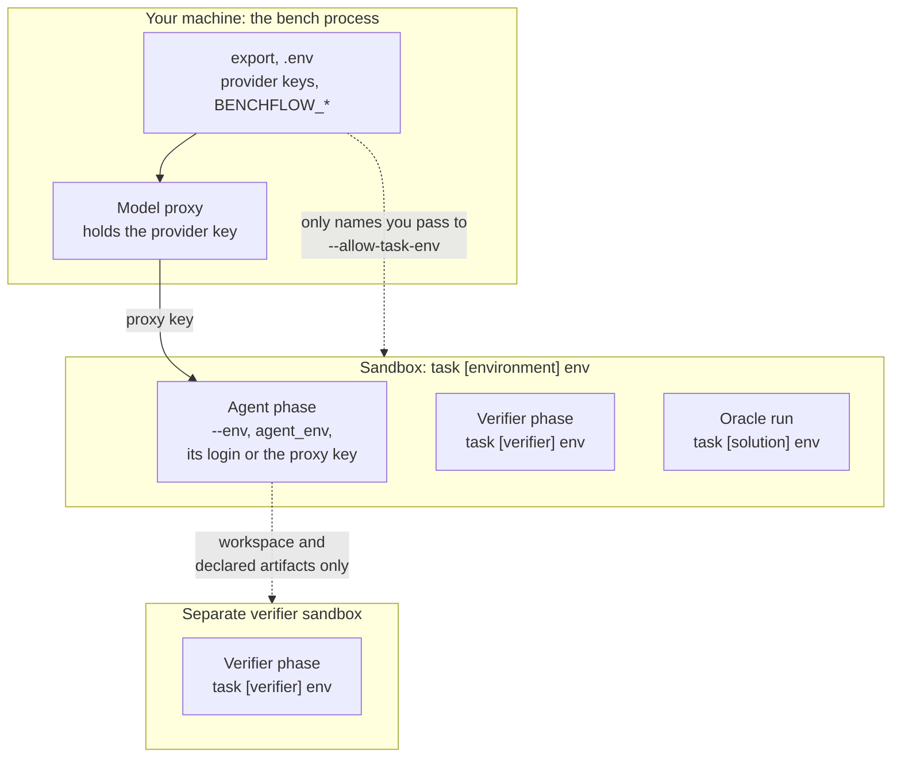

# Environment variables

BenchFlow keeps variables apart by where they are needed: the `bench` process on your machine, the sandbox, the agent phase or the verifier phase.

```bash
export ANTHROPIC_API_KEY=...                       # read by bench; stays in the model proxy
bench run tasks/ -a claude-agent-acp --env MAX_THINKING_TOKENS=32000   # the agent phase only
bench run tasks/judge-task -a codex-acp --allow-task-env OPENAI_API_KEY  # let the task read one of yours
```

> [!WARNING]
> A task's files cannot read your variables unless you name them with `--allow-task-env`. A task that asks for an unnamed one is refused before any sandbox starts.

## Where each variable reaches



| Scope | Shell or CLI | Run config | Task | Example |
|---|---|---|---|---|
| **The `bench` process** and the sandbox provider | `export`, `.env` | none | none | `DAYTONA_API_KEY`, `BENCHFLOW_*` |
| **The sandbox:** every phase in it | none | none | `[environment] env` | `DATABASE_URL` |
| **The agent phase only** | `--env KEY=VALUE` | `agent_env` | none | `MAX_THINKING_TOKENS` |
| **The verifier phase only** | none | none | `[verifier] env` | `OPENAI_API_KEY` for an LLM judge |
| **The oracle run only** | none | none | `[solution] env` | a token the reference solution needs |
| **The rubric reviewer** | `--reviewer-agent-env KEY=VALUE` | `reviewer.agent_env` | none | the reviewer's model key |

BenchFlow has no CLI flag that sets a verifier-phase variable. Put it in the task's `[verifier] env`.

## Agent logins and provider keys

BenchFlow reads the well-known credential variables from your shell and from `.env` in the current folder: `ANTHROPIC_API_KEY`, `CLAUDE_CODE_OAUTH_TOKEN`, `OPENAI_API_KEY`, `GEMINI_API_KEY`, `AWS_BEARER_TOKEN_BEDROCK`, the Azure and provider keys, and the like. `BENCHFLOW_DOTENV_PATH` names another `.env` file.

What the agent then gets depends on its route:

| Route | What reaches the agent |
|---|---|
| Through the model proxy (API keys) | Only the proxy's own key. The provider key stays in the proxy |
| A native login (a Claude or Codex subscription) | That login, and nothing of any other agent |
| `oracle` and `nop` | No credential |

Keep sandbox-provider keys such as `DAYTONA_API_KEY` in your shell. Passing them with `--env` puts them inside the sandbox, where the agent can read them.

## Letting a task read your variables

A task can read a variable of yours only if you name it:

```bash
bench run tasks/ --allow-task-env OPENAI_API_KEY --allow-task-env ROBOUSE_ORACLE_TOKEN
BENCHFLOW_ALLOW_TASK_ENV=OPENAI_API_KEY,ROBOUSE_ORACLE_TOKEN bench run tasks/
```

This covers a whole `${NAME}` or `${NAME:-default}` value in:

- task.toml's `[environment] env`, setup commands' `env`, `[verifier] env` and `[solution] env`;
- the `forward_env` keys of the task's [environment manifest](../environment-plane.md);
- the task's `docker-compose.yaml` and the files it includes (with the difference below).

| The task writes | You named it | Result |
|---|---|---|
| `${NAME}` | yes | Your value |
| `${NAME}` | no | Refused before any sandbox starts; the message names the variable and the flag |
| `${NAME:-default}` | yes | Your value |
| `${NAME:-default}` | no | The default, never your value |

A Compose file is read the same way with one difference: an unnamed `${NAME}` gets nothing instead of being refused, and `bench run` warns when you have it set.

`bench check <task> --allow-task-env NAME` checks the same rule without running anything.

For example, an LLM-judge task with `[verifier] env = { OPENAI_API_KEY = "${OPENAI_API_KEY}" }` runs with `--allow-task-env OPENAI_API_KEY`.

## Docker Compose on your machine

On `docker` and `remote-docker`, `docker compose` runs on your machine with a short, fixed environment. It holds `PATH`, `HOME`, `DOCKER_BUILDKIT`, `DOCKER_DEFAULT_PLATFORM`, the variables you named, the task's `[environment] env` and BenchFlow's own. Your credentials are not in it, so a task's Compose file cannot read them.

The address of the Docker daemon (`DOCKER_HOST`, `DOCKER_CONTEXT`, the TLS settings) goes on docker's command line, never into that environment. See [Compose on your machine](../sandboxes/threat-model.md#compose-on-your-machine) for the full rules.

## Separate verifier sandboxes

With `--verifier-sandbox separate`, the verifier runs in a second sandbox. Agent-phase variables never reach it. Only the workspace, the task's declared artifacts and `/logs/artifacts` cross over. The task's `[verifier] env` applies there as in a shared sandbox. See [Separate verifier](../tasks/separate-verifier.md).

## BenchFlow's own variables

These set how the `bench` process behaves.

| Variable | What it does | Default |
|---|---|---|
| `BENCHFLOW_ALLOW_TASK_ENV` | Names your variables a task may read, comma-separated | none |
| `BENCHFLOW_ALLOW_TASK_HOST_ACCESS=1` | Lets a task mount host paths or run a pre-compose hook on your machine. Only for tasks you have read | off |
| `BENCHFLOW_SKIP_PREFLIGHT=1` | Skip the sandbox and login checks before a run | off |
| `BENCHFLOW_FRESH_INSTALL=1` | Same as `--fresh-install` | off |
| `BENCHFLOW_NO_PROGRESS=1` | No live dashboard | off |
| `BENCHFLOW_PROGRESS=on\|off` | Force the plain heartbeat lines on or off | auto |
| `BENCHFLOW_LOG_LEVEL` | `DEBUG`, `INFO`, `WARNING` or `ERROR` | `INFO` |
| `BENCHFLOW_LOG_FORMAT=time` | Prefix log lines with time, level and logger | off |
| `BENCHFLOW_LOG_DIR` | Where crash logs go | `~/.cache/benchflow/logs` |
| `BENCHFLOW_LOGIN_LABEL` | The name the run report gives your login (never the token) | where the login came from |
| `BENCHFLOW_ACP_HANDSHAKE_TIMEOUT` | Seconds an agent has to answer the ACP handshake; raise it for slow images | `60` |
| `BENCHFLOW_AGENT_PENDING_TOOL_GRACE_SEC` | Seconds a silent pending tool call may run past the idle timeout | 3 idle timeouts |
| `BENCHFLOW_API_ERROR_BREAKER_THRESHOLD` | Stop starting trials after this many identical permanent API errors in a row; `0` turns it off | `5` |
| `BENCHFLOW_PROVIDER_BASE_URL`, `BENCHFLOW_PROVIDER_API_KEY` | A custom OpenAI-compatible model endpoint | none |
| `BENCHFLOW_DOTENV_PATH` | The `.env` file to read | `.env` |
| `BENCHFLOW_REMOTE_DOCKER_HOST` | The host for `--sandbox remote-docker`. See [Remote Docker](../sandboxes/remote-docker.md) | `DOCKER_HOST` |
| `BENCHFLOW_DOCKER_SUBNETS` | IPv4 ranges for trial networks, or `daemon`. See [Docker](../sandboxes/docker.md#many-trials-on-one-daemon) | auto |
| `BENCHFLOW_LITELLM_EXTRA_REQUIREMENTS` | Extra packages for the model proxy | none |

Variables for one sandbox backend are on its page: [Docker](../sandboxes/docker.md), [Remote Docker](../sandboxes/remote-docker.md), [AgentCore](../sandboxes/agentcore.md) and [Cache](../jobs/cache.md).

`BENCHFLOW_CAPTURE_TOKEN_LOGPROBS=1` is different: pass it with `--env`, and the model proxy records token logprobs for training. See [Token capture](../reference/token-capture.md).

## Next steps

- Put the agent's variables in a file: [Configs](../jobs/configs.md).
- What the sandbox guarantees: [Sandbox security](../sandboxes/security.md).
- Run the job: [Run a job](../jobs/run.md).
