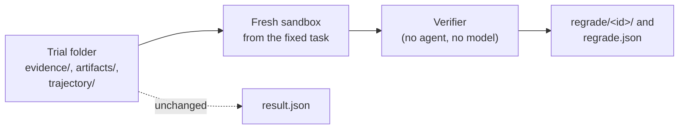

# Regrade

Score a finished run again with a fixed verifier, without running the agent again.

> [!NOTE]
> Regrading needs each trial's saved workspace. Run with `--save-outputs`; a rubric reviewer and verifier recovery save it too. A trial run without it cannot be regraded.

```bash
# 1. Run with saved outputs.
bench run tasks/ --agent claude-agent-acp --sandbox daytona --save-outputs

# 2. Fix a verifier, then regrade the job (or one trial folder).
bench regrade jobs/<job> --tasks-dir tasks-fixed/ --reason "compare numbers, not text"
```

The new score is written beside the original. `result.json` is never changed.

## From Python

```python
import benchflow as bf

summary = bf.regrade("jobs/<job>", tasks_dir="tasks-fixed/", reason="numeric comparison")
summary.counts()      # {'trials': 4, 'regraded': 4, 'changed': 2, 'fail_to_pass': 2, ...}
summary.changed       # TrialRegrade rows whose verdict or reward changed
summary.not_regradable
```

`bf.aregrade` is the async form.

## Options

| Flag | Meaning |
|---|---|
| `--tasks-dir` | The fixed task, or a folder of tasks, matched to trials by name. Without it, each trial's recorded task path is used if that folder still exists |
| `--sandbox` | Where the verifier runs. Default: the sandbox each trial used |
| `--concurrency` | Trials at a time. Default 4 |
| `--reason` | Why the verifier changed; stored with every result |
| `--json` | Print the summary as JSON |

It exits 1 when a sandbox failed. It exits 0 otherwise, even when some trials could not be regraded.

## Requirements

- `evidence/`: the agent's final workspace, saved after the agent stopped and before the verifier ran, with each file's size and sha256. Declared artifacts that lived outside the workspace are in it too.
- `artifacts/` and `artifacts-manifest.json` (optional): files collected from `/logs/artifacts`. Each file's hash is checked before it is restored.
- `trajectory/acp_trajectory.jsonl` (optional): restored to `/logs/agent` for verifiers that read the trajectory. The agent's final reply goes to `/logs/agent/output.txt`.

A trial is reported as **not regradable**, with the reason, when:

- it has no `evidence/`;
- its saved files no longer match their hashes;
- its task folder cannot be found;
- it is an embodied task (a robot or simulator), whose world is not in the workspace. See [what embodied tasks cannot do](../tasks/embodied.md#what-embodied-tasks-cannot-do);
- it ran with a separate verifier sandbox. Regrading it would build the verifier from the agent's environment, so rerun it with `bench run`. See [Separate verifier](../tasks/separate-verifier.md).

BenchFlow never grades an empty or rebuilt workspace.

## How it works



For each trial, BenchFlow:

1. Copies the current task folder and builds a fresh sandbox from it, with the settings the trial recorded (sandbox user, locked paths, config override).
2. Uploads the saved workspace, checks it byte for byte, and puts it at the task's workspace path. If the fixed task uses another workspace path, the regrade fails rather than guess.
3. Restores captured artifacts to their original paths, and the `/logs/artifacts` files.
4. Sets up the sandbox user and locked paths. No agent runs, so the agent firewall is skipped; the task's network mode still applies.
5. Runs the verifier with the usual hardening, and keeps its output.

No agent runs, so regrading needs no agent login and costs no agent tokens. An LLM-judge verifier still calls its model.

## What is written

Per trial:

- `regrade/<id>/`: the new verifier's output (`verifier/`), a copy of the verifier files that produced it (`verifier-files/`), and the sandbox's run folder (`runtime/`).
- `regrade.json` beside `result.json`: `original` (the run's own rewards, verifier error and task digest), `regrades` (every attempt, oldest first, failed ones included) and `latest`.

Each regrade adds one block with the new reward and a `change`:

| `change` | Meaning |
|---|---|
| `same` | The verdict did not change |
| `fail->pass`, `pass->fail` | The verdict flipped. A trial passes at reward 1 |
| `reward <a> -> <b>` | The reward changed, the verdict did not |
| `scored`, `unscored` | The trial gained or lost a score |
| `null` | The sandbox run failed |

A block also records `id`, `created_at`, `reason`, `task_dir`, `sandbox`, `status` (`complete`, `failed` or `interrupted`), `verifier_error`, the rewards before and after, and the digests: `original_task_digest`, `task_digest`, `task_changed` and `verifier_digest`.

Per job, or per trial folder, `regrade-summary.json` has the counts, the changed rows, and every row with its status and reason. Each regrade replaces it; the per-trial history keeps every attempt.

## Worked example

A task asks for one number in `answer.json`. Its first verifier compared the file's text with the exact string `42.0`. The second parses the number and compares values. Four trials ran with `--save-outputs` and were scored by the first verifier, then regraded against the second:

| Trial | Answer written | First verifier | Second verifier | Change |
|---|---|---|---|---|
| trial-a | `42` | 0 | 1 | fail->pass |
| trial-b | `42.00` | 0 | 1 | fail->pass |
| trial-c | `41.5` | 0 | 0 | same |
| trial-d | `42.0` | 1 | 1 | same |

Regrading again against the first verifier changes nothing: 4 of 4 `same`. A trial run without `--save-outputs` is reported as not regradable.

## Limits

- **Only the workspace comes back.** Services, databases and files written outside the workspace and the artifacts are not restored. A verifier that reads them sees the fresh image.
- **A verdict that changed on an unchanged task is flagged.** The row says `task_changed: false`, and `bench regrade` marks it `(task unchanged: …)`. A solver that installed a package system-wide or started a service can pass in its own sandbox and fail here.
- **Permissions are restored, owners are not.** The manifest records each file's mode.
- **Size.** Saving stores a copy of each workspace, at most 20 GiB and 200,000 entries per trial. Credential files and sandbox runtime state are left out and listed in the manifest.

## Next steps

- Read the new scores: `bench results jobs/<job>`.
- Trials that cannot be regraded: run them again with `bench run ... --save-outputs --fresh`.
- Make the verifier independent of the agent's sandbox: [Separate verifier](../tasks/separate-verifier.md).
