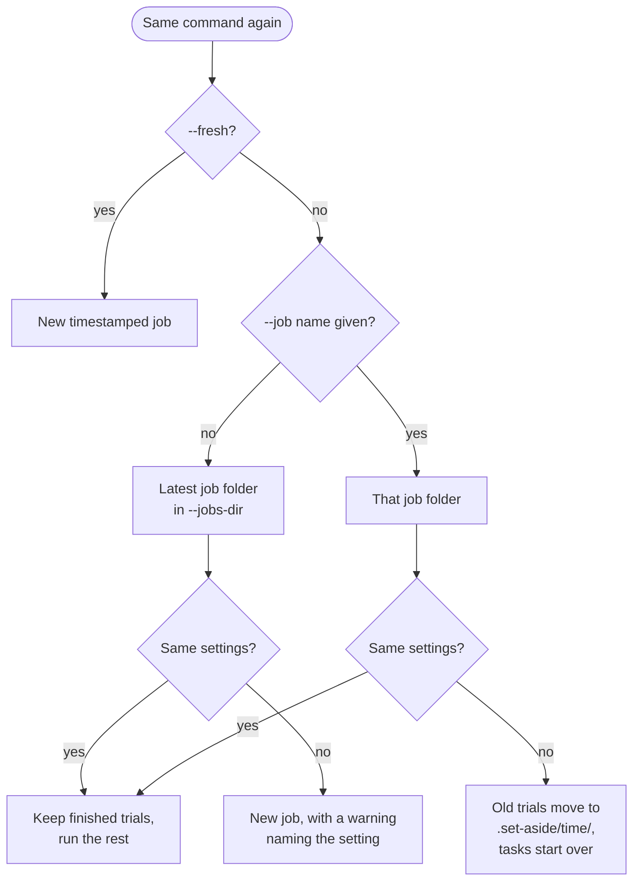
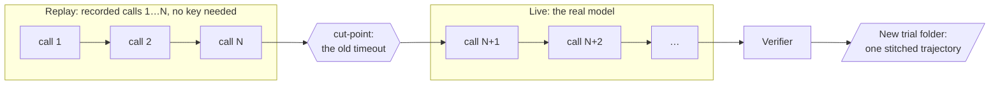

# Resume a job

Use the `Artifacts:` path printed at the end of a run when you need one exact job:

| You want to | Command |
|---|---|
| Continue the latest matching job in a jobs directory | Rerun the same `bench run ...` command. |
| Continue one exact job | `bench eval resume <artifacts-path>` |
| Find the exact job paths under a jobs directory | `bench results <jobs-dir>` |
| Start over | Add `--fresh`, or use a new `--job` name. |

Rerunning the same command reuses the latest matching job in `--jobs-dir`, keeps every finished trial and runs the rest. `bench eval resume` also reruns outcomes BenchFlow marked retryable and trials a usage limit kept from starting; scored trials stay. A parent such as `jobs/oracle` is not itself a job, so explicit resume refuses it and points to `bench results jobs/oracle`.

```bash
bench run tasks/ -a claude-agent-acp -m claude-sonnet-5          # stopped halfway
bench run tasks/ -a claude-agent-acp -m claude-sonnet-5          # runs only what is left
bench eval resume jobs/2026-10-19__12-00-00                      # the same, from the job folder
bench run tasks/ -a claude-agent-acp -m claude-sonnet-5 --fresh  # always a new job
```

> [!WARNING]
> In CI, a workspace that keeps `jobs/` between runs reports the old result on a rerun. Pass `--fresh` or a new `--job` name.

## What a rerun does



The latest job is the alphabetically last job folder in `--jobs-dir`. A folder of jobs, such as `jobs/smoke/`, is never picked.

A job another run holds is never shared. When the latest job is running in another process, an unnamed rerun starts a new job instead and says so (`Starting a new job …: job … is held by another run`), and runs started in the same second each get a new job of their own (`<stamp>`, `<stamp>-2`, …). A named job (`--job`, `bench eval resume`) is refused while another run holds it.

At the end, the run says what it reused on stderr: `Resumed job <dir>: N finished task(s) reused, M ran now`. When nothing was left to run, it says the results are the earlier ones.

A task whose files changed since its trial ran (its `task_digest` differs) is run again, in the same job: the run log names it, and its earlier trial moves to the job's `.set-aside/` folder.

A nonempty folder without a recognised BenchFlow job record is refused, including one holding only empty subfolders such as `lost+found` or `data/sub`, or Finder’s `.DS_Store`. Nothing in that folder is changed.

## Which settings must match

A rerun resumes only the same run. If a setting that changes what a trial measures differs, a new job starts and a warning names the job it did not resume and the setting.

| Compared (a change starts a new job) | Not compared |
|---|---|
| Agent and model: `agent`, `model`, `reasoning_effort`, `harness`, `codex_apps_policy` | Concurrency, the reviewer's too |
| Prompts: `prompts`, `extra_instruction` | A wider task selection (`--include`, `--limit`, `--seeds`); a narrower one is below |
| Limits: `timeout_multiplier`, `agent_idle_timeout`, `sandbox_setup_timeout`, `budget` | Retries |
| The agent's `agent_env` values that do not look secret | A rotated key or token |
| The sandbox: `environment`, `sandbox_user`, `sandbox_locked_paths`, `base_image_override`, `context_root`, `skip_agent_install`, `environment_manifest`, `config_override`, `pre_agent_hooks` | |
| Verifier placement: `verifier_sandbox` (strict integrity counts as separate), `separate_verifier`, `separate_verifier_include` | |
| Skills: `skill_mode`, `skills_dir`, `skill_creator_dir`, `self_gen_no_internet` | |
| The loop: `job_mode`, `loop_strategy`, `checkpoints`, `retry_from_checkpoint`, `retry_prompt`, `retry_resume_session` | |
| Scoring: `reviewer`, for a job with a reviewed trial | |
| The dataset (`dataset_name`, `dataset_version`) and the tasks folder | |

Each setting is compared as `evaluation.json` records it.

A job from 0.7.11 has no `evaluation.json`. Rerunning its original command compares the effective agent, loop and available task digest in each trial's `config.json`, plus its recorded model, reasoning effort, sandbox backend (`environment`) and sandbox user. Model and effort follow the final rollout's primary role, including the current task's scene overrides and the explicit-prompt override. Independent self-generation uses creator/solver roles with unset effort even when an effort was requested. Sequential learner runs use `with-skill`, retaining task scene overrides even when `self-gen` was requested. A known difference starts a new job under automatic selection or sets aside the affected trials in a named job; a sequential job sets aside all trials and its learner snapshot together.

Missing historical fields remain unknown and do not prevent resume; an explicit JSON `null` is a recorded value. Legacy resume does not certify the other settings in the table: the trial record contains derived values and incomplete inputs, such as a resolved timeout and prompt-presence flags rather than the requested timeout multiplier and prompt text. It preserves finished work across versions, not measurement equivalence. Start a fresh job for a fresh comparison and retain the earlier trials' provenance.

- **Secrets.** A secret-looking `agent_env` value is never stored, so a new key does not start a new job. A secret-looking string elsewhere, such as a password in a prompt, is compared without being shown.
- **Token settings.** `MAX_THINKING_TOKENS`, `CLAUDE_CODE_MAX_OUTPUT_TOKENS`, `MAX_TOKENS`, `SESSION_TIMEOUT` and `AUTH_ENABLED` are compared, so `MAX_THINKING_TOKENS=32000` after `1024` starts a new job.
- **Agent config JSON.** `CODEX_CONFIG` and `OPENCODE_CONFIG_CONTENT` are compared by structure, with credentials removed. Formatting and a rotated key keep the job; a changed tool setting does not.
- **Numbers in a config.** An `agent_env` value written as a YAML number or `true` reaches the agent as a string, so `32000` and `"32000"` are the same setting.
- **Budgets.** A bigger budget resumes a job its budget stopped.
- **The task selection.** A rerun scores only the tasks it selects. When the latest job holds a result of a task this run does not select (`-i fix-git`, then `-i regex-log` in the same `--jobs-dir`), a new job starts and the warning names the tasks left out: `Starting a new job …: the latest job in jobs (…) ran another task selection: it holds results of 1 task(s) this run does not select (fix-git); the selection (--include, --exclude, --limit) changed`. The same or a wider selection resumes: its finished tasks are reused and the new ones run.

## A named job

With `--job <name>` (or `bench eval resume`), a job that ran with other settings is not resumed either. Its earlier trials move to `<job>/.set-aside/<UTC time>/`, with a `set-aside.json` saying why. Readers of the job skip them, and the run starts those tasks over.

A named folder BenchFlow did not make is refused before anything in it is written: `<folder> is a folder BenchFlow did not make; nothing in it moves`. BenchFlow knows its own folders by its job record (an `evaluation.json` with an integer `schema_version`, a string `tasks_dir` and `job_name`, and a `config` object) or by trial folders it wrote. An empty folder, or one holding only BenchFlow's own dot-entries (`.evaluation.lock`, `.set-aside/`, `.pre-0.8/` and the like), is taken. Any other file, dot-files such as `.git` or `.env` included, makes the folder another program's. Known limitation: another program's `evaluation.json` with those four keys and types reads as BenchFlow's.

A named job keeps the results of tasks this run does not select, and its score counts them: the run warns `Job <name> also holds results of N task(s) this run does not select (…); its score counts them`. Name another job to score only the selection.

## `bench eval resume`

```bash
bench eval resume jobs/my-run/2026-01-01__12-00-00
bench eval resume jobs/my-run/2026-01-01__12-00-00 --agent-env OPENAI_API_KEY=... --concurrency 8
```

It reads the tasks and settings the job recorded in `evaluation.json`, the same as `bf.Evaluation.resume`, and runs only the tasks with no finished result. A job still running elsewhere is refused.

Secret-looking `agent_env` values are never stored, so pass them again with `--agent-env KEY=VALUE`. `--concurrency N` overrides the recorded concurrency.

Resuming reruns every trial in a retried category, plus the trials a [usage limit](./when-a-run-fails.md#usage-limits) stopped. Scored trials are kept.

`bench run --config run.yaml --job <name>` resumes `<jobs-dir>/<name>`.

## Continue a timed-out OpenHands run

```bash
bench eval continue path/to/run-folder --tasks-dir path/to/tasks
```

`bench eval continue` picks up an `openhands` trial that hit its timeout and lets it finish, as if the timeout had been longer. The agent gets no extra prompt. It works only with the `openhands` agent.

The run folder holds no verifier, so pass `--tasks-dir` with the folder that holds the task; BenchFlow matches it by name. If the `task_path` in `config.json` still exists, you can leave `--tasks-dir` out.

### Why replay

When a trial ends, BenchFlow deletes its sandbox. Only the trial's folder is left: `config.json`, `result.json`, `prompts.json` and `trajectory/llm_trajectory.jsonl`. So BenchFlow rebuilds the sandbox from the recorded model calls.



1. BenchFlow starts a fresh sandbox from the same image.
2. It starts a replay proxy and points OpenHands at it (`LLM_BASE_URL`).
3. The proxy answers the agent's first N model calls with the recorded responses, in order. The agent re-runs its own commands for real, which rebuilds the same files and the same agent state.
4. When the recorded calls run out, the proxy switches to the live model, and the agent carries on.
5. The task's verifier scores the result. BenchFlow writes a new trial folder with one stitched `llm_trajectory.jsonl` (recorded part, then live part) and a `continued_from` record. It can replace the timed-out trial.

The result is one continuous run, not a fresh agent on a warm workspace.

### Options

| Flag | Default | Does |
|---|---|---|
| `--tasks-dir DIR` | the recorded `task_path` | the folder that holds the task's instruction and verifier |
| `--model MODEL` | the original run's model | the model for the live part |
| `--timeout SEC` | the original run's timeout | the time budget for the continuation, in seconds |
| `--output DIR` | `<original parent>/continued` | the jobs folder for the new trial |
| `--require-timeout` | off | refuses a trial whose recorded status is not a timeout |
| `--strict-divergence` | off | stops if the replay leaves the original path, instead of warning |
| `--replay-only` | off | rebuilds by replay and stops at the cut-point; needs no model |
| `--proxy-mode auto\|host\|sandbox` | `auto` | where the replay proxy runs; `auto` puts it in the sandbox on Daytona and Modal, on the host for Docker |

To continue every timed-out trial under a folder, use `bench eval continue-batch DIR`. It takes `--tasks-dir`, `--model`, `--timeout`, `--output`, `--concurrency` (default 100), `--limit`, `--strict-divergence` and `--proxy-mode`.

The replay part calls no model and needs no key. The live part needs that provider's key on the host, for example `GEMINI_API_KEY`.

### Limits

- **`openhands` only.** The replay works by pointing `LLM_BASE_URL` at the proxy.
- **Commands run again.** If one gives different output (network, clocks, randomness), the agent sees something new. BenchFlow compares message counts and warns; `--strict-divergence` stops instead.
- **Not bit-identical.** The model samples, so the continuation can't match a longer original run exactly. You get one trajectory that reads as a single run.
- **Replay takes time.** It takes as long as the original commands took; recorded model calls return at once.

## Next steps

- Read the result: `bench view <job folder>`.
- Why trials failed: [When a run fails](./when-a-run-fails.md).
- Retry from where a trial failed, not from the start: [Branching](./branching.md#retry-from-a-checkpoint).
- Score stored runs again: [Regrade](./regrade.md).
