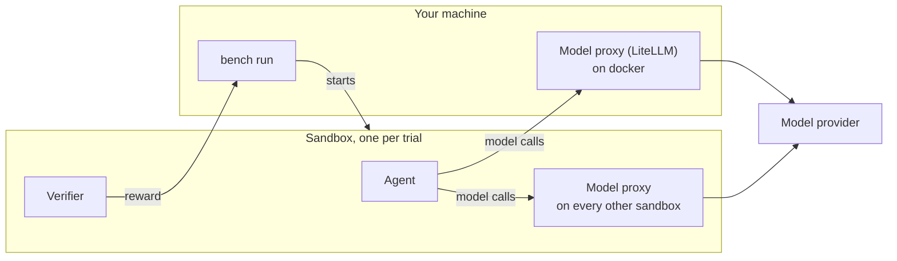

# Run a job

A job is a set of trials. A trial is one agent's attempt at one task, scored by the task's verifier. Run a job with `bench run`.

```bash
bench run tasks/hello-world                      # one local task
bench run tasks/                                 # every task in a folder
bench run benchflow-ai/skillsbench/tasks         # tasks in a GitHub repo (org/repo/path[@ref])
bench run -d terminal-bench@2.0                     # a pinned dataset version
bench run --config benchmarks/harvey-lab/harvey-lab-gemini-flash-lite.yaml
```

Without `--agent`, `bench run` runs the oracle, the task's reference solution. The oracle needs no model and no login, so it is the first thing to run on a new task.

Add an agent and a model:

```bash
bench run tasks/ --agent claude-agent-acp --model claude-sonnet-5
```

`bench agents` lists every agent. See [Agents](../agents/index.md) for each agent's login.

## What to run

| Source | Write | Notes |
|---|---|---|
| A local task or folder of tasks | `bench run tasks/` | The same as `--tasks-dir tasks/` |
| A folder in a GitHub repo | `bench run org/repo/path@ref` | Only that folder is downloaded. The same as `--source-repo`, `--source-path`, `--source-ref` |
| A pinned dataset version | `bench run -d name@version` | Checks every task against its pinned digest. See [Pinned dataset versions](../datasets/benchmarks.md#pinned-dataset-versions) |
| A run config file | `bench run --config run.yaml` | The whole run in one file. See [Configs](../jobs/configs.md) |
| A hosted Verifiers environment | `bench run --source-env org/name --source-env-version 0.1.1` | Runs on the environment's own harness. See [Any benchmark](../running-any-benchmark.md#layer-1-run-as-it-is) |
| Several models, several trials | `bench run tasks/ --matrix <models.yaml> --trials 3` | One job per model and trial, under `<jobs-dir>/<alias>/trial-NN` |

A matrix file maps an alias to a model, or to a mapping with `model`, `agent` and `agent_env`:

```yaml
models:
  haiku: claude-haiku-4-5-20251001
  gpt: {model: openai/gpt-5.4-mini, agent: codex-acp}
```

## Configure a job

| Group | Flags |
|---|---|
| Output | `--jobs-dir jobs/` (default `jobs`), `--job <name>`, `--fresh` |
| Concurrency | `--concurrency 8` (default 4): trials running at a time; on Docker, `--warm-pool N` more sandboxes are prepared ahead (see [Warm pool](../sandboxes/docker.md#warm-pool)) |
| Task filters | `--limit 10`, `--include 'hard-*'`, `--exclude <name>` |
| Sandbox | `--sandbox docker` (default), `remote-docker`, `daytona`, `modal`, `apple-container`, `agentcore` |
| Agent | `--agent`, `--model`, `--effort high`, `--env KEY=VALUE`, `--harness acp\|native`, `--task-skills` |
| Time | `--timeout-multiplier 2`, `--idle-timeout 10m` (default 10m; `none` turns it off) |
| Retries | `--retry-attempts N` (default 2) |
| Budgets | `--max-cost-usd`, `--max-tokens`, `--max-sandbox-seconds`, `--max-rollouts` |
| Grading | `--save-outputs` (so [`bench regrade`](../jobs/regrade.md) can score again), `--verifier-sandbox separate` |
| Gates | `--fail-under 0.8`, `--fail-on timeout,error` |

`bench run --help` shows the common flags. `bench run --help-all` lists all of them.

`--dry-run` prints the plan, with the agent, model, tasks and budgets, and runs nothing.

## Where a run happens



On Docker, a run with a network policy or no web tools runs the proxy in the sandbox too.

`bench run` stays on your machine. Each trial gets a fresh sandbox, where the agent works and the verifier then scores the workspace. API-key runs go through BenchFlow's model proxy, which holds the provider key so the agent never sees it. See [Sandboxes](../sandboxes/index.md).

## Before the run starts

Before any job folder exists, `bench run` checks the sandbox (Docker's daemon, or your Daytona key) and your agent's login. A failed check prints the same fix `bench doctor` prints. `BENCHFLOW_SKIP_PREFLIGHT=1` skips these checks.

A missing login stops the run before the job exists. Run `bench doctor` to see what it finds.

## Watching a run

On a terminal, a run shows a live dashboard: progress, pass and fail counts, and what each task is doing. The non-agent stretches are labelled `creating sandbox…`, `building image…` (on a task's first run), `installing agent…` and `verifying…`.

In CI or a pipe, it prints a heartbeat line instead, about every 45 seconds, when one task runs at a time.

| Setting | Effect |
|---|---|
| `--quiet` | No dashboard and no heartbeat |
| `BENCHFLOW_NO_PROGRESS=1` | No dashboard |
| `BENCHFLOW_PROGRESS=on\|off` | Force the heartbeat on or off. On a terminal, pair `on` with `BENCHFLOW_NO_PROGRESS=1` |

The dashboard footer shows a running token total. It is a lower bound while the run is going; cost appears only for finished tasks.

BenchFlow has no live view of a running sandbox yet. `bench view <job>` opens the trajectories of finished trials.

## Reading the score

```
Score: 2/4 (50.0%), mean reward 0.50, errors=1; scored only: 2/3 (66.7%), mean reward 0.67
Outcomes: 3 scored (2 passed, 1 failed), 0 unscored, 1 errored
Cost:      $0.75, 1,000 tokens
Time:      2m 10s
Artifacts: jobs/run
Summary:   jobs/run/summary.json
View:      bench view jobs/run
```

`Score: P/T` counts passed trials. A trial passes at reward 1. A task with a review rubric passes when every test and blocker passes.

`mean reward` is the average reward, so `1/1 (100.0%)` can come with `mean reward 0.80`.

Both figures count an unscored or errored trial as a fail with reward 0. When some trial is unscored or errored, the line adds `scored only:`, the same figures over scored trials alone.

After the score, each failed task gets one line, `✗ task: reason`, and the report groups the rest by cause. [When a run fails](../jobs/when-a-run-fails.md) explains every cause.

## Read the result

Each trial writes `result.json` in `jobs/<job>/<task>__<hash>/`:

```json
{
  "rewards": {"reward": 0.48},
  "n_tool_calls": 12,
  "agent_result": {"total_tokens": 23993, "cost_usd": 0.07, "usage_source": "provider_response"},
  "error": null,
  "verifier_error": null
}
```

| You want | Read |
|---|---|
| The reward | `rewards.reward`: 0 to 1, or `null` when unscored |
| Tokens | `agent_result.total_tokens`: `null` when the provider reported none |
| Pass or fail | Derive it: a trial passes at `rewards.reward == 1` (a rubric task when every test and blocker passes) |

There is no top-level `reward`, `total_tokens` or `status` key.

`bench results jobs/<job>` prints a job's scores. `bench results jobs/` lists every job. See [Analysing runs](../results/analysing-runs.md).

## Exit codes

| Code | `bench run` |
|---|---|
| 0 | The run finished, whatever the rewards |
| 1 | A trial was unscored by an agent or verifier error, a `--fail-under` or `--fail-on` gate failed, the run config was invalid, or no login was found |
| 2 | A usage mistake caught before anything runs: an unknown flag or a bad value, an unknown agent, sandbox, dataset or version, an `-i` or `-x` that matches no task, a tasks folder that is not there, or a run-config key the run does not read |

Every command's codes are in the [CLI reference](../reference/cli.md#exit-codes).

## Next steps

- Put the run in a file: [Configs](../jobs/configs.md).
- Pass keys and variables: [Environment variables](../jobs/environment-variables.md).
- A trial failed: [When a run fails](../jobs/when-a-run-fails.md).
- The run stopped halfway: [Resume a job](../jobs/resume.md).
- You fixed a verifier: [Regrade](../jobs/regrade.md).
