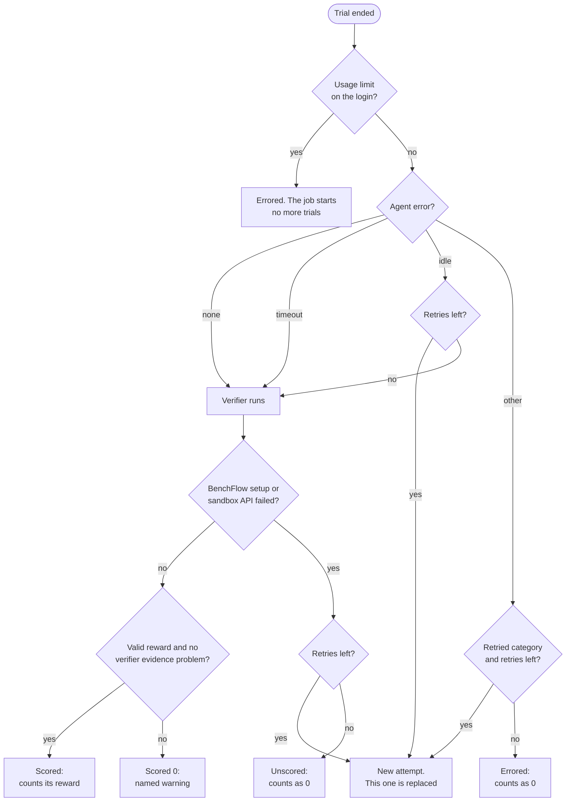

# When a run fails

Every trial ends scored, unscored or errored. This page says which causes are retried, whether the verifier still runs, whether the trial counts, and what to do next.

```bash
bench explain                     # every cause BenchFlow names
bench explain usage_limit         # one cause: what happened, whose problem, the next step
bench eval resume jobs/<job>      # rerun what failed, keep the rest
```

## Does it count?

| Outcome | What happened | Verifier runs | Counts in the score |
|---|---|---|---|
| **Scored** | The verifier gave a reward, pass or fail | yes | Its reward |
| **Unscored** | BenchFlow could not finish its own verification step, such as a lost sandbox | attempted | As a fail with reward 0 |
| **Errored** | The run stopped before a score | only after the agent's own time limits | As a fail with reward 0 |

`Score` and `mean reward` count every final trial this way. The `scored only:` figures, and metrics labelled scored-only, leave unscored and errored trials out.

A trial that hit its wall-clock limit is scored: the verifier scores what the agent left. One stopped by the idle watchdog is retried while retries are left; only its last attempt is scored. A wrong answer is scored 0, not errored.

A model request in flight at the proxy counts as activity, including a long
reasoning response without streaming output, for up to three idle budgets per
request. The task's wall-clock budget still stops a provider that never
answers. Idle diagnostics state the number of requests in flight and the
oldest request's age. When the agent's idle or wall-clock deadline ends while
a model request has had no response for longer than the idle budget (the
stall the idle deadline used to end), the trial errors as a provider stall
(`provider api error [provider_stall/transient]`, category `api_error`). The
error gives the number of requests and how long the oldest was pending. Like
any transient provider error, it has no score, it is retried, and `bench eval
resume` runs it again.

`trajectory/provider_requests.jsonl` records request start/end and each upstream
attempt: identifiers, timestamps, HTTP status, request/response byte counts and
upstream seconds. It adds no prompt or response content. A start without an end
identifies a request still pending when capture stopped. An upstream 5xx whose
body is not JSON is marked `invalid_provider_response`, with its actual status
and duration. Earlier callback-only traces do not prove the upstream status.

Timing includes `provider_wait` (the union of completed proxy request intervals),
`provider_retry_wait` (failed upstream attempts and the waits before subsequent
attempts inside the proxy), and `agent_without_provider_wait` when agent duration
is available. `agent_execution` remains the inclusive elapsed phase. Agent-side
retry sleeps are outside the proxy and remain in agent time.

Retried attempts that were replaced, and tasks that never started, are not counted.



A trial is retried at most 2 times. With a budget, a retry starts only while the budget allows another trial. Set `--retry-attempts N`, or `max_retries` or `retry:` in a [config](../jobs/configs.md#concurrency-time-and-retries).

`bench eval resume <job>` reruns every trial in a retried category, and the trials a usage limit stopped. It keeps the rest.

## Stopping a run

Ctrl-C (or SIGTERM, as CI sends, or SIGHUP, when the terminal closes or the SSH session drops) stops the running trials and removes their sandboxes. Then it prints one line and the command that finishes the job, and exits 130 (143 for SIGTERM, 129 for SIGHUP):

```text
Interrupted (Ctrl-C): stopped 1 running trial and removed its sandbox.
Resume with: bench eval resume jobs/int4
```

Signals that arrive while the sandboxes are being removed do not cut that short: a second Ctrl-C stops at once, a second SIGTERM is ignored and a third stops at once, and SIGHUP never does. A run started under `nohup` keeps going when the terminal closes. After a hangup the line goes nowhere when the output was the terminal; redirect the output to a file (`bench run … > run.log 2>&1`) to keep it.

The count is of the trials this run started. A sharded run (`--worker-concurrency`) says to run the same command again with the same `--jobs-dir`; `bench run --config` and `bench eval resume` say the same as a plain run.

- The live display's last frame marks those trials `stopped`.
- Each stopped trial's folder keeps `budget-cancelled.json`, its spend receipt, with `"reason": "interrupted"` (or `"budget"` when the job's budget cancelled it).
- `bench results` on a job stopped before any trial finished says so and names the same resume command, instead of calling the folder not a job.

## Errored trials

`bench eval metrics` gives kept-service refusals (`kept_service_freezer`),
protected-runtime refusals (`runtime_sealing`), guard timeouts (`guard_timeout`),
and invalid provider responses (`invalid_provider_response`) separate categories
with remedy lines. `bench explain <category>` describes each. Use Docker for
kept services (or, where the refusal names the Docker Engine or its cgroups,
fix that); fix runtime path ownership for sealing refusals; read the error
and setup log for guard timeouts; inspect the proxy lifecycle and retry or
change provider for invalid responses. These categories name the cause only:
a trial is retried, and `bench eval resume` runs it again, exactly as it was
before they existed (a guard timeout as a sandbox setup failure, an invalid
provider response as the provider or ACP error it replaced).

While a trial runs, a failure prints one line (`Run failed: ...`). `bench -v run ...` (or `BENCHFLOW_LOG_LEVEL=DEBUG`) prints its traceback too. A trial that failed on an unexpected error (a bug in BenchFlow) keeps its traceback, redacted, in its folder as `error-traceback.txt`, and the `Run failed:` line names that file. A failure another attempt would repeat (a task problem, a timeout) is not retried.


| Category | Message in the trial's `error` | Whose problem | Retried | What to do |
|---|---|---|---|---|
| `usage_limit` (`R213`) | `usage limit reached on login <label>: 7-day window, resets <time>` | setup | never; the job starts no more trials | See [Usage limits](#usage-limits) |
| `provider_auth` (`R212`) | `... provider auth failed (HTTP 401)`, `... was rejected as invalid` | setup | no | `bench doctor` checks each login and key |
| `provider_rate_limit` | `... rate limit ...`, `... HTTP 429` | infrastructure | no | Lower `--concurrency`, then `bench eval resume <job>` |
| `provider_rejected` | `... HTTP 400` (often a context too long) | agent | no | A model with a larger context, or a shorter prompt |
| `api_error` | `provider api error [<kind>/<transient or permanent>] HTTP <status> ...` | infrastructure | transient ones | `api_error_info` in `result.json` has the status |
| `suspected_api_error` | `suspected provider api error ...` | setup | no | The agent did nothing. Check the model id and login with `bench doctor` |
| `agent_integration` | `agent integration failure [agent_model]: <agent> does not offer model '<model>' ...` | setup | no | Pick a model from the list in the message |
| `agent_integration` | `agent integration failure [agent_auth]: ...` | setup | no | `bench doctor` |
| `agent_integration` | `agent integration failure [agent_install]: ...` | infrastructure | no | `bench doctor --agent-start <agent>` |
| `install_failure` | `... install failed ...` | infrastructure | yes | `bench doctor` checks the network to npm and Node.js. The log is `agent/install-stdout.txt` |
| `pipe_closed` (`R204`) | `PTY closed by the peer: agent process exited with code <n>` | agent | yes | The agent process ended. Its log is `agent/<agent>.txt` |
| `pipe_closed` | `PTY closed by the peer: websocket closed ...`, `PTY readline timeout (<n>s)`, `Process closed stdout (rc=<n>)` | infrastructure | yes | The connection to the sandbox dropped. `transport_error_info` in `result.json` says why |
| `idle_timeout` (`R203`) | `Agent idle for <n>s with no new tool call, message, or thought` | agent | yes | Raise `--idle-timeout` for an agent that thinks long. The verifier still scores the workspace when it can |
| `timeout` | `Agent prompt exceeded wall-clock budget <n>s`, `Agent timed out: still running at the host hard deadline`, `oracle/solve.sh timed out after <n>s, the task's agent timeout` | agent | no | The agent (or the oracle's solve.sh) ran out of time; for an agent, the verifier scores the workspace. Raise the task's `agent.timeout_sec` or `--timeout-multiplier`. An exec that stalled in the sandbox's transport (a Daytona poll that stopped answering) until the oracle's budget ran out cannot be told from a slow solve.sh, so it is reported the same way and not retried |
| `infra_failure` | `Rollout exceeded host hard deadline (<n>s) ...; sandbox abandoned` | infrastructure | yes | `bench eval resume <job>` |
| `sandbox_setup` | `Sandbox startup failed: ...` | infrastructure, or the task when its Dockerfile names a missing path | yes, unless it would fail the same way | the cause on the run summary's line, and `error` in `result.json`; `bench doctor` |
| `sandbox_setup` | `ImageBuildNetworkError: Sandbox startup failed: network or registry failure while the image built: environment/Dockerfile:<line> ... (Temporary failure resolving ...)` | infrastructure | yes | A RUN step failed because a mirror, an index or the network did (`Temporary failure resolving`, `Hash Sum mismatch`, `Read timed out`, an HTTP 5xx or 429 in the step's output) |
| `registry_auth` | `RegistryAuthError: the registry refused this machine's login for the base image: environment/Dockerfile:1 ...` (401, `unauthorized`, `pull access denied`) | setup | no | Check `docker login <registry>` on this machine, and the FROM line's image name (Docker Hub answers the same for a repository that does not exist) |
| `image_build` | `ImageBuildError: the task's image did not build: environment/Dockerfile:<line>`, then the step, `exited with code <n>` and the step's last error line, or `base image <ref> is not found or not public (...)` | task | no | Fix that line of the task's Dockerfile; `docker build <task>/environment` prints the whole build log |
| `task_config` | `TaskConfigKeyError: <task>/task.toml: unknown task.toml key 'agent.timout_sec' in [agent] — did you mean 'timeout_sec'? ...`, `TaskDocumentParseError: ...` | task | no | `bench check <task>` names the problem; fix the file, then run the task again |
| `disk_full` | `Unexpected: [Errno 28] No space left on device`, `DiskFullError: the disk that holds the job folder is full ...` | setup | no; `bench eval resume <job>` reruns it | Free space on the disk that holds `--jobs-dir`, or pass another `--jobs-dir`. When BenchFlow itself cannot write `summary.json`, `bench` prints the same and exits 1; `summary.json` is written whole or not at all, never left empty |
| `acp_error` (`R205`) | `ACP error <code>: ...` | agent | yes | The agent's log, `agent/<agent>.txt`, has its side. For Claude Code, `agent/claude_agent_acp.txt` |
| `unsupported_task_feature` (`R401`) | the message names what the backend cannot do | setup | no | Run the task with `--sandbox docker`, or change what it asks for |

A 429 is retried only when the model proxy records it (`api_error`, transient). One that crashes the agent is `provider_rate_limit` and is never retried.

A `PTY ...` or `... closed stdout` error means the connection to the agent ended. An `Agent idle ...` or `Agent timed out ...` error means a watchdog stopped a session that was still connected.

One case looks like the watchdog but is not: a connection that dies without closing looks like a silent agent until the idle watchdog fires.

After 5 identical permanent API errors in a row (a dead key, a wrong model id), the job starts no more trials. Running ones finish. `BENCHFLOW_API_ERROR_BREAKER_THRESHOLD` changes the count; `0` turns it off.

## Unscored trials

An unscored trial means BenchFlow's own step failed, such as initial hardening, communicating with the sandbox, uploading protected tests, writing a private judge file or capture destination, or obtaining a usable judge provider response. These failures stay unscored even after an earlier test command or soft verification. At the script-verifier boundary, a reward file, test output, exit status, guard marker or verifier timeout cannot discard the assessment. Later setup failures caused by sandbox state score 0 because earlier verifier code could have changed that state. Older result files retain their original classifications.

If either reward file cannot be captured, BenchFlow never accepts the other file's higher partial score. A verified unsafe companion scores 0; a transport failure stays unscored and names the capture step. A genuinely absent optional companion does not prevent the other valid reward from being used.

Docker and remote Docker verify optional-file absence through daemon metadata, including when recovering individual rewards after a directory download fails. A missing container or failed metadata request remains a capture error. An unreadable shared judge record and a saved-output archive with an unrepresentable filename score 0. Permission failures while creating a controller-private snapshot or judge record remain unscored.

A native task.md judge deadline while running submitted verification code scores 0. A deadline in the judge provider call remains unscored. If failed sample attempts include a provider failure, that cause remains visible even when a later attempt times out running a command. An unusable agent-judge provider verdict is also unscored; its diagnostic names the parsing failure without exposing the provider response.

Automatic rubric review keeps a separate requirement: a completed reviewer verdict. Its capture or export failure stays unscored, even if the script verifier already gave 0. Earlier verifier code can alter workspace capture inputs and cause that failure. The error names the failed step; final scored-zero handling for this path is deferred to 0.8.4.

| Evidence or failure | Current outcome | What to do |
|---|---|---|
| Missing, empty, malformed, unsafe, non-finite or conflicting reward files | Score 0 and a warning naming the file and error | Inspect `verifier/reward.txt`, `verifier/reward.json` and test output |
| A reward outside the task's range | Score 0 and a warning; `reward_out_of_range_info` keeps the raw number | Fix the reward, or declare the intended `[verifier] reward_range` |
| A guard load failure, refusal, crash, incomplete check or unreadable markers | Score 0 with `pytest plugin guard not confirmed` | The guard may have failed, or code test.sh ran may have changed its signals. Inspect the verifier logs and markers; pin the required plugins or bake them into the image |
| Verifier deadline exceeded while the test command still runs | Score 0 and a timeout warning, even if a passing reward was written first; `verifier_timeout_info` records the budget, the elapsed time and `scored: true` | Inspect the test command; adjust `verifier.timeout_sec` if appropriate |
| The test command ended, but its exec did not return within the budget (a lost Daytona poll, a hung transport) | Scored from its outputs as if the exec had returned: the command records its tests' exit status beside its start receipt, and BenchFlow takes up to 300 s more to bring the outputs in | Nothing; the warning names the exit status |
| The sandbox did not answer whether the test command had ended | Unscored: `verifier timed out after <n>s; the sandbox did not answer ...`, a verifier timeout, which is never retried | Check the sandbox; the trial's other evidence is kept |
| Start receipt missing after retry | Score 0 with a warning | Execution may not have begun, or code test.sh ran may have removed the receipt |
| BenchFlow setup, a protected tests or judge-runner upload, or a sandbox API operation fails | Unscored; `verifier_error` names the failed step and cause, including after prior verification | Restore the sandbox or fix the setup; use `bench eval resume <job>` where retry is supported |
| No review verdict yet, or a job interrupted by its operator | Pending or interrupted, not a completed scored trial | Finish the review or resume the job |

**The protected runner.** Name `$BENCHFLOW_PYTEST` in the tests folder or a `[verifier] env` value, even if a helper in the image makes the actual call. A comment is enough. BenchFlow prepares it with or without plugin pins or `--ctrf`. When it is not named, the variable names a stub that prints the reason and exits 4; test.sh still sets the reward. `bench check` warns when only the image's build context or solution names it. The stub works in a target verifier service too.

If the runner inherits stdout redirected into `/logs/verifier/reward.txt`, its report goes to stderr. Other stdout destinations are unchanged. A malformed file from any other command still gives score 0; BenchFlow does not extract a trailing number from test output.

Plugin releases pinned in `[verifier] pytest_plugin_releases` are installed into the protected runtime before the agent runs. pytest-json-ctrf comes without a pin for `--ctrf`. A plugin installed from agent-controlled files during verification is not trusted. Guard markers and their signing key are accessible to the verifier user, so markers do not prove loading and cannot cancel a reported failure. See the [threat model](../sandboxes/threat-model.md#how-guard-failures-are-scored).

Failures while preparing the runtime remain distinct:

| Message | Whose problem | What happened, and what to do |
|---|---|---|
| `RuntimeUnavailable: ...` (before the agent ran), or `verifier crashed: PinnedReleaseUnavailable: ...` in older results | infrastructure | BenchFlow could not build its protected verifier runtime: a wheel of a pinned release, of pytest-json-ctrf or of BenchFlow's pytest could not be fetched from PyPI with the sha256 PyPI lists (a timeout, an outage, or `BENCHFLOW_PLUGIN_RELEASES=offline` with no cached copy), so the agent did not run. A failed download is never cached. Each wheel is fetched once and kept in `~/.cache/benchflow/verifier-runtime`, checked against its sha256; with a warm cache a run needs no network. With no network and a cold cache the message starts `no network to PyPI`: run a task once where PyPI is reachable (`HTTPS_PROXY` is honored). Offline after an upgrade, name a folder of the release's wheels in `BENCHFLOW_PLUGIN_WHEELHOUSE`: a wheel the earlier release cache checked is taken from there. Category `verifier_infra`: retried, and `bench eval resume <job>` scores it again |
| `RuntimePinError: the task's pytest plugin releases cannot be prepared before the agent's turn: <why>. ...` (before the agent ran) | task | The task's `[verifier] pytest_plugin_releases` cannot make the runtime: a pin that is not `name==version`, a release PyPI does not have, a dependency of a pinned plugin the task does not pin (`<plugin> needs <name>, which the task does not pin`), or a release with no wheel the image's Python can load. Add the pin it names, or install the plugin into the image. Retrying does not help |

## Errors before the run

A problem you can fix stops the run before any job folder exists:

| Message | Cause | Fix |
|---|---|---|
| `No Claude login found for model '<model>'` (other providers: `<KEY> required for model '<model>' but not set.`) | No credential for the agent's model | `claude setup-token` and export `CLAUDE_CODE_OAUTH_TOKEN`, or `claude login`, or export the key. For Codex: `codex login` or `OPENAI_API_KEY`. `bench doctor` lists what it finds |
| `No such file or directory: <path>` | A file the command or the task names is missing | Create it or fix the path |
| A task.md or task.toml parse error | The task file is invalid | `bench check <task>` names the line |
| `Unknown sandbox ...`, `Invalid value for '--...'` | A bad flag | The message lists the accepted values |
| `usage limit reached ...` and no job report | The login was spent before the job started | See [Usage limits](#usage-limits) |

Each prints one red message with its next step. It exits 2 for a usage mistake (a bad flag or value, an unknown name, or a path on the command line that is not there), and 1 otherwise.

**Anything else is a BenchFlow bug.** `bench` prints the traceback, writes a crash log to `~/.cache/benchflow/logs/` (or `$BENCHFLOW_LOG_DIR`) and exits 1. The log holds versions and the traceback, not your arguments. Known credential values are shown as `***`.

Encoded or renamed secrets can slip through that masking, so read the log before you attach it to an [issue](https://github.com/benchflow-ai/benchflow/issues).

With `--json`, an error is one JSON object on stdout: `{"error", "code", "owner", "next", "detail", "exit_code"}`. See the [CLI reference](../reference/cli.md#exit-codes).

## The end-of-run report

```
Outcomes: 1 scored (1 passed, 0 failed), 1 unscored, 2 errored
  1 unscored: verifier sandbox connection lost during BenchFlow's setup: powerlifting-coef-calc
      next: `bench check tasks/powerlifting-coef-calc`
  1 errored: usage limit on login CLAUDE_CODE_OAUTH_TOKEN (environment), 7-day window, resets 2026-10-03 19:00 UTC (setup problem): hello
      next: switch to another login or wait for the reset, then `bench eval resume jobs/run`; `bench doctor` shows each login's headroom
  `bench explain verifier_plugin_trust` says more (also R213)
  2 not started: the login's usage limit stopped the job; `bench eval resume jobs/run` runs them on another login or after the reset
Cost:      $0.75, 1,000 tokens (2 of 4 trials reported no cost)
Time:      2m 10s
Artifacts: jobs/run
Summary:   jobs/run/summary.json
View:      bench view jobs/run
```

Each failed task first gets one line, `✗ task: reason`. The reason is the verifier's error, else the failing checks, else the reward. `(details: …/verifier)` points to the verifier's files.

The `bench explain` line names the code of each cause shown. `Cost` sums the USD each trial reported; subscription logins report tokens only. `Time` is this command's wall-clock time.

## Usage limits

A Claude subscription, and a ChatGPT plan, allow a fixed amount of use in a 5-hour and a 7-day window. When a login's window is spent, every request on it fails until the reset.

So BenchFlow does not retry the trial, and the job starts no more trials. Running ones finish. `summary.json`'s `usage_limit` block records the login, the window, the reset and the trials not started.

- **On the command line,** the report names the login, never the token: `CLAUDE_CODE_OAUTH_TOKEN (environment)`, `host login (~/.claude/.credentials.json)`, or `BENCHFLOW_LOGIN_LABEL`. Switch logins or wait, then run `bench eval resume <job>`.
- **From Python,** `Evaluation.run()` raises `bf.UsageLimitError` with `.login`, `.window`, `.resets_at` and the job's result as `.result`. See [the Python API](../reference/python-api.md#jobs-every-task-in-a-folder).
- **Before a run,** `bench doctor` shows each window's use and reset for the Claude login it finds.

## `bench doctor`

`bench doctor` checks what a first run needs and prints a fix under every problem:

- Python and uv;
- Docker: the daemon, its version and free disk (a warning below 10 GiB); or the Daytona SDK and key;
- each agent's credentials, by name and source, never the value;
- for a Claude subscription, its 5-hour and 7-day windows, from one 8-token request to api.anthropic.com. `--offline`, an API key, a gateway token or another `ANTHROPIC_BASE_URL` skips that request;
- Codex's login file, Gemini and Bedrock keys, other provider keys;
- the agent versions the sandbox installs, and the model proxy;
- the network: the Docker registry, Node.js and npm, the Daytona API, PyPI, and each credential's model API.

It exits 1 only when something stops every run on the chosen sandbox: Python older than 3.12, no Docker daemon, no Daytona SDK or key, or a required endpoint out of reach. With no credential at all it warns, since the oracle and nop still run.

## Next steps

- Rerun what failed: [Resume a job](../jobs/resume.md).
- Score again after fixing a verifier: [Regrade](../jobs/regrade.md).
- Retry a timed-out trial from a checkpoint: [Branching](../jobs/branching.md#retry-from-a-checkpoint).
