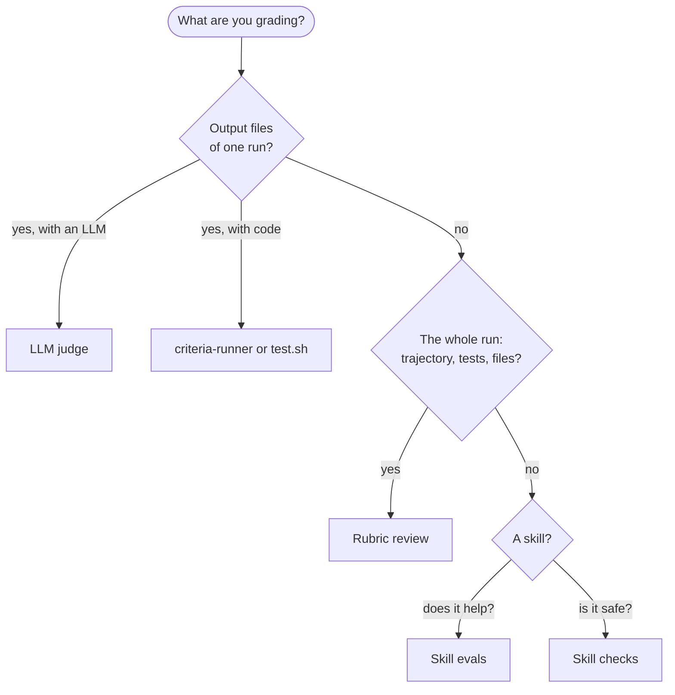

# Judging

Score work that a test script can't: drafts, analyses, a whole agent run, or a skill.

## Which judge?

| You want | Use | You write |
|---|---|---|
| a reward from an LLM reading the agent's output files | [LLM judge](./llm-judge.md) | a `verifier/verifier.md` strategy and a rubric TOML (or a `{id, match_criteria}` JSON) |
| a second agent to audit the whole run (files, trajectory, test output) and gate the reward | [Rubric review](./rubric-review.md) | a `rubric.json` with `name`, `guidance` and, to set the reward, `blocker` and `weight` |
| to measure how much a skill helps an agent | [Skill evals](./skill-evals.md) | `evals/evals.json` next to your `SKILL.md` |
| to check a skill for security and quality issues without running it | [Skill checks](./skill-checks.md) | nothing: point `bench skills validate` at the skill |
| an agent with tools grading inside the verifier | an `agent-judge` [verifier strategy](../tasks/verifier.md#declare-a-strategy) | a `## role:<name>` prompt in `verifier.md` |
| Python criteria with weights | a `criteria-runner` [verifier strategy](../tasks/verifier.md#declare-a-strategy) | `verifier/<root>/reward.py` |

The same file name means different things on these pages:

| File | Read by | Shape |
|---|---|---|
| `verifier/rubrics/*.toml` | LLM judge | `[[criterion]]` tables |
| `rubric.json` whose entries all have `id` and `match_criteria` | LLM judge | the Harvey LAB format |
| any other `rubric.json` (`verifier/`, `tests/` or the task root) | Rubric review | `criteria` with `name`, `description`, `guidance` |

## Next steps

- [LLM judge](./llm-judge.md): a rubric-scored task in four steps.
- [Rubric review](./rubric-review.md): a reviewer agent that gates the reward.
- [Verifier](../tasks/verifier.md): every verifier strategy.
