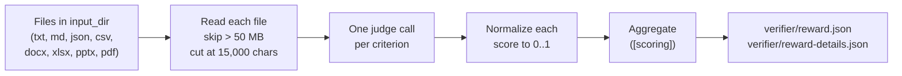

# LLM judge

Grade a task with an LLM and a rubric instead of a test script.

Use an LLM judge when the output has no single right answer: legal analysis, drafting, research summaries. When there is a right answer, use a [`test.sh` verifier](../tasks/verifier.md).

## 1. Install the judge extra

```bash
uv tool install --python 3.12 --upgrade 'benchflow[judge]'
```

In a checkout, run `uv sync --extra judge`. The extra brings the Anthropic, OpenAI and Google SDKs.

Without it, the verifier fails with an error naming the missing SDK. It never records a silent 0.

## 2. Select the judge in `verifier/verifier.md`

```md
---
document_version: "0.3"
verifier:
  name: draft-quality-verifier
  default_strategy: judge
  strategies:
    judge:
      type: llm-judge
      model: claude-sonnet-4-6
      rubric: rubrics/verifier.toml
      input_dir: /app
  outputs:
    reward_text: /logs/verifier/reward.txt
    reward_json: /logs/verifier/reward.json
---

## verifier intent

Score the submitted deliverables in `/app` against the rubric.
```

No `test.sh` is needed. The verifier collects the files in `input_dir`, scores them against the rubric, and writes `reward.json`.

## 3. Write the rubric

Put it where the strategy's `rubric` field points, relative to `verifier/`:

```toml
# verifier/rubrics/verifier.toml
[[criterion]]
name = "accuracy"
description = "The response accurately addresses the question with correct facts"
type = "binary"
weight = 3.0

[[criterion]]
name = "clarity"
description = "The response is well-organized and easy to understand"
type = "likert"
points = 5
weight = 1.0

[scoring]
aggregation = "weighted_mean"
```

A JSON rubric with `{id, match_criteria}` entries (the Harvey LAB format) works too. Set `rubric: rubrics/verifier.json`:

```json
{
  "title": "Task Title",
  "criteria": [
    {"id": "criterion-1", "title": "...", "match_criteria": "What constitutes a pass"}
  ]
}
```

[Rubric reference](./rubric-reference.md) lists every field, type and aggregation.

## 4. Give the judge a key and run

The judge uses the key in the task's `[verifier] env`. A `${NAME}` value there is filled from your environment only when you allow it:

```toml
[verifier.env]
ANTHROPIC_API_KEY = "${ANTHROPIC_API_KEY}"
```

```bash
bench run tasks/my-task -a claude-agent-acp --allow-task-env ANTHROPIC_API_KEY
```

With no key in the task, the judge uses your own key from the environment. It sends that key only to the provider's endpoint, or to your own `OPENAI_BASE_URL`. If a task sets its own `OPENAI_BASE_URL` without a key, none of your keys is sent.

The reward is the weighted mean of the criteria, or your `[scoring]` choice: a number from 0 to 1. Each criterion's score is in the trial's `verifier/reward-details.json`.



## Older `task.toml` tasks

Older tasks set the same fields in `task.toml`:

| Field | Default | Meaning |
|---|---|---|
| `[verifier] type` | `"test-script"` | `"test-script"` runs `tests/test.sh`; `"llm-judge"` runs the judge |
| `[verifier] timeout_sec` | `600` | overall verifier timeout, in seconds |
| `[verifier] env` | `{}` | variables for the verifier; judge keys go here |
| `[verifier.judge] rubric_path` | `tests/rubric.toml` | the rubric, relative to the task folder |
| `[verifier.judge] model` | `claude-sonnet-4-6` | the judge model |

New `task.md` tasks should use `verifier/verifier.md` as above.

## Strategy fields

| Field | Default | Meaning |
|---|---|---|
| `rubric` | required | rubric file relative to `verifier/` (`.toml` or `.json`) |
| `model` | `[verifier.judge] model`, so `claude-sonnet-4-6` | the judge model; its prefix picks the provider. In a task run it wins over a `model` in the rubric's `[judge]` table. |
| `input_dir` | `/app` | sandbox folder whose files are graded |
| `context` or `context_file` | the task instruction | extra context for the judge; not both |

The judge grades files only. It does not read the agent's trajectory. To grade a whole run, use [rubric review](./rubric-review.md).

## Next steps

- [Rubric reference](./rubric-reference.md): criterion types, aggregation, providers and the Python API.
- [Rubric review](./rubric-review.md): a reviewer agent that audits the whole run.
- [Verifier](../tasks/verifier.md): every verifier strategy.
