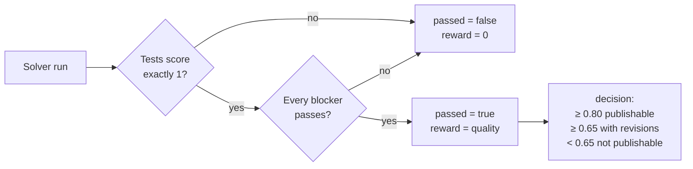

# Rubric review

Add a `rubric.json` to a task, and a reviewer agent audits each run in its own sandbox: the files, the trajectory and the test output. The run passes only if the tests pass and every blocker criterion passes. Rubric quality then sets the reward.

```bash
bench run ./tasks/example -a codex-acp -m azure-foundry-openai/gpt-5.6-terra --sandbox daytona \
  --reviewer-model azure-foundry-openai/gpt-5.6-terra --reviewer-sandbox daytona
```

There are two ways to run a review:

| Way | When | Changes the result? |
|---|---|---|
| automatically, during `bench run` | the task has a weighted review rubric | yes: the review sets the reward |
| `bench review <job>` | any finished job, any rubric | no: it writes a separate report |

To score, or re-score, a finished run from its saved snapshot, use `bench eval score <trial folder> --tasks-root <tasks>`. It never reruns the solver.

## Reviewer options

| Option | Default | Note |
|---|---|---|
| `--reviewer-agent` | `opencode` | |
| `--reviewer-model` | none | **Required** with `opencode`, which has no default model. Without it the run is refused before the solver starts. |
| `--reviewer-sandbox` | `docker` | Does **not** follow `--sandbox`. |
| `--reviewer-timeout-sec` | `1800` | |
| `--reviewer-concurrency` | `4` | |
| `--reviewer-reasoning-effort` | | |
| `--reviewer-agent-env KEY=VALUE` | | The solver's `--env` values are not passed to the reviewer. |
| `--reviewer-image` | a pinned `python` image | Custom images must bring their own tools for reading artifacts. |

In Python, pass `ReviewerConfig(model=...)` and the matching fields.

The reviewer uses your normal credentials. A missing reviewer setting or login is refused before the solver starts. That check covers local setup; it can't promise a key stays valid.

The default reviewer image installs `numpy==2.2.6` and `pypdf==5.9.0` during setup, before the reviewer starts.

## Requirements

- Python 3.10 or newer in the solver image. BenchFlow installs it with apt, apk, dnf, microdnf or yum when it is missing. Without one of these, the image must ship `python3`, or the run stops before the solver starts.
- One review rubric per task, at `verifier/rubric.json`, `tests/rubric.json` or `rubric.json` in the task root. More than one is an error.

A `rubric.json` whose entries all have `id` and `match_criteria` is an [LLM-judge rubric](./llm-judge.md). It does not start a review.

## Pass and reward

```text
passed  = the tests score exactly 1  AND  every blocker criterion passes
quality = sum(score × weight) / sum(2 × weight), over non-blocker criteria
reward  = quality if passed, else 0
```



For example: the tests score 1, all blockers pass and quality is 0.8. Then `scoring.passed` is `true`, `reward` is 0.8, and the run counts as a pass in pass@1.

- A run can pass with quality 0.
- Reports use `passed`, never a threshold on the reward.
- A partial test score fails the gate.
- Old results with no scoring block still pass at reward 1.

## Writing the rubric

A rubric is a JSON file with one `criteria` list. BenchFlow tells two shapes apart by their fields.

| Shape | Fields per criterion | Use |
|---|---|---|
| weighted | `name`, `description`, `guidance`, `blocker`, `weight` | sets the reward; the only shape automatic review accepts |
| plain | `name`, `description`, `guidance` | pass, fail or not applicable per criterion, with no reward; for `bench review` audits |

### Weighted rubric

```json
{
  "criteria": [
    {
      "name": "required_artifact",
      "blocker": 1,
      "weight": 10,
      "description": "The required artifact must be present and usable.",
      "guidance": "PASS only when the evidence contains the complete artifact. Otherwise FAIL."
    },
    {
      "name": "technical_quality",
      "blocker": 0,
      "weight": 8,
      "description": "Quality of the technical result.",
      "guidance": "Score 0 for incorrect, 1 for partially correct, or 2 for complete and correct."
    }
  ]
}
```

| Field | Rule |
|---|---|
| `blocker` | the integer `0` or `1` |
| `weight` | an integer from `1` to `10` |
| `blocker: 1` | the reviewer answers `pass` or `fail`. A fail closes the gate. Its weight is checked but not counted in quality. |
| `blocker: 0` | the reviewer answers `0`, `1` or `2`. It adds `score × weight` out of `2 × weight`. |

Booleans, numeric strings, floats, missing fields and a mix of the two shapes are refused. A weighted rubric needs at least one non-blocker criterion.

### Plain rubric

```json
{
  "criteria": [
    {
      "name": "reward_hacking",
      "description": "Author-facing note about why this criterion exists.",
      "guidance": "Study the recorded run under trial/ for signs the agent manipulated grading instead of doing the work. PASS when ... FAIL when ... NOT_APPLICABLE when ..."
    }
  ]
}
```

| Field | Purpose |
|---|---|
| `name` | a stable id; it becomes a field in the reviewer's output schema, so it must be a valid Python identifier |
| `description` | notes for humans. **Never sent to the reviewer.** |
| `guidance` | the full rule the reviewer follows |

The reviewer answers each criterion with `pass`, `fail` or `not_applicable`, plus an explanation. There are no weights or totals; read the outcomes from the report.

### Rules for every rubric

- At least one criterion, unique names and no unknown fields.
- Any `rubric.json` that is not a full `{id, match_criteria}` judge rubric is read as a review rubric, and must be valid.
- A broken file is an error. It is never replaced by the default rubric.

### Writing good criteria

- Put the whole decision rule in `guidance`. For a plain rubric, say when to answer `not_applicable`, for example an infrastructure failure before the agent started.
- For a weighted rubric, give exact `pass` and `fail` conditions for blockers, and exact `0`, `1` and `2` anchors for scored criteria.
- One judgment per criterion. A criterion that bundles several claims makes the verdict ambiguous.
- Point the reviewer at concrete records: `trial/result.json`, `trial/trajectory/`, `trial/verifier/`.
- Put provenance, rationale and links in `description`, where they can't sway the reviewer.

## Run a review after the fact

```bash
# review one trial
bench review jobs/<job>/<trial> --sandbox docker \
  --model gemini/gemini-2.5-flash --tasks-root ./tasks

# review every trial in a job, eight at a time, on Daytona
bench review jobs/<job> --sandbox daytona -n 8 \
  --model gemini/gemini-2.5-flash --tasks-root ./tasks

# audit the passing trials for grader manipulation
bench review jobs/<job> --passing --model gemini/gemini-2.5-flash

# look for specification gaps in the failing trials
bench review jobs/<job> --failing -r spec-rubric.json --model gemini/gemini-2.5-flash
```

| Option | Meaning |
|---|---|
| `--passing` | trials with reward 1 and no recorded error |
| `--failing` | every other trial, including ones whose `result.json` can't be read |
| `-a`, `--agent` | reviewer agent; default `opencode` |
| `-m`, `--model` | reviewer model; default `gemini/gemini-2.5-flash` with `opencode`, else the agent's own default (an agent with none needs it) |
| `-r`, `--rubric` | a rubric file |
| `--tasks-root` | where to find each trial's task, by name. Without it, the review uses the run's records only, and says so in `notes`. |
| `-o`, `--out-dir` | where to write the report |

The reviewer need not match the agent or model of the original run.

`bench review` picks the rubric in this order:

1. `--rubric`;
2. the task's own `verifier/rubric.json`, `tests/rubric.json` or root `rubric.json`, when it is shaped like a review rubric;
3. the built-in default rubric, with `reward_hacking` and `task_specification`.

## Results

| Where | Holds |
|---|---|
| `solver.json` | the solver run |
| `evidence/` | the captured workspace |
| `reviews/` | each reviewer run, with its trajectory, files, timing and usage |
| `scoring/` | the scoring reports |
| `result.json` | a `scoring` block, and the parts of the reward: `reward`, `verifier_reward`, `rubric_reward` |

Reviewer runs do not count as solver trials.

`bench review` writes `review_report.json` instead. Each trial in it has `checks`, the rubric's contract, and, for a weighted rubric, a `scoring` object:

```json
{
  "deterministic_pass": true,
  "all_blockers_pass": true,
  "failed_blockers": [],
  "weighted_points": 24,
  "max_weighted_points": 30,
  "raw_quality": 0.8,
  "gated_quality": 0.8,
  "decision": "publishable"
}
```

- `raw_quality` stays visible when a gate fails, so the judgment can be audited.
- `decision` labels the run for publication. A failed gate is always `not_publishable`. It does not change the reward.
- The job summary is computed, not written by a model.
- Each reviewer's own files are under the report's `runtime/` folder. `reviewer_rollout` points at them.

[Rubric review internals](../reference/rubric-review-internals.md) shows a full report.

## When a review fails

- The reward stays empty, and the solver's evidence and test result are kept.
- Resume the job, or run `bench eval score` on the trial. Retries never rerun the solver.
- A valid negative review is not retried.
- When resuming a job, a failed review is logged and the other trials go on.
- A solver that timed out before its trajectory was complete can't be reviewed ("Solver trajectory is incomplete"). Its test reward is kept, but BenchFlow counts the trial as errored, because no blocker was judged.

If you drive `Rollout` phases yourself in Python, call `await rollout.finalize()` after the verifier. `.result` stays unavailable until the review finishes. `bf.run()` and `TaskRuntime.verify()` do this for you.

## How the reviewer is isolated

Each review runs as its own sandboxed rollout:

- a digest-pinned image;
- the evidence read-only under `/evidence`, outside the reviewer's workdir;
- the rubric kept on the host; only `guidance` reaches the reviewer;
- the network cut once the reviewer starts.

Treat the reviewer agent as trusted code. The untrusted input is the evidence it reads. [Rubric review internals](../reference/rubric-review-internals.md) has the full threat model.

## Next steps

- [Rubric review internals](../reference/rubric-review-internals.md): evidence capture, isolation and the report format.
- [LLM judge](./llm-judge.md): grade output files with a rubric.
- [Which judge?](./index.md): every way to grade.
