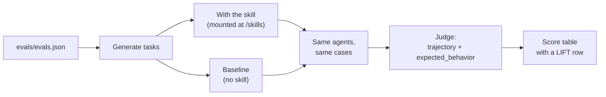

# Skill evals

Test whether your agent skill helps agents do better.

```bash
bench skills eval benchmarks/followup-bench --agent gemini --model gemini-3.1-flash-lite-preview
```

`bench skills eval` reads a skill folder's `evals/evals.json`, generates tasks from it, and runs each agent with and without the skill. It reports the lift: how much the skill improves the score.

[Install](../getting-started/install.md) BenchFlow first. The example skill, `benchmarks/followup-bench` in the BenchFlow repo, has a `SKILL.md` and three cases.

## 1. Add evals to your skill

```text
my-skill/
├── SKILL.md
├── scripts/
│   └── helper.py
└── evals/
    └── evals.json
```

## 2. Write the cases

```json
{
  "version": "1",
  "skill_name": "my-skill",
  "defaults": {
    "timeout_sec": 300,
    "judge_model": "gemini-3.1-flash-lite"
  },
  "cases": [
    {
      "id": "test-001",
      "question": "Do X using the my-skill skill.",
      "ground_truth": "expected output",
      "expected_behavior": [
        "Agent read the SKILL.md file",
        "Agent ran helper.py with correct arguments",
        "Agent produced the expected output"
      ]
    }
  ]
}
```

## 3. Run it

```bash
bench skills eval my-skill/ --agent claude-agent-acp
```

```text
Skill eval: my-skill (1 cases)
  Agents: claude-agent-acp
  Environment: docker

              Skill Eval: my-skill
┏━━━━━━━━━━━━━━━━━━━┳━━━━━━━━━━━━┳━━━━━━━┳━━━━━━━━━━━━┓
┃ Agent             ┃ Mode       ┃ Score ┃ Avg Reward ┃
┡━━━━━━━━━━━━━━━━━━━╇━━━━━━━━━━━━╇━━━━━━━╇━━━━━━━━━━━━┩
│ claude-agent-acp  │ with-skill │ 1/1   │ 0.90       │
│ claude-agent-acp  │ baseline   │ 0/1   │ 0.20       │
│ claude-agent-acp  │ LIFT       │ +1    │ +0.70      │
└───────────────────┴────────────┴───────┴────────────┘
```

Repeat `--agent` to compare agents. Each agent gets a with-skill row, a baseline row and a LIFT row:

```bash
bench skills eval my-skill/ --agent claude-agent-acp --agent codex-acp --agent gemini
```



## Options

| Flag | Default | Meaning |
|---|---|---|
| `--agent` | `claude-agent-acp` | agent to evaluate; repeatable |
| `--model` | the agent's default | once for all agents, or once per `--agent` |
| `--sandbox` | `docker` | where trials run |
| `--concurrency` | `1` | trials at a time |
| `--jobs-dir` | `jobs` | where results go |
| `--no-baseline` | off | skip the runs without the skill |
| `--export-gepa` | off | write traces for GEPA ([below](#export-for-gepa)) |

## evals.json reference

### Top-level fields

| Field | Required | Default | Meaning |
|---|---|---|---|
| `version` | no | `"1"` | schema version |
| `skill_name` | no | from `SKILL.md` | the skill's name |
| `defaults.timeout_sec` | no | `300` | per-task timeout, in seconds |
| `defaults.judge_model` | no | `gemini-3.1-flash-lite` | model for the judge |
| `defaults.skill_mount_dir` | no | `/skills` | where the skill is mounted in the sandbox |

### Case fields

| Field | Required | Meaning |
|---|---|---|
| `question` | **yes** | the instruction sent to the agent |
| `id` | no | a unique case id; generated when missing |
| `ground_truth` | no | the expected answer, for exact match |
| `expected_behavior` | no | rubric items the judge checks against the trajectory |
| `expected_skill`, `expected_script` | no | recorded with the case; not graded |
| `environment` | no | environment variables for this case |

Unknown fields are refused, so a typo like `expecte_behavior` fails at once.

### How a case is graded

| The case has | Grader | Reward |
|---|---|---|
| `expected_behavior` | an LLM judge reads the agent's trajectory (its first 50,000 characters) and checks each item | 0 to 1 |
| only `ground_truth` | 1 if the answer appears as a whole word in the agent's output | 0 or 1 |
| neither | none | 0 |

This judge is not the [LLM judge](./llm-judge.md) verifier. It reads the trajectory, not output files.

## Credentials

The agent needs its usual credentials ([Auth](../agents/auth.md)). Judged cases also need a judge key.

BenchFlow passes every judge key it finds (`GOOGLE_API_KEY`, `GEMINI_API_KEY`, `ANTHROPIC_API_KEY`, `OPENAI_API_KEY`) to the judge when it runs. Keys are never written into the generated tasks, and you need no `--allow-task-env`.

`--agent oracle` does not work here. Generated tasks have no `solution/solve.sh`.

## Skills inside a task

A skill under a task, such as `tasks/<task>/environment/skills/<skill>/SKILL.md`, is not shown to ordinary runs by default. To evaluate it, add `evals/evals.json` inside that skill folder, or copy the skill into a folder of its own.

## Custom environments

For a skill with dependencies, add a Dockerfile:

```text
my-skill/evals/
├── evals.json
├── Dockerfile           # replaces the default python:3.12-slim base
└── requirements.txt     # extra Python packages
```

For with-skill runs, BenchFlow adds a `COPY skills/ <skill_mount_dir>/` step. At setup it links that folder into the agent's own skill paths.

## Results

Results are in `jobs/skill-eval/<skill>/<agent>/with-skill/` and `jobs/skill-eval/<skill>/<agent>/baseline/`, one trial folder per case. The generated tasks are deleted after the run.

## Export for GEPA

```bash
bench skills eval my-skill/ --agent claude-agent-acp --export-gepa
```

This writes `jobs/skill-eval/<skill>/gepa/`:

```text
gepa/
├── skill.md        # the current SKILL.md
├── traces/         # one file per case, agent, model and mode, with its score
└── summary.json    # aggregate scores
```

Point your GEPA optimizer at that folder to evolve the skill text.

## In CI

```bash
uv tool install --python 3.12 --upgrade benchflow
bench skills eval . --agent claude-agent-acp --no-baseline
```

Your skill needs only `SKILL.md` and `evals/evals.json`. There are no tasks or test scripts to write.

## Tips for cases

1. **Name the skill in the question.** "Use the calculator skill to compute X" beats "Compute X".
2. **Write 3 to 5 rubric items per case**, each checkable from the trajectory.
3. **Include edge cases:** errors, unusual inputs, multi-step work.
4. **Keep `ground_truth` short.** Exact match works best for numbers and short strings.
5. **Start with 3 to 5 cases:** enough to see a pattern, cheap enough to rerun.
6. **Test the lift, not just correctness.** If the baseline already scores high, the skill adds little.

## Next steps

- [Skill checks](./skill-checks.md): scan a skill for security and quality issues.
- [Which judge?](./index.md): every way to grade.
- [Run a job](../jobs/run.md): run tasks with `--skills-dir`.
