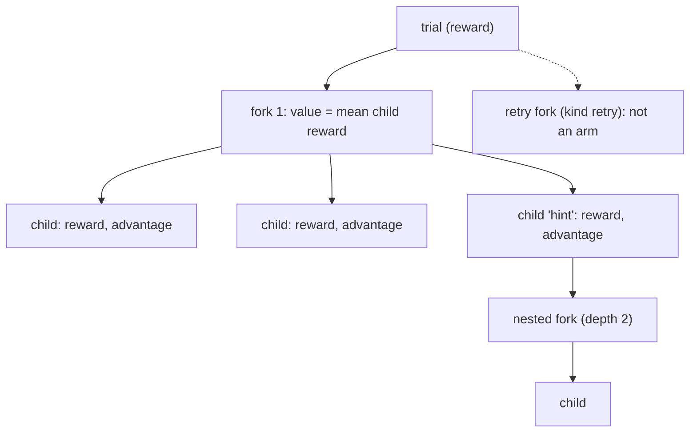

# Branch view: the JSON contract for branched runs

```bash
bench eval branches jobs/branch-…            # a table per branched trial
bench eval branches jobs/branch-… --json     # the documents, as a JSON list
```

```python
import benchflow as bf
view = bf.load_trial("jobs/branch-…/hello-world-task__0000abcd").branch_view
views = bf.load_job("jobs/branch-…").branch_views()      # every branched trial
from benchflow.branch_view import load_branch_view, BRANCH_VIEW_SCHEMA  # JSON Schema
```

`benchflow.branch-view/1` is one JSON document per branched trial. It lists every fork, nested forks and checkpoint retries included, and every child.

For each child it gives what the child was asked, its reward and advantage, cost, timings, what it reused from the snapshot, and where its files are.

Read this instead of the raw `tree.json` and `result.json`, whose fields changed across releases. Fields an older run lacks are `null`.

Privacy rules: snapshot refs (capability handles) never appear. Prompts never appear: `requested` is a short description with a sha256 prefix, and the prompt text is in the child's trajectory. Errors are `{type, code}` only.



## Shape

```json
{
  "kind": "benchflow.branch-view",
  "schema_version": "1.1",
  "schema": "benchflow.branch-view/1",
  "trial": {"name": "hello-world-task__0000abcd", "task": "hello-world-task",
            "reward": 1.0, "retry": null, "checkpoint_source": null,
            "parent": "kept", "unscored_by_design": false},
  "totals": {"forks": 1, "children": 4,
             "cost": {"tokens": 160000, "usd": null, "usd_known": false,
                      "sandbox_seconds": 450.0},
             "usage": {"input": 16, "output": 600, "cache_read": 155384,
                       "cache_creation": 4000, "total": 160000},
             "usd_estimate": 0.0235544,
             "per_scored_child": {"scored": 4, "tokens": 40000, "usd": null,
                                  "usd_estimate": 0.0058886, "sandbox_seconds": 112.5}},
  "pricing": {"model": "claude-haiku-4-5", "source": "litellm 1.91.5 bundled price table",
              "usd_per_token": {"input": 1e-06, "output": 5e-06,
                                "cache_read": 1e-07, "cache_creation": 1.25e-06}},
  "forks": [{
    "id": "00000000000000000000000000000001", "kind": "fork",
    "reason": null, "checkpoint": null, "parent_node": "n4", "depth": 1,
    "forked_by": {"rollout": "hello-world-task__0000abcd", "child_node": null, "child_label": null},
    "status": "completed", "value": 0.5, "value_stderr": 0.288675,
    "parent_restore": "restored", "error": null,
    "children_mode": {"isolated": true, "concurrency": 2, "prewarm": 2},
    "snapshot": {"layers_requested": ["sandbox"], "layers_captured": ["sandbox"],
                 "agent_session": "fresh", "retention": "deleted", "provider": "daytona",
                 "reused": false},
    "timing_sec": {"checkpoint": 45.0, "child_restore": [18.5, 18.5, 4.0, 4.0],
                   "children": 108.0, "parent_restore": 1.5},
    "cost": {"tokens": 160000, "usd": null, "usd_known": false, "wall_seconds": 150.0,
             "parent_sandbox_seconds": 150.0, "children_sandbox_seconds": 300.0,
             "sandbox_seconds": 450.0},
    "usage": {"input": 16, "output": 600, "cache_read": 155384,
              "cache_creation": 4000, "total": 160000},
    "usd_estimate": 0.0235544,
    "children": [{
      "node_id": "n7", "index": 2, "label": "hint",
      "requested": "own prompt (153 characters, sha256:000000000abc)", "execution": "runner",
      "status": "scored", "reward": 0.0, "reward_source": "verifier", "advantage": -0.5,
      "error": null, "attempts": 1, "retried_after": null,
      "cost": {"tokens": 40000, "usd": null, "sandbox_seconds": 75.0},
      "usage": {"n_input_tokens": 4, "n_output_tokens": 150, "n_cache_read_tokens": 38846,
                "n_cache_creation_tokens": 1000, "total_tokens": 40000},
      "usd_estimate": 0.0058886,
      "timing_sec": {"agent_setup": 3.5, "agent_execution": 5.5, "verifier": 27.5,
                     "sandbox_from_snapshot": 4.0, "install_agent": 5.5, "finalize": 1.5},
      "snapshot_start": {"agent": "reused", "verifier_baseline": "inherited",
                         "setup_commands": "skipped"},
      "archive": {"path": "branches/0000…/children/n7",
                  "observation": "branches/0000…/children/n7/observation.json",
                  "result": "branches/0000…/children/n7/result.json"},
      "nested_forks": []
    }]
  }]
}
```

(Illustrative output for the bundled hello-world task, with synthetic ids, prices and round numbers; one of four children shown. Keys are in the order the builder writes them.)

## Fields

All paths are relative to the trial folder. Every field is read from the `tree.json` fork or child entry of the same name, or from `result.json` for `trial`. These are computed instead: `depth`, `forked_by`, `advantage`, `nested_forks`, and the `usage` and `usd_estimate` sums.

### Trial

| Field | Meaning | Null when |
|---|---|---|
| `trial.name`, `trial.task` | the rollout name (else the folder name) and the task | |
| `trial.reward` | the trial's own reward, never a retry's | unscored |
| `trial.retry` | `{status, reason, checkpoint, fork_id, reward, original_reward, path}` for `--retry-from-checkpoint` | no retry |
| `trial.checkpoint_source` | for a trial started with `--from-checkpoint`: `{trial, checkpoint, provider, prefix_events}`. `prefix_events` is how many of the source trial's events the branch-tree export prepends. | not started from a checkpoint |
| `trial.parent` | `kept`, or `discarded` when a fork skipped restoring the parent (`--parent discard`) | no forks |
| `trial.unscored_by_design` | true when the parent was discarded and the trial has no reward. Leave these out of "attempted but unscored" counts. | |

### Totals and pricing

| Field | Meaning | Null when |
|---|---|---|
| `totals.forks`, `totals.children` | how many | |
| `totals.cost` | `result.json` `branches.cost`, else summed over forks. A nested fork's parent sandbox is not counted twice. | runs before cost accounting |
| `totals.usage` | token classes summed over children: `{input, output, cache_read, cache_creation, total}` | no child has a usage record |
| `totals.usd_estimate` | summed `child.usd_estimate` | any child's estimate is null |
| `totals.per_scored_child` | `{scored, tokens, usd, usd_estimate, sandbox_seconds}`: totals divided by the scored children (the cost of one sample) | each value: `scored` is 0, or the total is null |
| `pricing` | `{model, source, usd_per_token}` from LiteLLM's bundled price table. List prices; subscription, batch or negotiated prices differ. | no model, unknown model, or no price table |

### Fork

| Field | Meaning | Null when |
|---|---|---|
| `id`, `kind` | the fork id; `fork`, or `retry` for a checkpoint retry | |
| `reason`, `checkpoint` | why and where a retry started (`failure` or `timeout`; `prompt:N`) | not a retry |
| `parent_node` | the node the fork was taken at | |
| `depth` | 1 for the trial's own forks; one more per level of nesting | |
| `forked_by` | `{rollout, child_node, child_label}`: the child a nested fork was made from | `child_node` and `child_label` for top-level forks |
| `status` | the fork's status, such as `completed` | |
| `value` | mean child reward | the fork did not complete |
| `value_stderr` | standard error of `value` (sample std / √n) | fewer than two children, or older trees |
| `parent_restore` | `restored`, `skipped` (`--parent discard`), `deferred`, `failed`, `not_needed` (retry) | |
| `error` | `{type, code}` | no error |
| `children_mode` | `{isolated, concurrency, prewarm}` | older trees |
| `snapshot` | `layers_requested`, `layers_captured`, `agent_session` (`fresh`/`resumed`), `retention` (`deleted`/`deferred`/`kept`/`delete_failed`), `provider`, `reused` | |
| `snapshot.reused` | true when the fork used an existing image (a kept or automatic checkpoint) instead of taking a snapshot; `timing_sec.checkpoint` is then near 0 | |
| `timing_sec` | seconds: `checkpoint`, `child_restore[]` (per child), `children`, `parent_restore` | older trees |
| `cost` | tokens, `usd` + `usd_known`, `wall_seconds`, `parent_sandbox_seconds`, `children_sandbox_seconds`, `sandbox_seconds` | older trees |
| `usage`, `usd_estimate` | summed over the fork's children | as for totals |
| `children` | the child entries below | |

### Child

| Field | Meaning | Null when |
|---|---|---|
| `node_id`, `index`, `label` | the child's node, position and label | |
| `requested`, `execution` | a short description of what the child was asked, and how it ran | older trees |
| `status` | `scored`, `unscored`, `failed`, `cancelled` or `not_started` | |
| `reward`, `reward_source` | the reward (`verifier` or `runner_return`) | unscored (never 0) |
| `advantage` | `reward − fork.value` | either is null |
| `error` | `{type, code}` | no error |
| `attempts`, `retried_after` | runs of the child (2 when a failure before the agent did anything was retried), and that first error | older trees; `retried_after` when not retried |
| `cost` | `{tokens, usd, sandbox_seconds}` | `usd`: the provider reported no price (subscription runs never do) |
| `usage` | `n_input_tokens` (not counting cache), `n_output_tokens`, `n_cache_read_tokens`, `n_cache_creation_tokens`, `total_tokens` | no usage record |
| `usd_estimate` | USD at list price from `usage` and `pricing`; 0 when the child used no tokens (oracle). Never mixed into `cost.usd`. | no price for the model, or no usage |
| `timing_sec` | phase seconds; isolated children add `sandbox_from_snapshot`, `install_agent`, `finalize` | |
| `snapshot_start` | isolated children: `{agent: reused/installed/none, verifier_baseline: inherited/recaptured, setup_commands: skipped}`. Show `recaptured` as a warning: tampering before the fork is not undone at verification. | |
| `archive` | `{path, observation, result}`. `observation` exists for every published child; `result` only for isolated children. | each file that doesn't exist |
| `nested_forks` | ids of forks this child made | |

## What a child starts from

`snapshot_start` and the fork's `parent_restore` answer this. An isolated child starts from the fork's snapshot in its own sandbox. `agent` says whether the agent install was reused, `verifier_baseline` whether the verifier baseline was inherited, and setup commands are skipped. See [Branching](../jobs/branching.md).

## Validate a document

With the `jsonschema` package installed (BenchFlow does not ship it):

```python
import jsonschema
from benchflow.branch_view import BRANCH_VIEW_SCHEMA

jsonschema.validate(view, BRANCH_VIEW_SCHEMA)
```

## In your own viewer

`src/benchflow/branch_view.py` imports nothing from benchflow, so you can copy it. Call `build_branch_view(tree, result, trial_name=..., file_exists=...)`.

Pass the parsed `tree.json` and `result.json` (`{}` when missing) and a callback that says whether a trial-relative path exists. Optional `prices=` and `checkpoint_source=` arguments fill `pricing`, the estimates and `trial.checkpoint_source`.

`BRANCH_VIEW_SCHEMA`, in the same file, can type your API response (for example `GET /api/runs/<id>/branches`).

| Viewer element | Fields |
|---|---|
| Fork title | `kind` (retries read "Retry (failure) from prompt:1", not an experiment arm), `forked_by.child_label` ("forked from hint"), `depth` |
| Fork notes | `children_mode`, `snapshot.agent_session`, `snapshot.retention`; one cost line (show "USD unknown" when `usd_known` is false, never 0); one time line |
| Child columns | Requested, Tokens, USD, Sandbox-s, Advantage, Setup (`sandbox_from_snapshot + install_agent + finalize`), Reused (`snapshot_start`; flag `recaptured`), links to `nested_forks` |
| Run header | `totals.cost`; `trial.retry` on its own line next to the trial reward, never replacing it |

## Versions

`schema` names the family (`benchflow.branch-view/1`) and stays the same for every 1.x document. `schema_version` is the minor version. Minor versions only add fields, so a 1.0 reader reads 1.1 unchanged.

## Changelog

- 1.1: top-level `kind` (`benchflow.branch-view`) and `schema_version` (`"1.1"`), the same envelope `bench results --json` uses. `bench eval branches --json` still prints a list of documents.
- 1.1: token classes and an estimated USD: `child.usd_estimate`, `fork.usage`, `fork.usd_estimate`, `totals.usage`, `totals.usd_estimate`, `totals.per_scored_child`, top-level `pricing`. `build_branch_view` gains an optional `prices=` argument. `load_branch_view` prices from LiteLLM's bundled table by default (`prices=None` turns estimates off).
- 1.1: `trial.checkpoint_source`; `trial.retry` also carries `tool_calls` and `no_work` for new retries.
- 1.1: `fork.snapshot.reused`.
- 1.1: `trial.parent` and `trial.unscored_by_design`; `result.json` `branches.parent` records the same for new runs.
- 1.0: first version; documents have `schema` only.

## Next steps

- [Branching](../jobs/branching.md)
- [JSON export](./json-export.md)
- [Training signal](./training-signal.md)
- [Trajectories](../results/trajectories.md)
