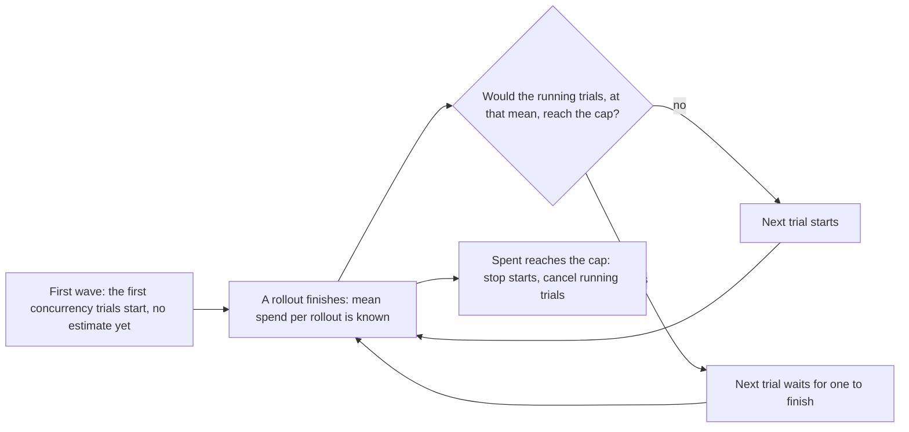

# Job budget caps

```bash
bench run tasks/ -a claude-agent-acp --sandbox daytona \
  --max-cost-usd 20 --max-sandbox-seconds 36000 --max-tokens 50000000 --max-rollouts 200
```

Expect a job to pass a USD or token cap by about one rollout. BenchFlow only learns a rollout's cost and tokens when it finishes, so it can't stop a running rollout on them.

A budget stops a job when it has spent enough. At the cap, BenchFlow starts no more rollouts. A rollout is one attempt at a task: the first try or a retry. At a spend cap, BenchFlow also cancels the running ones. Cancelled and not-started trials are reported as such, never as failures.

The budget flags are listed by `bench run --help-all`. From Python:

```python
import asyncio

import benchflow as bf

evaluation = bf.Evaluation(
    tasks_dir="tasks",
    jobs_dir="jobs/capped",
    config=bf.EvaluationConfig(agent="claude-agent-acp", environment="daytona"),
    budget=bf.Budget(max_cost_usd=20, max_sandbox_seconds=36_000, max_rollouts=200),
)  # same as EvaluationConfig(budget=...)
result = asyncio.run(evaluation.run())
print(result.budget)  # the summary.json "budget" block, or None
```

In a run config: `budget: {max_cost_usd: 20, max_rollouts: 200}`.

## The four caps

| Cap | Counts | When it's known | Checked |
|---|---|---|---|
| `--max-cost-usd` / `max_cost_usd` | USD of finished rollouts, retries included | Only when a rollout reports USD (usage tracking, or an estimate from the agent's own session log). The others are counted in `spent.usd_unknown_trials` and add nothing; one warning. | before each start |
| `--max-sandbox-seconds` / `max_sandbox_seconds` | Wall-clock seconds of every trial, from its start (sandbox creation included) to its end, retries included. A [separate verifier](#separate-verifier-seconds) sandbox's extra seconds count too. Running trials count as they run. | always | every 0.2 s |
| `--max-tokens` / `max_tokens` | Tokens of finished rollouts, retries included | When the agent's usage reaches BenchFlow. The others are counted in `spent.tokens_unknown_trials`. | before each start |
| `--max-rollouts` / `max_rollouts` | Rollouts started, retries included | always | at each start |

A cap is reached when spent ≥ cap.

## How a USD or token cap holds back starts



A new trial waits while the running trials, at the job's average spend per finished rollout, would reach the cap. It starts when one of them finishes and the estimate allows it. That is why a job passes the cap by about one rollout.

The first `concurrency` trials start before any has finished, so they start without an estimate. With `concurrency` 1, nothing waits, and the last rollout can pass the cap by its own spend.

## What happens at the cap

| | Spend cap (USD, sandbox-seconds, tokens) | Rollout cap |
|---|---|---|
| New trials and retries | not started; listed in `budget.not_started` | not started; listed in `budget.not_started` |
| Running trials | cancelled; listed in `budget.cancelled` | finish |

- A trial that would have been retried keeps its last result.
- A cancelled trial's sandbox is torn down. Its attempt folder gets `budget-cancelled.json` (the seconds it used) instead of `result.json`.
- Neither kind is in `total`, `passed`, `failed` or `errored`, so pass rates are over the trials that finished.
- The CLI prints a `Budget:` line with the reason and counts.

### Separate verifier seconds

A trial whose verifier runs in a separate sandbox pays for two sandboxes while both exist. The sandbox-seconds cap charges the seconds they overlapped, on top of the trial's wall clock. The charge starts before the verifier sandbox is created and ends when it is torn down, so a cancelled trial is charged too.

## Resuming a stopped job

The cap is per job, across resumes. A resume counts everything earlier attempts spent:

| Spend | Read from |
|---|---|
| Tokens and USD | each attempt's `result.json`, retried and re-run attempts included |
| Sandbox-seconds | each attempt's `timing.total`, or its `budget-cancelled.json` |
| Rollouts | each attempt folder, even one that wrote no `result.json` |

With the same caps, nothing more starts. To continue, rerun the same job with a bigger cap, or none:

```bash
bench run tasks/ -a claude-agent-acp --sandbox daytona --job capped --max-cost-usd 20
# stopped at the cap; raise it to run the rest:
bench run tasks/ -a claude-agent-acp --sandbox daytona --job capped --max-cost-usd 40
```

Raising or removing a cap resumes a job its budget stopped. Lowering a cap, or adding a new kind of cap, is a different run. On a named job, the earlier trials are then set aside and the tasks start over (see [Resuming](./cli.md#resuming)).

From Python, `bf.Evaluation.resume(job_dir)` resumes with the recorded caps; pass `budget=bf.Budget(...)` to replace them.

`bench eval resume` takes no budget flags, so it can't raise a cap.

## The `budget` block in `summary.json`

`summary.json` gets a `budget` block only when a budget was set:

```json
"budget": {
  "caps": {"max_cost_usd": null, "max_sandbox_seconds": null, "max_tokens": 150,
           "max_rollouts": null},
  "spent": {"cost_usd": 0.0, "sandbox_seconds": 12.4, "tokens": 200, "rollouts": 2,
            "usd_unknown_trials": 2, "tokens_unknown_trials": 0},
  "stopped": true,
  "reason": "budget reached: 200 tokens spent of a 150 cap",
  "cancelled": [],
  "not_started": ["task-2", "task-3"]
}
```

## Limits

- The cap is per job. With `--matrix`, each model × trial job gets its own cap.
- Refused with `--worker-concurrency` (each worker would get the whole budget) and `--source-env` (vf-eval runs those rollouts).
- A budget needs at least one cap, and each cap must be positive. An unknown key in a run config's `budget:` block is refused.
- `bench branch` jobs take no budget.

## Next steps

- [`bench run` reference](./cli.md#resuming): resuming, and which settings start a new job.
- [Reading results as JSON](./json-export.md): where `budget` appears in the exported documents.
- [When a run fails](../jobs/when-a-run-fails.md): the end-of-run summary and its causes.
- [Python API](./python-api.md): `bf.Budget` and `bf.Evaluation`.
