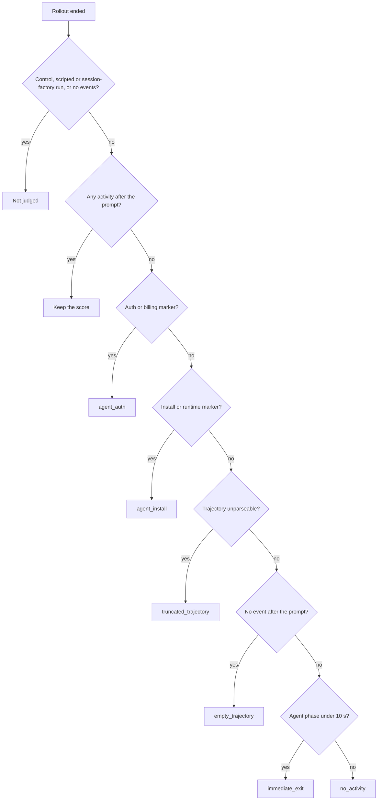

# Agent integration failures

```bash
bench results jobs/my-job                      # a Cause column for broken trials
bench explain agent_integration:agent_auth     # what happened and the next step
bench doctor --sandbox daytona --agent-start claude-agent-acp
```

An agent integration can break silently. The install lacks a runtime, the login is rejected, or the agent exits before doing anything. The verifier then scores the untouched workspace, usually 0, and the trial looks like a model that failed.

BenchFlow catches these. Such a trial is unscored (never 0), gets a named cause, and is counted on its own. For every other way a run can fail, see [When a run fails](../jobs/when-a-run-fails.md).

| Reward valid | Retried | Verifier runs |
|---|---|---|
| no | no | yes; its reward is kept as `reward_withheld` |

## When a trial is judged

A trial counts as an integration failure when, after the prompt, the agent:

- made no tool call,
- sent no message with text,
- had no real thought (shim diagnostics such as `[openclaw stderr] …` don't count), and
- reported no output tokens.

Any activity clears the trial. A model that thought for an hour and timed out, or refused, keeps its 0.

An adapter's `notice` event, such as Codex warning that a model isn't in its catalog, is the adapter talking, not the agent. It isn't activity; it is used as evidence.

Not judged when the run ends: control runs (`oracle`, `nop`), scripted agents, session-factory agents, and runs that recorded no events at all. Session-factory runs are still scored and still checked for provider API errors. When results are read (`bf.load_job`, `bench results`), a trial with no stored finding can still be judged.

A run that hit the agent's wall-clock limit is judged like any other and keeps its `agent_timeout_info`. An idle timeout is retried under its own category; only its final attempt is judged, when the results are read.



Every cause above makes the trial unscored, not a sample, with the verifier's reward kept as `reward_withheld`. `agent_model` is checked earlier, before the prompt is sent.

## Causes

| Cause | Evidence | Next step |
|---|---|---|
| `agent_auth` | an auth or billing failure in a diagnostic thought, a notice or `agent/*.txt`: credit balance too low, invalid API key, `authentication_error`, 401, not logged in, expired OAuth token, insufficient quota | `bench doctor` |
| `agent_install` | an install or runtime failure: `Node.js vX+ is required`, command not found, Cannot find module, `ModuleNotFoundError`, exec format error, `npm ERR!` | `bench doctor --agent-start <agent>` |
| `agent_model` | the agent's session doesn't offer the requested model (checked before the prompt); the error lists the models it does offer | pick a model the agent lists in the error |
| `truncated_trajectory` | the trajectory file has unparseable lines | read `integration_failure_info` in `result.json` |
| `empty_trajectory` | no event after the prompt | read `integration_failure_info` in `result.json` |
| `immediate_exit` | the agent phase lasted under 10 s | read `integration_failure_info` in `result.json` |
| `no_activity` | the agent ran and produced nothing | read `integration_failure_info` in `result.json` |

`bench explain` has a page for `agent_integration:agent_auth`, `agent_integration:agent_install` and `agent_integration:agent_model`. The other four causes share `agent_integration:unknown`.

## What is recorded

The trial's `result.json` gets:

- `error_category: "agent_integration"`;
- `rewards: null`;
- an `error` such as `agent integration failure [agent_auth]: LLM request rejected: Your credit balance is too low …`;
- `integration_failure_info`: the cause, the evidence and where it was found, the activity counts, the agent's seconds, and `reward_withheld` (what the verifier gave).

This works for subscription (OAuth) runs too, unlike the zero-token check (`suspected_api_error`).

## Where you see it

- `bench results <job>`: a `Cause` column, `broken` in the `Exec` column, and a count in the headline.
- `bench eval metrics`: an `Integration failures` row (`integration_failures` in `--json`).
- `summary.json`: `integration_failures: {total, by_cause}`. The end-of-run summary logs one warning line.
- `bench explain <code>`: what happened, whose problem it is, and the next step.
- Python:

```python
import benchflow as bf

trial = bf.load_trial("jobs/my-job/hello-world-task__0000abcd")
print(trial.execution, trial.integration_failure, trial.reward)
# integration_failed {'cause': 'agent_auth', ...} None
```

Results written before this check existed are checked when they're read, so old jobs show the same columns. Their `integration_failure` has `detected: "on read"`.

## Stopping a batch early

A job stops early when the same `agent_auth`, `agent_install` or `agent_model` failure happens 5 times in a row. Set `BENCHFLOW_API_ERROR_BREAKER_THRESHOLD` to change the count; `0` turns it off.

Tasks already running finish; only tasks not yet started are skipped. The other causes don't trip the breaker, since they may not repeat.

Integration failures are never retried automatically, and resuming the job does not run them again. Fix the cause, then start a new job (`bench run … --fresh`).

## Checking an agent before a batch

```bash
bench doctor --sandbox daytona --agent-start claude-agent-acp
```

This starts a sandbox with the bundled hello-world task, installs the agent, and opens its ACP session without a prompt. Then it deletes the sandbox. It makes no model call.

A failure names its cause, with the evidence line and the end of the agent's logs.

## Next steps

- [When a run fails](../jobs/when-a-run-fails.md)
- [JSON export](./json-export.md): `execution` and `denominators.integration_failures`
- [pass@k, pass^k and solve rates](./pass-at-k.md): how unscored trials count
