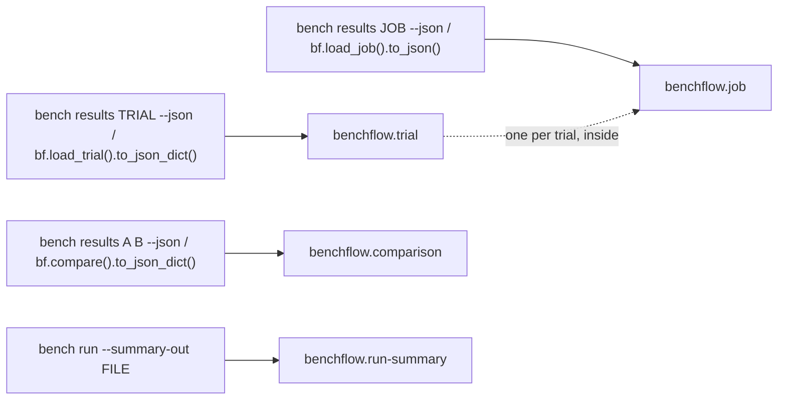

# JSON export: trials, jobs, comparisons and run summaries

```bash
bench results jobs/my-job/hello-world-task__0000abcd --json          # benchflow.trial
bench results jobs/my-job --json                     # benchflow.job
bench results jobs/a jobs/b --json                   # benchflow.comparison
bench run tasks/ -a claude-agent-acp --summary-out run.json   # benchflow.run-summary
```

```python
import benchflow as bf

bf.load_trial("jobs/my-job/hello-world-task__0000abcd").to_json_dict()   # benchflow.trial
bf.load_job("jobs/my-job").to_json("job.json")            # benchflow.job
bf.compare("jobs/a", "jobs/b").to_json_dict()             # benchflow.comparison
```

BenchFlow writes results as four JSON documents with a stable, versioned shape. Read results through them, not through the job folder. The folder layout changes between versions; the documents don't.



| `kind` | Schema | One document holds |
|---|---|---|
| `benchflow.trial` | [v1](./schemas/benchflow-trial.v1.schema.json) | One trial: task, agent and model; `reward` and `rewards`; `execution`; `assessment`; `control`; errors and their categories; usage and cost; timing; branch forks; checkpoints; verifier output; rubric reviews; the trajectory (ACP events). |
| `benchflow.job` | [v2](./schemas/benchflow-job.v2.schema.json) | Every trial of a job (no trajectories by default), the counts in `denominators`, total cost, `solve_rates`, and the job's `summary.json` as written. |
| `benchflow.run-summary` | [v2](./schemas/benchflow-run-summary.v2.schema.json) | One run's result, for CI: counts, pass rate, mean reward, tasks reused and run, the `--fail-under` / `--fail-on` gate, and the exit code. |
| `benchflow.comparison` | [v2](./schemas/benchflow-comparison.v2.schema.json) | Two jobs paired by task: each side's counts, per-task rewards and delta, setting mismatches, the `vary` settings, a summary and caveats. |

Every document has `kind` and `schema_version`: 1 for trials, and 2 for jobs, comparisons and run summaries (since 0.8.0). The version 1 schema files stay published.

The JSON is strict: NaN and infinity become `null`. Times are ISO 8601 strings in local time with no zone, as recorded.

## Trial

```bash
bench results jobs/my-job/hello-world-task__0000abcd --json
bench eval inspect jobs/my-job/hello-world-task__0000abcd --json --trajectories   # with the trajectory
```

```python
doc = bf.load_trial("jobs/my-job/hello-world-task__0000abcd").to_json_dict(include_trajectory=False)
```

From the CLI, the trajectory is left out; only `bench eval inspect` has `--trajectories`. From Python, `to_json_dict()` includes it unless you pass `include_trajectory=False`.

| Field | Holds |
|---|---|
| `task_name`, `rollout_name`, `agent`, `agent_name`, `model` | what ran |
| `reward`, `rewards` | the reward (`null` when unscored) and the full rewards dict |
| `passed`, `score_outcome` | `passed`, `failed`, `errored` or `verifier_errored` |
| `execution` | `completed`, `errored`, `timed_out` or `integration_failed` ([integration failures](./integration-failures.md)) |
| `assessment` | `scored`, `error` (the verifier failed) or `unscored` |
| `control` | `oracle` or `empty` for a control run; `null` for an agent run |
| `attempts` | rollouts the trial took: 1, plus each retry or resume re-run |
| `error`, `error_category`, `verifier_error`, `verifier_error_category` | what went wrong |
| `usage` | tokens by class, `cost_usd`, `cost_status`, `price_source`, `cost_estimate` |
| `started_at`, `finished_at`, `duration_sec`, `timing` | when, and seconds per phase |
| `settings` | the run settings `bf.compare` checks |
| `forks`, `checkpoints` | branch forks and their children; saved checkpoints |
| `verifier`, `sandbox` | verifier output; the sandbox id and provider |
| `review`, `rubric_reviews`, `scoring` | rubric reviews (see [below](#rubric-reviews)) |
| `integration_failure` | the cause and evidence when the agent integration broke |
| `trajectory` | ACP events; `null` when left out |

Each branch fork has `kind` (`fork`, or `retry` for a retry from a checkpoint), `parent_node`, `value` (mean child reward) and `cost`. Each child has its own `cost` and `advantage` (its reward minus the fork's value).

A viewer's Lineage page reads a separate document, [`benchflow.branch-view/1`](./branch-view.md) (`trial.branch_view`).

## Job

```bash
bench results jobs/my-job --json > job.json
```

```python
doc = bf.load_job("jobs/my-job").to_json_dict(include_verifier=False)
```

| Field | Holds |
|---|---|
| `path`, `job_kind` | the folder; `evaluation`, `branch` or `directory` |
| `denominators` | counts over agent runs (table below), or over the control runs when every trial is one |
| `denominators_with_controls` | the same counts with control runs included |
| `cost_usd` | total USD over trials that reported one |
| `solve_rates` | pass@k, pass^k and the solve rate ([pass@k](./pass-at-k.md)) |
| `summary` | the job's `summary.json`, as written |
| `groups` | counts per agent and model |
| `interrupted` | attempt folders that never wrote `result.json`, with the sandbox id if one was made |
| `error_categories` | errored agent runs, by category |
| `timing_totals` | seconds per phase, summed over agent runs |
| `trials` | one trial document per trial |

`denominators` counts agent runs. Control runs (oracle, empty) are left out; `denominators_with_controls` includes them. A job of only control runs (an oracle or nop check) counts them in `denominators` and `solve_rates` too, as `bench results` and `bench eval metrics` do; `controls_excluded` is then 0.

| Field | Counts |
|---|---|
| `attempted` | every trial |
| `scored` | trials with a reward |
| `assessment_errors` | trials whose verifier failed |
| `unscored` | trials with no reward |
| `execution_errors` | trials whose agent run failed |
| `integration_failures` | trials whose agent integration broke (also in `unscored` and `execution_errors`) |
| `passed` | trials that passed |
| `pass_rate_scored`, `pass_rate_attempted` | passed over scored, and over attempted |
| `mean_reward` | over attempted; an unscored trial counts 0 |
| `mean_reward_scored_only` | over scored trials only (the older `mean_reward`) |
| `clean_scored`, `clean_passed`, `pass_rate_clean` | scored runs whose execution did not fail |
| `controls_excluded` | control runs left out |

**Size.** Job documents leave out trajectories unless you pass `include_trajectories=True` (`bench eval inspect --json --trajectories`). Verifier output (test logs) is usually most of what remains. Pass `include_verifier=False` (`bench eval inspect --json --no-verifier`) to drop it. `bench results` has neither flag.

## Comparison

```bash
bench results jobs/a jobs/b --json > comparison.json
```

```python
doc = bf.compare("jobs/a", "jobs/b", vary=("model",)).to_json_dict()
```

| Field | Holds |
|---|---|
| `a`, `b` | each side's `label`, `path`, `denominators` and `solve_rates` |
| `a_paired`, `b_paired` | each side's counts over the tasks both sides ran |
| `by` | extra pairing keys besides the task |
| `include_controls` | whether control runs were counted |
| `vary` | the settings declared as intended differences |
| `summary` | tasks, paired, only on one side, both scored, same reward, B higher, B lower, `mean_delta`, setting mismatches |
| `rows[]` | per task: `status`, trials and scored trials per side, `reward_a`, `reward_b`, `delta` (B minus A), setting `checks`, `group` |
| `mismatches[]` | task, setting, and each side's values |
| `caveats` | warnings about the comparison |

## Run summary

```bash
bench run tasks/ -a claude-agent-acp --fail-under 0.8 --summary-out run.json
```

```python
import json
from pathlib import Path

summary = json.loads(Path("run.json").read_text())
assert summary["kind"] == "benchflow.run-summary"
```

`bench run --summary-out` writes it. From Python, `benchflow.job_export.run_summary_export(result, job_dir=..., timeouts=..., fail_under=..., fail_on=[...], gate_failed=[...], exit_code=...)` builds the same document.

| Field | Holds |
|---|---|
| `job_dir`, `job_name` | where the job is |
| `total`, `passed`, `failed`, `errored`, `verifier_errored`, `timed_out` | counts |
| `pass_rate` | passed over total |
| `mean_reward` | over every trial; an unscored trial counts 0 |
| `mean_reward_scored_only` | over scored trials only |
| `reused`, `ran` | tasks reused from an earlier run, and tasks this run ran |
| `gate` | `fail_under`, `fail_on`, and `failed` (one line per failed check) |
| `exit_code` | the process exit code |
| `budget` | the budget block when the job had a cap ([budget](./budget.md)) |
| `not_run` | planned tasks a budget, a usage limit or a stop kept from finishing; `--fail-under` counts them as not passed |
| `stopped`, `interrupted` | `stopped` is true when Ctrl-C or SIGTERM stopped the run: the counts are over the trials that finished first, no gate was applied, and `exit_code` is the stop's (130, 143). `interrupted` is how many of `not_run` had started |

## Versioning

Adding an optional field keeps `schema_version` and raises `schema_minor`. Trials are at 1.3 today.

Removing or renaming a field, or changing its type or meaning, raises `schema_version`. It also renames the schema file; the old files stay.

Readers should check `kind` and `schema_version` and ignore unknown fields. The published schemas allow extra fields, so a newer document still validates against an older schema file. BenchFlow's own writer is strict and cannot emit an undeclared field.

Run summaries have no `schema_minor` field yet.

## Rubric reviews

`rubric_reviews` lists every rubric review of the trial. There are two kinds:

- **revision**: written by the automatic reviewer (`bench run` on a task with a rubric, or `bench eval score`). Each attempt is `scoring/<attempt>.json` in the trial folder, oldest first. The one with `current: true` sets the trial's reward.
- **audit**: written by `bench review` (`review*/**/review_report.json` near the job). An audit never changes the reward; its `reward.reward` is `null`.

| Field | Holds |
|---|---|
| `kind`, `id`, `source`, `current`, `recorded_at` | which review, from which file, and whether it sets the reward |
| `status`, `error`, `review_valid`, `summary`, `notes` | how the review went |
| `rubric` | `contract`, `criteria[]` (name, `kind` blocker/scored/legacy, weight, `scale`, description, guidance), the rubric file `path`, its `sha256`, and the `snapshot` the reviewer used |
| `reviewer` | agent, model, `reasoning_effort` (`null` when not recorded, always for audits), environment, and `run` (the reviewer's own run folder) |
| `verdicts[]` | one per criterion: `outcome` or `score` (0-2), `points` = score × weight, `max_points` = 2 × weight, `explanation`, `evidence[]` (`area` trial/task/workspace, `path`, `line`) |
| `reward` | see below |

The `reward` block holds the arithmetic:

| Field | Meaning |
|---|---|
| `rubric_reward` | `weighted_points / max_weighted_points` |
| `gated_quality` | `rubric_reward` when the tests and every blocker pass, else 0 |
| `tests_pass`, `all_blockers_pass`, `failed_blockers` | the gates |
| `verifier_reward` | the test script's reward |
| `reward` | what the trial gets; `null` for audits and incomplete revisions |
| `decision` | `publishable`, `presentable_with_revisions` or `not_publishable` |
| `formula` | the arithmetic, with this review's numbers |

The older `review` field (one audit) is still written. [Rubric review](../judging/rubric-review.md) explains the scoring.

## Changelog

`summary.json` and `bench eval metrics --json` also carry `schema_version: 2` when every trial counts. A file with no version has the older scored-only figures. It also lacks `mean_reward_n` and `solve_rates.scored`.

Reading an old summary does not rewrite it. Re-scoring a job (`bench eval score`, `bench regrade`) writes the current version.

| Version | Document | Change |
|---|---|---|
| 2.0 | `benchflow.job`, `benchflow.comparison` | Every trial counts. An unscored trial is a fail in `solve_rate`, `pass_at_k` and `pass_hat_k`, and counts 0 in `denominators.mean_reward`. `solve_rates.trials` is their n. The 1.x figures moved to `*_scored_only` fields over `scored` trials of `tasks_scored_only` tasks. `schema_minor` restarts at 0. See [pass@k](./pass-at-k.md). |
| 2.0 | `benchflow.job` | 0.8.3: `denominators` and `solve_rates` count the control runs when every trial is one (an oracle or nop job), as the text output does; before, they were 0. |
| 2.0 | `benchflow.run-summary` | 0.8.3: `stopped` and `interrupted`; a stopped run writes the file too. |
| 2.0 | `benchflow.run-summary` | `mean_reward` is over every trial (an unscored one counts 0); the 1.x mean is `mean_reward_scored_only`. |
| 1.3 | `benchflow.job`, `benchflow.comparison` | `solve_rates.solve_rate_interval` (95%, `[low, high]`) and `solve_rate_interval_method` (`wilson` or `wilson-clustered`; see [pass@k](./pass-at-k.md)). |
| 1.3 | `benchflow.trial`, `benchflow.job` | `attempts` per trial: 1, plus each retry or resume re-run of its task in an Evaluation job. `usage.price_source` (who priced `cost_usd`) and `usage.cost_estimate` (set when `cost_usd` is the agent's own estimate from its session log). |
| 1.2 | `benchflow.trial` | `execution` may be `integration_failed`; `integration_failure` (cause, evidence, evidence source, activity counts, `reward_withheld`; `detected: "on read"` for results written before 1.2). See [Agent integration failures](./integration-failures.md). |
| 1.2 | `benchflow.job`, `benchflow.comparison` | `denominators.integration_failures` (also in `unscored` and `execution_errors`). |
| 1.1 | `benchflow.job` | `schema_minor`; `groups`, `interrupted`, `error_categories`, `timing_totals`. |
| 1.1 | `benchflow.comparison` | `schema_minor`; `by` and `rows[].group` (the extra pairing keys of `compare(..., by=...)`), `a_paired`/`b_paired`. |
| 1.1 | `benchflow.trial` | `usage.cost_status` (priced / subscription / unpriced / unavailable), `sandbox` (`sandbox.json`: id, provider, created), `verifier.reward_details` (`reward-details.json`). |
| 1.1 | `benchflow.trial` | `schema_minor`; `rubric_reviews`. |
| 1.1 | `benchflow.job` | `solve_rates` (see [pass@k](./pass-at-k.md)). |
| 1.1 | `benchflow.comparison` | `a.solve_rates`, `b.solve_rates`. |
| 1.0 | `benchflow.run-summary` | `budget` (summary.json's budget block when the job had a cap; see [budget](./budget.md)). |
| 1.0 | all | First release. Later optional fields within 1.0: branch fork `kind`/`parent_node`/`cost`, child `cost`/`advantage`, usage cache tokens. |

## Regenerating

For contributors: the pydantic models in `src/benchflow/job_export.py` build both the documents and the schemas. After changing a model, run `python -m benchflow.job_export docs/reference/schemas`. `tests/test_python_sdk_json_export.py` fails while the schema files are stale.

## Next steps

- [pass@k, pass^k and solve rates](./pass-at-k.md)
- [Branch view](./branch-view.md)
- [Agent integration failures](./integration-failures.md)
- [Trajectories](../results/trajectories.md)
- [Analysing runs](../results/analysing-runs.md)
