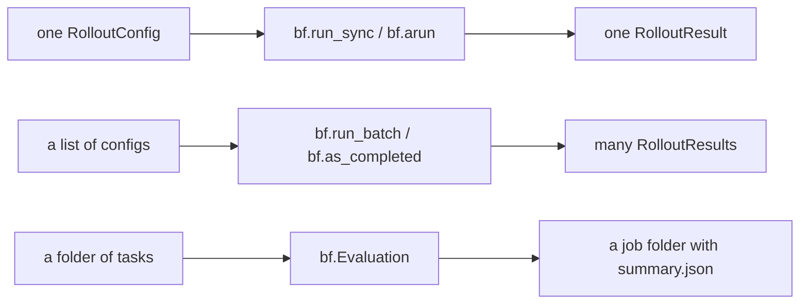

# Python API

Run tasks, batches, jobs and branches from Python, and read the results back. Everything here is `import benchflow as bf`. Each call matches a `bench` command: [CLI ↔ Python](./cli-python-parity.md) maps every flag to its Python keyword.



On this page: [Install](#install) · [Quick start](#quick-start) · [Results](#results) · [Many rollouts](#many-rollouts) · [Jobs](#jobs-every-task-in-a-folder) · [Usage limits](#usage-limits) · [Branching](#branching) · [Reading finished jobs](#reading-finished-jobs) · [Saving configs](#saving-configs) · [Types](#types) · [Errors and retries](#errors-and-retries) · [Sandbox, reward and adapter types](#sandbox-reward-and-adapter-types) · [Deprecated names](#deprecated-names)

## Install

```bash
uv add benchflow                     # or: uv add 'benchflow[sandbox-daytona]'
```

This adds BenchFlow to your project (Python 3.12+). The `sandbox-daytona` extra lets it run on Daytona.

`uv tool install --python 3.12 benchflow` installs only the `bench` command, in its own environment. Your code can't import it from there.

## Quick start

```python
import pathlib, tempfile
import benchflow as bf

task = pathlib.Path(tempfile.mkdtemp()) / "hello"
(task / "solution").mkdir(parents=True)
(task / "tests").mkdir()
(task / "task.md").write_text(
    "---\nschema_version: '1.3'\n"
    "sandbox: {docker_image: 'python:3.12-slim', workdir: /app}\n"
    "---\n\n## prompt\n\nWrite `Hello, world!` to `hello.txt`.\n"
)
(task / "solution" / "solve.sh").write_text("#!/bin/bash\necho 'Hello, world!' > /app/hello.txt\n")
(task / "tests" / "test.sh").write_text(
    "#!/bin/bash\ngrep -qx 'Hello, world!' /app/hello.txt && r=1 || r=0\n"
    "echo $r > /logs/verifier/reward.txt\n"
)

result = bf.run_sync(bf.RolloutConfig(task_path=task, agent="oracle", environment="docker"))
print(result.reward, result.passed, result.rollout_dir)   # 1.0 True jobs/<timestamp>/hello__<id>
print(bf.load_job(result.rollout_dir.parent))              # the job's summary
```

This writes a one-file task and runs it with the oracle agent. The oracle runs the task's own solution, so you need no model key. You do need Docker running.

`bf.run_sync` blocks until the run ends. It works in a Jupyter cell too. Open the run in the viewer with `bench view jobs/`.

For your own task, pass its folder as `task_path`. `bench new my-task` creates one.

In async code, use `await bf.arun(...)` with the same arguments. `bf.run` is the same function under its older name.

To run a real agent, set its key in the environment, as for the CLI. `bench agents` lists the key each agent reads. For Claude, set `CLAUDE_CODE_OAUTH_TOKEN` or `ANTHROPIC_API_KEY`.

```python
result = await bf.arun(
    bf.RolloutConfig(
        task_path="tasks/my-task",
        agent="claude-agent-acp",
        model="claude-haiku-4-5",
        environment="daytona",       # or "docker" (the default)
        jobs_dir="jobs/my-run",      # default "jobs"
    )
)
```

### Three ways to call bf.arun

```python
result = await bf.arun(config)                                     # 1. a RolloutConfig
result = await bf.arun("gemini", task_path="tasks/X",              # 2. an agent name
                       model="gemini-3.1-flash-lite-preview", env="daytona")
agent = bf.Agent("gemini", model="gemini-3.1-flash-lite-preview")  # 3. Agent + Environment
env = bf.Environment.from_task("tasks/X", sandbox="daytona")
result = await bf.arun(agent, env, bf.RuntimeConfig(sandbox_setup_timeout=300))
```

An `Environment` owns its trial's artifact directory. `result.rollout_dir`,
`result.json`, agent logs and verifier rewards all use that directory, even
when you start the environment before calling `bf.arun`. To choose its parent,
pass `jobs_dir="jobs/my-run"` to `Environment.from_task`; the directory is then
`jobs/my-run/environment/<name>__<id>/`. A later `RuntimeConfig.jobs_dir` cannot
move an existing sandbox's bind mounts. Stop a caller-owned environment with
`await env.stop()` after the run.

| Form | Sandbox default | Pre-run checks |
|---|---|---|
| 1. `RolloutConfig` | `environment="docker"` | yes |
| 2. agent name | `env="docker"` | yes |
| 3. `bf.Agent` + `bf.Environment` | `Environment.from_task(sandbox="daytona")` | none |

The three spellings `environment=`, `env=` and `sandbox=` all name the sandbox backend. Every form uses the task's own agent timeout (`[agent] timeout_sec`) unless you pass `timeout=` (`RolloutConfig(timeout=...)` or `RuntimeConfig(timeout=...)`). A task without one gives the agent no limit of its own; the rollout's deadline bounds it, as in 0.7.11. `timeout=` is whole seconds: a negative value or one under 1 s raises `ValueError`, and 0 means the task's own.

### Pre-run checks

Before a sandbox starts, forms 1 and 2, `bf.run_batch` and `Evaluation.run` check the request:

| Problem | Raises |
|---|---|
| Task folder missing | `FileNotFoundError` |
| A task folder (with `task.md` or `task.toml`) with an issue that stops a run (the list `bench run` refuses on) | `ValueError` (`benchflow.runtime.NotRunnableTaskError`), naming each issue and `bench check`. In `bf.run_batch` that task becomes an errored result and the others run. |
| Unknown sandbox, or a misspelt agent (`"claud-agent-acp"`) | `ValueError`, with a suggestion |
| An agent and model pair no provider serves | `ValueError`, naming the reason |
| The agent's login is missing | `benchflow.errors.MissingCredentialError` (a `ValueError`) |
| Docker not running (`environment="docker"`) | `RuntimeError`, with `bench doctor`'s fix |
| Claude login in `~/.claude/.credentials.json` expired | `UserWarning`, with the fix |

`BENCHFLOW_SKIP_PREFLIGHT=1` skips the host checks (login, Docker), as for `bench run`. `bf.Evaluation(..., preflight=False)` skips every check for one job.

To see progress, turn on logging: `logging.basicConfig(level=logging.INFO)`.

Every snippet on this page runs as-is from [`docs/examples/python-sdk/`](../examples/python-sdk/). Start with `quickstart.py`; its `# %%` cells run like a notebook in VS Code or PyCharm.

## Results

Every run returns a `RolloutResult`. The same data is on disk under `result.rollout_dir`: `result.json`, `config.json`, `timing.json`, `trajectory/acp_trajectory.jsonl` and `verifier/`.

| Attribute | Meaning |
|---|---|
| `reward` | `rewards["reward"]` as a float, or `None` when the rollout was not scored. |
| `rewards` | The verifier's full reward dict, e.g. `{"reward": 1.0}`, or `None`. |
| `passed` | `True` when the scoring outcome is a pass. |
| `score_outcome` | `"passed"`, `"failed"`, `"errored"` or `"verifier_errored"`. |
| `success` | `True` when there was no agent, verifier or export error (a scored 0 is still a success). |
| `error`, `error_category` | Agent-side error text and a stable category (`provider_auth`, `timeout`, `sandbox_setup`, ...), or `None`. |
| `verifier_error`, `verifier_error_category` | Verifier-side error, kept separate from agent errors. |
| `trajectory` | The agent's events as a list of dicts, each with a `type` (`user_message`, `agent_message`, `agent_thought`, `tool_call`, `notice`). Fields per type: [JSON export](./json-export.md). |
| `trajectory_source` | `"acp"` (captured over ACP), `"partial_acp"`, `"scraped"` (agent-writable, untrusted) or `"hosted_env"`. |
| `n_tool_calls`, `n_prompts` | Counts from the run. |
| `n_input_tokens`, `n_output_tokens`, `total_tokens`, `cost_usd` | Provider usage, or `None` when the provider reported none. |
| `usage_source` | Where usage came from: `provider_response`, `agent_native_acp` or `unavailable`. |
| `price_source` | Who priced `cost_usd`: `"litellm"`, or `"agent_session_log"` (an estimate from the agent's own log, used for Claude subscription runs). `None` when nothing priced it. |
| `task_name`, `rollout_name`, `agent`, `model` | Identity of the run. |
| `started_at`, `finished_at` | Local wall-clock times (naive `datetime`). |
| `rollout_dir` | The rollout's artifact directory, or `None` if the run failed before it was created. |

Read a finished rollout back later, for example from a notebook:

```python
result = bf.RolloutResult.load("jobs/my-run/2026-01-01__12-00-00/my-task__1a2b3c4d")
```

`result.to_record()` gives one flat, JSON-safe dict of the headline fields. It is the row the CSV and JSONL exports write.

## Many rollouts

```python
import contextlib
import benchflow as bf

configs = [
    bf.RolloutConfig(task_path="tasks/my-task", agent=agent, model=model, environment="daytona")
    for agent, model in [("claude-agent-acp", "claude-haiku-4-5"), ("oracle", None)]
]
results = bf.run_batch(configs, concurrency=4, on_result=lambda done: print(done.index, done.result))
print(results.n_passed, results.mean_reward)
results.to_csv("results.csv")          # also to_jsonl(), to_records()

# in async code:
async with contextlib.aclosing(bf.as_completed(configs, concurrency=4)) as stream:
    async for done in stream:          # Completed(index, config, result)
        print(done.config.primary_agent, done.result.reward)
```

To run several configs (several agents or models on one task), use `bf.run_batch` (blocking) or `await bf.arun_batch`. Both run at most `concurrency` at once (default 4). They return a `Results` list in input order. `bf.as_completed` yields each rollout as it finishes.

A rollout that raises comes back with `error` set instead of stopping the batch. Leaving `as_completed` early cancels the rollouts still running; `contextlib.aclosing` makes that immediate.

<a id="batches-over-a-task-directory"></a>

## Jobs: every task in a folder

```python
evaluation = bf.Evaluation(
    tasks_dir="tasks",
    jobs_dir="jobs/my-batch",
    config=bf.EvaluationConfig(agent="oracle", environment="daytona", concurrency=4),
)
job = evaluation.run_sync()             # or: job = await evaluation.run()
print(job.passed, job.total, job.score, job.mean_reward, job.job_dir)
for name, result in job.results.items():   # task name -> RolloutResult
    print(name, result.reward, result.rollout_dir)
job.to_csv("job.csv")                   # also to_jsonl(), to_records()
```

`bf.Evaluation` runs every task under a folder, with concurrency, retries and resume, like `bench run tasks/`. It writes `summary.json` into the job folder.

Watch results arrive with `stream()`. The `EvaluationResult` is left in `evaluation.result`:

```python
async for name, result in evaluation.stream():
    print(name, result.reward)
print(evaluation.result.score)
```

To act on each finished task, pass `on_result=lambda name, result: ...` to `Evaluation(...)`.

### Hooks, artifacts and budgets

```python
async def lock_inputs(sandbox):
    await sandbox.exec("chmod -R a-w /data", user="root", timeout_sec=60)

config = bf.EvaluationConfig(
    agent="claude-agent-acp",
    pre_agent_hooks=[lock_inputs],
    config_override={"artifacts": [{"source": "/home/agent/.claude/projects",
                                    "destination": "claude-sessions"}]},
)
```

| Keyword | What it does |
|---|---|
| `pre_agent_hooks=[...]` | Runs `async def hook(sandbox)` in each trial's sandbox before the agent starts. `RolloutConfig` takes it too. |
| `config_override={"artifacts": [...]}` | Keeps more files from every trial, along with the task's own artifacts. |
| `budget=bf.Budget(max_cost_usd=, max_sandbox_seconds=, max_tokens=, max_rollouts=)` | Caps the job. Set it on `Evaluation` or `EvaluationConfig`. |

A config file can't hold a hook, so `to_dict()` and `to_yaml()` refuse a config that has one. `evaluation.json` records only the hook names.

At a budget cap, no new rollout starts, and spend caps also cancel running ones. The result's `budget` and `summary.json` list rollouts stopped this way; they don't count as failures. Cost and tokens are known only when a rollout ends, so those caps apply between starts. See [Job budget caps](./budget.md).

### Resume a job

```python
job = bf.Evaluation.resume("jobs/my-batch/2026-01-01__12-00-00", agent_env={...}).run_sync()
```

A job saves its task folder and config in `<job_dir>/evaluation.json` when it starts. Values that look secret are not saved, so pass `agent_env` again. Pass hooks again too: `Evaluation.resume(job_dir, pre_agent_hooks=[...])`.

- Finished tasks are read from disk and appear in `job.results`; only the rest run.
- Keyword overrides such as `concurrency=8` replace config fields.
- A running job holds `<job_dir>/.evaluation.lock`. Resuming it fails with the holder's process id; an unnamed `Evaluation` whose latest job is held starts a new job instead.
- If you change a setting that changes what a trial measures (model, timeout, `extra_instruction`, budget, `agent_env`, sandbox; full list under [Resuming](./cli.md#resuming)):
  - an unnamed `Evaluation` starts a new job;
  - a named one (`job_name=` or `Evaluation.resume`) moves the earlier trials to `<job_dir>/.set-aside/<UTC time>/` and runs those tasks again. `bf.load_job` skips set-aside trials.

## Usage limits

```python
for token in tokens:                      # one Claude login per attempt
    config = bf.EvaluationConfig(agent="claude-agent-acp", agent_env={"CLAUDE_CODE_OAUTH_TOKEN": token})
    try:
        job = await bf.Evaluation(tasks_dir="tasks", jobs_dir="jobs/pool", job_name="run", config=config).run()
        break
    except bf.UsageLimitError as exc:
        print(f"{exc.login}: {exc.window} window spent until {exc.resets_at}")
```

All trials in a job share one login. When a trial hits that login's usage limit (a Claude 5-hour or 7-day window, a ChatGPT plan limit), the job:

1. starts no more trials and lets running ones finish;
2. writes `summary.json`, whose `usage_limit` block lists the trials not started;
3. raises `bf.UsageLimitError`.

| Attribute | Meaning |
|---|---|
| `login` | A label such as `CLAUDE_CODE_OAUTH_TOKEN (environment)`, never the token |
| `window`, `resets_at` | The spent window and when it resets, when the agent said so |
| `result` | The job's `EvaluationResult` |

To switch logins, catch the error and run the same named job again. The limited and unstarted trials rerun.

A single `bf.arun` doesn't raise. It returns a `RolloutResult` with `error_category == "usage_limit"`, unscored and never retried. `bf.UsageLimitError.from_result(result)` gives the same fields.

## Branching

```python
import benchflow as bf

result = bf.branch(
    "tests/examples/hello-world-task",
    agent="claude-agent-acp",
    model="claude-haiku-4-5",
    sandbox="daytona",
    prompts=["Create draft.txt containing: Hello world", "@instruction"],
    checkpoint_after=1,                  # fork after the first prompt
    children={
        "baseline": None,                # the parent's remaining prompts
        "hint": "Rename draft.txt to hello.txt and stop.",
    },
)
print(result.value)                      # mean child reward at the checkpoint
for child in result.children:            # BranchChildResult
    print(child.label, child.status, child.reward, child.reward_source)
print(result.parent_reward, result.parent.rollout_dir, result.job_dir)
result.to_csv("children.csv")
```

`bf.branch` (blocking) and `await bf.abranch` do what `bench branch` does:

1. Run the task up to a checkpoint (`checkpoint_after` prompts).
2. Snapshot the sandbox.
3. Start each child from the snapshot with its own prompt. The task's verifier scores each child.
4. Restore the parent, finish it and score it.

Each child starts a fresh agent session. Only files are restored, plus declared environment state with `snapshot_layers={"sandbox", "environment"}`. Write each child prompt to stand on its own, or pass `resume_session=True` to continue the parent's conversation.

| Keyword | What it does |
|---|---|
| `children` | `{label: prompt}` (`None`: the parent's remaining prompts), or a list of `bf.ChildSpec(label=, prompt=, parent=)` or `"label=...,parent=...,prompt=..."` strings for nested forks |
| `parent="discard"` | Skip restoring and scoring the parent |
| `concurrency=K`, `isolate_children=True` | Run each child in its own sandbox, K at once |
| `child_retries` | Retries for a child that failed before its agent did anything (default 1) |
| `continue_after_child_failure` | Keep going after a child fails (default `True`) |
| `retain_snapshots=True` | Keep the snapshot for a later branch |
| `from_checkpoint=<trial dir>`, `checkpoint=` | Branch again from a kept snapshot. `checkpoint` is a fork id or `"prompt:N"`; task, agent and model default to that trial's |
| `checkpoints=` | Keep automatic checkpoints |
| `jobs_dir`, `job_name`, `agent_env`, `reasoning_effort`, `harness` | As for `bench branch` |
| `on_event=print` | Progress dicts: `trial_started`, `checkpoint_reached`, `child_finished` (with `label`, `reward`), `fork_finished`, `parent_finished`, `trial_finished` |

`result.value` is the mean child reward at the checkpoint. Each child's `advantage` is its reward minus that value.

A bad request raises `bf.BranchPlanError` (a `ValueError`) before anything starts. The pre-run checks also apply. A trial that fails later returns with `result.error` set and `result.ok` false. Runnable example: [`run-branch.py`](../examples/python-sdk/run-branch.py). The manual `Rollout.branch()` is [below](#rollout).

## Reading finished jobs

```python
import benchflow as bf

job = bf.load_job("jobs/my-batch/2026-01-01__12-00-00")
for trial in job.trials:                 # Trial
    print(trial.task_name, trial.reward, trial.execution, trial.assessment,
          trial.control, trial.cost_usd, trial.verifier.stdout)
    for fork in trial.forks:             # branch lineage from tree.json
        print("  V =", fork.value, [(c.label, c.reward) for c in fork.children])
d = job.denominators()
print(d.attempted, d.scored, d.assessment_errors, d.unscored, d.passed,
      d.pass_rate_scored, d.pass_rate_attempted, d.controls_excluded)
job.to_csv("trials.csv")

report = bf.compare("jobs/run-a", "jobs/run-b", labels=("a", "b"))
print(report.to_markdown())              # per-task rewards and deltas, with caveats
report.to_json("comparison.json")        # the versioned JSON document
```

`bf.load_job(path)` reads every trial under a job folder. It also takes a folder of jobs, one trial, or a list of folders. `bf.load_trial(path)` reads one trial. Both read older BenchFlow layouts too. A walk-through with a worked example is in [Analysing runs](../results/analysing-runs.md). On the command line, `bench results` runs the same functions.

| Field | Values |
|---|---|
| `trial.execution` | `completed`, `errored`, `timed_out`, `integration_failed` |
| `trial.assessment` | `scored`, `error` (the verifier failed), `unscored` |
| `trial.control` | `"oracle"`, `"empty"`, or `None` for an agent run |
| `trial.source` | `"result.json"`, or `"results.jsonl"` for a folder with only those rows |
| `trial.review` | The `bench review` verdict, when there is one |

Counting matches `bench view`. A timed-out run can still be scored.

**Controls** check the task, not an agent: the oracle, an empty run (`agent="nop"`, which leaves the workspace untouched), and task copies suffixed `__o` (oracle) or `__e` (empty). `denominators()` and `compare()` leave controls out unless `include_controls=True`.

**Retries.** For a task an `Evaluation` retried, a trial is its best attempt (scored first, then newest). `trial.attempts` lists every attempt, oldest first. Pass `attempts="all"` to `load_job` to keep each attempt as a trial. Repeated rollouts in a `run_batch` folder are separate trials. Branch children sit in their parent's `trial.forks`.

**Compare** pairs tasks by name and gives means over each side's scored runs. It runs no significance test, and adds a caveat when each side has one run per task. It also checks that both sides ran with the same settings: task digest, model, harness, dataset, reasoning effort, sandbox, sandbox user, timeout, agent variables and prompts. Name the settings you meant to change with `vary=("model",)`. Any other difference is listed in `report.mismatches` and warns. Pass `on_mismatch="raise"` to refuse, or `"ignore"` to stay quiet.

`print(job)` or `job.to_markdown()` prints a summary: trial, task and agent counts, the solve rate with its 95% interval, unscored trials by reason, controls left out, and cost (estimates marked). A notebook shows it for a bare `job`; `repr(job)` stays one line.

`job.solve_rates(ks=[1, 5])` gives pass@k, pass^k and the solve rate with a 95% `interval`, over repeated trials of each task. An unscored trial counts as a fail; the `*_scored_only` fields and `get_scored_only(k)` count scored trials only. A task with fewer than k trials is left out of that k and named in the caveats. `compare(..., ks=[1, 5])` fills `report.solve_rates_a` and `report.solve_rates_b`. See [pass@k, pass^k and solve rates](./pass-at-k.md).

`to_json()` on a trial, job or comparison writes the documents in [JSON export](./json-export.md).

### Other readers

| Call | What it does | More |
|---|---|---|
| `bf.stream_rollouts(job_dir)`, `bf.astream_rollouts` | Yield each finished rollout of a job while it runs (`bench train stream`) | [Rollout stream](./rollout-stream.md) |
| `bf.regrade(job, tasks_dir=...)`, `bf.aregrade` | Re-score stored trials with a changed verifier (`bench regrade`); returns a `RegradeSummary` | [Regrade](../jobs/regrade.md) |
| `bf.load_results_jsonl(path)` | Read a `results.jsonl` file | [JSON export](./json-export.md) |

## Saving configs

```python
evaluation.to_yaml("job.yaml")                  # bench run --config job.yaml
same = bf.Evaluation.from_yaml("job.yaml")      # or from_dict(evaluation.to_dict())
config.to_yaml("rollout.yaml")                  # a RolloutConfig
config = bf.RolloutConfig.from_yaml("rollout.yaml")   # same as bf.rollout_config_from_yaml
```

`to_yaml` leaves out `agent_env` values unless you pass `include_agent_env=True`; it lists their names under `agent_env_keys`. A config whose `user`, `pre_agent_hooks` or `planes` hold Python objects raises `ValueError`. To see what a CLI job would run without running it, use `bench run --dry-run`.

### Environment manifests

```python
manifest = bf.load_manifest("environment.toml")   # or bf.EnvironmentManifest.model_validate_toml(text)
result = await bf.arun(
    bf.RolloutConfig(task_path="tasks/my-task", agent="oracle", environment="daytona",
                     environment_manifest=manifest)
)
```

An [environment manifest](../environment-plane.md) declares the world a task runs in: image, services, readiness probes and restorable state. Pass it as `environment_manifest=` on `RolloutConfig` or `EvaluationConfig`.

`bf.Environment` is a different thing: a handle on one task's sandbox, used with `bf.Agent` and `bf.Runtime`.

## Types

### RolloutConfig

One run of one task. For a single agent, set `agent=` and `model=`, as in the quick start. For several agents or several phases in one sandbox, set `scenes=` instead:

```python
from pathlib import Path
from benchflow import RolloutConfig, Scene, Role, Turn

# Two phases: write a skill, then solve with it
config = RolloutConfig(
    task_path=Path("tasks/my-task"),
    scenes=[
        Scene(name="prep", roles=[Role("gen", "gemini", "gemini-3.1-flash-lite-preview")],
              turns=[Turn("gen", "Write a skill for this task to /app/generated-skill.md")]),
        Scene(name="solve", roles=[Role("solver", "gemini", "gemini-3.1-flash-lite-preview")],
              turns=[Turn("solver")]),
    ],
    environment="daytona",
)
```

Raise `sandbox_setup_timeout` (default 120 s) when creating the sandbox user takes longer. `EvaluationConfig` and `RuntimeConfig` take it too.

### Scene, Role, Turn

```python
scene = Scene.single(agent="gemini", model="gemini-3.1-flash-lite-preview")   # one agent

scene = Scene(                                                               # two agents
    name="coder-reviewer",
    roles=[
        Role("coder", "gemini", "gemini-3.1-flash-lite-preview"),
        Role("reviewer", "gemini", "gemini-3.1-flash-lite-preview"),
    ],
    turns=[
        Turn("coder"),                    # no prompt: the task's instruction
        Turn("reviewer", "Review the current workspace."),
        Turn("coder", "Fix the issues."),
    ],
)
```

A `Scene` lists the agents (`Role(name, agent, model)`) and the order they get prompts (`Turn(role, prompt)`). A `Turn` with no prompt sends the task's instruction. Scenes run one after another in the same sandbox.

| Pattern | Roles | Turns | Use it for |
|---|---|---|---|
| Single-turn | 1 | 1 | A baseline benchmark run |
| Multi-turn | 1 | 2+ | A second pass by the same agent, which keeps its context (self-review) |
| Multi-role | 2+ | 2+ | More than one view (code review, client and advisor) |

In a multi-role scene, agents see each other's work only through the sandbox or the prompts you write. BenchFlow passes no messages between them.

### Rollout

```python
from benchflow import Rollout

rollout = await Rollout.create(config)

# Full lifecycle (most common)
result = await rollout.run()

# Manual composition (for custom flows)
await rollout.setup()
await rollout.start()
await rollout.install_agent()
await rollout.connect()
await rollout.execute(prompts=["custom prompt"])
# Optional fork here; branch() leaves the agent disconnected.
value = await rollout.branch(2, run_child, snapshot_layers={"sandbox"})
await rollout.connect()
await rollout.execute(prompts=["continue the parent"])
await rollout.disconnect()
await rollout.verify()
result = await rollout.finalize()  # cleanup() plus result.json
```

`Rollout` runs one `RolloutConfig`. `run()` does everything; call the steps yourself for a custom flow.

| Step | What it does |
|---|---|
| `setup()` | Resolve the config |
| `start()` | Start the sandbox, upload task files, start services |
| `install_agent()` | Install the agent, its login and the sandbox user |
| `connect()`, `connect_as(role)` | Open the agent session (per role in a multi-role scene) |
| `execute(prompts=)` | Send prompts and record the trajectory |
| `verify()` | Run the verifier and collect rewards |
| `cleanup()` | Stop the sandbox; writes no `result.json` |
| `finalize()` | `cleanup()` plus `result.json`; call it to end a run you drive by hand |

`rollout.branch(n, run_child, ...)` forks the live run into `n` children and leaves the agent disconnected. It takes the same options as `bf.branch` (`isolate_children`, `concurrency`, `resume_session`), but defaults to `child_retries=0` and `continue_after_child_failure=False`. It also takes `restore_parent=False` (skip the parent restore; the rollout can then only be finalized) and `child_requests` (one description per child for `tree.json`). See [Composed checkpoints](../jobs/branching-reference.md) and [`branch-agent-run.py`](../examples/branch-agent-run.py).

### Python decides the next prompt

```python
from pathlib import Path

import benchflow as bf
from benchflow import FunctionUser, RolloutConfig, RoundResult, Scene


def user(round: int, instruction: str, rr: RoundResult | None) -> str | None:
    if round == 0:
        return instruction.splitlines()[0]
    if rr and (rr.rewards or {}).get("reward") == 1.0:
        return None
    return f"Tests failed:\n{rr.verifier_output}\n\nUse the full spec:\n{instruction}"


config = RolloutConfig(
    task_path=Path("tasks/my-task"),
    scenes=[Scene.single(agent="gemini", model="gemini-3.1-flash-lite-preview")],
    user=FunctionUser(user),
    max_user_rounds=3,
    environment="daytona",
)
result = await bf.arun(config)
```

To give one agent several rounds and choose each prompt from the last round's test results, pass `user=bf.FunctionUser(fn)`. BenchFlow calls `fn(round, instruction, last)` before each round. `last` is a `RoundResult` with `rewards` and `verifier_output`. Return the next prompt, or `None` to stop.

`max_user_rounds` caps the rounds (default 5). With `oracle_access=True`, the user also sees the task's solution. Subclass `bf.BaseUser` for a user with its own state.

If another model should play the user, use a multi-role scene instead. More: [Progressive disclosure](../tasks/scripted-users.md) and [`scene-patterns.ipynb`](../examples/scene-patterns.ipynb).

## Errors and retries

A rollout doesn't raise when the agent fails. `Rollout.run()` catches the failure and returns a `RolloutResult` with `error` and `error_category` set. Causes include an agent timeout, a lost connection to the agent, an agent protocol error and a [usage limit](#usage-limits).

Mistakes you can fix (a task file that doesn't parse, a bad option, a missing login) raise a subclass of `benchflow.errors.UserError`. Catch that to handle them all. [When a run fails](../jobs/when-a-run-fails.md) maps each message to its fix.

`Evaluation` retries failed trials. Set the policy with `RetryConfig` (defaults shown):

```python
config = bf.EvaluationConfig(
    retry=bf.RetryConfig(max_retries=2, wait_multiplier=2.0, min_wait_sec=1.0, max_wait_sec=30.0),
)
```

| Field | Default | Meaning |
|---|---|---|
| `max_retries` | `2` | Retries per trial after the first attempt |
| `wait_multiplier`, `min_wait_sec`, `max_wait_sec` | `2.0`, `1.0`, `30.0` | Exponential backoff between attempts |
| `retry_on_install`, `retry_on_pipe`, `retry_on_acp`, `retry_on_idle_timeout`, `retry_on_infra`, `retry_on_verifier_infra`, `retry_on_api_error` | `True` | Which failure kinds retry |
| `exclude_categories` | `timeout`, `provider_auth`, `provider_rate_limit`, `provider_rejected` | Categories that never retry |

A usage limit never retries, whatever the policy says.

## Sandbox, reward and adapter types

### Sandbox protocol

```python
from benchflow import Sandbox

assert isinstance(my_sandbox, Sandbox)   # a runtime-checkable Protocol
```

To add a sandbox backend, implement `bf.Sandbox`. The built-in backends are `docker`, `remote-docker`, `daytona`, `modal`, `apple-container` and `agentcore`.

| Member | Signature |
|---|---|
| `exec` | `async exec(cmd, *, user="root", timeout_sec=30) -> ExecResult` |
| `upload_file` | `async upload_file(src: Path, dst: str, *, mode=None, admission)`; `mode` chmods the file |
| `upload_dir` | `async upload_dir(src: Path, dst: str, service="main", *, admission)` |
| `download_file` | `async download_file(src: str, dst: Path)` |
| `download_dir` | `async download_dir(src: str, dst: Path, service="main")` |
| `start`, `stop` | `async start()`, `async stop(*, delete=True)` |
| `snapshot`, `restore` | `async snapshot(name=None) -> SandboxImage`, `async restore(image)` |
| `supports_snapshot` | Whether the backend can snapshot. Backends that can't raise `SandboxSnapshotNotSupported` |
| `host`, `expose_ports` | The host where exposed ports are reachable, and the ports to expose at `start()` |

Every transfer into a sandbox takes a keyword-only `admission`: what `benchflow.trust.state.admit(sandbox, service, kind, reason=...)` returned for that sandbox and service. BenchFlow passes it on every call it makes, so a backend of your own must accept it. The built-in backends refuse an `upload_file`, `upload_dir` or `live_process` call without one, or with one for another sandbox, service or start, with `AdmissionRequired` before any byte moves. Your own code calling a built-in backend's primitive admits first: `admit(sandbox, "main", IngressKind.SDK_UPLOAD)` for bytes an agent or a user chose, or `admit(sandbox, "main", TRUSTED_TRANSFER, reason="...")` for your own. The SDK's `Environment.upload_file` and `upload_dir` admit for you.

`bf.ImageBuilder` builds images: `async build(config: ImageConfig) -> ImageRef` and `async cached(config) -> ImageRef | None`.

### Reward functions and Rubric

```python
from pathlib import Path

import benchflow as bf

rubric = bf.Rubric(
    reward_funcs=[bf.TestRewardFunc(), bf.StringMatchRewardFunc(expected="hello world")],
    weights=[0.7, 0.3],                         # None: equal weights
)
result = await rubric.score(Path("out"))        # a folder holding reward.txt and answer.txt
print(result.reward, result.items)              # weighted total; per-function scores
```

Each reward function has `async score(folder: Path) -> float`. `Rubric.score` runs them all on the same folder and returns a `VerifyResult`.

| Function | Score |
|---|---|
| `bf.TestRewardFunc()` | The first number in `reward.txt`; 0.0 when the file is missing or empty |
| `bf.StringMatchRewardFunc(expected, fuzzy=False)` | 1.0 when `answer.txt` matches `expected` (a substring when `fuzzy`), else 0.0 |
| `bf.CodeExecRewardFunc(func)` | `func(folder)`, your own Python function |
| `bf.LLMJudgeRewardFunc(prompt="", model=..., *, rubric_path=, criteria=, mode="individual", judge_model=)` | An LLM judge scores criteria from a rubric file or `criteria=`. See [LLM judge](../judging/llm-judge.md) |

| `VerifyResult` field | Meaning |
|---|---|
| `reward` | Weighted total |
| `items` | Score per function, keyed by class name |
| `events` | One `RewardEvent` per function |
| `error` | Errors from functions that raised (each scored 0.0), or `None` |

### Adapters

```python
inspect_task = bf.to_inspect_task(scene, rubric=rubric)   # a dict, not an Inspect Task
ors_payload = bf.to_ors_reward(verify_result)
```

| Call | Returns |
|---|---|
| `bf.to_inspect_task(scene, rubric=None)` | A dict in Inspect AI's task shape: `name`, `dataset` (one sample per turn), `scorer` (when a rubric is set). Class form: `bf.InspectAdapter` |
| `bf.to_ors_reward(result: VerifyResult)` | A reward dict in the ORS format. Class form: `bf.ORSAdapter` |

## Deprecated names

| Deprecated | Use instead |
|---|---|
| `benchflow.SDK().run(task_path=..., agent=..., ...)` | `bf.arun(bf.RolloutConfig(task_path=..., agent=..., ...))` (same keyword arguments) |
| `bf.snapshot`, `bf.restore`, `bf.list_snapshots` | `bf.workspace_snapshot`, `bf.workspace_restore`, `bf.list_workspace_snapshots` |
| `RuntimeConfig(max_rounds=..., snapshot_policy=..., reward_stream=...)` | Nothing reads these fields; use `RolloutConfig.max_user_rounds` for user loops. |
| `SDK.run(trial_name=...)` | `rollout_name=...` |
| `RuntimeConfig()`'s 900 s agent timeout | Removed: every form now uses the task's own timeout. Pass `RuntimeConfig(timeout=900)` to keep it. |
| `RuntimeResult` (and `result.verified`, `result.messages`, `result.snapshots`) | `RolloutResult`; `result.score_outcome in ("passed", "failed")`. `messages` and `snapshots` were always empty; read `agent_message` events in `result.trajectory`. |

Each emits a `DeprecationWarning` and keeps working. The timeout change is the exception: the `Agent` + `Environment` form warns with `FutureWarning` when the task's timeout differs.

## Next steps

- [CLI ↔ Python](./cli-python-parity.md): every `bench` flag and its Python keyword.
- [Analysing runs](../results/analysing-runs.md): a worked example of `load_job` and `compare`.
- [Composed checkpoints](../jobs/branching-reference.md): how branching snapshots and restores work.
- [External agents](../agents/external-agents.md): add an agent the registry doesn't ship.
- [When a run fails](../jobs/when-a-run-fails.md): each error message and its fix.
