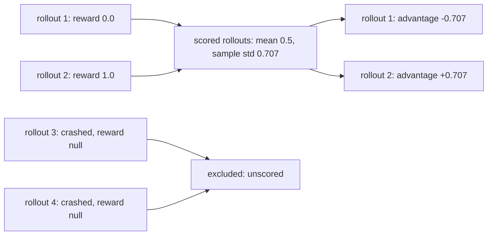

# Training signal: reward vectors and group advantages

```bash
bench train convert jobs/demo --format trl-sft --out train.jsonl --manifest m.json \
  --reward-vector --group-advantage grpo
```

`bench train convert` writes one training row per rollout (or per model call) with the rollout's scalar `reward`. For RL and reward modelling, two options add more signal:

| Option | Python keyword | Adds |
| --- | --- | --- |
| `--reward-vector` | `reward_vector=True` | The reward's components, with names, kinds and weights. |
| `--group-advantage grpo\|loo` | `group_advantage="grpo"` or `"loo"` | The reward normalised against the other rollouts of the same group. |
| `--group-by` | `group_by=` | The group key for `--group-advantage` (below). |

From Python, pass these keywords to `export_prime_sft_jsonl` or `export_trl_sft_jsonl` (in `benchflow.trajectories.export_prime_sft` and `benchflow.trajectories.export_trl_sft`).

To compute vectors and groups without writing rows, call `benchflow.trajectories.training_signal.rollout_training_signals(jobs_dir)`. This works for oracle and subscription runs, which have no LLM trajectory.

Row fields: [`benchflow-training-signal.v1.schema.json`](./schemas/benchflow-training-signal.v1.schema.json).

## Reward vector

| Trial | `source` | Components |
|---|---|---|
| Rubric-scored | `rubric` | `tests` (the verifier reward, kind `gate`), then one per rubric criterion in rubric order. `scored` criteria: score ÷ 2, with the criterion's weight. `blocker` and `legacy`: 1 pass, 0 fail (`legacy` `not_applicable` is null). Also records `revision` and `rubric_sha256`. |
| Rubric-scored, but `scoring/<attempt>.json` is missing or has no checks | `scoring` | `tests` and `rubric_reward`, plus a `note` naming the missing file. |
| Any other trial with a reward | `verifier` | Every number in `rewards`, nested keys joined with `.` (`metrics.task_success`), `reward` first; weights null. |
| No reward | — | `reward_vector: null` |

A criterion the reviewer gave no score or outcome is null, never 0. `formula` states how the scalar reward was aggregated from the components.

## Group advantages



### Who shares a baseline

Rollouts are grouped by `--group-by`. The default, `task,agent,model,job`, keeps oracle runs, different agents, different models and different jobs out of each other's baselines. Add `task_digest` to separate task versions.

A group stays inside one job by default. Two jobs may have run different checkpoints under the same model name, and nothing in the result says so.

If you know several jobs ran one policy, drop `job`: `--group-by task,agent,model`. The `trial-NN` jobs of `--matrix --trials` are an example. If the policy changed during a job, BenchFlow can't tell: run one job per checkpoint.

The `job` key is the job folder's name, or its path below the jobs' common folder when names repeat.

### Which rollouts count

Only [scored](../jobs/when-a-run-fails.md#unscored-trials) rollouts count toward a baseline: a rollout counts when it has a reward, whatever its value.

An attempt that a retry or a resume replaced is not a sample. It gets `excluded: "retried"`. BenchFlow keeps the attempt `bf.load_job` keeps: scored first, then newest.

### Formulas

- `grpo`: `advantage = (r − mean) / (std + 1e-4)`, sample std (ddof 1, as TRL's `GRPOTrainer`). When every scored reward is equal, the advantages are 0.0.
- `loo`: `advantage = r − mean(rewards of the other scored rollouts)` (the RLOO baseline).

A group with fewer than 2 scored rollouts gives no advantage.

### The `group` block

Each row gets `advantage` and a `group` block:

| Field | Meaning |
|---|---|
| `id` | The group, as `task=…\|agent=…\|model=…\|job=…`. |
| `by`, `key` | The group keys and their values. |
| `normalisation`, `formula`, `eps`, `std_ddof` | How `advantage` was computed. |
| `rollouts` | The group's rollouts, scored or not, retried attempts left out. |
| `scored`, `mean`, `std` | How many were scored, and their mean and sample std. |
| `excluded` | Why this row has no advantage: `unscored`, `single_scored_rollout` or `retried`. |
| `vector_names_differ` | `true` when the group's members have different reward components (the rubric changed between runs). |

With `--reward-vector`, `advantage_vector` applies the same normalisation to each component, over the members that have it.

Groups are computed over every selected rollout (after `--canonical-selection`) before `--min-reward` filters rows, so filtering never moves a baseline. The `--manifest` file's `training_signal` block lists each group with its members, rewards and advantages. It includes rollouts that produced no row.

## Subagents

`bench train convert` writes the main agent's conversation. A Claude subagent (started with the `Agent` or `Task` tool) sends its model calls through the same gateway, so conversion first decides who made each call:

| A call belongs to | When |
|---|---|
| A subagent | `acp_trajectory.jsonl` links its tool calls to a spawn call (`parent_tool_call_id`), or its conversation starts with the spawn call's `prompt` |
| The main agent | Its conversation declares the spawn tool, which Claude Code gives only to the main agent |
| Neither (skipped) | A tool-less call made inside a tool, such as `WebSearch`; counted as `skipped_helper_calls` |

A tool-using call that matches no rule, or conflicting evidence, stops the conversion, and nothing is written.

`--subagent-rows` also writes each subagent's calls as rows, in the same `rollout` or `exchange` mode. They are tagged `agent_role: "subagent"` and carry `parent_tool_call_id`, `subagent_type`, `subagent_description` and the trial's reward. The main agent's rows are then tagged `agent_role: "parent"`. The manifest counts `rollouts_with_subagents`, `subagent_calls_seen`, `subagent_exchanges_seen`, `subagent_exchanges_excluded` and `subagent_rows_written`.

A `results.jsonl` row does not record which agent made each call, so conversion refuses a row whose steps show subagent calls. Convert the job folder instead. The check sees only subagents whose spawn call is still in the row.

## Example

Four rollouts of one task: two scored 0.0 and 1.0, two crashed with no reward.

```bash
bench train convert jobs/demo --format trl-sft --out train.jsonl --manifest m.json \
  --reward-vector --group-advantage grpo
```

The two scored rows get advantages −0.707 and +0.707 (mean 0.5, sample std 0.7071). With `loo` they get −1.0 and +1.0.

The two crashed rollouts write no row. `m.json` lists them with `reward: null`, `advantage: null`, `excluded: "unscored"`.

## When the options are refused

`--format branch-tree` refuses both options: each branch child already has `advantage = reward − value`. Converting an existing trainer JSONL or a `results.jsonl` also refuses them, because there are no rollout folders to group.

## Next steps

- [`bench train convert`](./cli.md#bench-train-convert): every conversion option.
- [Stream rollouts to a trainer](./rollout-stream.md): the same groups while the job runs.
- [Training on branch runs](../jobs/branching.md#training-on-branch-runs): advantages per branch child.
- [When a run fails](../jobs/when-a-run-fails.md#unscored-trials): what makes a rollout unscored.
