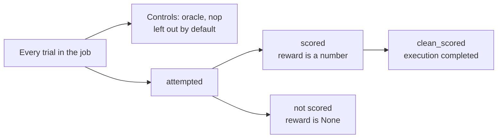

# Analyse runs

Read finished runs from the shell, the browser or Python. None of these start a sandbox.

```bash
bench results jobs/                       # one row per job, with its score
bench results jobs/run-a                  # one job, trial by trial
bench results jobs/run-a jobs/run-b       # two jobs, compared task by task
bench eval metrics jobs/claude            # passed, failed, errored, solve rate, pass@k, tool calls, time
bench view jobs/claude                    # every run in jobs/claude, in your browser
```

`bench eval metrics jobs/` counts every run under `jobs/` together, whatever agent ran it. Point it at one experiment's folder to read that experiment.

## View runs in the browser

`bench view` serves a local page at the printed `http://localhost:8888` URL. It shows each trial's trajectory, verifier output, and whether it completed and got a score. `--port` picks another port.

Point it at one job, a folder of jobs such as `jobs/`, or a single trial. `bench run` prints this command at the end of each run.

On a remote machine, forward the port first, then open the URL on your own machine:

```bash
ssh -L 8888:localhost:8888 <host>
```

## Where results land

Each run writes under `--jobs-dir`, by default `jobs/`:

```text
<jobs-dir>/
  summary.json                      # copy of the latest job's summary (the next run overwrites it)
  <YYYY-MM-DD__HH-MM-SS>/           # one job, named by its start time
    summary.json                    # the job's totals: pass counts, mean_reward, mean_reward_scored_only; planned, ran and score_of_plan beside score
    evaluation.json                 # the job's settings, used to resume it (no secret-looking agent_env value)
    results.jsonl                   # one row per trial (also verifiers.jsonl, adp.jsonl)
    <task>__<hash8>/                # one trial: task name + 8-character id
      result.json                   # rewards, errors, token usage and cost
      config.json                   # the trial's resolved settings (secret values left out)
      results.jsonl                 # the trial as a Verifiers/Prime-RL row
      rewards.jsonl                 # the reward record
      timing.json                   # time per phase
      trust-state.json              # recorded trust checks
      kill-before-grading.json      # how agent processes were stopped
      locked-system-path.json       # system PATH checks
      artifacts-manifest.json       # collected artifact names and metadata
      artifacts/                    # collected task artifacts
      prompts.json                  # the prompts sent to the agent
      agent/                        # the agent's own logs (install output, adapter log)
        acp_trajectory.jsonl         # agent-side ACP trace, also saved under trajectory/
      trajectory/
        acp_trajectory.jsonl        # the full agent trace (ACP events)
        llm_trajectory.jsonl        # raw model requests and responses (when the usage proxy saw them; not for subscription logins)
      trainer/
        verifiers.jsonl             # the scored trajectory for trainers (Verifiers/ORS record)
        atif.json                   # the trajectory as an ATIF record (left out when the trajectory is empty)
        adp.jsonl                   # the trajectory as an ADP record
      verifier/
        ctrf.json                   # a CTRF test report (when test.sh writes one)
        reward.txt                  # the raw verifier reward, 0.0 to 1.0
        test-stdout.txt             # the verifier's output
```

`total_cost_usd` is `null` when cost is unknown, not zero. Trial timestamps from older runs can lack a timezone suffix; do not infer the reader's local timezone from them.

## Score, reward and exit codes

`reward` is the verifier's raw value, from 0.0 to 1.0, in `result.json` and `verifier/reward.txt`. `Score: 3/5` counts tasks passed, and a task passes only at reward 1.0. A task the agent got wrong prints `[FAIL]`.

| Exit code | Means |
|---|---|
| 0 | the run finished, whatever the score |
| 1 | a missing credential, a run config that does not load, or a trial had an agent or verifier error |
| 1 | `--fail-under` or `--fail-on` was given and the run fell short |
| 2 | a usage mistake caught before anything runs: a bad flag or value, an unknown agent, sandbox or dataset, or a path that is not there |

[When a run fails](../jobs/when-a-run-fails.md) explains each kind of error and what to do.

## Load a job in Python

```python
import benchflow as bf

job = bf.load_job("jobs/run-b")        # a job dir, a folder of jobs, one trial, or a list
job.trials
# [Trial(task='fetch-note', agent='oracle', model=None, reward=1.0, execution='completed', assessment='scored'),
#  Trial(task='hello-world-task', agent='claude-agent-acp', model='claude-haiku-4-5', reward=1.0, execution='completed', assessment='scored'),
#  Trial(task='hello-world-task', agent='oracle', model=None, reward=1.0, execution='completed', assessment='scored')]
```

`bf.load_job` counts trials the same way as `bench view` and `bench results`, so your notebook's numbers match theirs.

Each trial has two verdicts:

| Field | Values | Question |
|---|---|---|
| `execution` | `completed`, `errored`, `timed_out`, `integration_failed` | Did the run finish? |
| `assessment` | `scored`, `error` (the verifier failed), `unscored` | Did it get a score? |

A trial with no score has `reward` `None`, never 0.

## Count

```python
d = job.denominators()
# Denominators(attempted=1, scored=1, assessment_errors=0, unscored=0, execution_errors=0,
#              passed=1, mean_reward=1.0, clean_scored=1, clean_passed=1, controls_excluded=2,
#              integration_failures=0, mean_reward_scored_only=1.0, mean_reward_caveat=None)
d.pass_rate_scored, d.pass_rate_attempted     # (1.0, 1.0)
```



| Figure | Divides by | A trial with no score |
|---|---|---|
| `pass_rate_attempted`, `mean_reward`, solve rates, pass@k | every attempted trial | counts as a fail |
| `pass_rate_scored`, `mean_reward_scored_only`, `solve_rate_scored_only`, `pass_at_k_scored_only` | scored trials only | is left out |
| `clean_*` | scored trials whose execution completed | is left out |

For example, three trials with rewards 1, 0 and `None` give `pass_rate_attempted` 1/3 and `pass_rate_scored` 1/2.

Control runs (oracle and `nop`) test the task, not an agent, so they are left out: above, `controls_excluded=2`. Pass `include_controls=True` to count them.

Split the counts by agent and model:

```python
for g in job.denominators_by(("agent", "model"), include_controls=True):
    print(g.key, g.denominators.attempted, g.denominators.passed)
# {'agent': 'claude-agent-acp', 'model': 'claude-haiku-4-5'} 1 1
# {'agent': 'oracle', 'model': None} 2 2
```

`bf.jobs.GROUP_KEYS` lists the keys you can split by: agent, model, control, and run settings such as reasoning_effort, environment and task_digest. `bench results JOB --by agent,model` prints the same table.

## Into pandas

```python
import pandas as pd

df = pd.DataFrame(job.to_records())       # one row per trial; job.to_csv(path) writes the same
df[["task_name", "agent", "model", "reward", "execution", "assessment", "control"]]
```

Each row has token counts (`n_input_tokens`, `n_output_tokens`, `n_cache_read_tokens`, `n_cache_creation_tokens`, `total_tokens`) and `cost_usd`. It also has timing, the error and its category, and the run settings.

`cost_usd` is `None` for agents on a subscription login, which report tokens but no price. With several jobs loaded, the `job` column tells them apart.

## Compare two runs

```python
cmp = bf.compare("jobs/run-a", "jobs/run-b", labels=("a", "b"))
print(cmp.to_markdown())
# On the 1 tasks both sides ran: a 1/1 scored passed (100%), …; b 1/1 scored passed (100%), …
# | Task | a | b | Delta | Status |
# | hello-world-task | 1 | 1 | 0 | paired |
```

From the shell: `bench results jobs/run-a jobs/run-b`.

`compare` pairs trials by task name. The headline uses `cmp.a_paired` and `cmp.b_paired`, the counts over tasks both sides ran. `cmp.a` and `cmp.b` cover every task each side ran.

It also checks that each pair ran with the same settings: task digest, model, harness, reasoning effort, timeout, prompts and more. It warns when they differ. Name the setting you changed on purpose with `vary=("model",)`.

To compare several agents or models in one pair of jobs, pair on them too with `by=("agent", "model")`. Without it, a side that mixes models is flagged in the caveats.

## Pitfalls

- When a job retried a task, you see one trial per agent and model: the scored attempt, else the newest (`attempts="best"`, the default). `attempts="all"` shows every attempt, and `trial.attempts` lists them, oldest first. Trials from `bf.run_batch` are not retries: each is its own trial.
- `bf.load_job` wants a job folder or a `results.jsonl` file. It refuses `summary.json` or `result.json` paths and names the folder to pass instead.
- With one run per task, chance alone can flip a pass to a fail. Run more attempts per task and read [pass@k](../reference/pass-at-k.md) before you call a difference real.
- A folder where an attempt started but never wrote `result.json` (a crash or a kill) is in `job.interrupted`, not in `job.trials`.

## Export results

Export a job as versioned JSON, or JSON and one CSV row per trial:

```bash
bench results jobs/run-a --json > job.json
bench eval inspect jobs/run-a --json --out job.json --csv trials.csv  # older spelling; extra output flags
```

`bench results` is the current short command. The older spelling `bench eval inspect` remains supported because its `--out` and `--csv` flags have no short-command equivalent. An unscored trial stays unscored in these files: its reward is `null`, never `0`.

For trainer rows, use a separate, explicit conversion:

```bash
bench train convert jobs/run-a --out train.jsonl --manifest train.manifest.json
bench train validate train.jsonl --source-jobs jobs/run-a
```

Training conversion supports function tools with JSON arguments. If a selected exchange contains an OpenAI Responses custom-tool declaration, call or result, conversion refuses with `unsupported_tool_protocol` before changing the output or manifest. The task score and raw captures remain intact. See [`bench train convert`](../reference/cli.md#bench-train-convert) for formats and limits.

`bench export` does not export results; it converts a `task.md` task to the compatibility split layout. See [`bench export`](../reference/cli.md#bench-export).

From Python, `job.to_json_dict()`, `trial.to_json_dict()` and `cmp.to_json_dict()` produce the same versioned document families (`benchflow.job`, `benchflow.trial`, `benchflow.comparison`). `bench run --summary-out` writes a fourth, `benchflow.run-summary`. See [JSON export](../reference/json-export.md).

## Next steps

- Why a trial has no score: [When a run fails](../jobs/when-a-run-fails.md), or `bench explain`.
- Score stored runs again after a verifier fix: [Regrade](../jobs/regrade.md).
- The full API: [Python API reference](../reference/python-api.md#reading-finished-jobs).
