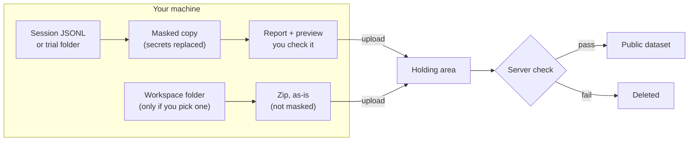

# Share a trajectory

```bash
bench traj upload path/to/session.jsonl
```

`bench traj upload` sends a coding-agent session or a BenchFlow trial to BenchFlow's public trajectory dataset. It masks secrets on your machine first and shows you what it will send. You need no BenchFlow account or API key.

It reads Claude Code and Codex sessions, BenchFlow trial folders, and other JSONL logs. Session discovery (`bench traj setup --list`) finds Claude Code and Codex sessions.

## Let your coding agent do it

Paste this into your coding agent (Claude Code, Codex, OpenCode or Cursor):

> Upload one of my recent local coding-agent sessions to BenchFlow.
>
> 1. Install the latest benchflow CLI: `uv tool install --python 3.12 --upgrade --force benchflow`
>
> 2. Read https://raw.githubusercontent.com/benchflow-ai/benchflow/main/.agents/skills/benchflow-traj-upload/SKILL.md and follow it: find the session, open the viewer, and upload only after I review it.

Your agent finds a session, opens it in the viewer, and uploads it after you approve it.

> **Before you upload:** a workspace zip (one you pick when asked, or `--workspace-dir`) is sent as-is: it is not masked, and nobody scans it. Once sent, an upload can't be listed or removed by you; `bench traj status` only says whether it was verified.

`bench traj setup` and `bench traj upload` print a one-line hint when a newer BenchFlow is on PyPI.

### Teach your agent once

To install the skill, so later chats need only a short ask:

```bash
npx skills add benchflow-ai/benchflow --skill benchflow-traj-upload
```

Or, with BenchFlow installed:

```bash
bench traj setup
```

`npx skills add` asks which agents to install the skill for. `bench traj setup` copies the skill into `.agents/skills/benchflow-traj-upload/` and prints an agent prompt. After that, ask your agent: **upload my last session to BenchFlow**.

| `bench traj setup` option | What it does |
|---|---|
| `--yes`, `-y` | Installs the skill without questions. |
| `--prompt` | Prints the copy-paste agent prompt and exits. |
| `--list` | Lists recent local sessions and exits. |

## Upload from the terminal

```bash
bench traj upload
```

With no path, the command walks you through it:

1. It asks for the session or trial path.
2. It checks the files, masks secrets, and shows a report and a preview.
3. It asks for a workspace folder to attach as a zip. Press Enter to skip.
4. It fills your GitHub ID and email from `gh` and `git`, or from `BENCHFLOW_GITHUB_ID` and `BENCHFLOW_EMAIL`. It asks only for what it cannot find.
5. It asks you to confirm.

> **Before you upload:** a workspace zip (step 3, or `--workspace-dir`) is sent as-is: it is not masked, and nobody scans it. Once sent, an upload can't be listed or removed by you; `bench traj status` only says whether it was verified.

For scripts and agents, give every input:

```bash
bench traj upload path/to/trial \
  --github-id YOUR_GITHUB_ID \
  --email YOU@example.com \
  --no-workspace
```

**When every input is given, the command does not ask.** It prints the report and uploads at once. Run `--dry-run` first if you want to look before sending.

The path can be a trial folder that contains `trajectory/`, a folder of JSONL files, or one JSONL file.

**Read your session before you upload it.** Automatic masking can miss secrets, and it does not look for personal data. Once a capture is in the dataset, BenchFlow may keep it.

## What leaves your machine



| What | Uploaded? | Masked? |
|---|---|---|
| Trajectory JSONL | Yes, as a masked copy. Your files are not changed. | Yes, on your machine. The server scans it again. |
| Workspace zip | Only with `--workspace-dir DIR`, or a folder you type at the prompt. | **No.** It is archived as-is. |
| GitHub ID and email | Yes, in `manifest.json` as `contributor`. | No. |
| Repository tag (`owner/name`) | Yes, unless you pass `--no-repo`. | No. The local path stays on your screen. |
| Your original session files | No. | — |

**Secrets.** BenchFlow replaces anything that looks like a key with `<XXX-benchflow-key-values-XXX>`. Only the masked copy is uploaded. Files with duplicate JSON keys or non-finite numbers are rejected.

**Workspace.** The zip leaves out version-control folders (`.git` and others), dependency folders and caches. It also leaves out files named like secrets: `.env` and `.env.*`, `*.pem`, `*.key`, `*.p12`, `*.pfx`, `*.keystore`, `id_rsa`, `id_dsa`, `id_ecdsa`, `id_ed25519`, `.netrc`, `.npmrc`, `credentials`, `secrets`, and `.DS_Store`. Everything else goes in unchanged: it is not masked, and the server does not scan it. A folder over 1 GiB or 50,000 files is skipped. A script with no `--workspace-dir` attaches nothing. `--no-workspace` never attaches one.

**Repository tag.** BenchFlow tags the upload with the GitHub repository the session worked in. It reads the working folder recorded in the session, not the folder you run the command from. It prints, for example, `Repo: owner/name (from session cwd /path; use --no-repo to omit)`. Pass `--no-repo` for a private repository, or `--source-id ID` to set the tag yourself. If no repository is found, the upload is tagged by path.

**Your GitHub ID and email** are not verified. The dataset may publish the manifest, so use an email you are happy to share.

`BENCHFLOW_TRAJ_UPLOADED_BY` adds a label to your upload. Do not put secrets or personal data in it.

## Options

| `bench traj upload` option | Default | What it does |
|---|---|---|
| `--dry-run` | off | Lists the files, sizes, digest and masked-secret count. Sends nothing. |
| `--workspace-dir DIR` | — | Attaches DIR as a zip, as-is. |
| `--workspace` / `--no-workspace` | `--workspace` | `--no-workspace` never attaches a workspace and skips the prompt. |
| `--repo` / `--no-repo` | `--repo` | Tags the upload with the session's GitHub repository. |
| `--source-id ID` | from the session | Sets the tag yourself. |
| `--github-id`, `--email` | from `gh` and `git` | Your contributor details. |
| `--preview-steps N` | 5 | Steps to preview, 0 to 20. |
| `--wait` / `--no-wait` | `--wait` | Waits until the server has checked the upload. |

The last line of `--dry-run`, `Masked for you: ...`, lists the masked secrets by kind.

## What the report shows

The report is built from the masked copy:

- the main trajectory file and its format;
- the earliest timestamp, or the file's timestamp;
- the number of JSONL files and their total size;
- step counts: human steps (your messages), tool-call steps (agent tool calls) and thinking steps (other agent messages). They add up to the total. Tool results are not steps;
- the number of masked secrets, by kind: API keys, bearer tokens, private keys, passwords, URL credentials and credential fields. With nothing to mask, it says `No secrets or personal identifiers detected — nothing needed masking.`;
- a preview of the first five steps, up to 100 words each.

Formats recognized: BenchFlow ACP, Claude Code, Codex, OpenTrace and BenchFlow LLM-exchange. Anything else is read as generic JSONL. When a trial has both an ACP and an LLM trajectory, the report counts steps from the ACP one.

Only the total masked count is uploaded. The counts by kind appear on your screen only.

## Review before you upload

```bash
bench view path/to/session.jsonl --confirm
```

`bench view PATH` opens a local page for a trial, a job, or a Claude Code, Codex or ACP session file. It shows the original session, not the masked one, and writes nothing next to the file.

With `--confirm`, the page shows Approve and Reject buttons. The command prints `DECISION: approved` (exit 0) or `DECISION: rejected` (exit 3), so an agent can wait for your click.

`--redaction-summary "2 API keys, 1 bearer token"` adds a note of what the upload will mask. The skill fills it from the `Masked for you` line of `bench traj upload --dry-run`.

## After upload

The first request can take up to a minute. Retrying is safe.

Your upload lands in a private holding area. The server checks every file again and rescans the JSONL for secrets. It rejects the upload if any secret survived. Only uploads that pass join the dataset; failed uploads are deleted. The server checks only that a workspace zip is a zip; it does not scan its contents.

By default the command waits up to 240 seconds for that check. `BENCHFLOW_TRAJ_WAIT_SECONDS` changes the wait, and `--no-wait` skips it. To check later:

```bash
bench traj status sha256:<digest>
```

The status is `Verified`, `Queued`, `Validating` or rejected with a reason.

Uploading the same masked content again prints `Already submitted` and sends nothing.

A contributor cannot list or remove an upload; the service offers only the upload and its status.

Operators with Azure access can upload directly with `--direct`. See [services/trajectory_upload](https://github.com/benchflow-ai/benchflow/blob/main/services/trajectory_upload/README.md#trusted-direct-upload).

The [eval prize page](./eval-prize.md) keeps the prompt from a past event, for reference.

## Next steps

- [`bench view`](../reference/cli.md#bench-view): every viewer option.
- [`bench traj upload`](../reference/cli.md#bench-traj-upload): the full flag list.
- [Results and analysis](./analysing-runs.md): read your own runs before sharing them.
