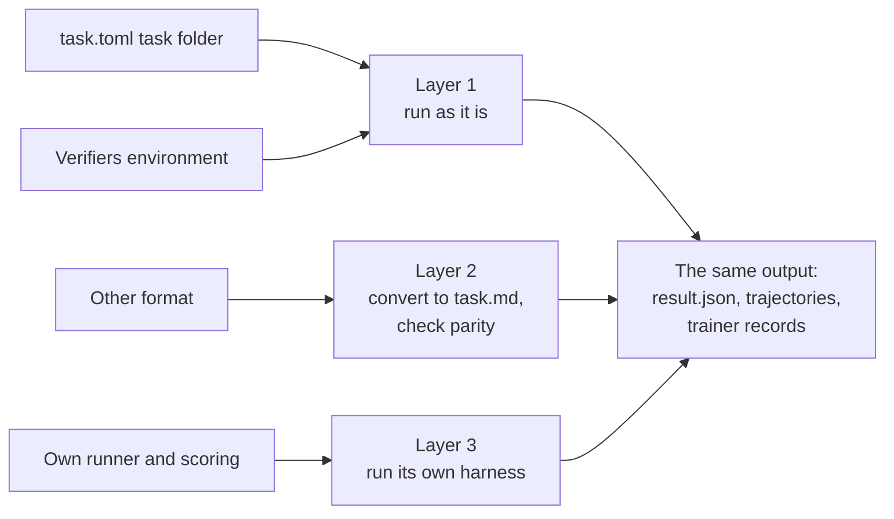

# Run any benchmark

BenchFlow runs a benchmark in one of three ways, depending on its format. Every way writes the same scored trajectory.

```bash
bench run path/to/toml-task -a claude-agent-acp                     # Layer 1: as it is
bench eval adopt <source>                                             # Layer 2: convert, then check
bench run --source-env primeintellect/general-agent --source-env-version 0.1.1 --model google/gemini-2.5-flash-lite
```

| If the benchmark is… | Layer | What BenchFlow does |
|---|---|---|
| task.toml tasks, or a PrimeIntellect Verifiers environment | **1: as it is** | Runs it as it is |
| In another format, or a variant of a known one | **2: convert** | Converts it to BenchFlow's `task.md`, then checks the conversion with a parity test |
| A one-off harness with its own runner and scoring | **3: its own harness** | Runs the benchmark's own harness and reads its output |

All three write the same files; see [The output](#the-output).

BenchFlow cannot run Inspect AI or OpenReward benchmarks. It can export its results to both formats; see [Export](#export).



## Layer 1: run as it is

task.toml tasks and PrimeIntellect Verifiers environments run as they are.

**task.toml tasks.** `bench run` reads a task.toml task folder directly. The sandbox, agent adapter and verifier hardening determine execution and scoring. [task folders in the task.toml format](./datasets/benchmarks.md#task-folders) lists which `task.toml` keys BenchFlow honours, ignores and refuses.

**PrimeIntellect Verifiers environments** do not run in a BenchFlow sandbox. BenchFlow runs them with the environment's own `vf-eval` and writes the same output files. It keeps the environment's identity (`env_uid`, `hub_url`).

```bash
bench run \
    --source-env primeintellect/general-agent \
    --source-env-version 0.1.1 \
    --model google/gemini-2.5-flash-lite
```

BenchFlow installs the environment from Prime's package index (`https://hub.primeintellect.ai/primeintellect/simple/`) into a fresh venv, and calls the `vf-eval` that package ships. Two versions exist:

| `vf-eval` | Used by | How BenchFlow runs it |
|---|---|---|
| Legacy (verifiers 0.3.1 and older) | The Hub's v0 environments | `--env-args`, `--num-examples`, `--sampling-args`, `--save-results`. The reward is the `reward: avg` line of its summary |
| v1 (the verifiers 0.3.2 dev line) | The Hub's v1 tasksets | Each `--source-env-arg` becomes `--env.taskset.<key>`, and `--no-push` keeps results off the Prime platform. The reward is the mean of the trajectories' weighted reward sums |

On v1, errored episodes are left out and counted. If every episode errored, the run is an error, not a 0 reward. Token counts come from the traces.

Each environment runs on the verifiers release its package requires. `--source-env-verifiers-version` pins one.

You need access to Prime's index and a model key: `PRIME_API_KEY` for Prime inference, or `--source-env-base-url` with `--source-env-api-key-var` for another OpenAI-compatible endpoint.

### Export

| Adapter | Turns | Into |
|---|---|---|
| [`InspectAdapter`](https://github.com/benchflow-ai/benchflow/blob/main/src/benchflow/adapters/inspect_ai.py) | A BenchFlow `Scene` and `Rubric` | An Inspect AI task |
| [`ORSAdapter`](https://github.com/benchflow-ai/benchflow/blob/main/src/benchflow/adapters/ors.py) | A `VerifyResult` or `RewardEvent` | An OpenReward reward record |

## Layer 2: convert, then check

A benchmark in another format is converted to `task.md`. There are two ways, checked differently:

| You are converting… | Commands | How the result is checked |
|---|---|---|
| A task you own, in the `task.toml` + `instruction.md` layout | `bench import` → `bench check` | `bench check` checks the new `task.md`. The conversion itself refuses to drop any setting |
| A benchmark with no adapter | `bench eval adopt <source>` → `bench eval adopt <name> --verify` | A parity test against the original's results |

`--verify` works only on a benchmark made with `bench eval adopt`. On anything else, including an imported `task.md`, it stops with `benchmark not adopted … run bench eval adopt first`.

### Import a task you own

```bash
bench import <dir>
bench check <dir>
```

`bench import` turns a `task.toml` + `instruction.md` folder into one `task.md`. It checks that the config means the same before it writes.

`bench check` then rejects leftover `[REPLACE: …]` placeholders, missing files and a verifier with no entry point. No parity test runs: the task is yours and only its format changed.

### Adopt a benchmark

```bash
bench eval adopt <source>                 # convert, ending in a pull request
bench eval adopt <name> --scaffold-only   # only create benchmarks/<name>/
bench eval adopt <name> --verify          # the parity test
```

`bench eval adopt <source>` creates `benchmarks/<name>/` and has an agent convert the benchmark, ending in a pull request. The conversion guide is built into the command. See [Adding a benchmark](./datasets/benchmarks.md#adding-a-benchmark) for the folder's files.

### The parity test

`bench eval adopt <name> --verify` compares the converted benchmark with the original in two ways:

1. **Each criterion's verdict** must match on the same inputs.
2. **Each reward difference** must be within 0.02 (`--tolerance`).

It prints `parity-confirmed`, `parity-divergent` or `insufficient-evidence`. A layer with no data does not block; no data at all gives `insufficient-evidence`.

The conversion must reproduce the original, flaws included: parity never fixes the benchmark, reward-hackable parts and all. On a divergence, the test writes a draft issue for a person to review and file. It files nothing itself.

The evidence is `benchmarks/<name>/parity_experiment.json`. A file with no verdict pairs and no reward samples gives `insufficient-evidence`.

Of the shipped experiments, ProgramBench's records reward samples, and `bench eval adopt programbench --verify` reports `parity-confirmed`. The others record notes the test cannot score, so they give `insufficient-evidence`; one uses an older list format. Read those files directly.

## Layer 3: run its own harness

A benchmark with its own runner and scoring runs under that harness. BenchFlow reads only its output.

- **ACP shims.** The benchmark's agent loop is wrapped as an ACP server, a `*-harness` agent such as `harvey-lab-harness`. BenchFlow drives it and reads its trajectory; the original loop runs unchanged.
- **Hosted runs.** A Verifiers environment (Layer 1) keeps its raw output under `hosted_env/`, and its records carry `source.type="hosted_env"`.
- **Trace import.** `bench tasks generate --from-file | --from-hf | --from-local` turns JSONL traces, Hugging Face datasets or local Claude Code sessions into BenchFlow records.

## The output

Every layer writes the same files per trial, under `<jobs-dir>/<job>/<task>__<hash8>/`. See [Run a job](./jobs/run.md#read-the-result).

| File | What it holds |
|---|---|
| `result.json` | The trial: rewards, errors, token usage and cost |
| `results.jsonl` | A Verifiers / Prime-RL rollout row |
| `rewards.jsonl` | The reward record, in OpenReward's shape |
| `trajectory/acp_trajectory.jsonl` | The agent's trace as ACP events |
| `trajectory/llm_trajectory.jsonl` | Raw provider requests and responses, when captured |
| `trainer/verifiers.jsonl` | A trainer-ready scored trajectory (Verifiers record) |
| `trainer/atif.json` | The ATIF trajectory record |
| `trainer/adp.jsonl` | The ADP trajectory record |
| `verifier/` | Raw verifier output: `reward.txt`, `ctrf.json`, stdout |

Hosted runs write the same files, marked `source.type="hosted_env"` and `trajectory_source="hosted_env"`. So release checks, trainers and reports read every benchmark the same way.

## Next steps

- [Run a job](./jobs/run.md)
- [Benchmarks](./datasets/benchmarks.md): the converted benchmarks BenchFlow ships
- [Concepts](./core-concepts.md): Rollout, Scene, Role, Verifier
- [task.md authoring](./tasks/overview.md): the format Layer 2 converts to
- [Architecture](./architecture.md): adapters and trainers at the edges of the system
