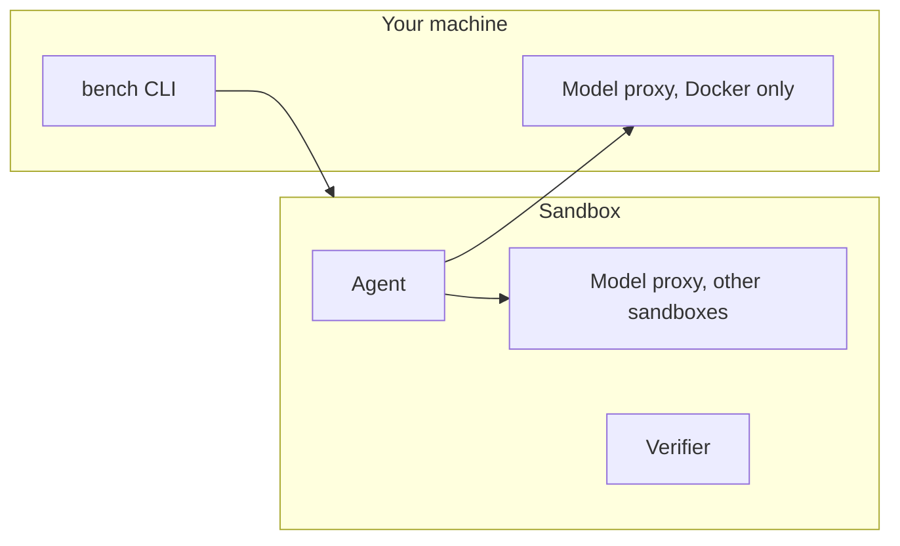

# Sandboxes

```bash
bench run tasks/my-task -a claude-agent-acp                  # Docker on this machine (the default)
bench run tasks/my-task -a claude-agent-acp -s daytona -j 32 # Daytona, 32 trials at a time
```

Each trial runs in a fresh, isolated sandbox. The agent works there, and the verifier then scores the workspace. Choose where with `--sandbox` (`-s`). The task stays the same on every backend, within each backend's limits.

## Available sandboxes

| Sandbox | `--sandbox` | Install | Best for |
|---|---|---|---|
| [Docker](./docker.md) | `docker` (default) | Docker Engine with Compose | Local development, and large runs on your own host |
| [Remote Docker](./remote-docker.md) | `remote-docker` | A Docker host you reach over SSH or TLS | Your own server or cloud VM |
| [Daytona](./daytona.md) | `daytona` | `benchflow[sandbox-daytona]`, `DAYTONA_API_KEY` | Cloud runs with high concurrency |
| [Modal](./modal.md) | `modal` | `benchflow[sandbox-modal]`, Modal login | Serverless runs, GPU tasks |
| [AgentCore](./agentcore.md) | `agentcore` | `benchflow[sandbox-agentcore]`, AWS credentials | AWS-native microVMs |
| [Apple Container](#apple-container) | `apple-container` | Apple Container 1.1+ on Apple Silicon | Local Mac runs without Docker |

Install an extra with:

```bash
uv tool install --python 3.12 --upgrade 'benchflow[sandbox-daytona]'
```

In a source checkout: `uv sync --extra sandbox-daytona --extra dev --locked`.

## What each sandbox supports

| Capability | `docker` | `remote-docker` | `daytona` | `modal` | `agentcore` | `apple-container` |
|---|---|---|---|---|---|---|
| ACP and native agents | ✓ | ✓ | ✓ | ✓ | ✓ | ✓ |
| Multi-container tasks (Compose) | ✓ | ✓ | ✓ | — | — | — |
| `no-network` | ✓ | ✓ | ✓ | ✓ | — | — |
| `denylist`, `allowlist` | ✓ | ✓ | ✓ | — | — | — |
| Separate verifier sandbox | ✓ | ✓ | ✓ | ✓ | — | — |
| Task GPUs | — | — | — | ✓ | — | — |
| Model proxy runs | On your machine | In the sandbox | In the sandbox | In the sandbox | In the sandbox | In the sandbox |

BenchFlow checks these before a run starts. A task that needs something its sandbox lacks is refused before any sandbox is created, never run with a weaker policy. To check ahead of time:

```bash
bench check tasks/my-task --sandbox modal
```

Modal runs ACP and native agents over `Sandbox.exec` stdio, as well as scripted agents, session-factory agents and the oracle; it refuses `denylist` and `allowlist` tasks.

## Where things run



The model proxy holds the provider key, so the agent never sees it. On Docker it runs on your machine. Elsewhere it runs inside the sandbox, as it does on Docker for tasks with a network policy.

## Apple Container

Apple Container (1.1+, Apple Silicon) runs single-container arm64 tasks with internet access, one at a time per process. Run one BenchFlow process at a time: a macOS memory leak is system-wide, and BenchFlow stops starting VMs when kernel memory runs low.

It cannot run `no-network`, `denylist`, `allowlist`, multi-container or snapshot tasks. Use Docker or Daytona for those.

## Next steps

- What every sandbox guarantees: [Sandbox security](./security.md).
- Set up a backend: [Docker](./docker.md), [Remote Docker](./remote-docker.md), [Daytona](./daytona.md), [Modal](./modal.md), [AgentCore](./agentcore.md).
- Run a job: [Run a job](../jobs/run.md).
