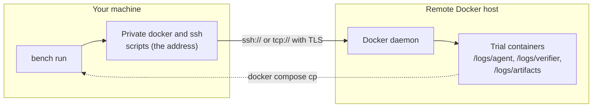

# Remote Docker

`--sandbox remote-docker` runs each trial on a Docker daemon you control, reached over SSH or TCP with TLS.

```bash
export BENCHFLOW_REMOTE_DOCKER_HOST=ssh://builder@gpu-box.example.com
bench doctor --sandbox remote-docker
bench run tasks/ --sandbox remote-docker
```

```python
import benchflow as bf

evaluation = bf.Evaluation(
    tasks_dir="tasks/",
    jobs_dir="jobs/",
    config=bf.EvaluationConfig(agent="oracle", environment="remote-docker"),
)
evaluation.run_sync()
```

It is the local `docker` sandbox with the daemon somewhere else: the same compose files, sandbox user, verifier hardening, network modes, side services, separate verifier sandboxes and snapshots.



## Choosing the host

The host comes from `BENCHFLOW_REMOTE_DOCKER_HOST`, or from `DOCKER_HOST` when that is unset.

| Host | Requirements |
|---|---|
| `ssh://user@host[:port]` | Your SSH setup: keys, agent, `~/.ssh/config`. The remote user needs the Docker socket. The host must already be in `known_hosts` |
| `tcp://host:2376` | TLS only: `DOCKER_TLS_VERIFY=1` and `DOCKER_CERT_PATH` (or `~/.docker`) holding `ca.pem`, `cert.pem` and `key.pem` |

Plain TCP is refused: an unauthenticated Docker API gives root on the host to anyone who can reach the port. `unix://` and `npipe://` are refused too; use `--sandbox docker`.

BenchFlow passes the host to every `docker` and `docker compose` call on the command line, never in the environment. So a task's compose files cannot read it: `${DOCKER_HOST}`, `${SSH_AUTH_SOCK}`, `${USER}` and the like are empty there.

Your current docker context and buildx builder are ignored. Builds go to the remote daemon's own `default` builder.

`remote-docker` runs on Linux and macOS.

### SSH hosts

- BenchFlow forces `StrictHostKeyChecking yes` for the host and every `ProxyJump` hop, over any setting in your SSH config. An unknown or changed host key fails the connection.
- A host reached through `ProxyCommand` is refused; use `ProxyJump`.
- BenchFlow reads each hop with `ssh -G` before connecting. A hop it cannot read, or more than 8 hops, is refused.
- `BENCHFLOW_REMOTE_DOCKER_SSH_CONFIG` names an SSH config file to use instead of `~/.ssh/config`.

### TCP hosts

- An empty port means 2375, still with TLS.
- Write international host names in IDNA form (`xn--…`). Unicode and percent-encoded host names are refused.
- Scoped IPv6 addresses (`[fe80::44%25eth0]`) are refused. Use a DNS name, IPv4, or unscoped IPv6.

### Checking the host

`bench doctor --sandbox remote-docker`, or plain `bench doctor` with `BENCHFLOW_REMOTE_DOCKER_HOST` set, checks the host and reports its Docker version, CPUs and memory:

```
Docker 29.1.3 on remote-docker[ssh] (16 CPU, 62.8 GiB)
```

## What differs from local Docker

| | Local Docker | Remote Docker |
|---|---|---|
| Trial folders | Bind-mounted from your machine | Created in the container and copied back with `docker compose cp` |
| Bind mounts, host-path volumes, `file:` secrets | Allowed inside the task folder | Refused, wherever they point |
| The model proxy | On your machine | In the sandbox |
| Verifier recovery after a lost sandbox | Yes | No |
| Start-of-job sweep of stopped containers | Yes | No: on a shared host it would remove other users' containers |
| Pre-compose hook | Refused unless `BENCHFLOW_ALLOW_TASK_HOST_ACCESS=1` | The same; allowed, it gets no connection settings, SSH agent or `docker` script |

**Refused tasks.** Before building, BenchFlow resolves the task's Compose project. It refuses the task with `Remote Docker host refuses this task: ...` when the project has:

- a bind mount (the path would be on the remote host; use `COPY` in the Dockerfile instead);
- a `file:` secret or config;
- a volume whose driver options bind a host path;
- an `external: true` volume, or one that already exists on the host without the trial's project label;
- a build with `ssh:`, which would forward your SSH keys to the build.

These are not retried.

> [!WARNING]
> BenchFlow refuses a task whose Compose project uses `privileged`, `devices`, host namespaces (`pid`, `ipc`, `network_mode: host`), added capabilities or `volumes_from`: each would give the task root on the remote host. `BENCHFLOW_ALLOW_TASK_HOST_ACCESS=1` turns the refusals off; on a host other people use, set it only for tasks whose Compose files you have read.

**The pre-compose hook.** A task's `benchflow-pre-compose.sh` runs on your machine as you. It could read your `~/.ssh` and BenchFlow's connection scripts, then copy them into the image. So `remote-docker` refuses such a task unless `BENCHFLOW_ALLOW_TASK_HOST_ACCESS=1`. Set it only for tasks you have read.

**The host is checked first.** `docker info` runs before each job and before each sandbox starts. These fail at once, are not retried and create no container:

| Message | Cause |
|---|---|
| `Remote Docker host unreachable: <host>: <reason>` | The connection failed |
| `Remote Docker host lacks resources: task needs 8 CPUs; <host> has 4` | The task asks for more CPUs or memory than `docker info` reports |
| `remote Docker host is out of disk space` | The remote disk is full |

Inside a VM, `docker info` may report the physical machine, so the resource check is a lower bound.

**Builds.** Images are built on the remote host, from a build context sent over the connection, and cached there. `--build-concurrency` works as on Docker. BenchFlow publishes no port: nothing needs to reach the remote host except the docker CLI.

## Teardown

Teardown removes only what the trial made: its containers, their anonymous volumes, its network, and the volumes labelled with its compose project. BenchFlow never runs `down --volumes` or `--rmi all`, which would also remove volumes and images it did not make.

Images follow the local Docker rules: only the trial's own build tags are released, and parent images are never pruned.

If the host is unreachable at teardown, the warning names the label to clean up later:

```bash
docker ps -a --filter label=com.docker.compose.project=<project>
docker network ls --filter label=com.docker.compose.project=<project>
docker volume ls --filter label=com.docker.compose.project=<project>
```

> [!WARNING]
> `bench sandbox cleanup` acts on the daemon your docker CLI reaches, which is the remote host when it comes from `DOCKER_HOST`. There it also removes the containers and networks of this machine's BenchFlow processes that died (their labels name this machine; other machines' are never touched), and every `bf-snap-*` image older than `--max-age` (24 hours by default), whoever made it. On a shared host, do not run it; remove your own snapshot images with `docker rmi`.

## What BenchFlow hides

Messages, records, logs and `bench doctor` name the host `remote-docker[ssh]` or `remote-docker[tcp]`, never its address. The SSH user is always shown as `***`, since some gateways put a token there.

To see the address while debugging, set `BENCHFLOW_REMOTE_DOCKER_SHOW_ADDRESS=1`. Messages then name `ssh://***@gpu-box.example.com`, still without the user.

An address Docker would print whole in its own error is refused before any call:

| Refused | Fix |
|---|---|
| `/`, `?`, `#` or `@` in the SSH user | Percent-encode it: `%2F`, `%3F`, `%23`, `%40` |
| A bad `%` escape, a character URLs do not allow, a space, tab or line break | Fix the address |
| A missing or misplaced `[` `]`, or an invalid port | Fix the address |
| An SSH password in the address | Use a key or an agent; Docker takes no password |

`bench doctor` applies the same rule to your own `DOCKER_HOST`.

## Reference: how diagnostics are masked

| Source | What is shown |
|---|---|
| Host names in ssh's and docker's messages | `<remote host>`: dotted names and IPs wherever they appear; a one-label name such as `docker` only where it stands as a host (`@docker`, `//docker`, `docker:2376`) |
| SSH logins | `***`: the user as written and percent-decoded, and every login and host name your SSH config picks for the host and each hop (read with `ssh -G`, which connects to nothing). Logins of 8 characters or more are masked anywhere; shorter ones where they stand as the user (`ubuntu@`, `-l ubuntu`) |
| TLS name mismatches | Both names masked, unless addresses are shown |
| TCP daemon diagnostics | A fixed message. A certificate failure and a full disk get their own; everything else gets one generic message naming `remote-docker[tcp]` and asking you to check the host, TLS and proxy |
| SSH helper diagnostics | The same fixed messages with `remote-docker[ssh]`. Permission denied, host-key, connection-refused and disk-full errors get more specific next steps. After a helper error, the rest of that process's stderr stays hidden |
| Successful command output, task output unrelated to the daemon | Unchanged |

Each sandbox asks its own Docker client for the daemon's identity once. Cached layers, image-build locks, pull records and subnet reservations are keyed by that server ID, so aliases of the same server share them.

## Next steps

- Compare sandboxes: [Sandboxes](./index.md).
- Local Docker, subnets and cached layers: [Docker](./docker.md).
- What tasks may touch on your machine: [Sandbox security](./security.md).
- Run a job: [Run a job](../jobs/run.md).
