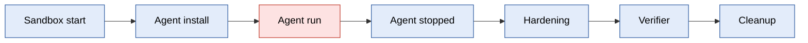
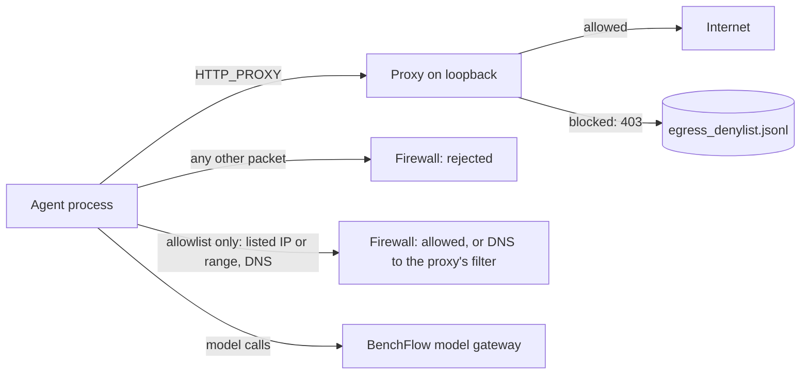

# Sandbox security

```bash
bench check tasks/my-task                      # report what would weaken grading
bench run tasks/my-task -a claude-agent-acp \
  --verifier-sandbox separate --integrity audit # grade where the agent never ran, and audit it
```

An agent may try to pass a task by changing how it is graded instead of solving it. BenchFlow runs every trial so the agent cannot touch the grader's code, its inputs, or its reward file. This rests on one assumption: the task's test script does not itself run code from the agent's files, for example by installing the workspace. BenchFlow trusts the test script and does not isolate what it runs ([What you must trust](#what-you-must-trust)). A few gaps do not depend on that assumption; they are listed under [Known gaps](#known-gaps).

## What is guaranteed

- **The agent runs as a normal user, not root.** It can write its workspace, and nothing that grades it.
- **The agent cannot gain privileges.** Every ACP or native agent launch starts with `no_new_privs`, so setuid programs such as `sudo` give it nothing. Session-factory agents start their own processes; see the [threat model](./threat-model.md).
- **Before grading, every agent process is stopped,** except servers on ports the task keeps (`x-keep-services`). Files that would run code inside the grader are removed: a planted `conftest.py` (unless the task keeps its own), `sitecustomize.py` and code-running `.pth` files.
- **The verifier runs as root with a fixed `PATH` and `PYTHONPATH`.** Folders the agent can write are not on the verifier's `PATH`. `PYTHONPATH` may keep image entries inside the workspace, which pytest imports from anyway; the agent's home is excluded.
- **pytest loads only plugins BenchFlow can vouch for:** the image's own, installed as root, and the releases the task pins in `[verifier] pytest_plugin_releases`, which BenchFlow installs into its protected verifier runtime before the agent's turn. A plugin the agent planted, or one test.sh installs after the agent stopped, is refused, and the trial counts as a failure.
- **Network access follows the task's policy.** On an open network, BenchFlow refuses the cloud metadata endpoints to the agent's user (TCP, every port but 53) in `main`, where it can install the rules. The agent, a root agent included, starts only once the block is `on`. When `cloud-metadata.json` says `not_installed` or `unproven`, the trial stops before the agent as an infrastructure error. A root agent on Daytona, AgentCore or Apple container gets the provider's own metadata policy instead (`provider-managed`, with a warning; `require_cloud_metadata_block = true` stops it). A Modal sandbox has no route to the endpoints at all: each trial proves it and records `not_reachable`. A task or run that opts out gets no block.

For the strongest guarantee, grade in a separate sandbox: only the workspace and the files you declare cross into it. See [Separate verifier](../tasks/separate-verifier.md).

The exact rules are in the [threat model](./threat-model.md).

## Who can touch what, and when



Red is the agent's user, filtered by the task's network policy. Blue is root, run by BenchFlow or the task.

| Stage | Runs as | Can write the workspace | Network policy applies |
|---|---|---|---|
| Agent install and setup | root | Yes | No |
| Agent run | The agent's user | Yes | Yes |
| Oracle run (`solve.sh`) | root, or the task's agent user | Yes | Yes, while `solve.sh` runs |
| Hardening | root | Freezes it | No |
| Verifier | root (or `[verifier] user`) | Read-mostly; it owns its outputs | No |
| Separate verifier sandbox | root | A copy only | No; network policies there are refused |

## Network policy by stage

| `network_mode` | Agent run | Oracle run | Agent install | Verifier |
|---|---|---|---|---|
| `public` (default) | Internet, except cloud metadata | Internet | Internet | Internet |
| `no-network` | Only BenchFlow's model gateway | No network | Internet | Unfiltered with an LLM agent; no network in oracle and nop runs (the container network stays off) |
| `denylist` | Internet, minus listed URLs and hosts | Same as agent | Internet | Unfiltered |
| `allowlist` | Only listed hosts, IPs and ranges | Same as agent | Internet | Unfiltered |

The model gateway, through which the agent reaches its model, is always reachable. Under `no-network`, `denylist` and `allowlist`, BenchFlow also turns off provider-hosted web search, and refuses models that search on their own. See [Network policies](../tasks/network-policies.md) for the syntax.

Under `no-network`, `denylist` and `allowlist` with an LLM agent, the agent user's firewall arms after the agent has started and its session is set up, just before the first prompt. Agent install and start-up have internet. A connection opened earlier is cut when the firewall arms.



Under `denylist` and `allowlist`, every agent web request goes through the proxy. Under `denylist`, a firewall rule lets the agent's user reach nothing else. Under `allowlist`, listed IPs and ranges are also reachable directly, and DNS goes to the proxy's filter.

## Checklist for task authors

1. **Keep the agent non-root.** Leave `sandbox_user` at its default. A root agent can undo every protection.
2. **Install the tools BenchFlow needs** in the image: `python3`, `openssl`, `iptables` and util-linux (for `setpriv`). Without `iptables`, BenchFlow installs it at run time (slower). Without `python3` and `openssl`, a network policy is refused. Without util-linux `setpriv`, every non-root agent launch fails.
3. **Keep grading files out of the workspace.** Put tests in `tests/` and reference answers in `solution/`. If a file must live in the workspace, declare it hidden ([Reward integrity](../integrity.md#the-contract)).
4. **Pin or bake the verifier's pytest plugins.** List them in `[verifier] pytest_plugin_releases` (`["pytest-asyncio==0.24.0"]`), or install them into the image. A plugin test.sh installs with `uvx`, `uv add` or `pip install` is never loaded; pytest-json-ctrf for `--ctrf` comes without a pin. Run the tests with `$BENCHFLOW_PYTEST`, and install nothing from the workspace: a `.venv` built from the workspace's `pyproject.toml` is agent code.
5. **Pass pip options in the script.** The verifier's pip reads no configuration file: `pip install --index-url "$INDEX_URL" pytest`.
6. **List servers your tests need** in `x-keep-services`, and have the agent start them in the background ([Kept services](#kept-services)).
7. **Do not give firewall tools capabilities or setuid bits** in the image.
8. **Run `bench check <task>` before you publish.** Add `--sandbox <backend>` to check a backend's limits too.

## Checklist for eval runners

1. **Run untrusted agents as the default non-root user.**
2. **Add `--integrity audit`** to learn whether an agent tried to tamper with grading ([Reward integrity](../integrity.md)).
3. **Add `--verifier-sandbox separate`** to grade where the agent never ran. It works on Docker, remote Docker and Daytona.
4. **On a cloud VM, block the metadata endpoints on the host** for services other than `main` (a `DOCKER-USER` rule, or the cloud's metadata settings).
5. **Set restricted-web model admissions in your shell,** never through `--env`: `BENCHFLOW_RESTRICTED_WEB_MODELS=azure/my-deployment` ([details](./threat-model.md#models-under-web-restrictions)).

## Opt-outs

Turn off `conftest.py` removal when your tests need their own `conftest.py` outside `/tests`:

```yaml
verifier:
  hardening:
    cleanup_conftests: false
```

In task.toml:

```toml
[verifier.hardening]
cleanup_conftests = false
```

| Key | Default | When `false` |
|---|---|---|
| `cleanup_conftests` | `true` | `conftest.py` files outside `/tests` and `/verifier` are kept |
| `cleanup_git` | `true` | The workspace repositories' hooks, and the config entries that run commands, are kept; `test.sh` then names a hook with `git -c core.hooksPath=...` |

The other hardening steps cannot be turned off. No real task needs a planted `sitecustomize.py`, `.pth` file or `/tmp` script. `cleanup_conftests` and `cleanup_git` are the only keys. Example: [progressive disclosure](../tasks/scripted-users.md#keep-a-tasks-own-conftestpy).

A task about the cloud metadata service itself can allow it in its environment table (the older `metadata.x-allow-cloud-metadata: true` still works). Without it, a trial whose metadata block is not proven stops before the agent:

```yaml
sandbox:
  allow_cloud_metadata: true
```

## Kept services

If your tests connect to a server the agent starts, list its TCP ports. BenchFlow then keeps that server running when it stops the agent:

```yaml
metadata:
  x-keep-services:
    - { port: 8080, name: web }
```

- Up to 8 ports. Processes listening on them survive; every other agent process is stopped.
- The service is paused while the workspace is frozen, and resumes just before the verifier starts.
- Start it in the background (`cmd &`, `nohup` or `setsid`) and send its output to a file.
- A task that keeps services cannot use a separate verifier; such a run is refused before it starts.
- The trial's `kill-before-grading.json` lists each kept, lost or dropped process.

Full rules: [Threat model: Services the agent leaves running](./threat-model.md#services-the-agent-leaves-running-x-keep-services).

## Changed in 0.8: the verifier ignores pip configuration

The verifier's pip no longer reads `pip.conf` from the image, `/etc`, the user's home or a venv. If your verifier needs a private index or local wheels, say so in test.sh:

```bash
pip install --index-url "$INDEX_URL" pytest
pip install --no-index --find-links /opt/wheels pytest
```

Or set `PIP_INDEX_URL`, `PIP_FIND_LINKS` or `PIP_NO_INDEX` in `[verifier] env`. BenchFlow warns when an image has a pip configuration file.

## Why did my run error?

| You see | Cause | Fix |
|---|---|---|
| `Verifier scored 0: pytest plugin guard not confirmed` | The guard may have failed, stopped or refused a plugin; code run by the tests can also print the diagnostic or change its markers | Inspect the verifier logs and markers. Pin required plugins in `[verifier] pytest_plugin_releases` or install them into the image. The diagnostic does not establish who caused it |
| A guard warning and an `installed` marker | A plugin install was reported as untrusted; verifier-run code can also forge the marker | Pin it in `[verifier] pytest_plugin_releases`, or install it into the image |
| `RuntimePinError: …` before the agent ran | A pin in `[verifier] pytest_plugin_releases` cannot be prepared (not `name==version`, not on PyPI, an unpinned dependency, no wheel for the image's Python) | Add the pin it names, or install the plugin into the image |
| `RuntimeUnavailable: …` before the agent ran | BenchFlow could not fetch the pinned wheels from PyPI | Check this machine reaches pypi.org; offline, see `BENCHFLOW_PLUGIN_WHEELHOUSE` ([When a run fails](../jobs/when-a-run-fails.md#unscored-trials)) |
| `Error importing plugin "_benchflow_guard_…"`, score 0 | The guard may not have loaded, or code run by test.sh printed the line | Run pytest with a Python on the verifier `PATH` |
| `firewall-power.json` says `refused` | The image lets the agent's user change the firewall | In the Dockerfile: `setcap -r <file>` or `chmod u-s <file>`, or install util-linux |
| `sandbox startup refused: the agent would start with the cloud metadata endpoints open to it`, and `cloud-metadata.json` says `not_installed` or `unproven` | The block could not be installed or proven: no iptables, `main` on the host network, no ip6tables, or root in `main` holds `NET_ADMIN` | Install `iptables` in the image, or, for a task about the metadata service, opt out with `allow_cloud_metadata` |
| A run under a network policy refuses its model | The model can search on its own, or BenchFlow cannot identify it | Pick a listed provider's model, or admit it with `BENCHFLOW_RESTRICTED_WEB_MODELS` |
| `--integrity strict` or `--verifier-sandbox separate` refuses a task | The task cannot run in a separate verifier | See [Reward integrity: The two modes](../integrity.md#the-two-modes) |
| The verifier warns about pip configuration | The image ships a `pip.conf` | Pass pip options in test.sh ([above](#changed-in-08-the-verifier-ignores-pip-configuration)) |

## What you must trust

- **The task's image and setup.** They are built before the agent runs.
- **The task's verifier and its test script.** BenchFlow protects the verifier's environment, not its logic. Whatever test.sh runs or installs is trusted as the task author's code, as in BenchFlow's Rust engine and other harnesses. BenchFlow does not isolate code that test.sh installs, builds or imports from files the agent wrote (a `pip install -e .` of the workspace, a requirements file there, a `pyproject.toml` that `uv sync` reads, a module of the agent's that the tests import): that code runs as the verifier's user, usually root, and can change the result. A `pytest.py` or another test-runner module the agent added to the workspace is removed before grading. The plugin guard checks what pytest loads; it does not contain what test.sh runs, and a run in which no pytest reached the guard (test.sh ended first, imported a `pytest` that is not pytest, or ran pytest under `env -i`, `sudo`, ssh or in another container) is scored as test.sh wrote it. To keep a task's grade out of the agent's hands, install test tools into the image or pin them, run the tests with `$BENCHFLOW_PYTEST`, do not run Python from the workspace folder, and install nothing from the agent's files. Refusing or isolating such installs remains follow-up work after 0.9.0. BenchFlow also takes the task's word in three places. On every backend and for every agent user, a separate verifier sandbox included, it prepares the protected runner only when the task's tests folder or `[verifier] env` names `$BENCHFLOW_PYTEST` (name it in test.sh, not only inside the image). When the agent runs as a non-root user in its own sandbox, it also keeps a Python start-up hook that only root could have written during the agent's turn, and it keeps on the verifier's `PATH` a program whose route leads into the workspace when that name was not in its `PATH` folder before the turn (root, or the owner of another user's folder, added it). The verifier then runs, under that name, whatever is at that workspace path, which can be the agent's file. The exact rule: [threat model](./threat-model.md#the-tasks-test-script-is-trusted).
- **The container runtime** and the task's container settings.

## Known gaps

- **Kept services can retain an open writer to an existing workspace file.** Changing a single-name file's owner and mode does not revoke a descriptor a service already opened for writing. The close step replaces non-root files, including shared hard-linked files, but does not copy every root-owned file. A kept service can still change such a file while tests read it. Use a separate verifier when its inputs must not change during grading.
- **Closing shared files for kept services can consume extra disk.** The root-owned copy writes sparse files in full: a sparse file with a logical size of 4 GiB can require 4 GiB of disk. Without a protected Python, the fallback file walk can also fail on paths longer than 4,096 bytes; this stops hardening rather than accepting the workspace.

- **Tasks written for a root agent can fail with the default user.** The agent runs non-root while the verifier normally runs as root. It cannot install system packages or write under `/usr`, `/etc` or `/opt`; packages installed in its user site may be invisible to root's tests. The historical Terminal-Bench 2.0 scan found root-only writes in 33 of 89 reference solutions; five tests read those writes directly (`build-pmars`, `build-pov-ray`, `mailman`, `nginx-request-logging`, `sqlite-with-gcov`). The other 28 depend on the chosen solution; this scan does not establish that every alternative solution needs root. `headless-terminal` also failed when the agent installed `pexpect` only for its own user. `--sandbox-user none` runs the agent as root and permits those writes, but root can undo the PATH lock, protected runtime and workspace freeze and change what the verifier runs. Use it only for trusted agents; keep its scores separate from non-root runs.
- **Some task images cannot pass the protected runtime's loader checks.** If the native loader searches or loads libraries from a folder another user can write, BenchFlow refuses its root steps and the trial is unscored, including the oracle. Terminal-Bench 2's `make-mips-interpreter` is one such task. Use an image whose library files and search folders are root-owned and closed to other writers.
- **Ten of Terminal-Bench 2's 89 tasks keep services that native Daytona cannot freeze for a non-root model agent.** These trials are refused: `configure-git-webserver`, `git-multibranch`, `hf-model-inference`, `install-windows-3.11`, `kv-store-grpc`, `mailman`, `nginx-request-logging`, `pypi-server`, `qemu-alpine-ssh` and `qemu-startup`. Use Docker or remote Docker. The oracle and nop do not have this model-agent refusal; their separate image and verifier limitations still apply.

The four cases below concern code the test script trusts ([above](#what-you-must-trust)).

- **Installing the workspace runs agent code as root.** If test.sh runs `pip install -e .` on the workspace, the agent's `setup.py` runs. Install test tools first, outside the workspace.
- **A `/root` workspace is no longer the verifier's home.** With `WORKDIR /root`, the verifier gets a new root-only `HOME`, so test.sh reads none of the agent's per-user files there. Read the agent's output by its path; a task whose tests read it through `~` sets `HOME = "/root"` in `[verifier] env` and takes that risk back. Tools that read the passwd home instead of `HOME` (a JVM's `user.home`) still see `/root`.
- **uv reads the workspace's `uv.toml`** for `uv pip install` and `uv run`. Set `UV_NO_CONFIG=1` in `[verifier] env` if your task does not need it.
- **Installing from the agent's files runs agent code.** A test.sh that installs from a requirements file, a wheel or a uv configuration the agent can write runs whatever those files choose, before pytest and the guard. The guard refuses any plugin from such an install, but not code that is not a plugin.
- **Native-library search paths of the protected runtime.** Three checks remain incomplete in 0.9.0; each needs an image that already points a library search path into a folder the agent can write. See the [threat model](./threat-model.md#known-gaps).
- **Bash start-up names are refused.** An image or sandbox environment that sets an exported bash function, `SHELLOPTS` or `BASHOPTS` is refused at start, on every sandbox, because bash would run it as root. Remove it from the image.
- **Images BenchFlow cannot copy a Python from.** Under `denylist` and `allowlist`, an image with no root-only `python3` in `/usr/local/bin`, `/usr/bin` or `/bin` (a conda or uv-only interpreter) stops before the agent.
- **Kept services and a change of role.** A new connection is refused while kept services retain processes from an earlier role or scene, before any later login is staged. Use a fresh rollout when those services must remain alive. See the [threat model](./threat-model.md#known-gaps).
- **Hook cleanup can fail on agent-controlled trees.** On Docker, about 90,000 files with startup-hook names, or a mode-000 folder under Compose without `DAC_OVERRIDE` and `DAC_READ_SEARCH`, can leave the trial unscored and retried. This remains a known scoring limitation in 0.9.0.
- **Startup refusal can cause extra creates.** A fixed image startup-name refusal can be retried twice on native Daytona before the job stops, without an agent turn. Correct the image before retrying the job.

## Next steps

- Declare what the agent may reach: [Network policies](../tasks/network-policies.md).
- Grade where the agent never ran: [Separate verifier](../tasks/separate-verifier.md).
- Learn whether an agent tried a shortcut: [Reward integrity](../integrity.md).
- The exact rules: [Threat model](./threat-model.md).
- Choose where trials run: [Sandboxes](./index.md).

## Controller output roots

BenchFlow pins rollout output roots before agent execution. Publication below a pinned root follows no symbolic links and crosses no mount points. A link used as an intermediate directory is refused; ordinary file outputs replace the destination entry without modifying an existing hard-linked inode.

SDK callers choosing an output filesystem or an operator alias outside the controller's initial working and temporary directories must call `sandbox.pin_download_root(path)` before starting the agent. Keep its returned capability and join relative output names onto it when downloading. Plain paths below that pinned root also work for the sandbox's lifetime. Do not register a new root from a path an agent has already modified. A mount or alias above the explicitly selected root is allowed; one below it is refused.

Docker downloads stream into descriptor-backed publication. Regular archive hard links to earlier validated members are copied into separate files. Symbolic links, special files, and unresolved archive hard links are refused.
