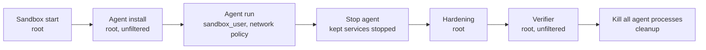

# Sandbox threat model

This is the reference behind [Sandbox security](./security.md). It states what BenchFlow assumes, what it checks before and during a trial, and what it does not cover. Read the security page first; come here when you need the exact rule.

Every section states an invariant: what holds, what is refused, and what the trial records.

## What BenchFlow trusts

| Trusted | Why |
|---|---|
| The task image and the packages in it | They are built before the agent runs. |
| The task's container settings, including its seccomp policy | They must let BenchFlow's cleanup process signal the agent's processes. |
| The container runtime (Docker, Daytona, AgentCore, Modal) | Checks assume it preserves syscall and filesystem semantics. |
| The verifier code shipped with the task, and everything its test script runs or installs | BenchFlow protects the verifier's environment, not the verifier's logic. See [The task's test script is trusted](#the-tasks-test-script-is-trusted). |
| The task's setup commands, hooks and declared environment | They run before the agent, as root. |

| Not trusted | Consequence |
|---|---|
| Everything the agent's user can write | It is frozen, filtered or refused before the verifier reads it. |
| The workspace, `/tmp`, `/var/tmp`, `/logs`, `/testbed`, `/home/<sandbox_user>` | Never on the verifier's `PATH`; on `PYTHONPATH` only the workspace may appear (see below). Plugin code there is refused. |
| Agent-supplied environment variables (`--env`) | They reach the agent only, never the controller or the model gateway's admission rules. |

The agent runs as a non-root `sandbox_user`. With `sandbox_user: null` the agent is root: hardening still runs, but the agent can undo it. Never run an untrusted agent as root.

When the verifier shares the agent's sandbox, the guarantees depend on the agent never gaining root in its sandbox. A separate verifier sandbox drops that assumption for everything that does not cross into it.

## The task's test script is trusted

BenchFlow runs a task's test script (`test.sh`, or the verifier command a task declares) as the task author's code, as BenchFlow's Rust engine and other harnesses do. This holds when the verifier shares the agent's sandbox and in a separate verifier sandbox.

| Holds | Does not hold |
|---|---|
| The script runs with the hardened environment below: a fixed `PATH` and `PYTHONPATH`, no agent start-up hooks, no planted `conftest.py`, no pip or uv configuration the agent wrote. | Code the script itself chooses to run from files the agent wrote is not isolated. |
| pytest loads only plugins BenchFlow can vouch for (see [Pytest plugin guard](#pytest-plugin-guard)). A score is refused only on evidence a pytest of the run left: a signed guard verdict, or pytest's own message that it could not load the guard. | The guard is a check on what pytest loads, not a boundary around what the script runs. A run in which no pytest reached the guard (test.sh ended before pytest, checked without pytest, or ran pytest under `env -i`, `sudo`, ssh or in another container) is scored as test.sh wrote it. |

So when test.sh installs or builds from files the agent can write, that code runs as the verifier's user, usually root, before or inside the tests. Examples: `pip install -e .` of the workspace runs the agent's `setup.py` or build backend; `pip install -r requirements.txt` or a wheel in the workspace installs what the agent chose; `uv sync` reads the agent's `pyproject.toml`; a `.pth` file or a replaced `pytest` from such an install runs before pytest; a module of the agent's that test.sh's Python imports from the workspace runs inside the tests. That code can change the result, for example by patching pytest in its own process or writing the reward file. BenchFlow does not refuse or isolate these installs; that remains follow-up work. It does remove the test runner's own modules when the agent added them: before grading, a top-level `pytest`, `_pytest`, `pluggy`, `iniconfig` or `py` module or package in the workspace that the pre-agent copy has no entry for is deleted, so `cd /app && python -m pytest` starts the real pytest (since 0.9.1). A repository's own such module stays. A workspace module named like a standard-library module that pytest imports later (an `argparse.py`) still loads first under `python -m pytest`: run the `pytest` program or `$BENCHFLOW_PYTEST` instead, or set `PYTHONSAFEPATH=1` in test.sh.

What a task author does instead:

- Install test tools into the image, or pin pytest plugins in `[verifier] pytest_plugin_releases`.
- Run the tests with `$BENCHFLOW_PYTEST`, the protected runner: it processes no `.pth` file and reads nothing such an install wrote.
- Install nothing from the agent's files. Where the tests must build the agent's code (many software tasks do), that build runs the agent's code with the verifier's rights, and its result is only as trustworthy as that code.

BenchFlow also takes the task's word in three places. The first applies to every trial, on every backend, whatever user the agent runs as, in a separate verifier sandbox too. The other two apply only when the agent runs as a non-root user in its own sandbox; with a root agent or in a separate verifier sandbox, the earlier rules stay.

- **The protected runner is prepared only when the task names it.** BenchFlow reads every file of the task's tests folder (`verifier/` for task.md tasks) and the `[verifier] env` values for `BENCHFLOW_PYTEST` as a whole word. When none names it, no runner is built and none of the image's `site-packages` is copied. `$BENCHFLOW_PYTEST` names a stub that prints an error and exits 4; the plugin guard is unchanged. The trial follows test.sh's reward, usually 0.
- **A start-up hook root made during the turn is kept.** A new or changed `.pth`, `sitecustomize` or `usercustomize` is kept when only root could have written it: owned by root, closed to group and others, every folder up to `/` root's alone, outside the workspace, `/tmp`, `/var/tmp`, `/home`, `/logs` and `/testbed`, and with one name (a link count of 1; a hard-linked hook is refused, since a change of owner could have made an agent's file root's). Where `bfx` does the clean-up (Docker), the trial log names the first five hooks it kept and their total count; the shell clean-up, used elsewhere, writes that line only to the step's error output, which the record returned by the preparation step does not carry. Root during the turn is the task's own setup or a root-run solution, as in the oracle.
- **A `PATH` program added during the turn whose route leads into the workspace is kept.** A program in a `PATH` folder (or a system folder) whose route reaches the workspace folder stays on the verifier's `PATH` only when its name is not in the record of that folder's names taken before the turn. The agent's user cannot add a name there, so root added it (the task's solution or a service) or, in a folder another user owns, that user did. The route inside the workspace is not walked, so the verifier runs, under that name, whatever the agent left at that path. A name the image shipped stays refused, so an image cannot hand the verifier a `python3` or `pytest` that runs the agent's files. When that record could not be taken, the rule is off. See [The verifier's `PATH`](#the-verifiers-path).

## Trial timeline



The oracle (`solve.sh`) takes the agent's place in an oracle run, under the same network policy.

## Agent launch restrictions

Every non-root ACP or native agent launch starts the agent under these kernel restrictions:

- `no_new_privs` is set, so setuid and setgid files and file capabilities grant nothing.
- Inheritable and ambient capabilities are cleared.
- `NET_ADMIN` and `NET_RAW` are removed from the bounding set.

The launch uses util-linux `setpriv --no-new-privs --bounding-set=-net_admin,-net_raw --inh-caps=-all --ambient-caps=-all`. If `setpriv` cannot switch identities directly, the same restrictions wrap `su -m`. BusyBox `setpriv` cannot drop bounding capabilities, so a launch that would need it is refused. Install util-linux in such images.

The agent's commands keep the agent's environment: `HOME` is set, `PATH` stays root's, the working directory stays, and no login profile is read. BenchFlow gives the agent no sudo access. Agent-side sudo, `su` elevation and file-capability grants are disabled on every non-root ACP or native launch.

Wherever a BenchFlow firewall rule holds the agent (the metadata block, `denylist`, `allowlist`, `no-network` with an LLM agent, or Daytona's daemon guard), a short process launched the same way proves the restrictions hold before the agent starts. Root reads its `/proc/<pid>/status` and requires the expected non-root identity, `NoNewPrivs: 1`, no `NET_ADMIN` or `NET_RAW` in `CapBnd`, and an empty `CapAmb`. A failed or missing check refuses startup.

A plain backend exec as the agent user (not the agent's launch) does not set `no_new_privs`; BenchFlow runs its own agent-user probes through the agent's launcher.

Session-factory agents receive a sandbox API and start their own processes, outside the shared launcher. For them, the agent user's privileges are checked as the agent will run. The trial stops before the agent starts if that user holds `NET_ADMIN`, can use a firewall tool, or can run a setuid-root file or a file with `cap_net_admin`, `cap_setuid`, `cap_sys_admin` or `cap_setpcap`. Distribution programs with narrow purposes are exempt; `sudo`, `sudoedit`, `doas`, `pkexec`, `su` and `ksu` never are.


**Generic exec as the agent user.** Docker, remote Docker and Daytona's Docker-in-Docker create every service reachable by agent exec with `security_opt: no-new-privileges:true`, including sidecars Compose resolves through includes, extends or profiles. The kernel applies it to the first process, every exec and every child. Generic exec keeps the backend's own user and shell; it never starts a root wrapper to drop back to the requested account. The option is set on the project Compose resolved, by identity, so a task that sets it too gets it once: the frozen launch gives it to every service in ordinary, cached and recovery starts, Docker-in-Docker's build overlay does the same, a task with no Compose file gets it from its own overlay, and snapshot restores also request the option. A task's `x-agent-identity-switch` does not disable this barrier: sudo, su and set-ID or file-capability programs cannot give the agent another identity.

On backends without a container-level option, a non-root generic agent exec starts with absolute `/usr/bin/setpriv --no-new-privs`, before any provider wrapper sources an environment file, runs a helper or selects the account.

- Caller environment reaches only processes inside that barrier. Native caller environments travel as inert JSON data: Apple uses stdin; Modal, native Daytona and AgentCore upload it into a fresh root-only folder whose file is opened and unlinked before account selection.
- A fixed decoder reads the data only as the selected account and passes it directly to the backend shell with execve; names and values never become dispatch statements or process arguments. This needs Python 3 at `/usr/bin/python3` or `/usr/local/bin/python3`, run with `-I -S`, and is refused if neither exists.
- Loader and shell startup variables become active only when the selected account's command shell starts. Names that are not identifiers reach that shell unchanged. Account selection keeps the account's real primary GID.
- A bootstrap in absolute `/bin/sh` carries the exported environment as data through `/usr/bin/env -i`, then restores it before the backend's own command shell (Bash on native Daytona, Modal and AgentCore; sh on Apple containers). The image needs util-linux `/usr/bin/setpriv`.

ACP and native-harness launches keep their own privilege-drop launcher. A task that names other accounts in `[metadata] x-agent-identity-switch` (never root) runs only where the agent's container has the creation-time barrier (Docker, remote Docker, Daytona with a compose file); every kill of the agent user's processes also stops those accounts' processes. On every other backend such a task is refused before any sandbox starts, naming the backend and pointing to `--sandbox docker`: the clean-up there goes account by account, so a process under one account could restart a process under an account already cleaned. For the public SDK, `bf.run(Agent(...), env, config)` checks the supplied sandbox's container capability before starting `env`, including custom backend names. A missing capability or a value other than `True` is refused. The refusal raises `UnsupportedTaskFeatureError`; an unstarted environment stays unstarted. If the caller already started it, BenchFlow leaves it running and the caller must stop it. Factory-based rollouts (including `bf.run(RolloutConfig(..., planes=...))`, batches and branch children) also check the returned sandbox immediately after creation, before start; a Docker-family name alone does not establish its capability. The install-time barrier check remains a second defence. Generic exec on those backends keeps the agent under no_new_privs even if the key is present. Services in the trusted image that run work under another account on request (an ssh daemon, another user's cron) stay part of the trusted image.

## Root's commands and the `PATH` lock

Sandbox execs start an absolute system shell, and BenchFlow sends each command on one of two routes:

- **Plumbing.** BenchFlow's own steps that run as uid 0 or as the image's user: the kill before grading, every hardening step, artifact copy-out, the proxy and credential helpers. The shell starts with the loader and start-up variables (`LD_PRELOAD`, `LD_LIBRARY_PATH`, `BASH_ENV` and the rest) empty, its first builtins unset them and pin `PATH` to the system folders (`/usr/local/sbin:/usr/local/bin:/usr/sbin:/usr/bin:/sbin:/bin`), and the task's environment reaches it without those variables. So neither a program on a workspace venv's `PATH` nor a library an image's `LD_PRELOAD` names under the workspace ever runs as root.
- **The task's own commands** (test.sh and the verifier's runner, the oracle's solve.sh, setup and healthcheck commands, services the environment manifest declares, SDK hooks and `Runtime.exec`) keep the image's `PATH` and loader variables. Their shell starts without the loader variables too, and gets them back just before the command, under the values BenchFlow's own environment sets (the verifier's `LD_PRELOAD=""`).

The route goes by the uid a command runs as, not its user's name: `root`, `0`, `00` and any other name for uid 0 (an image's `toor`, looked up once per sandbox with root's system shell) are root, and a name that cannot be looked up is treated as root. Each backend picks the route in one place. Every lower call that hands a command to the provider (Daytona's session commands and Docker-in-Docker exec, its file checks included, and AgentCore's command and sealed-upload calls) takes a route with no default, so no probe or clean-up skips it.

Plumbing's `PATH` keeps `/usr/local/sbin` and `/usr/local/bin` only while the `PATH` lock below found them root's alone and outside the workspace. It always keeps the system folders, so it is never empty.

BenchFlow's own runtimes that root reuses or runs (Node and the agents under `/opt/benchflow`, the cached proxy venv, the proxy's folder under `/tmp/benchflow-litellm`) are checked first. The folder and everything in it must be root's with no write for group or others (uv's `.lock` files, which uv makes writable by everyone and which hold no code, excepted), every folder above it root's (a sticky one such as `/tmp` may be open), and every link in it must resolve inside it or to a file that is root's alone. A cached proxy venv that fails the check is not used (the trial installs its own). An agent install whose `/opt/benchflow` fails it stops with `is not root's alone; refusing it`; a task whose workspace is `/opt` or `/` gives that folder to the agent user, so a second agent install in the same sandbox stops.

Where the provider starts the first shell itself, the image's values are moved aside before any agent runs. Daytona creates the sandbox again with them empty and kept under `_BF_IMAGE_<name>`. The AgentCore image BenchFlow builds sets them the same way; only its ping responder, which starts with the session before any agent turn, gets them back, so a Python that needs the image's `LD_LIBRARY_PATH` still answers. The agent launch on every backend keeps the launch environment's own loader variables under inert names until it has dropped to the sandbox user. The image `PATH` is kept for validation, including the folders that hold links in a `PATH` entry, and the verifier keeps its explicitly validated `PATH`.

**The sandbox user's uid.** Before the agent starts, setup creates the non-root sandbox user (unless the image already has one of that name) with a uid and gid that own nothing in the image: the first from 1000 that no `/etc/passwd` or `/etc/group` entry names and no file on the image or task filesystems (image volumes included) has as owner or group. Without this, the next free uid could be one the image's own files belong to (a tool left by a `docker commit` as uid 1001), and the agent would own them. The inventory crosses mounts and skips only `/proc`, `/sys`, `/dev` and `/run`; setup refuses if it cannot complete.

**The `PATH` lock.** Before the agent starts, once its user exists, every folder on the sandbox's `PATH` that someone other than root could write (another owner, or group or other write) is locked to root (`chown root:root`, `chmod go-w`), and so is every folder above it.

- A program directly in a `PATH` folder that group or others may write, or that a user other than root owns, is locked the same way. A tool unpacked from an archive keeps the archive's uid, often 1000, which is also the agent user's.
- A link is judged by the file it resolves to, and the folders each hop of its chain is in are locked like `PATH`'s own (for `/usr/local/bin/py -> /opt/venv/bin/python -> /usr/local/bin/python3`, `/opt/venv/bin` too).
- The image's `PATH` and the standard system folders appended after it (`/usr/local/sbin` to `/bin`) are checked as one list, so the image's last folder is checked too.
- Folders in the workspace, under `/home` and in temp folders are left alone; the verifier's `PATH` leaves them out.
- The oracle and nop get the same lock, so the verifier keeps the same folders whoever ran.

Root's commands and the verifier find their programs in these folders, so an agent user that could write one could have root run its program. An image that leaves a tool folder open (a 0777 `/usr/local/cargo/bin`, say) would also lose that folder from the verifier's `PATH`. An agent that writes to such a folder on purpose (a `cargo install` into a shared `CARGO_HOME`) now gets "Permission denied" and must use its own home.

The trial folder's `locked-system-path.json` says `enforced` (with a note starting `repaired:` naming the folders BenchFlow locked) or `failed`: a folder or program whose `chown` or `chmod` failed, or a link on `PATH` whose chain passes through the workspace, a home or a temp folder (which BenchFlow leaves alone), or that points at a missing file the agent could create there.

**The system loader.** BenchFlow seals its protected runtime only when everything the system loader reads or searches is root's alone: `/etc/ld.so.cache`, `/etc/ld.so.preload`, the `ld.so.conf` files, the folders they and the defaults name (`/lib`, `/usr/lib`, their `*-linux-*` folders), those folders' hardware-capability subfolders, and every file directly in them. Otherwise root's steps after the agent's turn, the verifier's included, could load a library another user replaced. A link to a missing file counts as a missing file: it passes when the link is root's and only root could create the file its exact target bytes name, including any trailing newline. Loader folders containing an entry whose name includes a newline are refused before any newline-delimited walk. Debian's `-dev` packages leave such links, such as `libopenjpip.so` in Terminal-Bench 2's `sam-cell-seg`. For agents with an unchanged built-in install recipe, the same check runs on the image before the agent is installed. A path that fails by its own owner or mode, and that the PATH lock would not repair, is refused then. The dry PATH report compares device and inode as well as path spellings, so a repair through a hard link counts. An incomplete identity report waits for the final seal. Custom install commands may repair loader ownership as root, so those agents use only the final seal after installation. The message names the path and its owner and mode, and ends with a `next:` line. Anything else waits for the seal, which runs after the workspace grant and the PATH lock. Terminal-Bench 2's `make-mips-interpreter` is refused this way: its image ships `/usr/lib/mips-linux-gnu` and the MIPS binutils libraries in `/usr/lib/x86_64-linux-gnu` owned by uid 2952, on Docker and on Daytona. Make those paths root's in the image (`chown -R root:root`), or run the agent as root with `--sandbox-user none`.

## What gets hardened

Between the agent's last action and the verifier's first command, BenchFlow runs these steps in `main`. An initial failure in BenchFlow's own step is a verifier error. Unsupported writable PATH entries score 0 with a warning. After earlier verifier code has run, a later setup failure caused by sandbox state also scores 0. Transport, controller-resource and provider failures remain named verifier errors regardless of earlier verifier commands.

| Step | Invariant |
|---|---|
| 1. Stop the agent | Every process of the agent's user is stopped (TERM, then KILL). A `/proc` scan must then find none. A survivor or an unreadable process entry fails hardening. |
| 2. Empty `/logs/verifier` | Its contents are deleted (a bind mount is kept), and the folder is left writable for a non-root verifier. |
| 3. Free disk space | Re-downloadable uv, pip and apt caches are deleted, never through a link and never inside the workspace. |
| 4. No workspace reset | The verifier grades the workspace as the agent left it. Build files are snapshotted but not restored. |
| 5. Freeze the workspace | Escaping symlinks, new bytecode, startup hooks and the git hooks and command entries the agent added are removed; then root owns the workspace, except a file with a second name. |
| 6. Remove Python startup hooks | Planted `conftest.py`, `sitecustomize.py`, `usercustomize.py`, code-running `.pth` files and `/tmp` scripts are removed. |
| 7. Build the verifier environment | `PATH`, `PYTHONPATH` and pytest options are pinned after the task's `[verifier] env`. Folders in the workspace, under `/home` and in temp folders are left out of `PATH`. |
| 8. Move uv and pip state | Caches, tool environments, managed Pythons and configuration move to a fresh root-owned folder. |
| 9. Load only trusted pytest plugins | See [Pytest plugin guard](#pytest-plugin-guard). |

### Workspace freeze

- **Symlinks.** A link whose real path leaves the workspace is removed. It is kept only when the locked pre-agent copy (`/testbed_verify`) holds the same link with the same text, it still resolves to the recorded target, and the interpreter startup files beside it (`pyvenv.cfg`, `<name>._pth`) match the copy.
- **Kept interpreter links.** When a kept link leaves the workspace, its target, the target's folder and that folder's parent must be root-owned and not group- or world-writable, and so must every folder above them unless it is sticky. So a venv built on a Python the agent can write (under `/home/<sandbox_user>`, or in a world-writable folder) loses its link. They must also lie outside `/tmp`, `/var/tmp`, `/logs` and `/testbed`. So does `pyvenv.cfg`'s `home`. Otherwise the link is removed and that venv does not run.
- **Links that stay.** A loop is removed. A link to a missing in-tree target is kept, because it can only resolve inside the workspace.
- **Bytecode.** Cache links are deleted without following their targets. A `__pycache__` the pre-agent copy did not have is removed. In one it had, every file that is not the same regular file as the copy's (a `.pyc` the agent added or rewrote) is removed. Workspace startup hooks are purged after that.
- **Git.** In every repository of the workspace, each hook and each config entry that runs a command (a filter, a diff or merge driver, an include, `fsmonitor`, an alias and the like) is removed unless the pre-agent copy holds it. A separate verifier has no copy, so there all of them go. Root's git in `test.sh` also runs with hooks, `fsmonitor`, an external diff and signing off. `cleanup_git = false` in `[verifier.hardening]` keeps a task's own; a `test.sh` that needs one can also name it with `git -c`.
- **Ownership.** Last, the workspace is given to root: by `bfx chown` where bfx is delivered, otherwise by root's Python, which walks the tree through folder descriptors and checks each change. A link is changed itself and never followed. A regular file with a second name (a link count above 1) keeps its owner, so a file the agent user owned stays theirs at every name. Any entry that cannot be given to root fails hardening. A sandbox with no protected Python uses `find` with `chown -h`, and then a second `find` fails hardening if an entry other than such a file is not root's.

Interpreter links are kept only with a sandbox user, the default locked paths and the verifier in the agent's sandbox.

### Python startup hooks

| File | Where | Kept when | Otherwise |
|---|---|---|---|
| `conftest.py` | Outside `/tests/` and `/verifier/` | `cleanup_conftests = false` in `[verifier.hardening]` | Removed |
| `*.py` | `/tmp`, `/var/tmp` | Never (inside the workspace, the workspace rules apply) | Removed |
| `sitecustomize`, `usercustomize` (any form) | Any folder on an interpreter's search path | The pre-agent record holds it with the same digest (in a workspace site directory: the pre-agent copy holds the same file or tree at the same path) | Removed |
| `.pth` with an `import` line | A site directory's own `.pth` files | It matches the pre-agent copy, and so does every module its import lines may load | Removed |
| `.pth` with paths only, new or changed | A workspace site directory | UTF-8 without a byte order mark, and every path it adds stays inside the workspace and is a directory, missing, or a recorded file | Removed |
| `.pth` that is a symlink | Anywhere | Never | Removed without being read |

Site directories outside `/usr/lib` and `/usr/local/lib` are searched, using the image's own `PYTHONPATH` and `PYTHONHOME`. Inside the workspace, a site directory is a folder named `site-packages` or `dist-packages`, or the in-workspace target of a link with that name.

A `.pth` file is judged under every encoding an interpreter may read it with. A byte order mark therefore cannot hide an import line.

An editable install made through an import hook (setuptools' finder `.pth`, hatchling's exact mode) loses its `.pth` and does not import in the verifier. 

**Which files are hooks.** Python start-up hooks follow the rule `site` itself uses, shared by the pre-agent record and the clean-up: an entry named `sitecustomize` or `usercustomize`, alone or followed by `.` (a `.py`, a sourceless `.pyc`, an extension module, a package folder), in any folder on an interpreter's search path, and a `*.pth` file only in a site folder (`site.getsitepackages()`, a venv's `site-packages`, the user site). A `.pth` anywhere else, such as `/app/model.pth`, is data and stays.

**The pre-agent record.** Before the agent, the kit records every recorded interpreter's search path, its site folders, and each hook with a digest (a file's sha256, a folder's whole tree, a link's target). The interpreters are recorded with `-I`, which ignores the environment, so the folders test.sh's Python also searches through it are added from its inputs, read as text and never run, both in the record and at clean-up:

- each `PYTHONPATH` entry (an empty or relative one against the original working folder);
- the site folders of `PYTHONHOME`'s prefix and exec_prefix;
- the user site (`PYTHONUSERBASE`, `/root/.local`);
- the folders the site folders' `.pth` files name (a path line, a literal `sys.path.append`/`insert` argument; a literal `site.addsitedir` argument is a site folder). At clean-up these are read only from the `.pth` files it keeps, and a line holding a NUL (a binary file named `*.pth`) names nothing.

The values come from root's route, which keeps them as data, and from PID 1's environment, in the clean-up's environment, never on a command line. A folder computed at run time by a `.pth` import line is not found. The prefix site folders are those of the first `python3` on root's route `PATH` and on the image `PATH` (test.sh's), each found by its real path and by Python's own venv rule (a `pyvenv.cfg` beside the executable or one folder up).

**The clean-up.** Every hook that is new or changed is removed (a folder or link without following links), unless only root could have written it. That holds in a trial with a non-root sandbox user, in the agent's own sandbox, for a file with one name (a link count of 1), or a folder of such files, with no link in it, root's and closed to group and others, in a folder that is root's and closed up to `/`, and outside the workspace, its mount aliases, `/tmp`, `/var/tmp`, `/home`, `/logs` and `/testbed`. The agent user cannot add or change such an entry, so root did during the turn: the task's solution, a service of the task, or a package either installed (a cmeel package such as `eigenpy` makes itself importable with a `.pth` whose line is `import cmeel_pth`). A file with a second name is refused: ownership cannot prove who wrote it when an agent can hold another name. The plain freeze leaves a file with a second name as it is, as bfx does, so such a hook stays the agent user's and is removed even when the workspace's `conftest.py` sweep has removed its second name before the one-name check. A root-made hook that passes these checks is kept and written again like a recorded one. Where bfx does the clean-up the trial log names the first five kept hooks and their total count; the shell clean-up writes the same line to the step's stderr, which the record returned by the preparation step does not carry. Every kept hook is read once without following a link, checked against its digest and written again as a new root-owned file renamed over the name, so a descriptor a kept service still holds never reaches what the verifier runs. Bytecode caches of a hook are always dropped. A search path entry that was absent or a folder and is now a file or a link (a zip archive) is removed. Folders no record lists lose every hook outside `/usr/lib` and `/usr/local/lib`. A hook that must go and cannot be removed fails hardening. A sandbox with no protected Python (the kit holds none, as on an image whose only Python is a conda or pyenv one) skips the clean-up, and a `benchflow:` line in the trial log says so.

The `*.pth` files of a workspace site folder that no pre-agent record covers (a workspace venv whose interpreter link the freeze kept) follow the workspace rules in the table above, judged during the freeze before the chown; a recorded one is judged by the record. In a venv whose kept interpreter link leaves the workspace, a path-only `.pth` that adds a path outside the workspace is removed, recorded or not, since nothing checks that folder. Beside a real interpreter file in the workspace (a `--copies` venv, a conda install), a recorded `.pth` stays. Which of the two a venv is comes from the pre-agent copy `/testbed_verify`, not the live tree, so a `pyvenv.cfg` the agent adds or an interpreter link it replaces with a copy changes nothing. An agent that rebuilds the image's linked venv as a `--copies` one therefore still loses a recorded `.pth` that adds a folder outside the workspace: the record decides.

The other packages in a kept workspace venv (`numpy`, `pytest`, console scripts) are agent code. Hardening neither restores nor checks them. A verifier whose result must not depend on agent code runs a test runner installed outside the workspace, or uses a separate verifier.

### The verifier's environment

| Variable | Value | Can `[verifier] env` change it? |
|---|---|---|
| `PATH` | The safe system path, plus the image entries that pass the checks in [The verifier's `PATH`](#the-verifiers-path), then the refusal stubs' folder when there are stubs | No |
| `PYTHONPATH` | Image entries that pass the same checks (the workspace is allowed), after the plugin guard's folder when needed | No |
| `PYTEST_ADDOPTS` | `-c /dev/null` (or the workspace's own pytest configuration, with its `addopts` plugins moved after the guard; see [Which pytest configuration](#which-pytest-configuration)) `--confcutdir=<verifier dir> -p no:cacheprovider --rootdir=<workspace> -p <guard> -p <declared plugins>` (discovered and inferred plugins are loaded by the guard itself) | No |
| `PYTEST_DISABLE_PLUGIN_AUTOLOAD` | `1` | No |
| `PYTHONBREAKPOINT` | `0` | No |
| `COVERAGE_PROCESS_START`, `COVERAGE_PROCESS_CONFIG` | Unset in the verifier's command (coverage.py's start-up hook starts measuring when either is defined, even empty) | No |
| `DJANGO_SETTINGS_MODULE`, `CELERY_CONFIG_MODULE` | Empty | No |
| `BASH_ENV`, `ENV` | `BASH_ENV` only after a trust check; `ENV` empty | No |
| `PIP_CONFIG_FILE` | `/dev/null` | No; see [pip configuration](#the-verifiers-pip-configuration) |
| `PYTHONDONTWRITEBYTECODE`, `PYTHONPYCACHEPREFIX` | `1`; `/nonexistent` | Yes |
| `PYTHONSTARTUP`, `LD_PRELOAD`, `LD_LIBRARY_PATH` | Empty | Yes |
| `PYTHONNOUSERSITE` | `1` | Yes |
| `GIT_CONFIG_GLOBAL` | `/dev/null` (git 2.32+; `/etc/gitconfig` still applies) | Yes |
| `HOME` | `/root`, or a new root-only folder when the agent could write `/root` (see below) | Yes |

The "No" rows are set again after the task's `[verifier] env`, so a task value never replaces them.

`<verifier dir>` is `/tests`, or `/verifier` for native verifier folders.

`TEST_DIR` is the verifier dir unless the task sets it. BenchFlow sets its default in the verifier's command, not in its exec environment.

When the agent could write `/root` (it is the workspace, as with `WORKDIR /root`, or the agent could write something in it), the verifier gets a new `HOME`: a root-only folder made after the agent stopped, with `XDG_CONFIG_HOME`, `XDG_CACHE_HOME`, `XDG_DATA_HOME` and `XDG_STATE_HOME` inside it and an empty `.curlrc` and `.wgetrc` (curl falls back to the passwd home's `.curlrc` without one). Then an env script the verifier sources from `~/.local/bin`, a `~/.curlrc`, and the other per-user files the agent left in `/root` do nothing. Tests must read the agent's output by its path (`/root/out.json`), not through `~`. A task whose tests read it through `~` sets `HOME = "/root"` in `[verifier] env` and keeps the old behaviour, with the agent's files in it. Tools that take the home from the passwd entry rather than `HOME` (a JVM's `user.home`, coursier) still read `/root`.

The verifier command starts with `umask 022`, so the files it creates are mode 0644 or 0755 on every backend.

### The verifier's `PATH`

The verifier's `PATH` is the safe system path plus the image `PATH` entries that root judges in a POSIX shell, so images without Python are judged too. An entry is kept when it is outside `/tmp`, `/var/tmp`, `/logs`, `/testbed`, the workspace and `/home/<sandbox_user>` (and every recorded mount alias of an agent-writable tree; see [Root helpers](#root-helpers)), and either:

- a root-owned folder whose route and executable entries also pass the ownership, mode, ACL and link checks; or
- for a non-root sandbox user that the image can name, in `main`, another user's folder that the sandbox user could never have changed: the way to it, the folder, its entries and where its links lead are neither the sandbox user's nor writable by it, and carry no POSIX ACL.

**A tool added during the turn that leads into the workspace.** Before the agent's turn, root records in its pre-agent inspector folder the names each image `PATH` folder and each system folder holds. After the turn, for a non-root sandbox user in the agent's own sandbox, a program in a judged folder (a system folder included) whose route reaches the workspace folder itself (or its physical path) is kept when that record does not hold its name; the rest of its route, inside the workspace, is not walked, so the name runs what the agent left there. The agent user cannot add a name to a folder that passes the checks above, so the name was added during the turn by root (the task's solution, as `ln -s /app/sqlite/sqlite3 /usr/local/bin/sqlite3` in sqlite-with-gcov, or a service of the task) or, in another user's folder, by that user. The hops before the workspace pass the same checks as any other route: identity only in the always-kept system folders, which the PATH lock makes root's before the turn (or logs as unlockable; such a folder was open to the agent already, so the rule adds no reach there). A name the image shipped (the record holds it, whatever it is now), a folder the record does not hold, a sandbox without the record, a separate verifier sandbox, a route into any other agent-writable tree (`/tmp`, a home, `/logs`) or through another alias of the workspace, the folder's own route and [root's interpreter](#root-helpers) all refuse as before. A kept route is not listed in `verifier/trusted-path.json`.

Root's judge runs on the inspector's protected copies (below); the image `PATH` is only data to it. Each entry left out is logged with its reason and listed in `verifier/trusted-path.json`. Relative and empty entries are always left out. Spaces in an entry are kept; a NUL in one is a hardening error. A newline, like any control byte or `:` in a tool's route, leaves that tool out on its own (see the inspector below).

**`required_tools`.** When any image `PATH` entry is left out, a folder missing at hardening included, the task must declare `[verifier] required_tools`: every external program whose presence on `PATH`, or lookup, can affect grading, helpers that start later included. This holds for absolute folders too: what a folder holds before the verifier cannot predict the helpers it starts later. Without the declaration, hardening stops with an error that says to add it. `required_tools = []` declares that no program on `PATH` is needed. Give uploaded or generated helpers by absolute path.

Before test.sh, each declared name must be an executable file in a kept folder; a missing name is an unscored error. That check runs as the verifier user, with shell builtins and file tests only, in a `sh` that never comes from the image `PATH`: from the system folders (`/usr/sbin:/usr/bin:/sbin:/bin`, which the [`PATH` lock](#roots-commands-and-the-path-lock) keeps root's when the trial has a sandbox user) for a user named other than root, and for root, or with `[verifier] user` unset, from the protected runtime (or the same system folders where there is none).

**Refusal stubs.** Each program found only in an absolute entry left out gets a stub at the end of the verifier's `PATH`, in a new root-owned folder at `/`. Relative and empty entries get none: only the `required_tools` contract covers them. Hidden names count; a name with a newline refuses hardening. No filesystem-wide inventory runs; more than 4,096 programs to stub refuses hardening.

- A stub that runs exits 127 and marks a pre-created marker. A hit gives score 0 with a warning naming the program and its folder, even when the script caught the failure, logged it or checked `command -v` first. The marker is writable by the verifier user and never makes a trial unscored. A failed negative check could otherwise select a false pass.
- A program the task lists in `[verifier] optional_tools` is the exception: the author guarantees that every use of it is optional, so its hit keeps the rewards, whatever their value.
- A lookup alone (`command -v`, `which`) finds the stub and leaves no hit.
- Every marker must stay present and valid: a missing, unreadable or malformed marker, or a failed marker write, makes the verification invalid, also for an optional tool.
- When `[verifier] service` names another service, that service's `PATH` is judged and stubbed there.
- Output that only looks like a missing program ("command not found", or exit status 127) is no evidence: it adds the entries left out to an error the verifier already has and never changes a score.

**Transport.** Root's `PATH` records are percent-encoded byte by byte with the inspector shell's builtins before they leave the sandbox, and stub inventories are NUL-framed. A path or program name that is not UTF-8 is refused.

**The inspector.** Root's `PATH` judge runs on protected copies of the shell, the file utilities and the receipt encoder, prepared in each service before the agent starts (or before the transfer into a fresh verifier sandbox); it never resolves through the live `PATH`. A checkpoint carries the inspector record of the container it restores. An older checkpoint without one cannot be trusted again and must be recreated with a fresh baseline. The inspector's programs and records are root's alone; only the receipt encoders can run as a non-root user. A tool whose route has a control byte or a `PATH` separator in any hop is left out on its own and noted in `verifier/trusted-path.json`; in a kept folder, its siblings stay usable through a root-protected filtered folder, and the omission never refuses grading, also for a declared tool. Install such a tool at a plain path, or call the image's tool by absolute path. These checks need a POSIX shell and the standard file utilities, not Python.

### Which pytest configuration

`PYTEST_ADDOPTS` passes `-c /dev/null`, so pytest reads no `pyproject.toml` or `pytest.ini` the agent could have written. When the verifier runs the project's own tests in the workspace (its package holds no Python file, and its scripts name no Python file by an absolute path outside the workspace), `-c` names the workspace's configuration file instead, if both:

- pytest would read that file in the image (`pytest.ini`, `.pytest.ini`, `pyproject.toml`, `tox.ini` or `setup.cfg`, chosen from the pre-agent copy `/testbed_verify`, which must be root's and not writable by group or others; unless it is also closed to them, the file itself must be root's with no write for group or others); and
- the workspace's copy gives pytest the same pytest section or table. Edits elsewhere in the file (dependencies, tox environments) do not matter; a changed section, a link, or a file pytest cannot parse keeps `/dev/null`.

It also keeps `/dev/null` for a verifier in a service other than `main`, for a file over 1 MiB or not UTF-8, and for an `addopts` BenchFlow cannot split into options (such as `-vp x`).

An `@file` token in that file's `addopts` is refused with a verifier error, since the comparison does not cover the argument file. Its `addopts` `-p` plugins are taken out with `-o addopts=...` and passed after the guard, which judges them. Tests in the verifier package (`pytest /tests/test_outputs.py`) keep `-c /dev/null`: pytest never reads the workspace's file for them.

### The verifier's uv and pip state

After the agent stops, BenchFlow creates a fresh root-owned folder, `/_benchflow_verifier_<random>` (mode 0755), and points uv and pip at it:

| Variable | Default it replaces | New value |
|---|---|---|
| `UV_CACHE_DIR` | `$HOME/.cache/uv` | `<dir>/uv-cache` |
| `UV_TOOL_DIR` | `$HOME/.local/share/uv/tools` | `<dir>/uv-tools` |
| `UV_PYTHON_INSTALL_DIR` | `$HOME/.local/share/uv/python` | `<dir>/uv-python` |
| `PIP_CACHE_DIR` | `$HOME/.cache/pip` | `<dir>/pip-cache` |
| `UV_CONFIG_FILE` | Project, user and system `uv.toml` | The task's safe `UV_CONFIG_FILE`, else a safe user or system `uv.toml`, else an empty file |
| `PIP_CONFIG_FILE` | Every pip configuration file | `/dev/null` |

A plugin test.sh installs with `uvx`, `uv tool` or `uv run --with` then lives under that folder, where the guard refuses it: the verifier's plugins come from the [protected verifier runtime](#where-the-verifiers-plugins-come-from), so pin the release instead.

A cache, tool environment, managed Python or index setting left in `$HOME` is never read. A warm cache the image ships in `$HOME/.cache/uv` is not reused either.

Only a root verifier in `main` is moved. If the probe fails, everything stays where it was, and the guard judges it by owner and mode.

Not moved:

| What | Why |
|---|---|
| `UV_TOOL_BIN_DIR`, `$HOME/.local/bin` | test.sh adds them to `PATH` through the uv installer's `env` script. The guard judges plugin code, not entry-point scripts. |
| Project environments (`uv run`, `uv sync`, a `.venv` in the workspace) | They are built from the workspace's `pyproject.toml`, which the agent controls. A reported plugin refusal scores 0 with a neutral guard warning. |
| `HOME` (when `/root` is root's alone) | The image's own files there (a model cache, a tool's settings) stay usable. |

For a workspace that is not `HOME`, `uv pip install` and `uv run` still read the workspace's `uv.toml` and `[tool.uv]`. Set `UV_NO_CONFIG=1` in `[verifier] env` when the task does not need them.

### The verifier's pip configuration

Every pip the verifier runs reads no configuration file: `PIP_CONFIG_FILE=/dev/null`. This holds for every interpreter and every form (`pip`, `python -m pip`, `pip --python`, a venv test.sh creates).

The value is set after the task's `[verifier] env` and is never replaced. The verifier command also exports it as a shell builtin, for test scripts and criteria runners alike. It applies to hard, soft, retried and separate-sandbox verification on every backend.

A verifier that needs a private index or local wheels passes pip options in its own script, or sets `PIP_INDEX_URL`, `PIP_FIND_LINKS` or `PIP_NO_INDEX` in `[verifier] env`. BenchFlow warns when a task's image has a pip configuration file.

### Root helpers

Hardening, workspace capture, artifact probes, recovery and the egress proxy of `denylist` and `allowlist` (its start, its health check and its certificate lookup) run Python as root. Each runs the protected runtime's Python (without a runtime, the system `python3`; only a sandbox with no agent user lacks a runtime) with `-I -S -B` from `/`, so no module in the workspace or on an image `PYTHONPATH` that names it is ever imported as root. In a sandbox with an agent user, no BenchFlow step starts the image's own Python as root after the agent's turn, and a protected runtime without a Python stops the step (exit 87 or 127). The pytest plugin guard's installer starts no interpreter: it reads each verifier interpreter's search path from a record taken before the agent's turn and writes the guard with shell tools. An interpreter missing from that record, or changed since, is not started as any user; it gets the guard only through the verifier's `PYTHONPATH`, with a `benchflow:` line naming it. A separate verifier sandbox takes the record before the agent's workspace is copied in; without a kit there, its installer never starts an interpreter under the folders the agent could write.

On Docker (local, remote or Docker Desktop), several of root's steps after the turn need no Python at all. BenchFlow mounts `bfx`, its own static helper, read-only at `/.bfx` (nothing else may be mounted at or below it; such a task is refused), and runs on it the kill before grading (with a receipt), the workspace capture, the workspace's change of owner, clearing `/logs/verifier`, the start-up hook clean-up and root's command channel. The capture and the change of owner fall back to the earlier steps at a link or a mount in the workspace. The binary is pinned by hash in the wheel for Linux x86_64 and aarch64; without it, or with `BENCHFLOW_BFX_DELIVERY=off`, the earlier steps run. Other backends keep the earlier steps.

Steps 5 and 6, the cache reclaim, the workspace-restore fallback and the kept-service workspace-ancestry check run Python as root. All of them run one interpreter, chosen before the first of them, isolated (`-I -S`) from `/`. Step 6 reads the image's Python search path (`PYTHONPATH`, `PYTHONHOME`, the user base) only as data, to find the folders it cleans; it never runs with that path.

- **With BenchFlow's protected runtime** (every sandbox with an agent user has one), it is the runtime's own Python, a copy of the image's root-owned `python3`. A copy that fails is made once more from a clean start (a step that failed once on a busy sandbox says nothing about the image); when it fails again the runtime holds no Python, the trial log names the step, and the kit is not cached for the next trial on that image. When the runtime holds no Python (the image had none to copy, such as a conda image whose only `python3` is under `/opt/conda`), root runs no image Python: those Python parts are skipped, BenchFlow's log says so, and the kept-service ancestry check refuses grading. On such an image the escaping-symlink purge of step 5 does not run.
- **Without the runtime**, it is a `python3` in the safe folders (`/usr/local/bin` included, the only one of a `python:*` image), else on the image `PATH`, accepted only when every hop of its route is root's, closed to the agent user, without an ACL and outside every excluded tree. When `python3` exists but none passes, grading is refused with a message naming the image. An image with no `python3` skips those steps' Python, except the ancestry check, which refuses.

A snippet that exits non-zero fails hardening. Before any verifier code has run, that own-step failure is a verifier error; after earlier verifier code, it scores 0 with a warning. The cache reclaim is best effort and never fails hardening.

The other commands hardening runs as root after the agent's turn run on root's route (see [Root's commands](#roots-commands-and-the-path-lock)), and so does every command BenchFlow or a backend runs as root until the trial's verification ends without a `PATH` of its own: the verifier upload, `chmod +x` of test.sh, the start receipt's and output folders, the retry's `pkill`, the downloads. Their programs come from the protected runtime's `PATH`, or, without a runtime, from the safe system path, whose `/usr/local` folders are left out once the `PATH` lock finds the agent user could write them, cannot run its check, or finds them in the workspace (a trial without a sandbox user runs no lock and keeps them); never from the image's `PATH`.

Every answer hardening reads back from the sandbox (mount records, plugin discovery, `PATH` checks, ownership and process reports, guard markers) travels as a checksummed receipt. A backend that rewrites command output cannot change it; a receipt that does not check counts as a failure.

Before freezing ownership, when the trial has a sandbox user or a separate verifier, hardening reads Linux mount provenance. It records the agent-writable trees as device and filesystem-root coordinates, and the files and links inside them by device and inode.

- The longest enclosing mount decides which tree a path is in, so an unrelated mount over part of a tree does not inherit its coordinates.
- A separate verifier service receives those identities and resolves its own exclusions against its own mount table; a name that is an alias only in `main` excludes nothing there.
- The `PATH` checks follow every hop of each program's route (intermediate links, the final file, hard links and single-file mounts). Link targets keep their literal bytes, newlines included. A left-out route in the always-kept system `PATH` refuses verification (a tool route into the workspace is not left out; see [The verifier's `PATH`](#the-verifiers-path)).
- The package-configuration and pytest plugin guards get the local aliases of the recorded trees.

A missing or incomplete mount or inode record stops verification.

## Pytest plugin guard

pytest imports plugins by name from `-p`, `PYTEST_PLUGINS` and a conftest's `pytest_plugins`, even with autoloading off. An installer can take what it installs from any file the agent left (a requirements file, inline script metadata, a project or installer configuration, a wheel, an environment variable test.sh sets), so BenchFlow no longer judges installed plugin bytes where the agent can write. Nothing test.sh installs after the agent stopped loads as a pytest plugin, wherever it goes and however root's it is. The verifier's plugins come from BenchFlow's protected verifier runtime instead.

### Where the verifier's plugins come from

| | |
|---|---|
| **What a task pins** | `[verifier] pytest_plugin_releases`, each `name==version` (`["pytest-asyncio==0.24.0"]`). pytest-json-ctrf comes without a pin when test.sh asks for `--ctrf`. |
| **Where it lives** | `/opt/benchflow/verifier` (`VERIFIER_DIR`, in the protected runtime tree `benchflow._runtime_tree`), reserved and made root's before the agent's turn (a separate verifier sandbox makes it at hardening). It holds `site/` (the pinned releases, pytest-json-ctrf when asked, every dependency they need and, when the sandbox has the kit Python, BenchFlow's own pytest 8.4.2), `run.py`, `bin/pytest` and `image-sites/` (the runner, only for a task that names it; see below), `manifest.json` and `SHA256SUMS`. |
| **What it is built from** | Wheels PyPI lists for that exact version, chosen for the verifier's Python (tags, glibc or musl, markers), fetched on the host and checked against PyPI's sha256. A dependency must resolve to a pinned version too; one the task did not pin (and BenchFlow's pytest does not bring) stops the trial with the pin to add. |
| **When and where** | Before the agent's turn, in the service that runs the verifier, from that service's own Python: `main`'s, or a target service's with its own kit, so a `grader` service's Python 3.12 decides, not `main`'s. A separate verifier sandbox builds its own tree from its own image. After the agent's turn, hardening checks the tree root's alone and byte for byte against `SHA256SUMS` (no file changed, none added); a tree that fails is refused. |
| **Cache and offline** | Wheels are cached per sha256 in `~/.cache/benchflow/verifier-runtime` with each release's PyPI file list. A download that fails or brings other bytes is retried, then refused; nothing partial is cached. `BENCHFLOW_PLUGIN_RELEASES=offline` builds from that cache. A host upgrading from an earlier release kept only each wheel's file hashes (`~/.cache/benchflow/plugin-releases`): offline, a local wheel (in a folder `BENCHFLOW_PLUGIN_WHEELHOUSE` names, or the task's folder) whose every file matches one wheel that cache checked is taken and kept in the new cache. When the task names the runner and its Python or checked pytest wheels are unavailable, preparation fails before the agent runs. A task that only needs plugins can still use the plugins without a runner. |
| **When it cannot be built** | The trial stops before the agent runs. PyPI or the network failing (`RuntimeUnavailable`) is infrastructure, retried (category `verifier_infra`). A pin PyPI does not have, a dependency the task did not pin, or a release with no wheel the verifier's Python can load is the task's (`RuntimePinError`), and the message says what to change. BenchFlow never falls back to the image's environment for these plugins. |

**The protected runner, `$BENCHFLOW_PYTEST`.** BenchFlow prepares it whenever a file in the tests folder or a `[verifier] env` value names `BENCHFLOW_PYTEST`, with or without plugin pins or `--ctrf`. A comment is enough. A tests folder that cannot be read completely or holds more than 256 MB also requests preparation. The tree then holds `run.py`, `bin/pytest` and `image-sites/`, a copy of the image's site folders made before the agent's turn. That copy can be several GB for an image with CUDA `torch`, so a task that never names the runner gets neither the runner nor the copy. The runner uses the kit Python and its standard library with `-I -S -B` and a `pycache_prefix` that never exists: no `.pth`, user site, `PYTHON*` environment variable or bytecode cache is read.

A script outside the tests folder, including one shipped in the image, does not request preparation. In that case `$BENCHFLOW_PYTEST` still names a root-owned stub, so a shell fallback cannot choose the image's pytest. The stub prints why no protected runner was prepared and exits 4. It writes no scoring marker: the trial scores what test.sh reports, usually 0. Code the tests run has the verifier user's access and can invoke the same stub. `bench check` warns when the build context or solution names the runner but the tests folder and `[verifier] env` do not, and explains how to request preparation.

- Before every run, its shell checks the kit and the verifier tree root's alone along their routes and against their manifests, with the kit's own tools. A changed file, or a module added to either, refuses the run (exit 4). Those checks use the kit's `PATH` in a subshell; pytest and its subprocesses inherit the hardened task `PATH`.
- A pre-agent inventory identifies standard-library names, including on Python 3.9. The enforcing finder and pytest's assertion rewriter serve these names from the kit, and the plugin closure's names from the site folder. Runtime aliases use the authenticated entry-point mapping directly. Every component of a dotted plugin is resolved and its actual file checked before it runs.
- The allowlist: the task's pinned plugin releases (by `-p` or a conftest's `pytest_plugins`, each once), pytest's own plugins, modules of the tests folder, and unchanged image helpers. A helper's sources must match the digests recorded from `/testbed_verify` before the agent ran, and it is compiled from that copy, with its dependencies loaded through the same checks.
- Code such a helper runs (its module body, a hook, a fixture) gets a workspace module the agent changed or wrote only when the task's own tests import that module themselves (`import`, `from`, or `pytest.importorskip`, `importlib.import_module` and `__import__` with a literal name, read from the tests sources as text when the runner is built), since the tests run that code anyway. Any other such import is refused before it runs, with the reason. A helper that hands tests a submission they never import themselves is therefore refused, and a tests file too large or too deeply nested to read is named in that refusal. Other plugin sources are refused with a signed marker.
- The runner changes to `/` once plugin argument definitions are available, normalizes positional paths and path option values, and keeps non-path values such as `-k`, `-m` and plugin-defined text options. Autoload is off, `--confcutdir` names the tests folder, and the runner signs a `registered` marker as the guard does.

**In any other pytest test.sh starts,** the guard sets `PYTEST_DISABLE_PLUGIN_AUTOLOAD=1` again and registers each runtime plugin itself, from the tree alone. Its finder serves the whole closure's names (but for the running pytest's own packages) and their metadata from the site folder, compiling the sources so no cache is read. A module name the tree holds is never looked up on test.sh's `sys.path`.

**Guard loading is not independently proven.** The guard's output, markers and signing key are accessible to test.sh's user, including agent code the tests import. There is no protected receipt of guard loading. A `registered` marker cannot cancel a load-failure message or any adverse marker. When a guard problem is reported, BenchFlow cannot confirm the guard loaded and scores 0 with a warning listing possible causes: a load failure, a stopped guard, a refused plugin, incomplete markers, or code changing those signals. The warning does not assign blame.

Code running as the verifier user could suppress the guard and its reports together. A task with no reported guard problem is scored from its reward files. This includes tasks that do not use pytest. That score is not a claim that pytest or the guard ran: code executed as the verifier user can already write a reward directly.

### What the guard loads

Besides the runtime's plugins, the armed guard loads:

- the pytest already running;
- the image's code: a file outside the agent's trees that is root's alone, parents included, and unchanged since the guard was armed (the change time of the key file hardening writes in the same exec);
- a workspace file that still holds the image's bytes: its counterpart in the pre-agent copy `/testbed_verify` (root's, mode 0700, reached without leaving the copy) is a regular file with the same bytes, or a folder for a folder. A Sphinx repository's kept `conftest.py` declares `sphinx.testing.fixtures` from the workspace, which loads while unchanged and is refused once edited. The bytes stand in for owners and modes, which say nothing in a workspace the image ships world-writable.

For either kind of image code, every bytecode cache Python or pytest would read in its place, looked up by the spelling Python imported as well as the real path, must be the image's or the source's own compilation. The guard's own imports are the standard library's alone: it narrows `sys.path` while importing them and checks each module's origin, so a `hashlib.py` in the workspace never runs inside it.

A plugin test.sh installs with `uvx`, `uv add` or `pip install` is therefore refused, even into a new environment. USACO's `uv init && uv add pytest-json-ctrf && uv run pytest --ctrf` in `/app` keeps working because the guard registers `ctrf` from the protected runtime; the copy `uv add` put in `/app/.venv` is never imported. Pin the release in `[verifier] pytest_plugin_releases`, or install it into the image.

**Discovery, before the verifier.** From `/`, with the trusted `PYTHONPATH`, `python3` lists the image's `pytest11` entry points without importing anything. A plugin is proposed only when:

- its name is registered once;
- its `*.dist-info`, `entry_points.txt` and every file of its module resolve to root-owned files, not world-writable, nor writable by a group the sandbox user is in (hardening reads its groups with `id -G`; when it cannot, by any group);
- every parent folder passes the same check;
- none of them lies under `/tmp`, `/var/tmp`, `/logs`, `/testbed`, the workspace or `/home/<sandbox_user>`.

Debian and Ubuntu ship `/usr/local/lib/pythonX.Y` as `root:staff` mode 2775, and the sandbox user is not in `staff`, so plugins the image installed there count as the image's. Registrations inside agent-writable trees are ignored, so they can neither add a name nor drop one.

Plugins found this way, and plugins inferred from test.sh (`ctrf` for `--ctrf`), are optional. `PYTEST_ADDOPTS` reaches every pytest test.sh starts, including one in a fresh `uv init` project or a `uvx` environment that lacks them, so the guard loads each one itself, only in a pytest that has a `pytest11` registration of that name. A module that only shares the name (a repository's own `benchmark.py` on test.sh's `PYTHONPATH`, the standard library's `asyncio`) is not that plugin and is neither loaded nor refused. Plugins declared in the task's `[verifier] pytest_plugins` stay `-p` flags that every pytest must load. A declared or inferred plugin that discovery rejects fails hardening.

**The guard, where pytest runs.** After the agent stops, hardening writes a guard plugin to `/_benchflow_guard_<random>/` (root, mode 0444) and puts it first among the `-p` plugins. It also writes a copy into the first site directory of every `python`, `python3` and `python3.N` on the verifier `PATH`, and of each `pytest` script's interpreter. So `python -I` and a test.sh that replaces `PYTHONPATH` still load it. A Python that is not a venv takes its copy in its standard library folder instead (the first site directory when that cannot be written): a venv made from it later keeps that folder on its `sys.path`, so DevEval's `export PYTHONPATH=$(pwd)` followed by `uv init`, `uv add pytest` and `uv run pytest` still loads the guard.

The guard's folder goes first on the verifier's `PYTHONPATH` when no Python took a copy, or when a verifier script names a tool that creates a Python after hardening. Those tools are `uvx`, `uv run|tool|venv|sync|python`, `python -m venv`, `virtualenv`, conda, mamba, micromamba, pixi, pipx, poetry, pdm, hatch, rye, pyenv, tox, nox, `bin/activate`, and distribution package installs of Python.

In the verifier's own pytest, the guard checks every `-p` name and every `PYTEST_PLUGINS` module against the interpreter pytest actually runs, before later plugins import. Once pytest has registered the guard, it loads each optional plugin this pytest has installed (by entry point name first, as `-p` does; one the command line disables with `-p no:<name>` is skipped) after the same check. It checks each plugin's `pytest_plugins` before pytest imports them.

The guard runs only when the verifier runs in `main`. A verifier in another service gets every discovered, inferred and declared plugin as a `-p` flag, without the guard.

Hardening still records the identity (device and inode, with the birth time where statx reports one) of every file and folder in the agent-writable trees after the agent stopped, in `/_benchflow_guard_<hex>/.record` (root, mode 0600), and writes a frozen proof that the agent left those trees alone. These records preserve diagnostic evidence; they cannot establish who caused a refusal or decide whether a trial is scored. Whether test.sh runs as root is asked once, as `id -u` run as the verifier's user (when that cannot be told, `[verifier] user` decides: `root`, `0` and any `root:<group>` or `0:<group>` are root), and that one answer decides both the uv and pip state move and the guard's rules.

**In a separate verifier sandbox,** only the folders that crossed from the agent's sandbox (the workspace, each declared artifact's bundle root, `/logs/artifacts`) and `/logs` are untrusted. Everything else is the verifier image's own. A plugin left in the workspace is still refused.

### How guard failures are scored

At the script-verifier boundary, signals test.sh's user can write can lower a score, never discard that assessment. Code the tests run has that same user's access. BenchFlow's own steps can still fail before producing a final score; automatic rubric review has the limitation below.

| Signal the verifier user can control | Effect |
|---|---|
| A guard import-error line in any verifier log | Score 0 and a neutral guard warning, even beside a `registered` marker |
| Guard markers: `loading`, `checking`, `crashed`, `installed`, `unproven`, `unlisted`, `unrecorded`, `refused` | Score 0 and the same warning |
| Missing, unreadable, excessive or incomplete guard markers | An incomplete read gives score 0; markers never prove loading independently |
| `reward.txt` or `reward.json` | Valid files set the score. Missing, empty, malformed, unsafe, non-finite, conflicting, oversized (over 16 MiB) or out-of-range rewards give score 0 and a warning naming the file and error. With both valid, JSON retains precedence and its scalar must agree with text |
| The runner stub's output and exit 4 | The stub gives no separate verdict; score what test.sh reports under the reward rules |
| test.sh's exit status | A valid reward is scored regardless of exit status; no reward gives score 0 |
| Running until the verifier deadline, including after writing a passing reward | Score 0, with a timeout warning and diagnostic |
| Writing the test command's exit record (beside its start receipt) and then hanging | The reward files are scored by the rules above, as when test.sh ends after writing a reward |
| Removing or changing the test command's start receipt | Cannot establish that execution never began; an unconfirmed start gives score 0 after the existing retry |
| A PATH refusal stub's marker | Score 0 with the program and folder named |
| Invalid verifier output files or inputs to a judge | Score 0 with a warning; no successful fallback to another reward file |
| Unsafe output entries that prevent separate-verifier or recovery publication | Score 0 with a capture/publication warning; the warning survives result loading |
| Changing runtime files during an earlier verification, including soft verification | A later setup failure scores 0; host state records that a test command was already issued |

Unsupported filenames or excessive program counts in a writable PATH folder also give 0 with a named inventory warning.

**Automatic rubric-review limitation.** A trial that also requires automatic rubric review is scored only after a completed reviewer verdict. A capture or export failure remains a named, unscored failure of BenchFlow's review step, even after the script verifier gave 0. Earlier verifier code, including soft verification, can alter workspace inputs and cause that capture to fail. This limitation remains in 0.9.0; handling it as a final scored zero is separately deferred.

Warnings are recorded in the trial's `warnings` as well as the log, including separate and recovered verification. Before any test command has been issued, BenchFlow setup failures remain separate. Outside the guard-check rule above, sandbox execution and capture API failures, controller resource failures, missing judge credentials and provider failures remain unscored even after soft verification or a judge shell command. Their errors name the failed operation and retain the cause. Test output never selects those paths. A guard copy that cannot be installed during initial hardening is a setup failure. Later sandbox-state failures can score 0 because earlier verifier code could have changed that state; a host-side command flag records this possibility, but does not turn a controller or provider failure into submitted evidence. The same distinction applies to trajectory publication and separate or recovered output capture. Unsafe judge-only output files and folders score 0 with a warning even when no test.sh runs; failure to write a private judge-session file remains an own-step error.

Reward capture must account for both `reward.json` and `reward.txt`. Canonical recovery may omit a genuinely absent optional companion, but cannot accept a higher partial score when capture of an existing companion fails. A verified unsafe entry gives 0; a transport failure leaves the trial unscored with the capture error. Daytona directory downloads preserve immediate empty directories so an unsafe `reward.json/` beside `reward.txt=1` reaches validation.

The guard's HMAC prevents unrelated users from inventing markers. It does not authenticate the verifier user: that user reads the key. The record of plugin files remains diagnostic evidence, not authority to exclude a trial or blame the task author.

### Limits of the guard

- A pytest that cannot import the guard is recognised by its message or leftover loading marker. If the verifier user removes all failure evidence, BenchFlow has no independent proof of loading. It does not infer one from success text or a `registered` marker.
- A pytest run as another user may be unable to read the key or write markers. Its reward follows the same file rules.
- Code test.sh imports can change its reward files. Protecting plugin discovery does not make that code's own reported score trustworthy; the task's test logic must check its work.
- The record covers the agent-writable trees: the workspace, `/tmp`, `/var/tmp`, `/logs`, `/testbed` and `/home/<sandbox_user>`. A venv test.sh makes elsewhere is judged by owners and modes. The project-file check reads the environment's own folder and those above it. A copy test.sh makes of the agent's files gets new identities.
- Use `$BENCHFLOW_PYTEST` and install nothing from the agent's files. Its protected runtime avoids `.pth` startup code and checks plugin imports before running them.

## Services the agent leaves running (`x-keep-services`)

A task whose tests connect to a server the agent starts lists the server's TCP ports. Up to 8 `{ port, name }` entries, ports 1 to 65535:

| Format | Where the key goes |
|---|---|
| task.md front matter | `metadata.x-keep-services` |
| task.toml | `[metadata] x-keep-services` |
| task.md package (draft 2) | `[sandbox] x-keep-services` |

`bench check` refuses a wrong value and prints the ports a task keeps.

A task with no key of its own gets one from BenchFlow's Terminal-Bench 2 list (`src/benchflow/task/tb2_keep_services.json`). This happens only when the folder's content digest matches the published task's, so an edited copy gets none. `kill-before-grading.json` says, for each kept process, whether its ports came from the task or the list.

The invariants:

- **Who survives.** Both kills (end of the agent's turn, and before grading) spare only the agent user's processes listening on a named port (IPv4 or IPv6). Every other agent process dies. Root's own processes are never signalled.
- **Waiting for listeners.** The first kill of a trial waits up to 30 s for each named port to have a listener.
- **Frozen while hardening runs.** Kept processes stay frozen from the end of the agent's turn (through the capture of the submission and the evidence) until just before the verifier's first command. What holds them is the kernel's cgroup v2 freezer, not SIGSTOP: a stopped process goes on at any SIGCONT, which the kernel can send with no other process running (a timer the service armed, a parent-death or child-exit signal, an orphaned process group). See [The freezer](#the-freezer).
- **Logs are replaced, not shared.** While they are stopped, `/logs` is root's alone. Every file in `/logs/agent` and `/logs/artifacts` is replaced by a fresh root-owned copy. Links, FIFOs and sockets there are removed without being followed.
- **Workspace closed.** The workspace loses group and other write. A regular file in it that is not root's (after the freeze, only a file with a second name) is replaced at its workspace name by a fresh root-owned copy without setuid or setgid, so neither the service's own write nor a descriptor it still holds reaches what the verifier reads. The other name keeps the old file. Any other entry that is not root's, or a change that does not hold when read back, fails hardening. It runs in root's Python, which kept services need.
- **No way into `/logs`.** A kept process that still holds a way into `/logs` is killed instead (its working folder, an open file, a mapping, a root folder or a namespace of its own). It is listed under `kept_services_dropped` with the reason.
- **Writes stay closed.** While kept services run, `/logs/agent` and `/logs/artifacts` have no group or other write. After the verifier, every agent process is killed, and only then do those folders get their owner and mode back.
- **Root verifier only.** No service is kept when the verifier runs as a user other than root.
- **No separate verifier.** A task that keeps services is refused before anything runs under `--verifier-sandbox separate` or `--integrity strict`, and when it declares a separate verifier itself.

| Record in `kill-before-grading.json` (among others) | Meaning |
|---|---|
| `kept_services` | Each kept process: port, pid, command (200 characters), and whether the ports came from the task or the built-in list |
| `kept_services_dropped` | Killed because it held a way into `/logs` |
| `kept_services_lost` | Exited by the release, or within 0.2 s of it |
| `kept_services_on_terminal` | Kept, but its terminal is hung up, so it may not answer |
| `kept_services_closed_folders`, `kept_services_ended` | The log folders' closing and restoring |

Start a kept service in the background (`cmd &`, `nohup` or `setsid`), with its output sent to a file. A terminal's own command or foreground job dies with its terminal. A launcher that stays the service's parent (`npm start`, `uv run`, pm2) gets SIGKILL rather than SIGTERM, since it would pass SIGTERM on.


The kill record keeps each call's own `killed` count and the total across the turn's end and grading (`killed_total`); `quiesce_killed` is the turn-end share, also for trials that capture no optional workspace evidence.

### The freezer

As soon as the kill finds a kept process, it moves it into a cgroup of root's that is frozen before anything enters it (`/sys/fs/cgroup/benchflow-kept`; a child it forks there is born frozen). The kill reports success only once that cgroup reports frozen and holds every kept process still alive. The release checks again that it is frozen and holds exactly the processes it lets go on, before anything else and right before it thaws it, its last step.

- **What it needs.** A cgroup v2 hierarchy root may write, in a cgroup namespace of the sandbox's own (the kill reads the mount's type from `/proc/self/mountinfo`). On Docker, remote Docker and a Daytona task with `environment/docker-compose.yaml`, a task that keeps services gets `cgroup: private` and `security_opt: writable-cgroups=true` on `main` (a Docker Engine that knows that option; the cgroup files stay root's, so the agent user gets no write there).
- **When it is decided.** The sandbox's start asks for that option whenever the trial may keep services (the oracle, or an agent run as a `--sandbox-user`, beside a verifier in the same sandbox). The rest is decided once setup has measured the agent's and the verifier's accounts, before any agent code runs (after the agent's install and before its launch; before the oracle's `solve.sh`).
- **Other sandboxes** (a Daytona task without a Compose file, Modal and the rest) cannot hold kept processes: a non-root agent that keeps a service there is refused then, with a message naming `--sandbox docker` or `remote-docker`. `bench check` does not refuse it, since no account is measured before the image runs. A trial that keeps nothing (an agent run as root, a verifier measured as non-root) is not refused.
- **A host that cannot.** Where root still cannot hold that cgroup (a cgroup v1 host, or an Engine without writable-cgroups, which the start reads from `docker info` and then starts without the option), a non-root agent that keeps services is refused with the Engine's reason. A trial whose agent code runs as a user other than root otherwise makes the cgroup in `main`, runs the same checks, moves a throwaway process of root's into it, freezes it, waits for the kernel to report it frozen, kills it and thaws the cgroup (`kept_freezer_probe` in `timing.json`). If any of that fails, the trial ends there with the reason and what to do, and is not graded. `nop` and an oracle measured as root are not checked: the kills keep no process of theirs.

The kill and the release still run every check themselves, and a kill that would keep a process the cgroup cannot hold fails rather than keep a service the kernel can let run. A kill that keeps nothing is unchanged.

## Separate verifier sandbox

By default the verifier runs in the agent's sandbox after the steps above. A separate verifier sandbox removes that dependence: the verifier never runs where the agent ran.

Turn it on per task with `verifier.sandbox_mode: separate` (task.toml may say `environment_mode`), or for a run with `bench run --verifier-sandbox separate` or `--integrity strict`. The older spelling `--separate-verifier` still works. Only Docker, remote Docker and Daytona run it.

Only these cross into a fresh sandbox built from the verifier image:

- the frozen workspace;
- the declared artifacts;
- `/logs/artifacts`;
- the paths named with `--separate-verifier-include`.

Hardening and test.sh run there. Package caches (`.cache/pip`, `.cache/uv`, npm's caches) are not copied.

Details (image order, transfer, scoring, cost): [Separate verifier](../tasks/separate-verifier.md).

## Network policy: open (the default)

`network_mode: public` leaves the internet open to the agent, except the cloud metadata services. A cloud VM serves its instance credentials there to any process that asks. BenchFlow refuses TCP from `main` to each of these, on every port but 53, for every user but root, and for root too when the agent runs as root (below). The agent starts only once that block is proven `on`; otherwise the trial stops before the agent, unless the run opts out (below):

- IPv4: 169.254.169.254 (AWS, GCE, Azure, Oracle, DigitalOcean, OpenStack), 169.254.170.2 (AWS ECS), 169.254.170.23 (EKS Pod Identity), 100.100.100.200 (Alibaba Cloud), 168.63.129.16 (Azure WireServer), 169.254.0.23 (Tencent Cloud).
- IPv6: fd00:ec2::254 and fd00:ec2::23 (AWS), fd20:ce::254 (GCE), fd00:c1::a9fe:a9fe (Oracle Cloud).

The rules are iptables and ip6tables rules in `main`'s network namespace (`iptables`, `iptables-nft` or `iptables-legacy`, whichever works). `main` gets `NET_ADMIN` while the block is armed. For an environment made with `Environment.from_task`, `Runtime.execute` adds it before it starts the sandbox. One the caller started already has none: on Docker the helper below still adds the rules for a non-root agent, a root agent is refused because root keeps `NET_RAW`, and elsewhere the record says `not_installed` and the trial stops.

On Docker and remote Docker, root's script runs in a helper container of BenchFlow's that joins `main`'s network namespace and brings its own iptables (Alpine 3.24 pinned by digest, with pinned iptables, iptables-legacy and nftables):

- Each BenchFlow process builds that image itself, once per Docker daemon, and runs it by the image ID its build printed, never by a tag, which a task's Compose file could give an image of its own.
- The helper runs as root with `NET_ADMIN` and `NET_RAW` only, no new privileges, a read-only root and tmpfs without exec, and shares nothing with `main` but the network namespace: the agent can neither see nor signal it. BenchFlow execs, checks and removes it by the container ID its run gave.
- It adds the rules as soon as `main` exists, before the task's processes start. At the block it must still be running that image with 5 minutes of its 30-minute life left; otherwise a new helper runs the install again (which adds nothing to rules already there), so a sandbox prepared long before its agent starts is proven like any other.
- It is removed once the block has its proof. Nothing is installed in `main`, and the record says `rules_from: helper`.
- Where the block is `main`'s only reason for `NET_ADMIN` (an open network, no agent-layer no-web firewall) and the process has already built the helper's image when `main` starts (as a rule, every sandbox after a process's first: a start never waits for the build), `main` starts without `NET_ADMIN` at all. Nothing in `main` can change the firewall, root included, and the record says `main_net_admin: false`. If such a helper then fails, a new one gets one more try before the block is recorded as not installed. `BENCHFLOW_METADATA_MAIN_NET_ADMIN=1` keeps `main`'s `NET_ADMIN`.

Elsewhere, and on Docker when the helper cannot serve the block (its image cannot be built, its script could not add every rule, or `BENCHFLOW_METADATA_HELPER=0`; the record says `rules_from: sandbox` and why), root's script runs in `main`. If the image has no iptables, root installs it with apt-get, apk, dnf, microdnf or yum, with a 240 s limit. That time shows as the `cloud_metadata_block` span in `timing.json`. Put `iptables` in the task's image to skip it.

Either way the proof is the same: the rule's counter is read again right before the agent user's test connect, and without that count the block is `unproven`.

IPv6 rules are required even when IPv6 looks off at setup. Without working ip6tables the record says `not_installed`.

Each trial with an agent on an open network writes `cloud-metadata.json`:

| `state` | Meaning |
|---|---|
| `on` | The rules hold in `main`. A test connect as the agent user was refused, and the rule counted it. Other compose services are listed in `uncovered_services`. |
| `off` | The run opted out (below); `opt_out` names how. Nothing is installed and the agent starts. |
| `not_reachable` | Modal: the provider gives its sandboxes no route to any of the endpoints, so nothing is installed. A TCP connect as the agent's user (root for a root agent) to each endpoint on ports 80 and 443 timed out or found no route; `probes` lists each. The agent starts, `require_cloud_metadata_block = true` included. Any answer, or a connect that could not run, records `unproven` instead. |
| `provider-managed` | A root agent on Daytona, AgentCore or Apple (on Modal, only when its `not_reachable` proof does not hold): the provider's own metadata policy applies, nothing is installed, and the agent starts with a warning (it stops instead with `require_cloud_metadata_block = true`). |
| `not_installed` | The rules could not be added. `why` gives the reason: no iptables, a failed install, no `NET_ADMIN`, no ip6tables, a root agent whose root holds `NET_ADMIN` or `NET_RAW`, or `main` on the host network. The trial stops before the agent starts. |
| `unproven` | The rules were added, but the test connect could not confirm them. The trial stops before the agent starts. |

A trial that stops this way ends as an infrastructure error (`sandbox startup refused: the agent would start with the cloud metadata endpoints open to it (the block is <state>: <why>)`) that names the opt-out, and its `result.json` says `"cloud_metadata": {"state": "<state>"}`. Every trial with the block records the same field (`{"state": "on"}`, or `off` with `opt_out`).

**An agent that runs as root** (`sandbox_user` none, `root` or `0`) is held too, where nothing in `main` can remove or go around the rules:

- The rules refuse root as well (no owner match), and they come from BenchFlow's helper, so `main` starts without `NET_ADMIN` and without `NET_RAW` (a packet socket sends frames the OUTPUT chain never sees). For a root agent the start waits for the helper's image build.
- Root's capability sets in `main` are read before the rules go in. If root holds `NET_ADMIN` or `NET_RAW` in its bounding, permitted or inheritable set (another backend, a failed helper build, `BENCHFLOW_METADATA_HELPER=0` or `BENCHFLOW_METADATA_MAIN_NET_ADMIN=1`, so either switch stops every root agent on Docker unless the run opts out), the record says `not_installed` and the trial stops.
- The proof is root's own test connect, refused and counted. A root agent's `main` never gets `NET_ADMIN` for the block.

**`main` never restarts while the block applies.** The rules live in `main`'s network namespace, and a restarted container gets a new one without them, while the record would still say `on`. Wherever the block applies (Docker, remote Docker and Daytona DinD), BenchFlow stacks `docker-compose-no-restart.yaml` after the task's compose file (`restart: "no"`, and `deploy.restart_policy` with `condition: none`), so a task's own restart policy is turned off. On Docker and Daytona DinD the block also reads `main`'s restart policy from the daemon first, and records `not_installed` unless it is `no`.

**Per backend.** The block protects the credentials of the host BenchFlow runs the sandbox on.

| Backend | Non-root agent | Root agent |
|---|---|---|
| Docker, remote Docker (hosts you run) | Block, fail-closed | Block from BenchFlow's helper, fail-closed (no helper image, or root holding `NET_ADMIN` or `NET_RAW`: the trial stops) |
| Daytona, AgentCore, Apple (the provider's host) | Block in `main`, fail-closed | The provider's own metadata policy: the record and `result.json` say `provider-managed`, and each connection logs one warning (a reconnect or restored snapshot logs it again) |
| Modal (no route to the endpoints; measured, and proven per trial) | `not_reachable` when every connect timed out or found no route, else `unproven` and the trial stops | `not_reachable` the same way, from root; if that does not hold, `provider-managed` as on the other providers |
| Any other sandbox class (an SDK caller's own) | Block in `main`, fail-closed | `not_installed`: no helper and no known provider policy, so the trial stops |

A task whose root agent must never run without the block sets `require_cloud_metadata_block = true` in its environment table; on those providers the trial then stops instead.

A non-root agent on a metadata-protected connection needs an ACP or native agent: session-factory agents can start processes outside BenchFlow's launcher, so a non-root one is refused on every connection, including role switches and reconnects. A session-factory agent that runs as root is not refused for its transport, since the launcher is not what holds root: on Docker the block holds root only in a `main` whose root has neither `NET_ADMIN` nor `NET_RAW`, and on a sandbox provider it is `provider-managed`.

A task about the metadata service itself opts out in its environment table (`[environment]` in task.toml, `sandbox:` in task.md front matter), and a whole run opts out with `--allow-cloud-metadata` (`EvaluationConfig.allow_cloud_metadata`). Then nothing is installed, `main` gets no `NET_ADMIN`, the agent starts, and the record says `off` with `opt_out` naming how. The older `metadata.x-allow-cloud-metadata: true` still opts out the same way.

```toml
[environment]
allow_cloud_metadata = true
```

What the rules do not cover:

- **Other compose services.** Only `main` gets the rules. `why` names the other services.
- **`main` on the host's network.** With `network_mode: host`, `container:…` or `service:…` (or when BenchFlow cannot tell from the compose file), no rule is added: it would change the host's firewall. The record says `not_installed`, and the trial stops unless the run opts out.
- An opted-out run.

There, and on any host that runs tasks it does not trust, block the metadata addresses on the host (a `DOCKER-USER` rule, or the cloud's metadata settings). `no-network`, `denylist` and `allowlist` already confine the agent user. The verifier runs as root and is not limited. The oracle runs under the task's network policy (see [The oracle under a network policy](#the-oracle-under-a-network-policy)).

## Network policy: denylist egress

`network_mode: denylist` keeps the internet reachable and blocks listed URLs and hosts for the agent. It is declared on `sandbox` only.

```yaml
sandbox:
  network_mode: denylist
  blocked_urls:
    - https://example.org/papers/lattice-qcd-2026
    - github.com/example-org/lattice-qcd-code
  blocked_hosts:
    - mirror.example.net
```

Every ACP agent gets the same proxy, certificate authority and firewall, whatever its harness or model.

| Part | Invariant |
|---|---|
| Loopback proxy | A Python proxy runs as root on `127.0.0.1:18628`, on the protected runtime's Python, started with `-I -S -B` from `/`, so a reconnect after the agent's turn imports nothing from the workspace. An image whose protected runtime holds no Python (no root-only `python3` in `/usr/local/bin`, `/usr/bin` or `/bin`, such as a conda or uv-only image, or a standard library others can write) is refused under `denylist` and `allowlist` (exit 87). A blocked request gets `403 Forbidden` with `X-BenchFlow-Blocked: 1`. An idle relayed connection closes after 15 minutes. |
| Uid firewall | The agent's user can reach loopback only. Every other outbound packet from that uid is rejected, so the proxy is the only way out. |
| Proxy environment | The agent gets `HTTP_PROXY`, `HTTPS_PROXY`, `NO_PROXY`, `SSL_CERT_FILE`, `REQUESTS_CA_BUNDLE`, `CURL_CA_BUNDLE`, `GIT_SSL_CAINFO`, `NODE_EXTRA_CA_CERTS` and `NODE_USE_ENV_PROXY`. |
| HTTPS inspection | The proxy terminates TLS with a per-rollout CA (`BenchFlow egress policy CA`). Its key is root-only in `/opt/benchflow-egress` and removed at cleanup. `CONNECT`, SNI, `Host` and any absolute URL must name the same destination. |
| Model gateway | BenchFlow's own model gateway on loopback is always reachable, directly or through the proxy. The exception comes from the running gateway, never from task metadata or agent variables. |
| Block log | Each refusal is appended to `trajectory/egress_denylist.jsonl`: `ts`, `action`, `method`, `url`, `rule`. |

Rules in the block log: `host:<host>`, `url:<host><path>`, `ip-literal`, `private-address`, `authority-mismatch`, `tls-sni-mismatch`.

Search tools that run on the model provider's servers bypass the sandbox, so BenchFlow switches them off:

| Harness | Switched off | Still on |
|---|---|---|
| `claude-agent-acp` | `WebSearch` | `WebFetch` (fetches from inside the sandbox, through the proxy) |
| `codex-acp` | `web_search` | Local shell tools |
| `gemini` | `google_web_search`, `web_fetch` | |
| `opencode`, `mimo` | `websearch` | `webfetch` |
| Other harnesses | Nothing | Whatever hosted tools they ship |

**Matching.** Matching ignores scheme, port, query string and case, and strips a leading `www.`. Paths are normalized: percent-encoding is decoded repeatedly, `.` and `..` resolve, repeated slashes and backslashes collapse, and `;` parameters drop. A `blocked_urls` entry blocks every path under it. A `blocked_hosts` entry blocks the host and its subdomains. Requests to raw addresses are refused in every notation, and through wildcard DNS names that embed an address.

**Requirements.**

- A non-root `sandbox_user`; setup fails before any sandbox is created otherwise.
- `python3` (or `python`) and `openssl` on `PATH` in the image.
- An ACP agent.
- Docker, remote Docker or Daytona. BenchFlow adds `NET_ADMIN` to `main` through its own compose overlay. Modal, Apple Container and AgentCore refuse the mode before the run.

**Limits.**

- **A denylist hides pages, not knowledge.** The model may have read the page in training.
- **Only what you list is blocked.** Mirrors, cached copies, citing papers and the same repository under another host stay reachable. List every form of a page you know.
- **A name the agent controls** that resolves to a blocked address is not detected.
- **The block is visible.** The agent sees the `403` and the CA's name.
- **Clients that ignore the proxy variables get no network.** The firewall rejects them; the attempt is not in the block log.
- **Hosted search is per harness.** A harness not in the table may reach blocked pages through its provider.
- **HTTP/1.x only.** HTTP/2-only clients, raw TCP tunnels, upgrades and pinned certificates are not supported.

## Network policy: allowlist egress

`network_mode: allowlist` makes only the listed destinations reachable for the agent. It uses the same proxy, CA, uid firewall and block log as the denylist, in allow mode.

```yaml
agent:
  network_mode: allowlist
  allowed_hosts: [pypi.org, "*.pythonhosted.org", 10.0.0.0/8]
```

Declare it on `sandbox` or on `agent`. Both filter only the agent's user here. Entries are exact names, one leading `*.` label, IP addresses or CIDR ranges. An empty list is an error; use `no-network` to block everything.

| Traffic | Enforced by | Rule |
|---|---|---|
| Agent HTTP(S) to a name | Proxy | Allowed if an entry matches; otherwise `403`, rule `not-allowlisted`, and the name is never resolved |
| Agent HTTP(S) to an IP literal | Proxy | Allowed only inside a listed IP or CIDR entry; odd notations get `ip-literal` |
| Address a listed name resolves to | Proxy, at connect time | Public addresses, or private ones inside a listed range; anything else is `private-address` |
| Redirects | The client | Each new request is judged on its own |
| HTTPS inner authority | Proxy | `CONNECT` host, SNI and `Host` must agree |
| Agent DNS (port 53, any server) | Firewall redirect to the proxy's DNS filter (`127.0.0.1:18653`) | Listed names are resolved; others get `REFUSED`, logged as `dns-not-allowlisted` |
| Agent traffic to listed IP or CIDR entries | Firewall | Reachable directly, any protocol |
| All other agent traffic | Firewall | Rejected (IPv4 and IPv6) |
| Model API | Controller | BenchFlow's model gateway is always reachable |
| Agent install and setup | Not filtered | The firewall goes up after the agent is installed |
| Verifier | Not filtered | It runs as root. `verifier.network_mode: allowlist` is refused before the run |
| Separate verifier sandbox | Not filtered | `allowlist` or `denylist` on `verifier.sandbox` is refused before the run |

With a Claude subscription login (`claude-agent-acp` with `CLAUDE_CODE_OAUTH_TOKEN`, no gateway), `api.anthropic.com:443` is reachable for `POST /v1/messages` only. Other native subscription clients are refused when they connect.

Requirements are the denylist's, plus the kernel's iptables `nat` table and `owner` match. When either is missing, firewall setup exits 86 and the trial fails before the agent starts.

**Limits.**

- **Names reach the agent only through the HTTP proxy.** Tools that ignore `HTTP_PROXY` (git over ssh, raw TCP) reach only IP and CIDR entries.
- **A CIDR entry admits addresses, not names.** List the name too.
- **Wildcard DNS services** such as `*.sslip.io` make any public address reachable.
- **A CIDR entry admits every site in that range.** Use names for CDN-hosted services.
- The denylist's limits on HTTP/1.x, pinned certificates and proxy support apply unchanged.

### The oracle under a network policy

An `allowlist` or `denylist` also covers the oracle. A passing reference solution therefore shows the task is solvable under its policy.

Right before `solve.sh` starts, root starts the proxy and adds firewall rules that match only the oracle's processes. Right after it ends, root removes them, before the verifier and BenchFlow's own installs run. A root oracle runs with one extra supplementary group (gid 61628) that the rules match. An oracle run as a non-root `[agent].user` is matched by that user's uid. Refusals go to `trajectory/egress_denylist.jsonl`.

## Images that hand the agent the firewall

Under `denylist`, `allowlist`, a `no-network` task with an LLM agent, and an open network with the metadata block (unless, on Docker, the metadata helper adds its rules from outside `main`), `main` holds `NET_ADMIN` for the rules that confine the agent. An image that gives a binary that capability, or ships a setuid-root firewall helper, could let the agent's user change the rules.

Before the agent starts, BenchFlow checks as root whether `NET_ADMIN` is in the sandbox and inventories the image's privilege sources. It never runs the files it finds. Where root's bounding set has no `NET_ADMIN` (on Docker, a `main` whose metadata block the helper adds), the check is `clear` at that first read: nothing in the sandbox can hold the capability, and every non-root agent launch drops it anyway. Each such trial writes `firewall-power.json`:

| `state` | Meaning |
|---|---|
| `disarmed` | The agent's commands start without `NET_ADMIN` and with `no_new_privs`. `found` lists what the image held. |
| `refused` | The restrictions cannot apply, and the agent user could change the firewall, or capabilities could not be read. The trial stopped before the agent started. |
| `clear` | The restrictions cannot apply, but nothing gives the agent user `NET_ADMIN`, or the sandbox has none. |

To fix a refused image, in its Dockerfile:

- remove the capability or the setuid bit (`setcap -r <file>`, `chmod u-s <file>`);
- install util-linux `setpriv`;
- for capabilities that could not be read, install libcap's `getcap` (`libcap2-bin` on Debian and Ubuntu, `libcap-getcap` on Alpine).

The check's time shows as the `firewall_power` span in `timing.json`.

Not covered: a root process in the image that changes the firewall when asked, and, where the restrictions cannot apply, a `sudo` rule that makes the agent root.

## Models under web restrictions

When a task limits the web (`no-network`, `denylist` or `allowlist`), the model gateway refuses hosted web tools in every request. Some models search on their own, with no tool in the request. So before the gateway starts, BenchFlow admits the run's model only if it can identify it.

- The provider prefix is split against the pinned LiteLLM provider registry. Each provider's id grammar finds the base model.
- Admission is keyed by provider, official endpoint and base model, from a curated list generated from pinned LiteLLM. The providers are OpenAI (with its US endpoint), Anthropic, Gemini, Vertex's Google and Anthropic APIs, Bedrock foundation models, DeepSeek and Z.ai.
- Models in the hosted-retrieval catalogue are always refused, including OpenRouter routers (`openrouter/auto`, …) and presets (`@preset/…`).

A model BenchFlow cannot identify is refused before the run, with a message that names the fix. The operator who launches the run can admit it in the shell that runs `bench` (never through `--env`, which the agent's side controls):

```
BENCHFLOW_RESTRICTED_WEB_MODELS=azure/my-deployment,hosted_vllm/*
```

Each entry is a model id exactly as the gateway resolves it, or `<provider>/*` for a whole operator-run provider (vLLM, SGLang, Ollama). An operator entry cannot override a hosted-retrieval refusal.

Models BenchFlow cannot identify by itself:

- opaque Azure deployment names;
- gateways (LiteLLM, OpenRouter) and providers outside the curated set;
- custom API bases, even when the alias matches a first-party model;
- self-hosted servers;
- Bedrock application inference profiles, imported or provisioned models;
- Vertex endpoint ids;
- unknown routing variants;
- providers LiteLLM does not know.

Every trial's `config.json` records the admission under `restricted_web_model`. It holds `admitted_by` (`metadata` or `operator`), the provider, the base model and the endpoint.

Under restriction the gateway serves only the configured model. A request for any other model name is refused, so a request cannot switch to a different upstream.

**An agent's own network under `allow_internet: false`.** The agent keeps its network for the model, and the agent-layer uid firewall lets its packets leave only on loopback, where the sandbox-local model proxy listens. DNS on loopback is refused too: Docker's embedded resolver (127.0.0.11) answers from outside the sandbox, so it would resolve any name. An operator `script:` agent under `no-network` is held the same way. A non-root agent is held by its uid. An agent that runs as root (`--sandbox-user none`, `root` or `0`) is held too:

- It is launched as uid 0 with its own primary group (gid 61997) and no supplementary groups, with no new privileges, and without `NET_ADMIN`, `NET_RAW`, `SETUID` or `SETGID` in its bounding set (util-linux `setpriv`). It can neither change the rules nor leave the group.
- The rules match uid 0 *in that group*, not all of uid 0: BenchFlow's own root processes keep gid 0 and their network. That includes the sandbox-local model proxy, which must reach the provider, and Daytona's root daemon, whose replies are uid 0's.
- An image without util-linux `setpriv` refuses the launch with the reason. A session-factory agent that runs as root is refused before anything runs, since its commands run outside that launch. A sandbox where the rules cannot be added stops the trial before the agent's first prompt, as for a non-root agent.
- Limit: root keeps its file powers, so it can change files that BenchFlow's own root commands run later; the rules hold the agent's own processes.


## Compose on your machine

On `docker` and `remote-docker`, `docker compose` runs on your machine. BenchFlow checks a task's Compose project before any sandbox starts.

**The environment Compose gets.** `PATH`, `HOME`, `DOCKER_BUILDKIT`, `DOCKER_DEFAULT_PLATFORM`, the variables you named with `--allow-task-env`, the task's `[environment] env` and BenchFlow's own. The daemon's address (`DOCKER_HOST`, `DOCKER_CONTEXT`, `DOCKER_CONFIG`, the TLS settings) goes on docker's command line instead. Only `remote-docker` over `ssh://` adds `SSH_AUTH_SOCK`, which a Compose file may not read.

- A task value for a variable that steers a program Compose runs (`LD_*`, `CLOUDSDK_*`, `AWS_*`, `GIT_*`, `PASSWORD_STORE_*`, `GPG*`, `SSH_*`, `DOCKER_*`, `COMPOSE_*`, proxies) is not given to Compose unless you name it. A Compose file that reads one the task sets is refused.
- A task that sets one of BenchFlow's own Compose variables (`MAIN_IMAGE_NAME`, `CONTEXT_DIR`, the `HOST_*` and `ENV_*` log paths, `CPUS`, `MEMORY`) is refused.
- A credential helper (`AWS_*` for ECR, `GOOGLE_APPLICATION_CREDENTIALS`) gets your variables only when you name them.

**What is refused** unless you set `BENCHFLOW_ALLOW_TASK_HOST_ACCESS=1`:

| A task that | Examples |
|---|---|
| Mounts or reads a path outside its folder | a bind mount, an env, label, secret or config file, a build context or Dockerfile; links are followed, `~` is your home, `/var/run/docker.sock` counts |
| Includes or extends a file outside its folder | a remote file (git or OCI) is refused before Compose fetches it |
| Gives a service this machine | `privileged`; `pid`, `ipc`, `network_mode` or `userns_mode` of `host`; capabilities such as `SYS_ADMIN`; `devices`; `security_opt` unconfined; `use_api_socket`; a `provider` service |
| Uses a volume or network the project does not own | `external: true`, a `name:` of its own, a volume plugin, a local volume that binds a path outside the task |
| Runs on your machine | `environment/benchflow-pre-compose.sh`, a privileged `post_start` or `pre_stop`, a `credential_spec` from your machine |
| Hands a remote build your SSH agent | `build.ssh` on `remote-docker` |

A path that is the value of a variable you named, or inside it, may be mounted. On `remote-docker`, every bind mount and file secret or config is refused unless you set it, because the path is on the remote host. A Compose file `docker compose config` cannot resolve is refused with Compose's own message.

**The task copy.** Every sandbox is built from a private copy of the task folder. A link that leaves the folder is refused unless you set the variable above; a FIFO, socket or device always is. Compose resolves the project once, BenchFlow checks it and writes it to a private file, and every later Compose call uses only that file. A change to the original task after the check never reaches the run.

**On Daytona,** Compose runs in the sandbox's VM on the uploaded `environment/` folder, and the resolved project is checked the same way before the task's pre-compose hook runs and again after.

## Compose mounts

For Compose tasks, every launch-source folder must stay outside every writable host mount, including aliases through host bind mounts. Before startup BenchFlow checks this without following links inside a mount. It refuses an unreadable ancestor, an incomplete inspection, a repeated folder identity, or a writable tree with more than 65,536 folders.

At the first start, BenchFlow records each service's bind targets (device and inode) from inside its container. Later starts and snapshot restores must match that record, or reuse is refused. The check needs `/usr/bin/env` and `/usr/bin/stat` in the image.

Services with host-backed mounts, and every service sharing their volumes or PID, IPC or network namespaces, start behind an inert bootstrap until those records check.

## Trial folder writes

The controller writes trial outputs (`agent/`, `verifier/`, `artifacts/`) through folder handles it holds open, never through paths. It never follows a link the agent planted.

Reads and copies of sandbox-derived trees use the same no-follow rule. Regular files are copied through their descriptors, and folder walks never follow a link.

Archive extraction checks every member first. It rejects absolute paths, backslashes, `..` and control characters. On a Windows controller it also rejects drive letters, device names (`aux.py`, `con.txt`), streams (`a:b`), `*?"<>|`, a trailing dot or space, and 8.3 aliases (`LONGNA~1`). On Linux and macOS those are ordinary names, kept as written.

## Daytona

- **Startup environment.** As on every backend, the 13 loader and shell start-up names (`LD_PRELOAD`, `LD_LIBRARY_PATH`, `BASH_ENV`, `ENV` and the rest) are emptied when the sandbox is created and carried aside as data for the task's own command, and an image or sandbox environment that sets an exported bash function, `SHELLOPTS` or `BASHOPTS` is refused at create and at checkpoint. The check uses shell builtins only.
- **Large commands.** A command over 64 KiB is staged in root's mode-700 `/opt/benchflow/run`, run only after the folder is proven root's alone and not a link, and deleted after; a payload cut short runs nothing. Folders move as one archive.
- **Daemon guard.** On a single-container sandbox, before the agent's turn, root drops every non-root uid's connections to the toolbox daemon's ports. If the image has no iptables (or no ip6tables while IPv6 is on), root first installs them with apt-get, dnf or apk. The guard has 180 s. It logs each step and the package manager's output as they happen. If it fails and the log can be read, the trial folder gets a redacted copy as `daemon-guard.log`, and the message names the last recorded step. The error message also redacts known credentials before it is saved with the result. Reading that log is best effort: a read failure leaves the original guard refusal and its setup classification intact. Its seconds are timing.json's `daemon_guard`. An image that already has iptables installs nothing.
- **Compose networks.** On Docker-in-Docker, Daytona reads its Docker network inventory after Compose starts. Every bridge interface gets the toolbox port guard. Only `bridge`, `host` and `null` network drivers are supported.
- **Cached proxies.** The cached model proxy and its Python live under the root-only `/opt/benchflow/daytona-proxy`. Reuse checks every ancestor, the whole tree and link targets, without running the interpreter.
- **Install layers.** Only the audited, pinned built-in agent installers are cached. Custom installers, setup commands, hooks and runtime overrides install in each trial.
- **Owner scopes.** `BENCHFLOW_DAYTONA_OWNER` must be 1–48 ASCII letters, digits, `_`, `.` or `-`, with no leading or trailing `.` or `-`. Invalid values are refused, never trimmed.

## Known gaps

- **Kept services can retain an open writer to an existing workspace file.** Changing a single-name file's owner and mode does not revoke a descriptor a service already opened for writing. The close step replaces non-root files, including shared hard-linked files, but does not copy every root-owned file. A kept service can still change such a file while tests read it. Use a separate verifier when its inputs must not change during grading.
- **Closing shared files for kept services can consume extra disk.** The root-owned copy writes sparse files in full: a sparse file with a logical size of 4 GiB can require 4 GiB of disk. Without a protected Python, the fallback file walk can also fail on paths longer than 4,096 bytes; this stops hardening rather than accepting the workspace.

- **Tasks written for a root agent can fail with the default user.** The agent runs non-root while the verifier normally runs as root. It cannot install system packages or write under `/usr`, `/etc` or `/opt`; packages installed in its user site may be invisible to root's tests. The historical Terminal-Bench 2.0 scan found root-only writes in 33 of 89 reference solutions; five tests read those writes directly (`build-pmars`, `build-pov-ray`, `mailman`, `nginx-request-logging`, `sqlite-with-gcov`). The other 28 depend on the chosen solution; this scan does not establish that every alternative solution needs root. `headless-terminal` also failed when the agent installed `pexpect` only for its own user. `--sandbox-user none` runs the agent as root and permits those writes, but root can undo the PATH lock, protected runtime and workspace freeze and change what the verifier runs. Use it only for trusted agents; keep its scores separate from non-root runs.
- **Some task images cannot pass the protected runtime's loader checks.** If the native loader searches or loads libraries from a folder another user can write, BenchFlow refuses its root steps and the trial is unscored, including the oracle. Terminal-Bench 2's `make-mips-interpreter` is one such task. Use an image whose library files and search folders are root-owned and closed to other writers.
- **Ten of Terminal-Bench 2's 89 tasks keep services that native Daytona cannot freeze for a non-root model agent.** These trials are refused: `configure-git-webserver`, `git-multibranch`, `hf-model-inference`, `install-windows-3.11`, `kv-store-grpc`, `mailman`, `nginx-request-logging`, `pypi-server`, `qemu-alpine-ssh` and `qemu-startup`. Use Docker or remote Docker. The oracle and nop do not have this model-agent refusal; their separate image and verifier limitations still apply.

The first four follow from [the trusted test script](#the-tasks-test-script-is-trusted); the others do not:

- **Installing the workspace runs agent code as root.** Build files are not restored before grading. A verifier that runs `pip install -e .` on the workspace runs the agent's `setup.py` or build backend as root.
- **Tools that take root's home from the passwd entry** (a JVM's `user.home`, coursier, sbt) still read `/root` when it is the agent's workspace; the verifier's new `HOME` does not move them. Pass `-Duser.home=$HOME` to such tools in test.sh.
- **uv reads the workspace's settings** for `uv pip install` and `uv run`, unless `UV_NO_CONFIG=1`.
- **Installing from the agent's files runs agent code.** A test.sh that installs from files the agent can write (a requirements file in the workspace, a wheel there, a configuration it points uv at) runs whatever those files choose: a `.pth` file or a replaced `pytest` runs before pytest and the plugin guard. The guard refuses any plugin from such an install, but it cannot stop code that is not a plugin.
- **Native-library search paths of the protected runtime.** Python extension modules copied into the protected runtime keep their own RPATH and RUNPATH; the check of a tool's search path splits paths on spaces and, on musl, does not read RUNPATH folders; the protected Python's own native dependency search is not fully covered. Each needs a task image that already points a search path into a folder the agent can write. Closing these gaps remains follow-up work after 0.9.0.
- **An image with no `python3` at all** skips the removal of workspace links that leave the workspace, and the trial log says so.
- **Root agents.** With `sandbox_user: null` there is no protected runtime: root's steps and the guard installer start the image's `python3` with `-I -S -B` from `/`.
- **A Python added or changed during the turn** gets no copy of the guard. Run with `-I` or its own `PYTHONPATH`, its pytest cannot load the guard, and the run is not scored.
- **Bash start-up names in a task's own environment.** Docker and Docker-in-Docker refuse a task's `[environment] env` that sets an exported bash function, `SHELLOPTS` or `BASHOPTS`. Daytona can carry these values to task commands; Modal omits them from its root plumbing. These values do not have consistent semantics across backends. A fixed image startup-name refusal can also be retried twice on native Daytona before the job stops, without an agent turn.
- **Hook cleanup can fail on agent-controlled trees.** On Docker, about 90,000 files with startup-hook names, or a mode-000 folder under Compose without `DAC_OVERRIDE` and `DAC_READ_SEARCH`, can leave the trial unscored and retried. This remains a known scoring limitation in 0.9.0; the general separation between submitted evidence and controller failures does not close these cleanup cases.
- **A start-up hook clean-up without `bfx`.** On sandboxes other than Docker, an image whose only `python3` the agent can remove has its start-up hook clean-up skipped when the agent removes it, and the trial log says so.
- **Kept services across connections.** Between connections of an ordinary trial, BenchFlow stops every process of the agent's user. When `x-keep-services` preserves processes from an earlier role or scene, their access to a later login cannot be revoked merely by deleting the old credential files or matching the agent's command name. BenchFlow refuses the next connection before its probes, proxy setup or credential staging unless the previous connection has been quiesced. Use a fresh rollout when the services must remain alive. The first connection and prompts within its existing session remain supported; this does not add descendant tracking.
- **Unchanged bytecode stays.** A `__pycache__` the pre-agent copy had keeps the files that match it.
- **Host proofs.** Selecting a native Linux Docker daemon assumes the client and daemon share a filesystem. Detecting nested bind mounts depends on path spelling. Bind records protect reuse, but are not a full host-filesystem proof.
- **Seccomp.** An agent can install a seccomp filter on its own processes. It does not reach BenchFlow's cleanup process, but the checks assume the runtime preserves syscall behaviour.

## Next steps

- What this means for your task: [Sandbox security](./security.md).
- How network policies are declared: [Network policies](../tasks/network-policies.md).
- Grade where the agent never ran: [Separate verifier](../tasks/separate-verifier.md).
- Learn whether an agent tried a shortcut: [Reward integrity](../integrity.md).
