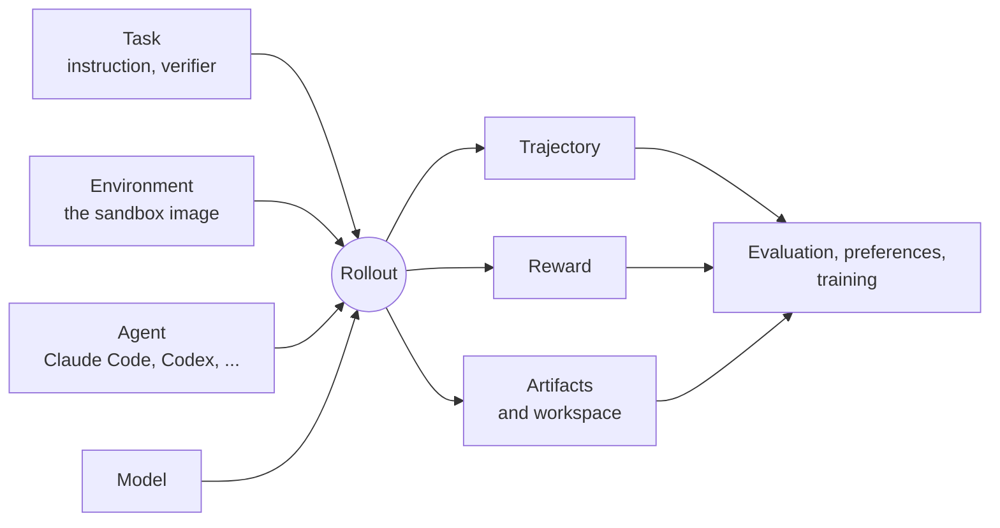
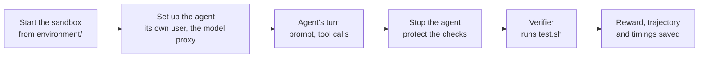

# How BenchFlow works

BenchFlow's unit of work is the **rollout**: one agent, driving one model, works on one task in a fresh sandbox built from the task's environment, and when the agent stops, the task's verifier scores what it left. Everything else BenchFlow gives you is read from rollouts: a job's score, a comparison of two agents, a ranking from human votes, rows for a trainer. This page names the parts, then follows one real rollout through them: the [Quick start](./quick-start.md#on-another-provider)'s Claude Code run on MiMo, through BenchFlow's model proxy.

The command line and the result folders call a rollout a **trial** and a set of rollouts a **job**. In Python they are `Rollout` and `Evaluation`. The other pages say trial wherever you'll see that word in the output.

## What goes in, what comes out



A task, its environment, an agent and a model go in; a trajectory, a reward and the agent's files come out. Every other part of BenchFlow either sets up rollouts or reads what they left:

| View | What it reads | Page |
|---|---|---|
| Evaluation | each rollout's reward, outcome, tokens and cost, summed per task and per job | [Read the results](../evaluate/read-results.md), [Compare runs](../audit/compare-runs.md) |
| Controls | rollouts of the reference solution (`oracle`, should score 1) and of an agent that does nothing (`nop`, should score 0), which tell a broken task from a weak agent | [Check a benchmark](../audit/check-a-benchmark.md) |
| Preferences | the outputs of two rollouts of one task, judged side by side and ranked | [Human preferences](../tasks/human-preferences.md) |
| Training | trajectories and rewards as rows for a trainer, with each rollout's advantage over the others in its group | [BenchFlow as an RL environment](../train/environment.md) |
| Run card | the rollouts a command would start, before any starts: tasks, agent, model, tries, time and what isn't capped (0.10) | [Before you run an eval](../evaluate/before-you-run.md#the-run-card-010) |

## The words

| Word | What it is | On disk |
|---|---|---|
| **Task** | What to do and how it's scored: an instruction, an environment, a verifier, and usually a reference solution. | `task.md`, `environment/`, `verifier/`, `oracle/` |
| **Environment** | What the sandbox is built from: the task's Dockerfile and the files it copies in, or a named image. The task's `sandbox:` settings add its CPUs and memory. | `environment/`, `sandbox:` in `task.md` |
| **Agent** | The program doing the task: Claude Code, Codex, OpenCode and others. Two need no model: `oracle` runs the reference solution, `nop` does nothing. | |
| **Model** | The model the agent calls, named with `-m`, such as `xiaomi/mimo-v2.6-flash`. | |
| **Benchmark** | A set of tasks, often published as a folder in a Git repository; the registry names some of them (`bench hub list`). | a folder of task folders |
| **Rollout** (trial) | One agent's attempt at one task, in its own sandbox. | `jobs/<job>/<task>__<id>/` |
| **Sandbox** | The isolated machine one rollout runs in: a Docker container on your machine, or a cloud sandbox on Daytona or Modal. | |
| **Attempt** | One try at a rollout. A rollout that fails for a reason another try could fix, such as a dropped connection, runs again in a new sandbox, up to 2 more times by default (`--retry-attempts`); it keeps its best attempt. | each trial's `attempts` |
| **Trajectory** | Everything the agent did: messages, thoughts and tool calls, and each model request that went through the proxy. | `trajectory/` |
| **Verifier** | The task's check, usually `verifier/test.sh` running tests. | `verifier/` in the task |
| **Reward** | The verifier's score: 1.0 for a pass, 0.0 for a fail, or a value in between for partial credit. | `verifier/reward.txt`, `result.json` |
| **Artifacts** | What the agent left: the workspace the verifier grades, and the files the task declares, copied into the rollout's folder. | `artifacts/` |
| **Job** | The rollouts one command starts, one per task, and their summary. Rerunning the same command continues the job. | `jobs/<job>/` |
| **Repeat** | One pass over the whole task set. `--trials 3` makes three repeats, each a job of its own; the flag and the `trial-01` to `trial-03` folders call a repeat a trial. | `jobs/<agent>/trial-NN/` |

## One rollout, step by step



1. **Start the sandbox.** BenchFlow builds or pulls the task's image and starts a fresh sandbox from it.
2. **Set up the agent.** It installs the agent and gives it a user of its own (`agent`, not root). With an API key, it also starts a model proxy, on your machine for local Docker and inside the sandbox on Daytona and Modal; every model call goes through it, so BenchFlow can count tokens and record each request.
3. **The agent's turn.** The agent gets the task's instruction and works until it says it's done, or a time limit stops it.
4. **Stop the agent and protect the checks.** BenchFlow stops every process the agent left running and removes files it could use to fake a test run, so the agent can't change how it's graded after its turn.
5. **Verify.** BenchFlow copies the task's tests into the sandbox, runs `test.sh`, and reads the reward it writes.
6. **Save and clean up.** It writes the rollout's results, deletes the sandbox, and moves on to the next rollout.

The rollout's `timing.json` records how long each step took. For the quick start's Claude Code rollout on MiMo:

```json
{
  "slot_wait": 0.0,
  "environment_setup": 2.1,
  "install_agent": 0.068,
  "sandbox_ready": 7.859,
  "proxy_health_wait": 0.0,
  "firewall_power": 0.099,
  "cloud_metadata_block": 0.421,
  "acp_connect": 1.877,
  "agent_setup": 2.4,
  "agent_execution": 372.3,
  "harden_before_verify": {
    "kill_sandbox_user_procs": 0.056,
    "clear_verifier_output": 0.01,
    "prepare_app_dir": 0.0,
    "reclaim_disk": 0.02,
    "freeze_workspace": 0.28,
    "cleanup_conftests": 0.596,
    "build_verifier_env": 0.603,
    "total": 1.85
  },
  "verifier": 5.3,
  "agent_stop_to_reward": 5.517,
  "provider_wait": 360.0,
  "provider_retry_wait": 0.0,
  "agent_without_provider_wait": 12.2,
  "cleanup": 0.383,
  "total": 388.6
}
```

The agent's turn took 372 seconds, and 360 of them were spent waiting for the model to answer. That split matters when a run is slow: here the model was the bottleneck, not the sandbox or the agent's tools. Each time is rounded on its own, so a difference can be 0.1 off (372.3 less 360.0 shows as 12.2), and some steps overlap, so they don't add up to `total`.

## What a rollout leaves on disk

```text
jobs/2026-11-04__16-43-38/
├── summary.json                      the score, counts and settings for the whole job
├── results.jsonl                     one line per rollout
└── econ-detrending-correlation__c6772b40/
    ├── result.json                   the reward (rewards.reward), outcome, errors, tokens
    ├── timing.json                   seconds per step
    ├── config.json                   the rollout's settings and BenchFlow version
    ├── trajectory/
    │   ├── acp_trajectory.jsonl      the agent's messages, thoughts and tool calls
    │   └── llm_trajectory.jsonl      each model request and response the proxy saw
    ├── verifier/
    │   ├── test-stdout.txt           what the tests printed
    │   └── reward.txt                the reward the verifier wrote
    ├── agent/                        the agent's own logs
    └── trainer/                      the same rollout in training formats
```

Every file in a rollout's folder, and every key of its `result.json`, is in [Read the results](../evaluate/read-results.md#everything-in-a-trials-folder); the files you write and the schema files BenchFlow writes are in [Files BenchFlow reads and writes](../reference/files.md).

## Why the rollout

BenchFlow made the rollout its core unit in [v0.4.0](https://github.com/benchflow-ai/benchflow/releases/tag/v0.4.0), in May 2026, when the Python names `Trial` and `Job` became `Rollout` and `Evaluation`. Han-chung Lee, a SkillsBench author, gives the reason in [his essay on agent evaluation infrastructure](https://leehanchung.github.io/blogs/2026/06/13/hidden-technical-debt-agent-evaluation-infra/#rollouts): "Rollouts is the core artifact of an Agentic AI system." An agent does its work by changing its sandbox, so its final answer alone can't show how it got there. A rollout keeps the whole attempt, and the same record serves a score, a vote and a training row. [Why BenchFlow](./why-benchflow.md) follows the rest of his argument.

## What BenchFlow does not do

- It doesn't serve models. Agents call the model provider you choose.
- It doesn't train models. It turns rollouts into training data and hands them to a trainer: see [Train with RL](../train/environment.md).
- It doesn't write tasks for you. It runs, checks and grades the tasks you or a benchmark provide.
