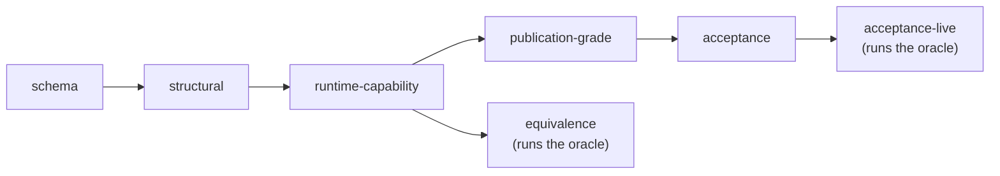

# Check a task

```bash
bench check tasks/my-task
bench check tasks/                       # every task in the folder
bench check tasks/my-task --level schema # parse task.md only
```

At every level but `equivalence` and `acceptance-live`, `bench check` validates a task without starting a sandbox. It prints `✓ my-task — valid (structural)`, or each issue with an arrow. Warnings, such as a `task.toml` key BenchFlow doesn't know, are printed but don't fail the check.

Given a folder of tasks, it checks each one. It fails if any task fails.

## Check the plan a run will use

By default the check plans a Docker run of `claude-agent-acp`. To check the run you will actually start, pass the same settings:

| Option | Checks the plan for |
|---|---|
| `--sandbox <name>` | That sandbox; default `docker` |
| `--agent <name>` | That agent; use `--agent oracle` for an oracle-only task |
| `--model <name>` | That model |
| `--sandbox-user <name>` | That agent user; default `agent` |
| `--verifier-sandbox separate` | A [separate verifier](./separate-verifier.md), and names where its image comes from |
| `--allow-task-env <NAME>` | A task that reads `NAME` from your shell |

`bench check` reads `.env` and resolves agent names and the default model the way `bench run` does. `bench check` lists every issue it finds. `bench run` and the Python API (`bf.run`, `bf.run_sync`, `bf.run_batch`, `bf.branch`) refuse a task only for the ones that stop a run, the same list on both: `task.md` or `task.toml` does not parse or is a symlink; the verifier has no runnable entrypoint (or its `verifier.md` does not parse); a symlink sits in (or is) `environment/`, `verifier/` or `oracle/`, or the older layout's `tests/` or `solution/` (uploads skip links, so its file never arrives); or nothing names an image (no Dockerfile, `sandbox.docker_image` or environment manifest). The others (a non-standard CTRF path, rubric checks, `oracle/` beside `solution/`, placeholders, a symlink elsewhere in the task) are authoring issues: the task still runs. `bf.run_batch` records a refused task as an errored result and runs the rest.

## What fails a check

| Issue | Fix |
|---|---|
| A `[REPLACE: ...]` placeholder left in any file | Replace it |
| `environment/Dockerfile` missing | Add one, or name a prebuilt image in `sandbox.docker_image` (which needs neither `environment/` nor a Dockerfile). A task that ships only a `docker-compose.yaml` is refused: the sandbox builds `main` from the Dockerfile even when the Compose file names an `image:`. |
| An unknown key in `task.md` | Fix the typo; the message names the key |
| A feature the chosen sandbox can't run | See [What runs where](./overview.md#what-runs-where) |
| A `verifier.md` strategy that can't run | See [Verifier](./verifier.md#declare-a-strategy) |
| An env value that reads an unnamed variable of your shell | Pass `--allow-task-env NAME`, or write the value in |
| A symbolic link in the task | Copy the linked files into the task. `bench run` skips a task whose link is in `environment/`, `verifier/` or `oracle/` (or the older `tests/` or `solution/`, or is its `task.md`), with a warning; a link elsewhere gets a warning and the task runs. |

## Levels

Each level adds to the one before, except `equivalence`, which adds its oracle battery to `runtime-capability` and skips the publication and acceptance checks.

| `--level` | Checks | Starts a sandbox |
|---|---|---|
| `schema` | `task.md` parses | no |
| `structural` (default) | The files, plus the launch plan for `--sandbox` and `--agent` | no |
| `runtime-capability` | The same, named explicitly; an unknown sandbox name fails; `--sandbox` defaults to `docker` | no |
| `publication-grade` | `task.md` is the only entry point, with `oracle/`, `verifier/verifier.md`, rubric files and an explicit `reward_json` output | no |
| `acceptance` | The evidence the task declares: oracle proof, verifier reruns and flake rate, review status, a calibration report, SHA-256 pins | no |
| `acceptance-live` | Runs the declared live cases and `oracle/solve.sh` in `--sandbox` (default `docker`) and checks their rewards | yes |
| `equivalence` | Runs the oracle, then grades wrong and value-equivalent variants of its output, in `--sandbox` (default `docker`) | yes |



For a task family, the ordinary levels check the generator's plan without running it. `acceptance-live` and `equivalence` run it.

## Evidence for acceptance

`--level acceptance` reads `benchflow.evidence` in `task.md`. Use it for leaderboard tasks, and for any task with hidden tests, a subjective rubric or a model judge.

The block below is abridged. The full block, with reference examples and the SHA-256 pins the check requires, is in the [task package reference](../reference/task-package.md#evidence).

```yaml
benchflow:
  evidence:
    oracle_runs:
      required_reward: 1.0
      artifact: evidence/calibration/oracle-run.json
    verifier:
      reruns: 5
      flake_rate: 0.0
      report: evidence/calibration/verifier-stability-report.json
    review:
      anti_cheat: passed
      instruction_alignment: passed
      artifact: evidence/calibration/review.json
    calibration:
      no_op_reward_max: 0.0
      known_bad_reward_max: 0.2
      partial_solution_range: [0.3, 0.8]
      report: evidence/calibration/calibration-report.json
```

The check reads each JSON file the evidence names. It fails unless the rewards, review status, calibration cases and verifier run records agree with what `task.md` declares, and every file matches its SHA-256 pin.

## Live acceptance

`--level acceptance-live` runs the cases in `benchflow.evidence.acceptance_live` in a real sandbox:

```bash
bench check tasks/my-task --level acceptance-live --sandbox docker
```

| Option or key | Effect |
|---|---|
| `acceptance_live.report` | Write a JSON report and a `.sha256` file into the task |
| `--report-output <path>` | Write the report elsewhere and leave the task untouched |
| `--no-report-write` | Write no report at all |
| `expect.flake_rate_max` | Allow that flake rate over a case's reruns; without it, any failed rerun fails |
| `acceptance_live.calibration.from: calibration.report` | Generate no-op, known-bad, partial and reference cases from the calibration report |
| `acceptance_live.leaderboard.required: true` | Add a `leaderboard_suitability` verdict to the report |

## Draft-2 tasks

A [task.md draft 2](./taskmd-draft-2.md) folder gets three reports: the format's own checker, BenchFlow's field-by-field decisions, and the checks above on the converted task.

## Before you publish

Check that:

- the oracle scores exactly 1 (`bench run tasks/my-task` runs it), and an empty run scores below 1 (`bench run tasks/my-task -a nop`);
- the agent can't read tests, scorer code, reference answers or git history past the base commit;
- the agent can't write to anything the verifier reads;
- the reward can't be earned by patching Python, overriding `__eq__` or forcing an exit code;
- the network is off, or limited with `allowlist` or `denylist` ([Network policies](./network-policies.md)).

## Next steps

- [Create a task](./create-a-task.md): the check in the authoring loop.
- [Oracle](./oracle.md): prove the task is solvable.
- [Task package reference](../reference/task-package.md): the full contract the checks enforce.
