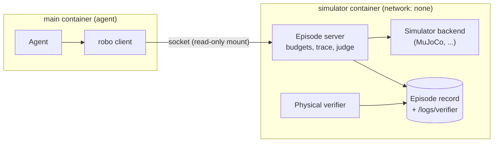

# Embodied tasks

Run every task in a folder of robot tasks five times, once per seed, then read the pass rates:

```bash
bench run tasks/ --agent claude-agent-acp --seeds 0-4
bench embodied report jobs/<job>
```

The report has one row per task. Sample output (illustrative):

```
task                                           n pass   mean    std   p@1   p@2   p@3   p@4   p@5
pick-place                                     5    3  0.600  0.548 0.600 0.900 1.000 1.000 1.000
...
all tasks                                     10        0.500       0.500 0.800 0.950 1.000 1.000
pass rate 0.500 (95% Wilson interval 0.237-0.763)
  sim: 10 trials, pass rate 0.500 [0.237, 0.763]
```

An embodied task gives an agent a robot, simulated or real. The agent drives it with the `robo` command. BenchFlow runs the simulator next to the agent, enforces the budgets, records every step and judges success.

This page is for benchmark authors. To write a simulator backend, see the [embodied reference](../reference/embodied.md).

## What BenchFlow provides

BenchFlow provides the shared parts:

| Part | What it does |
|---|---|
| **Embodiment spec** | describes the robot: sensors, action groups, skills, budgets |
| **`robo` command** | the agent's only way to see and move the robot |
| **Episode server** | runs the simulator, checks every action, records the episode, judges success |
| **Physical verifier** | turns the episode result into the trial's reward |
| **Rollout extensions** | seeded runs, pass@k, per-step training export |

A robotics benchmark such as [Robo Use](https://github.com/benchflow-ai/robouse) adds only its own parts: simulator backends, tasks, reference solutions and a task format.

An embodied task is still an ordinary BenchFlow task. Its [task format](./task-formats.md) writes a normal task folder. So it runs with BenchFlow's agents, sandboxes, verifier, trial layout and training exports.

## Who runs where



The agent's container holds the `robo` client and nothing else of the simulator. It cannot read the task source, the episode record or `/logs/verifier`, so it cannot write a reward in advance. The simulator container has no network.

## The agent's commands

```
robo info                                   the robot's spec, budgets, observation mode, cameras
robo status                                 finished?, outcome, steps used
robo observe [--image] [--camera C|all]     state; --image saves camera PNGs and prints their paths
robo act GROUP=V1,V2,... [--repeat N]       one step (or N), commanding one or more action groups
robo skill NAME [ARG ...] [key=value ...]   a named skill from robo info
robo done ["message"]                       end the episode and ask for scoring
robo give-up ["message"]                    end the episode without claiming success
```

Examples:

```bash
robo act arm.ee_delta=0.2,0,-0.1 gripper=1 --repeat 5   # move the arm and close the gripper, 5 steps
robo act left.ee_delta=0,0.3,0 right.gripper=-1         # a bimanual rig
robo skill arm.move_to 0.1 0.6 0.2 grip=1               # a built-in skill
robo skill base.navigate_to fridge_1                    # a backend skill
```

Groups the agent does not name in a step follow their hold rule (for example, a gripper keeps its last command). Every command takes `--json` to print the raw response. The [reference](../reference/embodied.md#the-robo-command) lists the older command forms and the environment variables.

## Budgets

The episode server enforces budgets; the agent cannot change them.

| Budget | Limits |
|---|---|
| `max_steps` | simulator steps, skill steps included |
| `max_wall_s` | wall-clock seconds from simulator start |
| `max_repeat` | steps one `robo act --repeat` may run |
| `max_skill_steps` | steps one skill may run |
| `settle_steps` | steps held still after `robo done`, before judging |

When the step budget runs out, the episode ends as `budget_exhausted`. How it scores depends on `reward.success_mode`:

| `success_mode` | A `budget_exhausted` episode scores |
|---|---|
| `final` | 0, because the agent must call `robo done` |
| `first` | 1 if the task ever succeeded (`success_ever`), else 0 |

## Seeded rollouts

`--seeds 0-4` (or `0,3,7`) runs each task once per seed. `--include` and `--exclude` match the source folder names. `--seeds` needs `--tasks-dir` or `--source-repo` (or a task folder as the target), and cannot be combined with `--matrix` or `--worker-concurrency`.

The task format writes one task per seed, named `<task>--seed-<n>`. The seed travels in the task folder, so you can rerun any rollout from its folder alone. `result.json` records `initial_state_sha256`, so you can check that two runs with the same seed started from the same state.

`summary.json` gains a `seeded` block, which `bench embodied report` prints (add `--json` for the raw report):

- **Per task:** the reward for each seed, mean and standard deviation, unbiased pass@k for k = 1..n, a 95% Wilson interval on the pass rate, and the median, max and min.
- **Over all tasks:** the mean reward with a 95% bootstrap interval, and the pass rate with its Wilson interval, overall and by robot mode (`sim`, `real`, `hil-mock`).

Every trial counts: an errored trial is a fail with reward 0. The `*_scored_only` fields (`mean_scored_only`, `pass_at_k_scored_only`, `mean_reward_scored_only`, `pass_rate_scored_only`) leave errored trials out.

## Training export

```bash
bench embodied export jobs/<job> --out data/   # data/steps.jsonl + data/episodes.jsonl
```

For each trial with an episode record, BenchFlow also writes two files next to its other trainer files:

| File | Content |
|---|---|
| `trainer/embodied_steps.jsonl` | one row per simulator step: `obs`, `action`, `reward`, `success`, `done`, `truncated`, `op`, `role`, `frame`, `t` |
| `trainer/embodied_episode.json` | the robot spec, the video index, the return, the outcome and the ATIF session id |

In vision mode, `obs` holds only what the agent could see. Settle steps (`op: settle`) are included and marked, so you can drop them for behaviour cloning. Each step's `reward` is the backend's shaped reward when it has one, otherwise 1 or 0 for success on that step. The trial's final reward is still the judged success.

## Sim, real and hardware-in-the-loop

The spec's `mode` says where the robot is:

| `mode` | Robot |
|---|---|
| `sim` (default) | a simulator |
| `real` | live hardware |
| `hil-mock` | a hardware-in-the-loop mock that replays sessions recorded on the real robot |

A `real` or `hil-mock` robot must declare a `safety` block, which its backend enforces outside the agent's container. The [reference](../reference/embodied.md#safety) lists its fields. Each episode record saves the mode, and `bench embodied report` groups pass rates by it.

## What embodied tasks cannot do

BenchFlow can roll back only state it controls: a container snapshot, a workspace, declared environment state, or a recorded agent session. A simulator's state lives inside the episode server's process, which a container snapshot does not capture. A real robot's state is not software: restoring a container cannot put a block back in a cup.

So BenchFlow refuses these on every embodied task, before anything is restored or replayed:

| Operation | What happens |
|---|---|
| [Branching](../jobs/branching.md): `bench branch`, `bf.branch`, `--from-checkpoint`, `Rollout.branch()` | refused before any sandbox starts |
| `bench run --retry-from-checkpoint` | the retry records `status: refused` |
| `bench regrade` | the trial is reported as not regradable |
| `bench eval continue` | refused |

A task in a simulator that can restore its world may allow these in `metadata.embodied`:

```yaml
metadata:
  embodied:
    mode: sim             # sim (default) | real | hil-mock
    world_restore: true   # restoring a checkpoint returns the simulator to that state
    action_replay: true   # replaying recorded actions affects only that restorable world
```

Both default to `false`. A `real` robot, or a `hil-mock` that stands in for one, cannot set either: BenchFlow refuses to write that task package. BenchFlow does not compare `mode` with the backend's spec, so a task on a real robot must say `mode: real` itself.

A finished trial's own episode record also marks it embodied, for `bench eval continue` and `bench regrade`. If that record names a `real` or `hil-mock` robot, it overrides what the task declares.

## Several roles on one robot

A [scene](./scenes.md) runs all its roles in one sandbox, so every role reaches the same simulator and the episode carries on across turns. Each role names itself with `ROBO_ROLE`, set in `Role.env`:

```python
Scene(name="plan-then-act",
      roles=[Role(name="planner", agent="codex", model="gpt-6-astra", env={"ROBO_ROLE": "planner"}),
             Role(name="operator", agent="codex", model="gpt-6-astra", env={"ROBO_ROLE": "operator"})],
      turns=[Turn(role="planner", prompt="Inspect the scene with robo observe --image and write a plan to /app/plan.md. Do not move the robot."),
             Turn(role="operator", prompt="Carry out /app/plan.md with robo, then call robo done.")])
```

The server writes the role on every trace line. The task can limit what each role may do, in its format block:

```yaml
robouse:
  roles:
    planner: {allow: [info, observe, status]}
    operator: {allow: all}
```

Role limits are a guard rail and an attribution record, not a security boundary: roles share a container, so a role can change its own environment.

## Limits

- **No simulator snapshots yet.** Embodied tasks cannot branch, restore a checkpoint or replay ([why](#what-embodied-tasks-cannot-do)).
- **Docker only.** The verifier runs in the simulator container, which needs Docker. Daytona is not supported for embodied tasks.
- **GPU simulators** such as BEHAVIOR on Isaac Sim keep their worker outside the simulator container; the container holds a thin client.

## Next steps

- [Embodied reference](../reference/embodied.md): the spec, the wire protocol, the backend contract and the record files.
- [Task formats](./task-formats.md): how a format writes task folders.
- [Pass@k](../reference/pass-at-k.md): how pass@k and its intervals are computed.
- [Scenes](./scenes.md): roles and turns.
