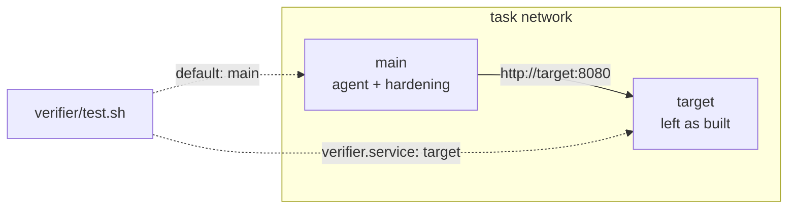

# Environment

`environment/` builds the sandbox the agent works in. Most tasks need one file:

```dockerfile
# environment/Dockerfile
FROM ubuntu:24.04
WORKDIR /app
RUN apt-get update && apt-get install -y python3 && rm -rf /var/lib/apt/lists/*
```

The agent starts in the image's `WORKDIR`. `sandbox.workdir` in `task.md` overrides it without a rebuild.

## Prebuilt images

To skip the build, name an image in `task.md`:

```yaml
sandbox:
  docker_image: ghcr.io/my-org/my-task:1
```

A task on a prebuilt image builds nothing, so it needs neither `environment/` nor a Dockerfile. A task that ships only an `environment/docker-compose.yaml` still needs one: the sandbox builds `main` from the Dockerfile even when the Compose file names an `image:`, so `bench check` and `bench run` refuse it. Name the image in `sandbox.docker_image`, or write a one-line Dockerfile, `FROM ghcr.io/my-org/my-task:1`.

## Resources

```yaml
sandbox:
  cpus: 2
  memory_mb: 4096
  storage_mb: 10240
  build_timeout_sec: 900
```

The defaults are 1 CPU, 2048 MB of memory, 10240 MB of disk and a 600-second build. Daytona caps a sandbox's disk at 10 GB. [GPU tasks run on Modal](../sandboxes/modal.md#gpus), with an explicit count and at most one type. Other backends refuse GPU requests; TPUs remain unsupported.

## Paths BenchFlow sets up

| Path | Holds | Who writes it |
|---|---|---|
| `/logs/agent/` | The agent's logs, and the oracle's output (`oracle.txt`) | BenchFlow, the agent |
| `/logs/artifacts/` | Files the agent wants kept; copied to the trial's `artifacts/` | the agent |
| `/logs/verifier/` | The reward files and verifier output | the verifier |
| `/verifier` (or `/tests`) | `verifier/`, copied in after the agent stops | BenchFlow |
| `/oracle` (or `/solution`) | `oracle/`, uploaded at the start of every trial and locked to root before the agent starts | BenchFlow |

The agent never sees `verifier/`: it arrives after the agent stops. `oracle/` is in the sandbox from the start, root-only (mode 700) whenever the agent runs as a non-root user (the default). An agent run as root can read it.

## Setup commands and readiness

```yaml
sandbox:
  setup_commands:
    - command: python3 /app/seed_db.py
  healthcheck:
    command: curl -sf http://localhost:8080/health
    interval_sec: 5
    retries: 10
```

`setup_commands` run after the services start and before the agent is installed. `healthcheck` waits until the sandbox is ready.

## Artifacts

`artifacts` lists files to copy out of the sandbox after the verifier runs, into the trial's `artifacts/` folder:

```yaml
artifacts:
  - /app/report.json
  - source: /root/output
    destination: output
    exclude: ["*.tmp"]
```

| Field | Meaning |
|---|---|
| `source` | A path in the sandbox, absolute or relative to the workspace, without `..` |
| `destination` | Where it goes under the trial's `artifacts/`; relative, without `..` |
| `exclude` | Paths under `source` to leave out |

The trial's `artifacts-manifest.json` records each collection and every file's size and SHA-256. A problem in collection is recorded there; it never fails the trial.

A [separate verifier](./separate-verifier.md) receives the declared artifacts at their `source` paths. Artifacts work on Docker, remote Docker and Daytona.

## Multi-container

Add `environment/docker-compose.yaml` to run more containers beside the agent's. The agent always runs in the `main` service. Other services join the same network.

```yaml
# environment/docker-compose.yaml
services:
  main: {}            # the agent's container; BenchFlow fills in build, image and limits
  target:             # a vulnerable server the agent must attack
    image: vulhub/struts2-s2-001:latest
    expose: ["8080"]
```

`main` reaches `target` by name: `http://target:8080`. Compose runs on Docker, remote Docker and Daytona.



### Run the verifier in another service

When the proof of success lives in another container, such as a marker file or a changed database row, run the verifier there:

```yaml
verifier:
  service: target     # run verifier/test.sh inside the target container
```

BenchFlow then copies `verifier/` into `target`, runs `test.sh` there, and copies the reward back. The default is `main`.

Use the service name from `docker-compose.yaml`. A `test.sh` in `target` reaches `main` by name. `verifier.service` other than `main` runs on Docker and remote Docker only.

### Hardening covers main only

Before the verifier runs, BenchFlow hardens `main`. It kills the agent user's processes, cleans `PATH` and `PYTHONPATH`, and restores build files.

It leaves other services alone. A target is meant to be vulnerable, and the agent has no shell in it.

`verifier.service` moves where `test.sh` runs, not where hardening runs. The pytest plugin guard is part of that hardening, so pytest in another service runs without it. See [Sandbox hardening](../sandboxes/security.md).

### From Python

`env.exec_in_service("target", cmd)` and `env.exec(cmd, service="target")` run a command in another service. They work on Docker and on Daytona with compose. Single-container backends raise an error for any service but `main`.

## Next steps

- [Network policies](./network-policies.md): what the agent and services may reach.
- [Verifier](./verifier.md): writing `test.sh`.
- [Separate verifier](./separate-verifier.md): grading in a fresh sandbox.
