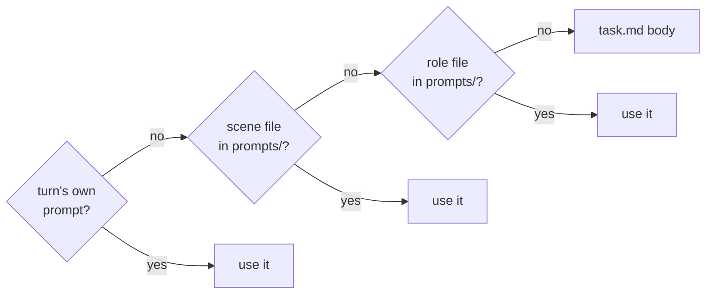

# Instruction

The body of `task.md`, everything below the frontmatter, is the instruction. The agent gets it as plain markdown at the start of a trial.

```markdown
---
agent:
  timeout_sec: 300
---

Create a file `/app/hello.txt` containing exactly `Hello, world!`.
```

No heading or markup is needed. To port a benchmark, paste its instruction text in as the body.

## Writing a good instruction

- **State outcomes, not steps:** the files to create, the commands that must work, the numbers to hit.
- **Use absolute paths**, such as `/app/out.json`, not `out.json`, so the instruction and the verifier agree.
- **Define output formats**, so the agent and `test.sh` read the same schema.

## Canary

`bench new` writes a canary line, a unique ID, as the first line of the frontmatter and into the scripts the agent never sees. The agent gets only the body, never the frontmatter. If the ID turns up in a model's output or a training set, the task has leaked.

## Instruction vs. agent prompt

Keep agent-specific prompting out of the instruction. A task should read the same to every agent.

To add text for one run, use `--extra-instruction`:

```bash
bench run tasks/ -a claude --extra-instruction "Do not use the network."
```

For rules every trial of a task must get, set `agent.prompt_prefix` in the frontmatter. It goes before the instruction, and it must never hint at the solution.

## The `## prompt` heading

`bench new` writes a `## prompt` heading above the placeholder. For a one-prompt task it changes nothing, so keep it or delete it.

Three more headings, `## role:<name>`, `## scene:<name>` and `## user-persona`, exist for imported tasks. Each heading may appear once. For a new task, put those prompts in files.

## Several prompts

Put each extra prompt in its own file under `prompts/`:

| File | Prompt for |
|---|---|
| `prompts/role.<name>.md` | The role `<name>` |
| `prompts/scene.<name>.md` | The scene `<name>` |
| `prompts/user-persona.md` | The simulated user |

A file in `prompts/` wins over a heading with the same name.

For each turn, the agent gets the first prompt that exists:



To join the prompts instead of picking one:

```yaml
benchflow:
  prompt:
    composition: append
    order: [base, role, scene, turn]
```

`composition: replace` keeps the default. A prompt passed on the command line or in the Python API overrides both.

## Several agents

Roles and scenes are declared in the frontmatter. Scenes run in order, and each turn names a role:

```yaml
agents:
  roles:
    solver:
      agent: claude-agent-acp
scenes:
  - name: solve
    turns:
      - role: solver
```

The solver's prompt goes in `prompts/role.solver.md`.

Several roles can share one workspace when a team hands off in sequence:

```yaml
agents:
  roles:
    planner:
      agent: claude-agent-acp
      model: claude-sonnet-5
    implementer:
      agent: codex-acp
      model: gpt-5.5
      reasoning_effort: high
benchflow:
  teams:
    default:
      handoff:
        mode: sequential
        workspace_visibility: shared
        trajectory_visibility: metadata
```

`trajectory_visibility` takes `none` or `metadata`. Any other `teams` setting is refused.

Runnable examples, including converted SkillsBench tasks, are in [examples/task-md](../examples/task-md/).

## Simulated user

A scripted user reveals private facts only when the agent asks for them:

```yaml
user:
  model: scripted
  stop_rule: satisfied-or-3-rounds
  private_facts:
    hidden_need: reveal only after the solver asks for it
benchflow:
  nudges:
    mode: simulated-user
    nudge_budget: 2
```

The public instruction runs first. A private fact stays out of the instruction and the task metadata.

A model-backed user takes a model whose name starts with `claude-`, `gpt-`, `o1`, `o3`, `o4`, `gemini`, `anthropic/`, `openai/` or `google/`:

```yaml
user:
  model: claude-haiku
  stop_rule: satisfied-or-5-rounds
benchflow:
  nudges:
    mode: simulated-user
    branchable: true
    branch_execution: option-kinds-preserved
    confirmation_policy:
      destructive_actions: human
```

| Setting | Effect |
|---|---|
| `confirmation_policy: human` | The agent's permission requests are refused unless the caller passes an `on_ask_user` handler |
| `branch_execution: option-kinds-preserved` | Records each choice's id and kind, so the trial can be branched later |
| `branch_execution: forked-snapshot` | Refused |

## Next steps

- [Configuration](./configuration.md): the frontmatter.
- [Verifier](./verifier.md): how the result is scored.
- [Scene patterns](../cookbook/scene-patterns.md): multi-agent and user-loop recipes.
