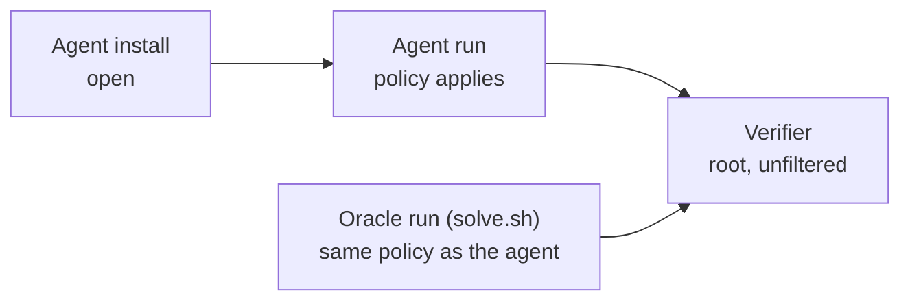

# Network policies

What the agent can reach while it works.

```yaml
sandbox:
  network_mode: denylist
  blocked_urls:
    - https://example.org/papers/lattice-qcd-2026
  blocked_hosts:
    - mirror.example.net
```

A task sets its policy with `sandbox.network_mode`. An `allowlist` can also go on `agent.network_mode` in the task.toml format. BenchFlow filters the agent's user only, so the two forms behave the same. The verifier runs as root, outside the filter.

## Modes

| `network_mode` | The agent can reach | Sandboxes |
|---|---|---|
| `public` (default) | The internet, except cloud metadata endpoints | All |
| `no-network` | Only BenchFlow's model gateway | All but `apple-container` and `agentcore` |
| `denylist` | The internet, minus `blocked_urls` and `blocked_hosts` | `docker`, `remote-docker`, `daytona` |
| `allowlist` | Only `allowed_hosts`, plus the model gateway | `docker`, `remote-docker`, `daytona` |

The model gateway, through which the agent reaches its model, is always reachable. A task whose mode its sandbox cannot enforce is refused before any sandbox starts; it never runs with a weaker policy. Check ahead of time with `bench check tasks/my-task --sandbox <name>`.

## By stage

| `network_mode` | Agent run | Oracle run | Agent install | Verifier |
|---|---|---|---|---|
| `public` | Internet, except cloud metadata | Internet | Internet | Internet |
| `no-network` | Only the model gateway | No network | Internet | Unfiltered with an LLM agent; no network in oracle and nop runs |
| `denylist` | Internet, minus the listed URLs and hosts | Same as the agent | Internet | Unfiltered |
| `allowlist` | Only the listed hosts, IPs and ranges | Same as the agent | Internet | Unfiltered |



Under `no-network`, `denylist` and `allowlist` with an LLM agent, the agent user's firewall arms after the agent has started and its session is set up, just before the first prompt. Agent install and start-up have internet. A connection opened earlier is cut when the firewall arms.

The oracle runs under the same `denylist` or `allowlist` as the agent, so the reference solution must reach only what the policy allows.

Under `no-network`, `denylist` and `allowlist`, BenchFlow also turns off provider-hosted web search, and refuses models that search on their own. See [Models under web restrictions](../sandboxes/threat-model.md#models-under-web-restrictions).

## `public`: cloud metadata

`public` blocks the cloud metadata endpoints (169.254.169.254 and the others) for the agent in `main`, a root agent included (on Daytona, AgentCore and Apple a root agent runs under the provider's own metadata policy; a Modal sandbox cannot reach the endpoints at all, which each trial proves, recording `not_reachable`). The agent starts only once that block is proven; a trial where it is not stops before the agent. Other Compose services are not covered. A task that needs the endpoints says so in its environment table, and the trial's result records the opt-out (`--allow-cloud-metadata` does the same for a whole run):

```yaml
sandbox:
  allow_cloud_metadata: true
```

The older `x-allow-cloud-metadata: true` under `metadata` still works. Any value other than `true` or `false` is refused when the task loads. See [Network policy: open](../sandboxes/threat-model.md#network-policy-open-the-default).

## `denylist`

```yaml
sandbox:
  network_mode: denylist
  blocked_urls:
    - https://example.org/papers/lattice-qcd-2026
    - github.com/example-org/lattice-qcd-code
  blocked_hosts:
    - mirror.example.net
```

The internet stays reachable; the listed pages do not.

| Entry | Blocks |
|---|---|
| `blocked_urls: example.org/abs/2401.12345` | That path and every path under it, including `/abs/2401.12345v2`. The scheme is optional (`https://` is assumed); the host is lowercased; the query string and a trailing slash are dropped. |
| `blocked_urls: example.org` | Every path on `example.org` and `www.example.org`, but not other subdomains. |
| `blocked_hosts: example.org` | The host and all of its subdomains. |

- At least one entry in either list is required.
- IP literals, wildcards, ports and user info are refused.
- Both lists are refused under any other mode.
- `denylist` is sandbox-level only: `agent.network_mode` and `verifier.network_mode` refuse it.

Blocked attempts are written to `trajectory/egress_denylist.jsonl` in the trial folder. A blocklist hides pages, not knowledge: a model may already know what they say. See [Denylist egress](../sandboxes/threat-model.md#network-policy-denylist-egress).

## `allowlist`

```yaml
agent:
  network_mode: allowlist
  allowed_hosts:
    - pypi.org
    - "*.pythonhosted.org"
    - 10.0.0.0/8
```

The agent reaches only what is listed.

| Entry | Matches |
|---|---|
| `pypi.org` | Exactly that host: no subdomains, no implied `www.` |
| `*.pythonhosted.org` | Subdomains at any depth, but not `pythonhosted.org` itself |
| `10.0.0.5`, `::1` | That address |
| `10.0.0.0/8` | That range. It must be a strict CIDR (`10.0.0.1/8` is refused) |

- The list must not be empty.
- Hostnames are reachable over HTTP(S) through the egress proxy. IP and CIDR entries are also reachable directly, for any protocol.
- A CIDR entry never admits a name. To reach a Compose sibling by name, list both its name and its range (`sidecar` and `172.16.0.0/12`).
- `agent.network_mode: allowlist` cannot combine with `sandbox.network_mode` `no-network` or `denylist`.
- `verifier.network_mode: allowlist` is refused, because the verifier runs as root outside the agent's firewall.

See [Allowlist egress](../sandboxes/threat-model.md#network-policy-allowlist-egress).

## Requirements

| Mode | The task image needs | The sandbox user |
|---|---|---|
| `denylist` | `python3` and `openssl` | Non-root (the default) |
| `allowlist` | `python3` and `openssl` | Non-root (the default) |

On Docker, BenchFlow adds `NET_ADMIN` to `main` through its own Compose overlay; the task needs nothing extra. The host's kernel must provide the iptables `nat` table and the `owner` match for `allowlist`.

## Next steps

- What each stage guarantees: [Sandbox security](../sandboxes/security.md#network-policy-by-stage).
- Subscription logins under a network policy: [No-web subscription logins](../agents/no-web-subscription.md).
- The rest of the task's settings: [Configuration](./configuration.md).
