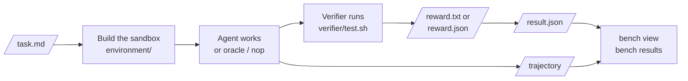

# Tasks

A BenchFlow task is a folder. `task.md` holds the settings, as YAML frontmatter, and the instruction the agent gets, as the body. `environment/` builds the sandbox, `verifier/` scores the result, and `oracle/` holds a reference solution.

```text
tasks/my-task/
├── task.md             # settings + instruction
├── environment/
│   └── Dockerfile      # the sandbox image
├── verifier/
│   └── test.sh         # writes a reward, 0.0-1.0, to /logs/verifier/reward.txt
└── oracle/
    └── solve.sh        # reference solution; `bench run <task> -a oracle` runs it
```

The smallest task that runs has three files: `task.md`, `environment/Dockerfile` and `verifier/test.sh`. `oracle/` is optional, but without it you cannot prove the task is solvable.

To make one, follow [Create a task](./create-a-task.md).

## Trials

A trial is one agent's attempt at one task. A job is a set of trials.



The verifier runs after the agent stops, in the same sandbox by default. A [separate verifier](./separate-verifier.md) runs it in a fresh sandbox instead.

## The parts of a task

| Part | Page |
|---|---|
| `task.md` body: what the agent is asked | [Instruction](./instruction.md) |
| `task.md` frontmatter: timeouts, resources, network, users | [Configuration](./configuration.md) |
| `environment/`: the image, extra containers | [Environment](./environment.md) |
| `oracle/`: the reference solution | [Oracle](./oracle.md) |
| `verifier/`: the reward | [Verifier](./verifier.md) |
| Network access during the run | [Network policies](./network-policies.md) |

## Which file wins

| If a folder has both | BenchFlow uses |
|---|---|
| `task.md` and `task.toml` + `instruction.md` | `task.md` |
| `verifier/` and `tests/` | `verifier/`, even if it is empty or broken |
| `oracle/` and `solution/` | `oracle/`, even if it is empty or broken |

If both copies exist they must match: `bench check` and `bench run` refuse a task whose `task.md` and `task.toml` + `instruction.md`, `oracle/` and `solution/`, or `verifier/` and `tests/` differ. Keep only one.

## Task folders

A task.toml task (`task.toml`, `instruction.md`, `solution/`, `tests/`) runs as it is. BenchFlow's names map onto the task.toml format's:

| BenchFlow | task.toml |
|---|---|
| `task.md` | `task.toml` + `instruction.md` |
| `sandbox:` | `[environment]` |
| `oracle/` | `solution/` |
| `verifier/` | `tests/` |

To convert a task.toml task, or export one, see [Import and export](./import-export.md). Folders in the [task.md draft 2](./taskmd-draft-2.md) format run too.

## What runs where

A task that uses something the chosen sandbox can't run fails with `UnsupportedTaskFeatureError` before any sandbox starts. `bench check <task> --sandbox <name>` shows the same error.

| Feature | Docker, remote Docker | Daytona | Modal, Apple Container, AgentCore |
|---|---|---|---|
| A single container | yes | yes | yes |
| Extra containers (`docker-compose.yaml`) | yes | yes | no |
| `verifier.service` other than `main` | yes | no | no |
| Declared `artifacts` | yes | yes | no |
| [Separate verifier](./separate-verifier.md) | yes | yes | Modal only |
| `allowlist` and `denylist` networks | yes | yes | no |

[GPU tasks](../sandboxes/modal.md#gpus) run on Modal with a positive count and at most one requested type. Other sandboxes refuse GPU requests. Some features are refused on every sandbox:

| Feature | Status |
|---|---|
| Multi-step tasks (`steps`) | Refused: one instruction per task |
| `sandbox.os: windows` | Refused |
| `sandbox.tpu` | Refused |

## Interaction modes

Most tasks are one instruction, one agent, one score. `task.md` can also declare more:

| Mode | What happens | Runs today |
|---|---|---|
| Single-shot | One agent, one instruction, scored once | yes |
| Multi-round | The agent gets more information across rounds | yes |
| Simulated user | A scripted or model-backed user answers the agent | yes, one role per scene |
| Several agents in turn | Roles hand off in one shared workspace | yes, in sequence only |
| Arena | An assessor scores the agent during the exchange | no: parsed only |

See [Instruction: several agents](./instruction.md#several-agents) and [Simulated user](./instruction.md#simulated-user).

## Tasks are packages

A task should run anywhere that reads its format. It depends on nothing outside its folder and the images it names. Version it, review it and maintain it like any other package.

## Next steps

- [Create a task](./create-a-task.md): write and prove your first task.
- [Configuration](./configuration.md): every `task.md` setting.
- [Task package reference](../reference/task-package.md): the full file and reward contract.
