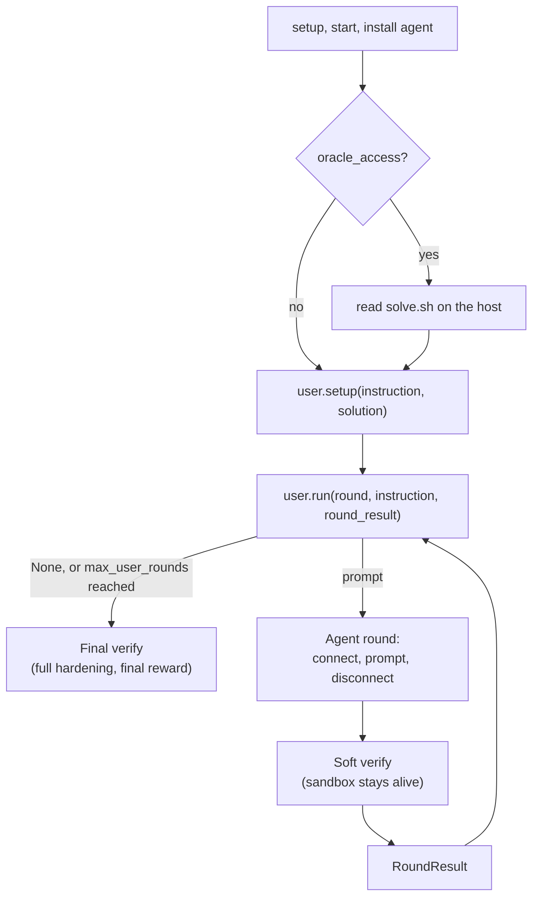

# Scripted users

Drive a multi-round run with a Python function. It reads each round's test result and decides what to tell the agent next.

```python
import asyncio

import benchflow as bf
from benchflow import FunctionUser, RolloutConfig, RoundResult, Scene, resolve_source


def progressive(round: int, instruction: str, rr: RoundResult | None) -> str | None:
    if round == 0:
        return instruction.split("\n")[0]            # terse: the first line only
    if rr and (rr.rewards or {}).get("reward", 0) >= 1.0:
        return None                                  # passed: stop
    return f"Tests failed:\n{rr.verifier_output}\n\nFull spec:\n{instruction}"


config = RolloutConfig(
    task_path=resolve_source("benchflow-ai/skillsbench", path="tasks/edit-pdf"),
    scenes=[Scene.single(agent="gemini", model="gemini-2.5-flash")],
    user=FunctionUser(progressive),
    max_user_rounds=3,
    environment="daytona",
)
result = asyncio.run(bf.run(config))
print(result.rewards, result.error)
```

A `BaseUser` runs between rounds. It sees the last round's verifier result and returns the next prompt, or `None` to stop. It is plain Python: no second model and no sidecar.

| You want | Use |
|---|---|
| hints that follow fixed rules: compress the spec, show failing tests, stop on pass | a scripted user (this page) |
| a user played by an LLM that reads files and gives open-ended feedback | a [simulated user](./scenes.md#simulated-user) |

A scripted user wins on cost and determinism when the hint schedule is fixed and the verifier does the grading.

## How the rounds run

When `RolloutConfig.user` is set, the agent step runs once per round instead of once:



Each scene must have exactly one role, and every turn in a scene must use that role. Otherwise the run raises `ValueError`. The exception is a task.md user with a sequential, shared handoff, which may use multi-role scenes with explicit turns.

## Round scores are not the final score

Between rounds, BenchFlow runs a lighter verifier, the soft verify, so the sandbox stays alive. It can score differently from the final verifier. In a SWE-bench Pro trial, every round scored 0 even where the final score was 1. Write your hint rules with that in mind.

| | Soft verify, between rounds | Final verify |
|---|---|---|
| Kills agent processes | no | yes |
| Restores the workspace from a snapshot | no | when the task asks for it |
| Removes planted `conftest.py`, `sitecustomize.py` and `.pth` files | yes | yes |
| Locks down `PATH` and `PYTHONPATH` | yes | yes |
| Runs the verifier | yes | yes |
| Result | `RoundResult.rewards` | the rollout's reward |

Soft verify still removes planted hook files, so an agent can't fake a round score with a `conftest.py`.

A soft verify that times out or crashes does not fail the rollout. Its error is in `RoundResult.verifier_error`, and the next round still runs.

## API

### `BaseUser`

```python
from benchflow import BaseUser, RoundResult


class MyUser(BaseUser):
    async def setup(self, instruction: str, solution: str | None = None) -> None:
        """Called once before round 0. solution is set only with oracle_access=True."""
        self.spec = instruction

    async def run(
        self,
        round: int,
        instruction: str,
        round_result: RoundResult | None = None,
    ) -> str | None:
        """Return the next prompt, or None to stop. round starts at 0."""
        ...
```

`instruction` is the original task instruction, the same every round. `round_result` is `None` on round 0.

### `RoundResult`

| Field | Holds |
|---|---|
| `round` | the round number, from 0 |
| `trajectory` | this round's ACP events only |
| `rewards` | the soft verifier's rewards, or `None` if it crashed |
| `verifier_output` | the soft verifier's raw output |
| `verifier_error` | the error message, if the soft verifier failed |
| `n_tool_calls` | tool calls in this round |
| `scene`, `role` | the scene and role of the round, for multi-scene runs |
| `handoff_from`, `handoff_to` | the roles of a handoff, when the round is one |

### Ready-made users

| Class | Does |
|---|---|
| `PassthroughUser` | sends the instruction unchanged on round 0, then stops: one ordinary round |
| `FunctionUser(fn)` | wraps a function `fn(round, instruction, round_result)`. Sync and async functions both work. |

### `RolloutConfig` fields

| Field | Default | Meaning |
|---|---|---|
| `user` | `None` | the `BaseUser` that drives the rounds |
| `max_user_rounds` | `5` | the most rounds; the loop also stops when the user returns `None` |
| `oracle_access` | `False` | pass the reference solution to `user.setup()` |

## Oracle access

With `oracle_access=True`:

Before round 0, the rollout reads the task's `oracle/solve.sh` (or legacy `solution/solve.sh`) on the host and passes its text to `user.setup(instruction, solution=...)`.

The solution is never in the sandbox of a non-oracle run, under any path, so an agent cannot read it even when it runs as root. Only `--agent oracle` uploads it. Verifiers never read it, so nothing is restored for soft verify or the final verify.

> ⚠️ `oracle_access=True` without a user has no effect: only a user reads the solution. BenchFlow logs a warning.

Uses for oracle access:

- **Dataset generation:** the user knows the answer and writes the best prompt for it.
- **Curriculum learning:** reveal parts of the solution step by step.
- **Research:** measure how much oracle information an agent needs.

## When the user fails

If `user.run()` raises, the loop stops. The run's `result.error` says `user.run() failed at round <n>: <error>`.

## Keep a task's own `conftest.py`

Before verifying, BenchFlow deletes `conftest.py` files outside `/tests/`, so an agent can't plant one. Some tasks ship real ones; the SWE-bench Pro qutebrowser task needs them to fix circular imports. Such a task opts out:

```toml
# task.toml
[verifier.hardening]
cleanup_conftests = false
```

In a `task.md`, put `hardening: {cleanup_conftests: false}` under `verifier:` in the frontmatter.

`cleanup_conftests` is the only opt-out. `sitecustomize.py`, `.pth` files and `*.py` in `/tmp` are always removed.

## Case study: SWE-bench Pro

SWE-bench Pro tasks have long instructions (2-5 KB) of API requirements, fixtures and expected behaviour. A scripted user can reveal them in steps:

```text
round 0   "Fix the bug described here: <one-line summary>"
            agent attempts → tests fail
round 1   "Tests <names> failed. Here is the requirements section: <half of the spec>."
            agent retries → tests still fail
round 2   "Still failing. Here is the full spec: <complete instruction>"
            agent makes a final attempt
```

On 5 tasks with Gemini 3.1 Pro on Daytona, all 5 ran 3 rounds end to end, and 3 of 5 reached reward 1. This was one model on one day, not a published comparison. The notebook has the cells and data.

## Examples

- [`examples/swebench_pro_progressive_disclosure.ipynb`](../examples/swebench_pro_progressive_disclosure.ipynb): the SWE-bench Pro case study, end to end.
- [`examples/swebench_pro_user_dogfood.py`](../examples/swebench_pro_user_dogfood.py): any of the 5 SWE-bench Pro tasks, for example `--task flipt --max-rounds 3`.
- [`examples/user_dogfood.py`](../examples/user_dogfood.py): the edit-pdf task with a `FunctionUser`; a starting template.

## Next steps

- [Scenes and simulated users](./scenes.md): a user played by an LLM.
- [Verifier](./verifier.md): what the final verify runs.
- [Native harness](../agents/harness.md): scripted users on Claude Code and Codex CLIs.
