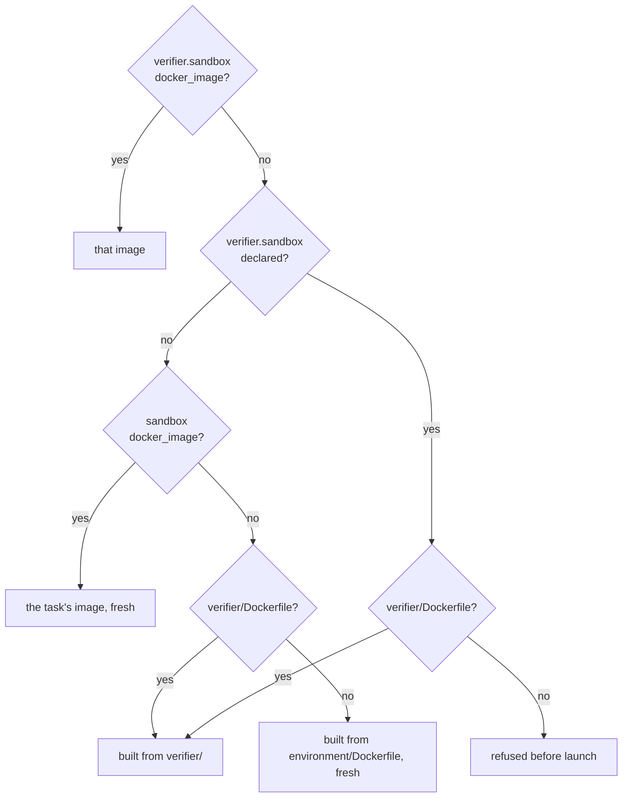
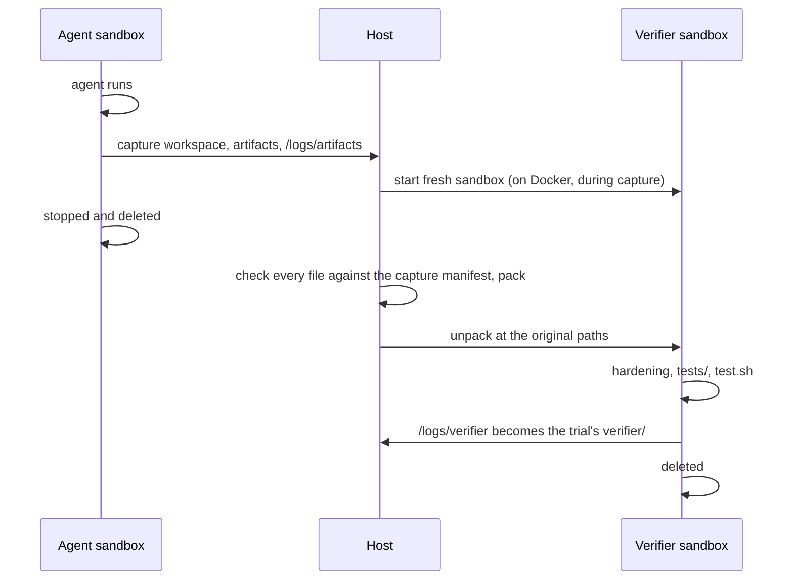
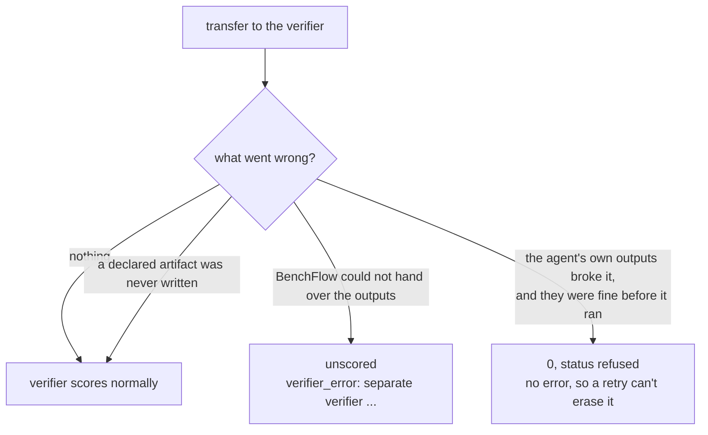

# Separate verifier

```yaml
# task.md
verifier:
  sandbox_mode: separate
```

By default the verifier runs in the agent's sandbox. Anything the agent left there can change the score: a planted `conftest.py`, a written reward, a process still running.

A separate verifier runs `test.sh` in a fresh sandbox. That sandbox gets only the agent's workspace, its declared artifacts and `/logs/artifacts`.

## Turn it on in a task

There are two ways:

1. Set `verifier.sandbox_mode: separate`. The verifier sandbox copies the task's own `sandbox:` settings.
2. Add `verifier.sandbox:` with the verifier's own image or resources. This turns separate mode on by itself.

```yaml
verifier:
  sandbox:
    docker_image: ghcr.io/my-org/task-verifier:1
    cpus: 1
    memory_mb: 2048
```

| `sandbox_mode` | `verifier.sandbox` | Result |
|---|---|---|
| omitted | omitted | shared |
| omitted | set | separate |
| `shared` | omitted | shared |
| `shared` | set | refused: the task fails to load |
| `separate` | omitted | separate, with the task's `sandbox:` settings |
| `separate` | set | separate, with `verifier.sandbox` |

In a `task.toml`, the same keys are `[verifier] environment_mode = "separate"` and `[verifier.environment]`. task.toml tasks that use them run unchanged.

## Force it for a whole run

```bash
bench run tasks/ -a claude-agent-acp --verifier-sandbox separate
```

| Value | Effect |
|---|---|
| `task` (default) | Each task's own setting |
| `separate` | Every task. There is no `shared` value; a task that declares separate stays separate. |

The same setting is `verifier_sandbox: separate` in a run YAML, and `EvaluationConfig(verifier_sandbox="separate")` or `RolloutConfig(verifier_sandbox="separate")` in Python. `--separate-verifier` is an older spelling of the same switch.

`--integrity strict` turns the switch on and adds the [integrity audit](../integrity.md). Runs of a hosted environment (`--source-env`) score with that environment's own verifier, so they refuse both.

For a task whose agent writes graded files outside the workspace, add the path with `--separate-verifier-include /root`. It is repeatable.

### Which runs should use it

| Run | Switch | Why |
|---|---|---|
| Leaderboard and publication runs | `separate`, once every task's oracle scores 1.0 under it | A published score should not depend on what the agent left outside its outputs |
| RL reward runs | `separate`, after the same oracle check | A policy learns whatever raises its reward, tampering included |
| Debugging a task, an agent or a verifier | `task` | You want to see the agent's sandbox as it was left |
| Tasks whose verifier reads a service, a database or files outside the workspace | `task`, or declare those paths as artifacts | Under the switch the verifier can't see that state |

> **A 0 under the switch may mean the verifier saw nothing.** A task whose answer lives outside the workspace scores 0, with no error. The only sign is `verifier_isolation_source: run-flag` in `result.json`. Before comparing, run each task's oracle under the switch, and declare the missing paths as artifacts.

## When a task can't use it

BenchFlow checks every task before anything starts. If one can't use a separate verifier, the run exits before it creates a job. It names each task and its reason. Drop those tasks with `--exclude`, or run without the switch.

To check one task, and see where its verifier image would come from:

```bash
bench check tasks/my-task --sandbox docker --verifier-sandbox separate
```

| Reason | Fix |
|---|---|
| The verifier is `llm-judge`, or `verifier.service` is not `main` | Keep the verifier shared |
| `allowlist` or `denylist` on the verifier sandbox | Use `no-network` or `public` there |
| No verifier image (see [below](#which-image-the-verifier-uses)) | Add `verifier/Dockerfile` (`tests/Dockerfile` in a task.toml task) or `verifier.sandbox.docker_image` |
| The task has `steps` | Not supported yet |
| The sandbox is not Docker, remote Docker, Daytona or Modal | Use one of those |
| An artifact or `sandbox.workdir` in `/tests`, `/verifier`, `/logs/verifier` or `/logs/agent` | Move it |
| The verifier image's build folder has a compose file with services besides `main` | Give the verifier its own image |
| The task keeps services running for grading (`x-keep-services`, its own or from BenchFlow's Terminal-Bench 2 list): the verifier sandbox has none of them | Keep the verifier shared |
| The verifier image only mirrors the agent's, and an environment manifest (`--environment-manifest`, `--state`, or the task's own) sets the agent's `image` | Give the verifier its own image |

## Which image the verifier uses



| Order | Image |
|---|---|
| 1 | `verifier.sandbox.docker_image` |
| 2 | Without `verifier.sandbox`: the task's `sandbox.docker_image`, fresh |
| 3 | Built from `verifier/Dockerfile` (`tests/Dockerfile` in a task.toml task) |
| 4 | Without `verifier.sandbox`: built from `environment/Dockerfile`, fresh. The run's `--base-image-override` and `--context-root` apply as they do to the agent's build. |

BenchFlow copies the task's verifier files in at run time. None of the agent's changes survive into the image.

The verifier sandbox never runs the task's setup commands, healthcheck, skills or MCP servers. Those belong to the agent's sandbox.

## What happens in one trial



1. The agent runs as usual. Before it starts, BenchFlow checks the image has `python3` 3.10+ or `tar`, and measures the paths it will copy.
2. After the agent stops, BenchFlow saves the workspace and declared artifacts to the trial's `evidence/`, and `/logs/artifacts` to `artifacts/`. Then it stops and deletes the agent's sandbox.
3. The host checks every file against the capture manifest and packs them.
4. A fresh verifier sandbox unpacks them at the same paths. Then the normal verifier runs: hardening, `tests/`, `test.sh`. On Docker and remote Docker this sandbox starts when the agent's turn begins (its sandbox is ready and the agent installed), so it is ready by the time step 3 has packed the archive. On Daytona and Modal it starts once the agent's sandbox has stopped. On Modal a file over 5 GiB, the per-file transfer limit there, cannot cross: the capture fails with that reason and the trial is unscored. It is its own Compose project on its own network and publishes no port, so the agent cannot reach it. A trial that ends before verifying (the agent errored, the run was stopped) deletes it at cleanup.
5. The verifier sandbox is deleted.

Every step, and the records each one writes, are in the [custody reference](../reference/separate-verifier-custody.md).

## What crosses

Into the verifier sandbox, and nothing else from the agent's run:

- the frozen workspace, at its absolute path;
- each declared artifact outside the workspace, at its absolute path;
- the files of `/logs/artifacts`, at `/logs/artifacts`;
- the agent's trajectory, at `/logs/agent/acp_trajectory.jsonl`.

BenchFlow always gives the verifier the agent's trajectory.

Nothing crosses into `/tests`, `/verifier`, `/logs/verifier` or `/logs/agent`. The trial's `verifier/` holds only what the verifier sandbox wrote.

## Failures and zeros



| What happened | Result |
|---|---|
| BenchFlow could not hand over the outputs: capture failed, the image didn't build, the upload failed | Unscored. `verifier_error` starts with `separate verifier`, category `verifier_infra`. |
| The agent's own outputs broke the transfer: over the size limits, or a declared artifact left as a symlink, when the same paths were fine before it ran | 0, with `status: refused` in `verifier-sandbox.json`. There is no error, so a retry can't resample it. |
| A declared artifact the agent never wrote | Scored normally; the verifier sees it missing |
| Code run by test.sh leaves output files that cannot be published, such as a FIFO | Score 0 with a publication warning. It cannot discard the trial. |

A symlink that points out of the workspace is not a failure. Capture leaves it out and lists it in the manifest.

## Records

| Where | Field | Value |
|---|---|---|
| trial `config.json` | `verifier_sandbox` | The run's setting |
| trial `result.json` | `verifier_isolation` | `shared` or `separate` |
| trial `result.json` | `verifier_isolation_source` | `task`, `run-flag` or `integrity-strict` |
| job `summary.json` | `verifier_isolation` | Trials per mode |
| `verifier-sandbox/verifier-sandbox.json` | `image_source`, `status`, `custody`, ... | The image, the outcome and the transfer; see the [custody reference](../reference/separate-verifier-custody.md#records) |

The run log warns about tasks the switch moved that declare no artifacts.

A rerun whose switch differs from the job's does not reuse its trials. `strict` counts as `separate`. Without `--job` it starts a new job; with `--job` it sets the old trials aside.

## Cost

On Docker and remote Docker, the verifier sandbox is a sandbox of its own beside the agent's for the agent's whole turn, so you pay for both during that turn. `--concurrency` counts trials, so a `--concurrency 1` job with a separate verifier has two sandboxes alive (and `--warm-pool` adds its prepared ones on top; see [Warm pool](../sandboxes/docker.md#warm-pool)). On Daytona the two never overlap. `timing.json` breaks the verifier phase down.

A job's `--max-sandbox-seconds` budget charges the verifier sandbox only from the moment scoring begins, as a sandbox started then would be, until the agent's sandbox has stopped (`verifier_sandbox_overlap`). Its seconds during the agent's turn are recorded as `verifier_sandbox_warmup` and not charged.

`BENCHFLOW_VERIFIER_PREPARE=entry` starts the verifier sandbox when the agent finishes, while step 2 runs (the order without this warm-up). `BENCHFLOW_VERIFIER_PREPARE=serial` keeps the older order: the verifier sandbox starts after step 3, and the agent's sandbox stays up until the trial's cleanup; the budget then counts the verifier sandbox's whole life.

## Worked example

Each row is an oracle trial. The task.toml fixtures use `FROM ubuntu:24.04` with no network, so capture uses `tar`.

| Task | Mode | Reward | Notes |
|---|---|---|---|
| answer-42 (a task.toml-layout fixture, so `tests/`), oracle writes 42 | separate | 1.0 | Image from `tests/Dockerfile`; 1 workspace file transferred |
| answer-42, solution writes 41 and tampers as root | separate | 0.0 | Planted `/tests/conftest.py`, site-packages `.pth`, PATH shim, `/tmp` file: all absent in the verifier sandbox |
| the same tampering task | shared | 1.0 | The plants reach the verifier; pytest passes the wrong answer |
| task.toml `separate-explicit` | separate | 1.0 | `/logs/artifacts` marker copied, declared `/tmp` artifact present, undeclared `/tmp` file absent |
| task.toml `separate-reuse-env` | separate | 1.0 | Also checks the verifier image was built from `tests/`, not `environment/` |
| answer-42 with an unbuildable `tests/Dockerfile` | separate | unscored | `verifier_error: separate verifier sandbox failed to start: ... BUILD_FAILED`, category `verifier_infra` |

The tampering solution runs as root because the oracle does. It stands in for an agent that gained root.

## Which tampering this closes

A separate verifier closes these attacks that depend on grading inside the agent's sandbox:

| Attack | In a separate verifier sandbox |
|---|---|
| V1 Overwrite: tests, runners or tools replaced | The image is fresh. Only the transfer crosses, never into `/tests` or `/verifier`, and never over a system folder's tools. |
| V3 Reward: a reward written directly, also by a surviving process | `/logs/verifier` is empty when `test.sh` starts. A plant in the agent's folder is moved aside and listed. |
| V5 Sleeper agent: a process left running | No agent process runs in the verifier sandbox, and the agent's sandbox is stopped before anything crosses |
| V6 Staging: links, special files or hooks that cross | No link that leaves its root crosses, and hardening still removes workspace `conftest.py`, `.pth` and `sitecustomize.py` |

Still open:

- **Code that `test.sh` runs.** A verifier that imports or runs the submission (V2 patch, V4 fail-open, V7 forgery, V8 disclosure, V9 exploit) runs it with the verifier's rights. There it can patch the tests or write the reward. Set a non-root `verifier.user` to limit it.
- **The live agent sandbox, in the serial order or after a failed stop.** There the agent's sandbox keeps running while the verifier runs. What it can still reach is outside what is scored.

## Limits

- Docker, remote Docker and Daytona only. Other sandboxes refuse separate mode before launch.
- Script verifiers only. `llm-judge` verifiers and `verifier.service` other than `main` are refused.
- Multi-step tasks (`steps`) are refused as a whole.
- Services, databases and files outside the workspace, the declared artifacts and `/logs/artifacts` don't reach the verifier.
- Capture limits: 20 GiB and 200,000 entries per workspace; 1 GiB and 10,000 files of collected artifacts. Credential files, sandbox runtime state and escaping symlinks are left out and listed in the manifest.
- The verifier's network is the verifier sandbox's `network_mode`.
- `soft_verify()`, intermediate feedback for user loops, is unavailable: it would upload `tests/` into the agent's sandbox.
- `bench regrade` and verifier recovery don't regrade separate trials yet. `bench regrade` lists them as not regradable; rerun them with `bench run`.

## Next steps

- [Custody reference](../reference/separate-verifier-custody.md): every step and record in detail.
- [Integrity](../integrity.md): `--integrity strict` and its audit.
- [Sandbox hardening](../sandboxes/security.md): what the shared verifier is protected by.
