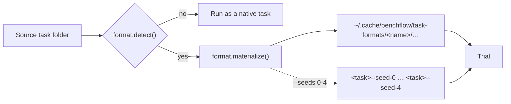

# Task formats

Let a benchmark keep its tasks in its own compact form and still run them with no export step.

```toml
# pyproject.toml of the package that owns the tasks
[project.entry-points."benchflow.task_formats"]
robouse = "robouse.engine.format:RobouseTaskFormat"
```

```bash
bench check path/to/robouse-tasks/    # checks the generated packages, prints their paths
bench run path/to/robouse-tasks/      # runs them like any other task
```

When BenchFlow loads a folder that a format claims, the format writes an ordinary task package: `task.md`, `environment/`, `verifier/` and `oracle/`. BenchFlow then runs that package like any other task, with the same sandboxes, agents, verifier, trial folders and job tools.



Use a format when hundreds of tasks share one environment. A [robouse](https://github.com/benchflow-ai/robouse) task, for example, is a `task.md` with a `robouse:` block. The robouse package builds the same agent image, simulator and verifier for every task. Those files are never copied into each task folder, where they would drift from the package.

## Where formats apply

Every way of loading a task applies formats first:

| Entry point | What happens |
|---|---|
| `bench run DIR` (and `tasks_dir:` in a run config) | `DIR` itself, or each child folder, is generated if a format claims it; native children are used as they are |
| `bench check DIR` | checks the generated package and prints its path |
| `RolloutConfig(task_path=...)`, `bf.run(...)`, `SDK().run(...)`, `Evaluation(...)` | `task_path` or `tasks_dir` is generated the same way |

Trial names, `task_name` in `result.json`, and `--include` / `--exclude` use the generated folder's name. Name it after the task id, so it matches the source folder.

## Register a format

A format is any object with three members:

| Member | Does |
|---|---|
| `name` | the format's name |
| `detect(task_dir) -> bool` | says whether this folder is in the format; it must be cheap and never raise |
| `materialize(task_dir, out_root) -> Path` | writes the native package and returns its folder |

Ship it as the entry point shown at the top of this page. The entry point can name an instance or a class that takes no arguments. Code in the same process can call `benchflow.task.formats.register_task_format(obj)` instead.

If a format's entry point fails to import, BenchFlow logs it and skips that format. Native tasks still load.

## Write the package

`materialize` writes the package under `out_root` and returns its folder. `out_root` is `$BENCHFLOW_TASK_FORMAT_CACHE/<name>`, by default `~/.cache/benchflow/task-formats/<name>`.

It must give the same output for the same input and be safe to run in parallel:

1. Hash the source task and the generator into the folder name.
2. Write to a temporary folder.
3. Rename it into place.

BenchFlow refuses a returned folder that a format still claims, so a format can't hand back its own input.

## Seeded variants

A format can also implement `materialize_variant(task_dir, out_root, *, seed)` to write one seed's package. Then `bench run DIR --seeds 0-4` (or `--seeds 0,3,7`) runs each task once per seed.

`summary.json` then gets a `seeded` report per task: pass@k, mean, standard deviation, and whether a reset reproduced the same start state.

Give each seed its own folder name. `benchflow.embodied.sidecar.EmbodiedTaskFormat` uses `<task>--seed-<n>`. `--seeds` refuses native task packages, because BenchFlow can't pass them a seed.

## Built-in formats

BenchFlow ships one format of its own, `taskmd`, for [task.md draft 2](./taskmd-draft-2.md) packages. Their `task.md` opens with the instruction rather than YAML settings. A registered format with the same name replaces a built-in one.

## Simulator tasks

For tasks that run a simulator beside the agent, subclass `benchflow.embodied.sidecar.EmbodiedTaskFormat`. It writes the agent image, the compose file with the simulator service, the physical verifier, and the seeded and no-op variants. You supply the simulator image, the episode factory and the reference solutions. See [Embodied rollouts](./embodied.md).

## What a format may generate

Anything a native package may contain. The robouse format uses:

- `environment/docker-compose.yaml` with a `main` service (the agent) and a trusted sidecar service. The sidecar's build context can sit outside the package, in a shared folder under `out_root`. Use an absolute path: BenchFlow may copy the task elsewhere, as it does when it adds skills, and a relative path would then break.
- `verifier.service: <sidecar>` in `task.md`, so the verifier runs next to the trusted state. Its `/logs/verifier` is downloaded from there (Docker sandbox only).
- `oracle/solve.sh`, which BenchFlow uploads to `/oracle` for `--agent oracle` runs only.

The `task.md` schema rejects unknown top-level keys. So move a format's own block under `metadata`: robouse moves `robouse:` to `metadata.robouse`.

## Next steps

- Check a generated package: `bench check DIR`.
- What a native package holds: [task.md authoring](./overview.md).
- Robots and simulators: [Embodied rollouts](./embodied.md).
