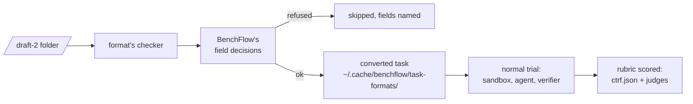

# task.md draft 2

```bash
bench check path/to/hello-world
bench run path/to/hello-world -a oracle --sandbox docker   # the reference solution scores 1
bench run path/to/hello-world -a nop --sandbox docker      # doing nothing scores 0
```

task.md draft 2 is an open task format, still a design draft: an instruction followed by typed blocks, with the settings in a `toml task` block. BenchFlow runs draft-2 folders like its own tasks, through `bench check`, `bench run` and the Python API.

A field BenchFlow cannot honor is refused by name, before anything runs. None is skipped silently.

Draft 2 is not BenchFlow's own [`task.md`](./configuration.md). BenchFlow's opens with YAML frontmatter (`---`); a draft-2 `task.md` does not.

## Write a task

The smallest package, the format's `examples/hello-world`:

````markdown
Create a file `/app/hello.txt` that contains exactly `Hello, world!` with no trailing newline.

```toml task
name = "examples/hello-world"
title = "Hello, world"
version = "1.3.0"

[agent]
timeout = "2m"
```
````

```text
hello-world/
├── task.md
├── sandbox/Dockerfile          FROM ubuntu:24.04, WORKDIR /app
├── verifier/rubric.json        one gate, decided by the test test_hello
├── verifier/test.sh            writes /logs/verifier/ctrf.json
└── oracle/solve.sh             printf 'Hello, world!' > /app/hello.txt
```

Here `test.sh` does not score. It writes test results to `/logs/verifier/ctrf.json`, in the CTRF test-report format. `verifier/rubric.json` says which results count, and BenchFlow computes the reward.

A draft-2 folder holds:

| Path | Holds |
|---|---|
| `task.md` | The instruction, then typed blocks, with a `toml task` block last |
| `sandbox/` | The agent's Dockerfile and its files |
| `verifier/` | `test.sh`, `rubric.json`, `judge.md` |
| `oracle/solve.sh` | The reference solution |
| `controls/`, `evidence/`, `family/` | Optional |

BenchFlow treats a folder as draft 2 when its `task.md` exists, is not empty and does not start with `---`.

## Check it

```bash
bench check path/to/hello-world
```

`bench check` prints three reports:

1. **The format's own checker**, exactly as its `python3 tools/taskmd.py check` prints it: the parse, what grading needs, each judge's settings and the worst-case grading time.
2. **BenchFlow's decisions.** `refused: ...` fails the check. `refused when an agent runs ...` fails only agent runs. Every other field says how it is honored or recorded.
3. **BenchFlow's own checks** on the converted task, when nothing was refused. A family is checked at the format checker's sample seed.

## Run it

```bash
bench run path/to/suite -a claude-agent-acp -m claude-sonnet-5 --sandbox docker
```

A folder of draft-2 tasks runs each one. A refused task is skipped with a warning that names its fields, and the rest run. In Python: `bf.Evaluation(tasks_dir=...)`, or `RolloutConfig(task_path=...)` for one trial.



The converted task is cached under `~/.cache/benchflow/task-formats/taskmd/`; `BENCHFLOW_TASK_FORMAT_CACHE` moves it. Trial names and `--include` use the source folder's name.

### Families

`[family]` generates one task per seed. Pass `--seeds 0-4` or `--seeds 3,9`; each seed is its own trial, `<task>--seed-<n>`. A family without `--seeds` is refused.

```bash
bench run path/to/family -a oracle --sandbox docker --seeds 0-4
```

The generator runs in a container of the task's image, so the machine that loads the task needs Docker.

### Controls

Run the do-nothing control with `-a nop`. To run a control script from `[integrity.controls]`, write it out as a task of its own and run its oracle:

```python
from benchflow.taskmd import TaskMdFormat, controls

controls(task)  # the control ids
TaskMdFormat().materialize_variant(task, out_root, control="known-bad-line-fit")
```

Then run `bench run <the written task> -a oracle`.

### Stages

Stages that unlock in a chain (`at_start`, then `on_submit` or `after:<previous>`) become later turns of the same agent session. Each stage's prompt arrives after the agent ends its previous turn. The oracle and `nop` run their scripts instead.

### Model judges

Model judges use BenchFlow's own credentials, never the agent's:

| Variable | Use |
|---|---|
| `ANTHROPIC_API_KEY` or `CLAUDE_CODE_OAUTH_TOKEN` | Judge on Anthropic's API |
| `BENCHFLOW_TASKMD_JUDGE_BASE_URL` and `BENCHFLOW_TASKMD_JUDGE_AUTH_TOKEN` | Judge on another provider's Anthropic-compatible endpoint. The token is sent only there, and no agent gets these two. |
| `BENCHFLOW_TASKMD_JUDGE_TRUST_BASE_URL=1` | Allow sending your Anthropic key to a non-Anthropic `ANTHROPIC_BASE_URL`, such as your own gateway. Without it, such a run is refused. |
| `BENCHFLOW_TASKMD_JUDGE_MODEL` | A model for every role (`claude-haiku-4-5-20251001`), or per role (`agent=...,llm=...`) |
| `BENCHFLOW_TASKMD_MAX_JUDGE_SESSIONS` | Cap the judge sessions one process starts |
| `TASKMD_SHARED_RUBRICS` | A folder of shared rubrics, `<name>.json`. `extends` is never fetched: for `https://task.md/rubrics/code-change@1`, put `code-change@1.json` there. |

`ANTHROPIC_AUTH_TOKEN` is not a judge credential, because every agent gets it. A run whose judges cannot be served is refused before the agent starts. Every verdict records the model that gave it.

An agent judge's image needs util-linux (`setpriv`), `runuser` or `su`, owned by root; without one, the trial is unscored. A `sandbox/Dockerfile` that ends in `USER 65534` or `USER nobody` is refused, because the judge's runner needs that uid. The [reference](../reference/taskmd-judges.md#judges-llm-and-agent-roles) explains both.

### Refused at launch

Before any sandbox starts, an agent run is refused when:

- the package sets an agent `budget` or `system_prompt_append`;
- `[agent] user` differs from the run's `--sandbox-user`;
- its judges cannot be served.

## What a trial records

| File in the trial's `verifier/` | Holds |
|---|---|
| `ctrf.json` | `test.sh`'s test report |
| `review.json` | One verdict per rubric criterion |
| `reward.json` | `reward` (the rubric's headline), `strict`, `partial`, `timed_out` |
| `script-reward.txt` or `.json` | A reward `test.sh` wrote anyway: kept, and ignored |
| `judgments.jsonl` | One line per judge session and one per model-judged criterion |
| `taskmd-judge/` | Each judge session; the agent's `trajectory-1.json`; `fs/`, the files the judges could read |

A package with no rubric keeps the script-reward contract: `test.sh` writes the reward.

## What BenchFlow supports, field by field

- **Honored**: mapped onto a BenchFlow setting.
- **Partly**: the values the row names work; the rest are refused.
- **Refused for agents**: works for the oracle, controls and `nop`; an agent run is refused.
- **Refused**: the package is refused.
- **Recorded**: kept as metadata. Scoring rules (`[runs]`, `[integrity.controls]`, a rubric's validation) are recorded as not checked, because no BenchFlow run claims a scored result yet.

| Field | Status | How, or why not |
|---|---|---|
| name, version, description, authors, keywords | Recorded | native task.name, version, description, authors, keywords |
| title | Recorded | metadata.title |
| [about] \<key> | Recorded | native metadata |
| [agent] timeout | Honored | agent.timeout_sec |
| [agent] on_timeout | Partly | "grade" (BenchFlow grades what the agent left and records timed_out); "grade-flagged" and "fail" are refused |
| [agent] budget, [agent.budget] tool_calls, tokens | Refused for agents | BenchFlow enforces no tool-call or token budget on an agent; a scripted seat never approaches one |
| [agent] user | Partly | the oracle runs as it; an agent runs as the run's --sandbox-user, and a run whose agent user differs is refused |
| [agent] network | Partly | equal to [sandbox] network, or narrower than it: "none" runs the agent's phase offline in an online sandbox, a host list is an agent allowlist. A network wider than the sandbox's is refused, since the agent works inside the sandbox's container |
| [agent] network_reason | Honored | reviewer documentation: nothing to do at run time |
| [agent] system_prompt_append | Refused for agents | BenchFlow's harnesses take no system prompt addition |
| [agent] timeout_basis | Partly | "wall" (BenchFlow counts wall time); "environment" is refused |
| [sandbox] image | Honored | sandbox.docker_image, or FROM in environment/Dockerfile |
| [sandbox] os | Partly | "linux"; "windows" is refused |
| [sandbox] cpus, memory, disk | Honored | sandbox.cpus, memory_mb, storage_mb (a whole number of CPUs) |
| [sandbox] build_timeout | Honored | sandbox.build_timeout_sec |
| [sandbox] gpus | Honored | sandbox.gpus |
| [sandbox] x-keep-services | Honored | metadata.x-keep-services: the agent user's listeners on these TCP ports outlive the kills before grading |
| [sandbox] gpu_types, tpu | Partly | gpu_types to sandbox.gpu_types; a TPU is refused |
| [sandbox] network | Partly | "none" (no-network), "open" (public), a host list (allowlist); \{ block = [...] \} is refused |
| [sandbox] workdir | Honored | sandbox.workdir |
| [sandbox] env | Partly | literal values to sandbox.env; $\{VAR\} values are refused |
| [sandbox] skills | Refused for agents | BenchFlow installs task skills only in its with-skill mode; the oracle and nop run without them |
| [sandbox] mcp | Honored | sandbox.mcp_servers (the server tables, which an import keeps) |
| [sandbox] mounts | Partly | empty; task files are not mounted at start yet |
| [sandbox] services, [[sandbox.services]] name, image, build, command, env, ready | Partly | Compose services beside main; refused with network = "none", or a build folder outside sandbox/ |
| [sandbox] compose | Partly | only sandbox/docker-compose.yaml |
| [sandbox] ready, [sandbox.ready] run, interval, timeout, start_period, start_interval, retries | Honored | sandbox.healthcheck |
| [sandbox] outputs, [[sandbox.outputs]] path, save_as, exclude | Honored | native artifacts; the judges read the saved outputs |
| [[sandbox.outputs]] max_bytes, service | Refused | per-output caps and service outputs are not implemented |
| [sandbox] boundary | Partly | "container"; gvisor, microvm, and vm are refused |
| [sandbox] clock, [sandbox.clock] start, advance, enforce | Refused | BenchFlow sets no clock |
| [sandbox] timezone | Refused | BenchFlow cannot check that the image has the zone's data |
| [verifier] timeout | Honored | bounds test.sh; each judge session keeps its own timeout |
| [verifier] user | Honored | verifier.user |
| [verifier] env | Partly | literal values to verifier.env; $\{VAR\} values are refused |
| [verifier] network | Partly | a shared verifier: "none" (taken offline with iptables) or "open" (over an open sandbox or an agent allowlist); a separate verifier: "none" or "open" for its own sandbox. A host list written for the verifier is refused, since BenchFlow holds only the agent's uid to one; a host list the verifier only inherited from [sandbox] network is honored as binding the agent, with the shared verifier running as root outside it |
| [verifier] isolation | Honored | "shared", or "separate" (verifier.sandbox_mode: separate) |
| [verifier] sandbox, [verifier.sandbox] \<key> | Partly | image, os, cpus, gpus, gpu_types, memory, disk, workdir, env, build_timeout, and empty mcp; the rest is refused. The image is found in the spec's order: [verifier.sandbox] image, verifier/Dockerfile, the task's image |
| [verifier] snapshot, [[verifier.snapshot]] run, reads, service, timeout, user | Refused | snapshot commands are not run |
| [verifier] combine_stages, unreached_stages | Honored | no stage is graded on its own, so the task's verifier alone decides the reward |
| [verifier] mount | Partly | "/verifier" or "/tests" |
| [verifier] feedback | Honored | BenchFlow shows an agent none of its review |
| [verifier] models | Partly | false; true (a script that calls a model) is refused |
| [verifier] judges and its role tables | Partly | llm and agent roles run judge-loop@1 (docs/reference/taskmd-judges.md); vlm, panel, effort, a hosted harness, resources, services are refused |
| [verifier] human, [verifier.human] \<key> | Refused | human assessment is not supported |
| [oracle] env | Partly | literal values to oracle.env |
| [oracle] mount | Partly | "/oracle" or "/solution" |
| [world], [tiers], [conventions] (every key) | Refused | worlds, tiers, and conventions are not provided |
| [stages.\<name>] unlock | Partly | a chain from the instruction (at_start, on_submit, after:\<previous>) becomes turns of one session; on_request and at_turn are refused |
| [stages.\<name>] submit, mounts, agent, verifier, gate, ready, outputs | Refused | stages graded or set up on their own are not implemented |
| [roles.\<name>] \<key>, [interaction] \<key> | Refused | multi-agent roles are not mapped (the spec leaves each role's prompt and order open) |
| [user] \<key> | Refused | simulated users are not mapped |
| [variants.\<name>] \<key> | Recorded | BenchFlow runs the base task |
| [matrix] \<key> | Refused | condition grids are not run |
| [family] generator, seed_param, params, splits, database | Honored | family@1 per seed (--seeds): the generator runs in a fresh container of the task's image |
| [training] reward, learnable_band, difficulty, admit | Recorded | metadata |
| [training] fork | Honored | a bench run sets every episode up from scratch |
| [training] max_concurrent | Refused | not enforced across a run's trials yet |
| [trajectory] require | Partly | "tool-calls"; the rest is refused |
| [preference] \<key> | Refused | the human-preference protocol is not run |
| [integrity] profile | Partly | "shared-hardened", or "separated-verifier" with isolation = "separate"; "runner-separated" is refused |
| [integrity] intended_use | Honored | a BenchFlow eval run is not training |
| [integrity] canary, threat_model, residual_risks | Recorded | metadata |
| [integrity] forbidden_sources | Refused | not blocked yet |
| [integrity] resources, [integrity.resources] \<key> | Refused | per-path resource classes are not enforced |
| [integrity] answers | Honored | judges are never served files the verifier writes |
| [integrity] controls and its keys | Recorded | scoring rule, not checked; controls run as control variants (Python API) and --agent nop |
| [runs] \<key> | Recorded | scoring rule, not checked |
| [[credits]], [provenance], [import.\<format>] | Recorded | metadata |
| x- keys and [x-\<name>] | Partly | metadata; [x-benchflow] is refused |

The rest of the package:

| Part | Status |
|---|---|
| The instruction, and a canary comment before it | Honored: the canary is stripped from what the agent sees, and an instruction holding a reserved native heading is kept intact |
| ` ```stage <name> ` blocks | Partly, as the stage's unlock row says |
| ` ```role <name> ` and ` ```user ` blocks | Refused, with `[roles]`, `[interaction]`, and `[user]` |
| ` ```notes ` blocks | Recorded: never shown to an agent |
| `sandbox/` | Honored: the build context of `environment/` |
| `verifier/test.sh` | Honored: run in the task's working folder |
| `verifier/rubric.json` | Honored: test, llm, and agent criteria; rule, world, replay, human, vlm, and panel criteria are refused; `extends` needs `TASKMD_SHARED_RUBRICS` |
| `verifier/behaviors.json` | Refused when it watches or pairs any behavior: monitors, tags, and consequences are not run |
| `verifier/judge.md`, a role's `brief` | Honored: the brief of judge-prompt@1 |
| `verifier/verifier.md` | Refused: a BenchFlow verifier document would replace task.md's verifier contract |
| Evidence items | Honored: files, `trajectory`, `trajectory:reasoning`, `tests`; refused: `diff:`, `screenshots`, `video`, `request-record`, world streams |
| `oracle/` | Honored: `--agent oracle` runs `solve.sh` |
| `controls/`, `evidence/` | Recorded: never placed in the agent's image; controls run as control variants |
| `family/` | Honored with `--seeds` |
| `stages/<name>/` | Refused: stages graded on their own |
| `world/`, `variants/` | Refused with `[world]`; unused files of the base task otherwise |

## Why some features are refused

- **Stages** that unlock `on_request` or `at_turn:<n>`, or that are graded, timed or mounted on their own: a BenchFlow turn ends only when the agent stops, and nothing grades between turns. Multi-step task.toml tasks are refused on BenchFlow's own path too.
- **Roles** (`role` blocks, `[roles]`, `[interaction]`): the format does not say which role gets the instruction or in what order roles act.
- **Simulated users** (` ```user `, `[user]`): BenchFlow's user loop starts a fresh agent session every round, so the agent would lose the conversation.

## Format equivalence

On 56 task.toml tasks, the draft-2 path scored the same as BenchFlow's own path on every task both ran. Three tasks differ, because the draft-2 path refuses settings the other path ignores. The [reference](../reference/taskmd-judges.md#format-equivalence) has the breakdown.

## Next steps

- [How BenchFlow runs draft 2](../reference/taskmd-judges.md): parsing, grading and the judges in detail.
- [Task formats](./task-formats.md): the other formats BenchFlow reads.
- [Check a task](./check.md): the checks every task gets.
