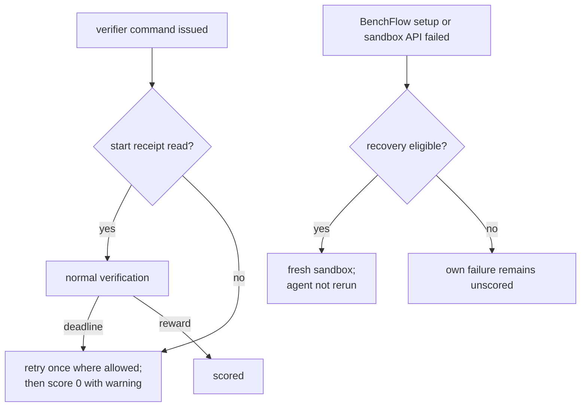

# Verifier recovery

```yaml
# task.md
verifier:
  workspace_recovery: true
sandbox:
  docker_image: registry.example/task@sha256:<digest>   # optional; pinned, with Python 3.10+
```

Sometimes BenchFlow’s own setup or sandbox API fails before it can grade the work. A task that opts in is then graded again in a fresh sandbox, from the agent's saved work. The agent, often the expensive part, never runs again.

## Start receipts and timeouts

Each verifier command writes a start receipt under `/run/benchflow`. The verifier user can remove or forge it, so a missing receipt cannot establish that the command never ran.

| Task | If the receipt is still missing after 30 seconds |
|---|---|
| Opted in, and eligible (below) | Score 0 with a warning that startup is unconfirmed |
| Not opted in | Retry once in place; score 0 with that warning if the second receipt is also missing |

A test command that exceeds its verifier deadline scores 0, even if it wrote a passing reward first. It does not trigger fresh-sandbox recovery. A verifier without a receipt probe retains the existing single in-place retry when it times out without output; a second timeout scores 0.

Fresh-sandbox recovery remains available for BenchFlow’s own setup or sandbox API failures. Reward-file problems, printed errors and guard markers never trigger it. Older saved records retain their original failure categories.



## Opt in

A task opts in with one of two settings. They can't be combined.

| Setting | Use when | Recovers | Sandboxes |
|---|---|---|---|
| `verifier.workspace_recovery: true` | Everything the verifier reads is in the workspace | The whole workspace | Docker; Daytona only with an image pinned by digest |
| `verifier.submission_files: [...]` | The verifier reads a few named files, even outside the workspace | Only those files | Docker, with an agent user |

By opting in, you promise that the task image plus the recovered files are enough to grade. Don't opt in if the agent's work also lives in installed packages, other files, running processes or an external database. A workspace archive is not a VM snapshot.

### Recover named files

```yaml
verifier:
  submission_files: [/root/result.csv, /root/summary.json, /root/report.md]
```

Set it in the task, not in a run override. The list is checked when the task loads:

- 1 to 8 distinct absolute paths, each at most 512 characters;
- no `.`, `..`, empty or trailing segments; no `*`, `?`, `[` or `{`;
- each a file inside a folder, not a top-level entry;
- not under `/dev`, `/logs`, `/proc`, `/solution`, `/sys` or `/tests`.

The order matters: files captured under one list can't be restored under another. Only regular files with no symlink in their path are captured, up to 128 MiB each and 256 MiB in all. A missing file stays missing; nothing else in the image changes.

## Who is eligible

Recovery runs for scored trials with a script verifier, in a sandbox BenchFlow started itself. A task is not eligible if it has any of these:

| Not eligible | Why |
|---|---|
| A [separate verifier](./separate-verifier.md) | Recovery would grade in another image, without the custody record |
| Compose services, an environment manifest, or services the run starts | Their state is not in the workspace |
| `setup_commands`, a pre-compose hook, custom hooks or uploads | They can't be replayed exactly |
| `sandbox.env`, MCP servers, external skills | Not captured |
| Declared `artifacts` (without `submission_files`) | Restoring them is not supported |
| `--context-root` or `--base-image-override` | No pinned baseline image |
| An `allowlist` or `denylist` network, off Docker | The policy can't be restored |
| A built image (no `@sha256:` digest), off Docker | Recovery reuses the exact local image |
| A symbolic link in the task folder | Outside the task's digest |

The image must already have Python 3.10+. BenchFlow installs nothing, so the image stays as it was.

## Retry a recovery

```bash
bench eval score jobs/<job>/<trial> --tasks-root ./tasks
```

Resume, `bench eval score` and `TaskRuntime.verify()` all take the same path. The task's files must be unchanged, or the digest differs and recovery is refused. A deterministic score is reused, and a rubric review, if any, runs after it. The agent's trajectory, usage and record are kept.

## What you'll see

| In the trial | Meaning | What to do |
|---|---|---|
| `Verifier scored 0: verifier start receipt ...` | Startup is unconfirmed; the verifier user could have removed the receipt | Inspect the test output and warning; this does not trigger recovery |
| `verifier-recovery/<id>/recovery.json` | One recovery attempt | Read it to see what happened |
| `verification.json` | Points at the attempt whose score counts | |
| `[solver-preserved] ...` error | Recovery failed; no score, and the agent was not rerun | Fix the cause, then `bench eval score` |
| `Recovery image lease is missing or changed` | A finished attempt already gave up the image | Rerun the trial; BenchFlow never rebuilds the image |
| `warnings` in `recovery.json` | A named scoring warning, also retained by later result loading | A failed capture of verifier-written output files scores 0 |
| `publication_error` in `recovery.json` | The score counts, but `verifier/` still holds the old files | Read the recovered files in `verifier-recovery/<id>/verifier/` |

A successful attempt's outputs replace `verifier/`, and the old ones move to the attempt's `previous-verifier/`.

Without opting in, a verifier infrastructure failure is retried by the run's retry loop and on resume, and both rerun the agent. You can't opt an old run in after the fact: changing the task changes its digest.

## Two things to know

- **A finished attempt gives up the image.** Recovery reuses the exact image the agent started from, held by a Docker tag. Every finished attempt releases it, successful or not. Only an interrupted attempt keeps it for a retry.
- **If swapping in the recovered files fails**, for example on a full disk, the recovered score still counts but `verifier/` keeps the old files. Viewers and rubric reviewers read `verifier/`, so check `publication_error` before comparing those files with the score.

## Next steps

- [Recovery internals](../reference/verifier-recovery-internals.md): receipts, the image lease and the scoring lock.
- [Verifier](./verifier.md): exit codes and verifier errors.
- [When a run fails](../jobs/when-a-run-fails.md): every failure class.
